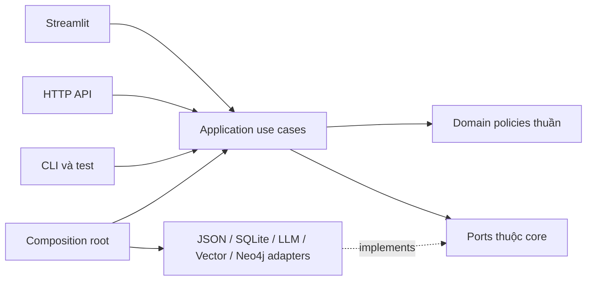

# Kế hoạch tối ưu kiến trúc, tái sử dụng và loại bỏ mã dư thừa KG Studio

> Bàn giao triển khai theo hiện trạng 12/11/2026: dùng [kế hoạch AI Agent R00–R13](modular-monolith-refactor-agent-handoff-plan.md) để nhận đầu vào, đầu ra, thứ tự và gate kiểm thử cụ thể. Tài liệu này giữ vai trò thiết kế nền; các số liệu/hạng mục ngày 11/11 cần đối chiếu trạng thái mới trước khi thực hiện.

- Ngày lập: 11/11/2026.
- Trạng thái: kế hoạch triển khai; chưa refactor hoặc xóa mã nguồn ứng dụng trong đợt lập kế hoạch này.
- Kiến trúc đích: **Modular Monolith, tổ chức theo nghiệp vụ và use case, áp dụng Ports & Adapters có chọn lọc**.
- Tài liệu nền: [bản đồ hệ thống](../structure.md), [quy tắc bắt buộc](../../AGENTS.md), [graph report](../../graphify-out/GRAPH_REPORT.md), `graphify-out/graph.json`, `graphify-out/manifest.json`.
- Đối chiếu lịch sử: [kế hoạch cleanup cũ](code-cleanup-plan.md), [báo cáo refactor pipeline](pipeline_refactoring_implementation_report.md), [kế hoạch hiệu năng](performance-optimization.md). Các số liệu và tuyên bố hoàn thành cũ không thay thế baseline mới.

## 1. Mục tiêu và phạm vi

Giảm chi phí thay đổi tính năng bằng cách xác định chủ sở hữu nghiệp vụ, thu nhỏ vùng ảnh hưởng, dùng lại những hành vi có cùng ý nghĩa và xóa mã đã được chứng minh không cần thiết. Ưu tiên khả năng đọc, kiểm thử và bảo toàn dữ liệu; không lấy số dòng giảm được làm mục tiêu độc lập.

Phạm vi gồm backend, frontend, contracts, ML Lab, tests, entrypoint, dependency và tài liệu vận hành. Giữ năm bước UI, ba chế độ extraction, các phương pháp retrieval/benchmark, khả năng xuất dữ liệu và API đang được hỗ trợ. Thay đổi thuật toán, prompt mặc định, schema lưu trữ, database authoritative hoặc deployment cần một thay đổi có thiết kế và kiểm chứng riêng.

Không triển khai đồng loạt template .NET, generic repository/service, mediator, event bus hoặc microservices. Chỉ thêm abstraction tại ranh giới có nhu cầu thay adapter, kiểm thử hoặc chia sẻ use case cụ thể. Tạo thư mục khi di chuyển use case đầu tiên, tránh dựng nhiều tầng rỗng.

## 2. Bằng chứng hiện trạng và giới hạn

Worktree sạch tại lúc rà soát; HEAD là `5351cfa6b8a4f60d8ef832676c33fe602cef8ae3`. Graph ghi nguồn commit `d937661c7d82059fe8e78f1dead6a2acbd71f9b3`, gồm 1.780 nodes, 5.867 edges và 99 communities. Hai commit khác nhau, vì vậy graph được dùng để định vị rồi kiểm chứng nguồn hiện tại, không dùng làm bằng chứng duy nhất để xóa mã.

Lệnh `graphify query` đã được thử nhưng CLI không có trong PATH của phiên lập kế hoạch. Không có `graphify-out/wiki/index.md` trong danh sách đầu ra hiện có; đã dùng report và JSON graph cho đánh giá kiến trúc rộng. Các file HTML là bản hiển thị của graph, không phải implementation thứ hai để dọn bỏ.

| Điểm kiểm tra | Quan sát hiện tại | Hệ quả cho kế hoạch |
| --- | --- | --- |
| `backend/facade.py` | 1.730 dòng; graph ghi `KGStudioFacade` có 164 liên kết | Tách use case, wiring và điều phối commit; không suy ra mọi liên kết đều xấu |
| `frontend/client.py` | 517 dòng; graph ghi 96 liên kết; UI dùng cả client lẫn facade | Một application boundary; transport được chọn tường minh |
| `FrontendClient._post_api` | Tìm reference trong client hiện chỉ thấy định nghĩa; HTTP models có nhánh fallback local | Ứng viên xóa helper sau audit; chưa phải remote client đầy đủ |
| `backend/domain/catalogs/service.py` | 1.135 dòng; chứa catalog, prompt, proposal impacts, preview/apply EDC, revision | Phân chia theo chủ sở hữu thay đổi |
| `backend/domain/curation/merge.py` | 1.501 dòng; `merge_core.py` đã có 153 dòng | Tái sử dụng primitives hiện có, tách workflow theo loại merge |
| `backend/domain/graph/g_retriever.py` | 1.209 dòng | Tách index, thuật toán, textualization, use case QA và evaluation |
| `backend/domain/graph/qa_generator.py` | 1.510 dòng | Tách generation rules, sampling/split, serialization và paraphrase LLM |
| `frontend/state/session.py` | 1.416 dòng | Tách state theo phân hệ, giữ contract key và callback |
| `frontend/components/curation_table.py` | 1.144 dòng | Tách render, presenter, selection và gọi use case |
| `domain/schema_intelligence/*`, extraction engines, graph QA | Có import concrete repositories/gateways | Chuyển orchestration ra application; inject ports |
| `backend/api/v1.py` | Dùng trực tiếp `svc.sqlite_repo` ở truy vấn summary | Đưa query ra application API; adapter HTTP chỉ mapping |
| API hiện tại | `backend/main.py` dùng `HTTPServer`; dependencies hiện không có FastAPI | Giữ API chuẩn Python, không tái tạo các router FastAPI đã bỏ |
| `SchemaModel` | Nguồn hiện dùng `ConfigDict(extra="ignore", populate_by_name=True)` | Khác mô tả `extra="allow"` trong structure; cần contract test trước round-trip |
| Legacy shim LLM | `llm_gateway.py` vẫn có caller trong aligner, QA, package exports và tests | Di chuyển caller trước, xóa shim sau |
| `workers/job_manager.py` | Có `start_sync_job`; tìm reference hiện thấy định nghĩa và package re-export | Ứng viên audit; chưa có bằng chứng triển khai async như tài liệu mô tả |
| LLM import cycle trong graph | Graph báo `llm/__init__.py ↔ gateway.py`; gateway import các submodule qua package | Kiểm tra module-level imports và import smoke test; có thể là cách graph biểu diễn re-export |

Số dòng được đếm trên nguồn hiện tại, gồm comment/dòng trắng. God-node và cohesion là tín hiệu điều tra, không là tiêu chí kết luận lỗi hoặc dead code. `normal`, `uid`, DTO dùng chung có degree cao là điều có thể hợp lý.

Tài liệu ghi 117 tests PASS nhưng đợt lập kế hoạch này **không chạy lại test suite**; không coi đó là kết quả đã xác nhận của HEAD hiện tại. Những thông tin version/framework trong tài liệu phải được đối chiếu runtime và dependency thực tế khi triển khai.

## 3. Kiến trúc đích và trách nhiệm

```text
backend/
  bootstrap.py                  # Composition root: cấu hình và wiring adapter
  modules/
    projects/                   # Project lifecycle, revision, commit, read model
      public.py
      application/
      domain/
      ports.py
      adapters/
    extraction/                 # Documents/chunking, engines, execution/provenance
    schema_intelligence/        # Catalog, proposals, review EDC, retrieval/alignment
    curation/                   # Review, evidence, entity/relation/triplet merge
    graph_qa/                   # Approved graph, retrieval, QA, benchmark, graph export
    training/                   # Application boundary cho export/training/evaluation
  api/                          # HTTP inbound adapter
  facade.py                     # Compatibility shell trong thời gian chuyển đổi
frontend/
  composition.py                # Lấy application API cho app, inject vào component
  pages/
  components/
  state/                        # State theo phân hệ, selection primitives thuần
shared/
  schemas/                      # Contracts thật sự dùng xuyên phân hệ
  prompt_templates/             # Formatting train/serve đồng nhất
  ...                           # Tách dần pure helpers khỏi filesystem/config I/O
ml_lab/                         # Trainers, evaluation, CLI và model artifacts
```

Mỗi module chỉ tạo `application/domain/ports/adapters` khi có trách nhiệm tương ứng. Chưa đổi tên toàn bộ `shared/` sang `shared_kernel/`; tránh một đợt thay import lớn không tạo giá trị hành vi.



Mũi tên đặc thể hiện chiều phụ thuộc mã nguồn; adapter implement port do core sở hữu. Khi chạy, application gọi adapter qua port đã được inject.

- Domain: quy tắc duyệt, canonicalization, merge, evidence và eligibility; không đọc file, gọi mạng hoặc tạo adapter. Pydantic có thể dùng cho contract; không bắt mọi domain entity kế thừa Pydantic.
- Application: một hành vi người dùng như `ApplyProposalDecisions`, `MergeEntities`, `ExtractChunks`, `AnswerQuestion`; điều phối domain và ports. Hàm hoặc class đều hợp lệ; không bắt mỗi request có ba lớp wrapper.
- Ports: interface nhỏ theo nhu cầu như project store, snapshot store, read projection, LLM chat/extraction, embedding, vector search và graph sink. Dùng `Protocol` hoặc ABC; tránh một interface bao trùm mọi chức năng.
- Adapters: triển khai filesystem/SQLite/SDK; framework exception và serialization được xử lý tại biên thích hợp.
- Public module API: contracts và use cases được hỗ trợ. Module khác không import private implementation; orchestration liên module thuộc application, không tạo vòng import domain.
- `projects` sở hữu revision và commit contract; schema intelligence sở hữu catalog/hash/EDC policy; curation cung cấp eligibility policy để graph/export dùng lại. Không để toàn bộ core phụ thuộc `catalogs/service.py` hoặc facade để lấy helper.
- `training` cung cấp boundary cho UI/API gọi ML Lab. Trainers/CLI dùng chung thư viện formatting/model registry cần thiết, không import frontend hoặc facade.

## 4. Những bất biến phải giữ qua mọi đợt

1. JSON project bundle là nguồn dữ liệu authoritative hiện tại; SQLite là read projection có thể dựng lại. Vector index là dữ liệu dẫn xuất. Không gom ba nơi thành một distributed transaction giả.
2. Preview không mutate project hoặc ghi dữ liệu nghiệp vụ. Apply xác thực lại scope, revision, request hash và điều kiện stale; giữ semantics `all_or_nothing`/`valid_only`.
3. Commit phối hợp khóa dự án, idempotency, snapshot, ghi JSON atomic/rollback; chỉ cập nhật state hiển thị sau commit thành công. SQLite lỗi phải phản ánh `sync_pending`, không báo JSON thất bại khi đã commit.
4. Khi projection pending, đọc không được im lặng coi SQLite là dữ liệu mới nhất: giữ hành vi fallback hiện có hoặc trả trạng thái stale tường minh và cho resync.
5. Giữ đúng scope project; ID ổn định; redirects không chu trình; merge không mất observations, aliases, bằng chứng, offsets, trạng thái, lịch sử hoặc liên kết tài liệu.
6. Giữ prompt version pinning, content/request hash, preview-execution parity, token accounting và provenance theo từng attempt/run.
7. Giữ selection theo ID, bộ lọc/phân trang, hai bảng EDC độc lập, invalidation draft/preview và return context giữa các phân khu.
8. Train/serve dùng cùng normalization, tokenization và instruct/passage formatting; schema export và model metadata tương thích.
9. Không ghi secrets vào project, trace, snapshot, fixture hoặc log. Tests mặc định không gọi LLM/Neo4j thật hoặc sửa dataset thật.
10. `RLock` trong một process không bảo đảm đồng bộ nhiều process. Giữ mức bảo vệ hiện có; nếu hỗ trợ concurrent writers giữa HTTP/UI processes thì phải thiết kế lock/CAS riêng và có test tương ứng, không tuyên bố đã có chỉ nhờ coordinator.

## 5. Backlog triển khai theo giai đoạn

Thứ tự phụ thuộc: **P0 → P1 → P2 → P3 → P4 → P5 → P6 → P7**. Mỗi đợt có phạm vi nhỏ, test liên quan và checkpoint có thể revert. Hoàn thành gate của đợt trước khi mở rộng; không gộp thay thuật toán vào đợt di chuyển code.

### P0 — Chốt baseline và bảo vệ kiến trúc (ưu tiên cao)

- Xác minh Python >=3.11 và graphify hoạt động; chuẩn bị venv của KG Studio, ưu tiên `.venv-win`. Không để môi trường chạy phụ thuộc cố định vào venv của `KG_Studio_MVP`.
- Chạy test discovery để ghi số test thực tế, pass/fail/skip và runtime. Test live phải opt-in; lập fixture project nhỏ/medium trong thư mục tạm.
- Chạy benchmark offline hiện có để ghi p50/p95 và peak memory cho load/save, review/preview, merge, queries và retrieval nơi công cụ hỗ trợ; bổ sung phép đo cần thiết trước khi thay đường nóng.
- Tạo architecture tests: cấm phụ thuộc frontend từ backend/shared, cấm shared import backend/ml_lab, kiểm soát domain → infrastructure, UI → concrete storage/gateway, cross-module internals và cycles.
- Vì legacy đang vi phạm một số ranh giới đích, ghi allowlist **cạnh import cụ thể + lý do + đợt gỡ**. Fail khi thêm vi phạm mới; rút allowlist sau mỗi module migrate. Không allowlist cả package.
- Lập bảng public exports, HTTP endpoints, engine registry, CLI, session keys, persistent schema và monkeypatch/test seams. Phân biệt API đã dùng với nội bộ có thể đổi.

Gate: có baseline chạy được hoặc ghi rõ phần môi trường đang chặn; chưa được xóa implementation rủi ro khi chưa có bằng chứng test. Architecture checks hoạt động trên module mới, baseline và kế hoạch rollback đã lưu.

### P1 — Dọn dư thừa có bằng chứng (rủi ro thấp trước)

- Tạo sổ kiểm kê deletion theo mục 6. Xử lý import cục bộ dư, nhánh unreachable và helper không caller khi đã kiểm tra cả dynamic use.
- Audit `_post_api` và `JobManager`: xóa khi xác nhận không nằm trong public contract, CLI/config/plugin registry hay downstream cần hỗ trợ. Nếu giữ, mô tả chính xác capability đồng bộ thay vì quảng bá async.
- Chuyển imports LLM legacy sang public API chuẩn `backend.integrations.llm`; xử lý cả `backend/integrations/__init__.py`, aligner, QA và tests. Xóa shim chỉ sau khi kết thúc compatibility obligation.
- Kiểm tra vòng import LLM bằng import smoke test và cạnh module thực tế; sửa import ownership nếu có cycle thật. Không sửa re-export đúng chỉ để làm đẹp hình graph.
- Rà dependency dựa trên feature đang hỗ trợ. Dependency phục vụ Neo4j, parsing PDF/DOCX, embedding/ML không được coi là rác vì chưa import trong một lần chạy UI.

Gate: diff deletion có lý do và caller audit; smoke import/CLI/API, unit tests liên quan và full offline suite pass. Nếu dùng compatibility shim, ghi điều kiện gỡ cụ thể, không giữ vô hạn.

### P2 — Di chuyển use cases và composition root

- Tạo `backend/bootstrap.py` để dựng store, gateways và module application APIs; bootstrap không chứa nghiệp vụ và tránh I/O không cần thiết khi import.
- Di chuyển các nhóm facade thành application APIs theo thứ tự: project reads/lifecycle → prompts/catalogs → graph/export/QA → extraction → curation/EDC writes. Giữ commit path cũ đến P3.
- Chuyển `ProjectRepository` thành port core có adapter hiện tại implement; chỉ mở rộng interface theo use case thật. Tách read projection khỏi write store thay vì ép SQLite và JSON vào cùng API.
- Truyền LLM/embedder/vector/clock/ID provider qua dependencies khi cần kiểm thử; không tạo interface cho mọi helper thuần.
- `KGStudioFacade` tạm giữ signature và delegate; migration callers theo từng nhóm. Public exports cũ chỉ re-export tường minh những symbol còn được hỗ trợ.

Gate: use case chạy được với fake adapter mà không cần Streamlit hoặc server; không tạo concrete adapter trong domain/application mới; kết quả tương đương facade cũ. Facade không nhận thêm nghiệp vụ trong quá trình này.

### P3 — Hợp nhất điều phối commit (rủi ro cao, làm sau khi có test)

- Trích `ProjectCommitCoordinator` vào application của projects. Dùng ports cho project store, snapshot, synchronization, lock/idempotency nơi cần; cơ chế filesystem nằm trong adapter.
- Đối chiếu `apply_proposal_decisions` với `_commit_curation_operation`: dùng chung lifecycle nhưng giữ khác biệt EDC như catalog-hash, vector invalidation và batch metadata bằng policy/callback có kiểu rõ ràng.
- Migrate lần lượt EDC batch, curation review, entity/relation merge và edit; mỗi lần giữ nguyên domain validation/result semantics. Không dùng generic executor không kiểu với nhiều cờ để che khác biệt nghiệp vụ.
- Đưa idempotency persistence và replay về cùng owner; xác minh cùng request ID khác payload bị từ chối, retry sau restart và rollback không tạo batch/snapshot dư.
- Kiểm tra phạm vi khóa cả mutation và restore trong extraction; không giữ khóa suốt HTTP LLM request nếu chưa có lý do consistency rõ ràng.

Gate: fault injection JSON write fail/SQLite fail/vector invalidation fail, stale revision, double-click, concurrent attempts, snapshot restore và idempotent replay pass; golden fixtures bảo toàn dữ liệu. Giữ đường rollback về phiên bản trước, không chạy migration trên dữ liệu thật để thử nghiệm.

### P4 — Chốt một boundary cho UI và HTTP

- UI nhận module application APIs từ `frontend/composition.py`; component không tự tạo singleton facade/repository và không quyết định snapshot/save sequence.
- Giữ in-process execution mặc định. `backend/api/v1.py` gọi cùng use cases, bao gồm project summaries; bỏ truy cập `svc.sqlite_repo` từ HTTP adapter.
- Thay `FrontendClient` rộng bằng interface hẹp theo capability hoặc gọi trực tiếp application API. Không dùng `__getattr__`/kế thừa facade để ẩn toàn bộ backend sau client.
- Đối với `KG_STUDIO_API_URL`, giữ contract được hỗ trợ trong migration. Chỉ xây `HttpApplicationClient` khi có remote workflow cần dùng; mapping endpoints phải tường minh và có contract tests. Nếu remote capability chưa đủ, báo unsupported rõ ràng. Không âm thầm thực hiện mutation local sau lỗi HTTP.
- Migrate caller xong mới bỏ `get_client()`/compat facade không còn cần thiết; giữ stdlib HTTP API hiện có.

Gate: cùng request fixture qua application và HTTP cho kết quả nghiệp vụ tương đương; HTTP errors không gây local write; smoke đủ năm màn hình và flow schema → edges → merge → export.

### P5 — Phân rã module lớn theo trách nhiệm

| Nguồn hiện tại | Đích trách nhiệm |
| --- | --- |
| `catalogs/service.py` | Catalog CRUD/hash; proposal ingestion/impact; EDC review policy/application; project revision về projects; prompt delegation về owner prompt |
| `curation/merge.py` | Entity merge; relation/type merge; triplet collapse; orchestration application; giữ primitives tại một `merge_core` |
| `graph/g_retriever.py` | Graph index/cache; scoring; PCST/PPR/Top-K strategies; textualization; QA use case; evaluation |
| `graph/qa_generator.py` | Semantic/question templates; multi-hop generation; sampling/splits; dataset serialization; paraphrase qua LLM port |
| `frontend/state/session.py` | Navigation/project state; LLM widgets; EDC draft/selection; curation state; graph/QA state; public compatibility exports tạm thời |
| `curation_table.py` | Presenter/filter/sort/rows thuần; edge table; entity table; batch actions gọi application |
| `shared/catalog_utils.py`, config/secrets helpers | Giữ validation/formatting thuần; chuyển I/O vào owner adapter khi migrate caller |

- Tái sử dụng `merge_core`, `selection_core`, pagination/action bar và BaseExtractionEngine đã có. Kiểm tra ý nghĩa input/output trước khi hợp nhất helper có tên tương tự.
- Không yêu cầu move-only làm tổng LOC giảm ngay. Chỉ xóa implementation cũ khi caller đã chuyển và parity được chứng minh.
- Module nội bộ dùng import trực tiếp module sở hữu; public re-export dùng cho consumers bên ngoài. Tránh import qua chính barrel của mình gây cycle.

Gate: test của từng capability và architecture checks pass; import graph rõ ownership; file lớn có cohesion tốt hơn. Mốc tham khảo facade <=300 dòng và file >500 dòng cần review trách nhiệm, không cắt cơ học hoặc tạo nhiều file vài dòng để đạt số.

### P6 — Contracts, train/serve và đường nóng

- Giữ Pydantic v2 hiện có. Chuẩn hóa request/response tại biên bằng `model_validate/model_dump`, migrate `.from_dict/.to_dict` khi caller sẵn sàng; không xóa hai compatibility methods trước audit.
- Contract test cho optional/default/null, enum/status, Unicode, list ordering, ID, timestamp và trường lạ. Do `extra="ignore"`, không round-trip toàn bộ project qua DTO chưa mô hình hóa đầy đủ rồi ghi đè JSON.
- Không đổi global `extra` policy trong một đợt cleanup; chọn policy theo contract và có migration/compatibility test nếu thay hành vi.
- Đưa model registry metadata/formatting dùng chung về owner độc lập phù hợp; UI gọi training application boundary thay vì trainers trực tiếp. Giữ heavy ML imports lazy ở adapter/training path cần dùng.
- Bảo toàn incremental SQLite upsert, query indexes, reverse-index batch impacts, lazy traces/documents và vector-cache fingerprint. Chỉ thêm caching khi có phép đo và invalidation contract.

Gate: dataset export/normalization train-serve parity pass; round-trip không mất dữ liệu; benchmark với cùng fixture/seed/environment cho chất lượng và hiệu năng tương đương. Nếu p95 hoặc peak memory tăng >10%, điều tra và ghi tradeoff trước nghiệm thu; không áp threshold như phép đo tin cậy khi baseline nhiễu.

### P7 — Dọn compatibility, đồng bộ tài liệu và nghiệm thu

- Kết thúc deletion ledger; xóa shim/wrapper cũ khi đủ điều kiện, cập nhật import/tests/docs/config cùng đợt. Tests còn bảo vệ hành vi phải được chuyển sang boundary mới, không xóa để làm suite xanh.
- Sửa `AI/structure.md` theo implementation đã hoàn thành: Pydantic extra policy, API, JobManager, flow QA, dependency/entrypoint và test inventory. Bỏ các khẳng định tuyệt đối chưa kiểm chứng.
- Cập nhật README, package exports và commands dùng runtime của KG Studio. Không tái xuất module đã xóa để che caller chưa migrate.
- Chạy full offline suite, architecture tests, API/import/CLI smoke và UI smoke; ghi kết quả cụ thể. Live LLM/Neo4j chỉ chạy opt-in với môi trường được cấu hình.
- Chạy `graphify update .` sau thay code; inspect graph/report mới, commit cả generated graph changes. Không dùng degree giảm làm tiêu chí chất lượng duy nhất.

Gate: checklist mục 9 hoàn tất; không có baseline exception đã hết lý do; nếu CLI/runtime không chạy được phải ghi bước chưa xác minh, không tuyên bố hoàn thành kiểm chứng.

## 6. Sổ kiểm kê xóa mã và quy trình xác minh

Trước mỗi deletion, ghi tối thiểu: `symbol/path | owner | loại dư thừa | caller/import tĩnh | dynamic/registry/CLI/config/public consumers | thay thế | tests | điều kiện gỡ | kết quả`.

| Ứng viên | Phân loại ban đầu | Điều kiện để xóa |
| --- | --- | --- |
| `FrontendClient._post_api` | Helper nghi không caller | Kiểm tra introspection/downstream và transport contract; migrate nếu cần; smoke client/API |
| `backend/workers/job_manager.py` và package exports | Capability nghi chưa tích hợp | Không consumer công khai/config/CLI; audit package import, tài liệu và jobs contract |
| `backend/integrations/llm_gateway.py` | Compatibility shim còn caller | Chuyển toàn bộ consumers đã biết, chốt thời hạn compatibility, test public import mới |
| Wrapper facade/client chỉ delegate | Trùng API surface hoặc compatibility boundary | Không xóa boundary có giá trị; migrate consumers trước khi bỏ wrapper cũ |
| Thuật toán merge/selection trùng | Có primitives dùng chung | Cùng semantics, fault/edge cases parity; giữ một implementation thuộc owner |
| Pydantic conversion boilerplate | Có thể dư ở biên đã chuẩn hóa | Kiểm tra defaults/unknown fields/instance semantics; không xóa `.from_dict/.to_dict` toàn cục |
| Imports/re-exports và dependencies | Chưa kết luận | Kiểm tra `__all__`, registry, side effect, plugins, CLI, tests, optional features |

Quy trình bắt buộc: định vị qua graph → kiểm chứng source/callers có phạm vi → liệt kê external/dynamic contract → tạo/chạy test hành vi cần thiết → migrate → xóa → chạy test/import smoke → cập nhật tài liệu/graph → ghi bằng chứng.

Không xóa datasets, snapshots, catalogs/history, prompt versions, model artifacts, training exports hoặc `graphify-out` theo kế hoạch dọn source. Không xóa empty `__init__.py` chỉ vì ít dòng; có thể là package boundary. Không coi graph thiếu node, thin community hoặc reference trong tests là bằng chứng đủ để xóa.

## 7. Kiểm thử và đo lường

Khi có interpreter của dự án, lệnh nền:

```powershell
& '.\.venv-win\Scripts\python.exe' -m unittest discover -s tests
graphify update .
```

Nếu môi trường dùng tên khác, ghi interpreter thực tế và phiên bản trong kết quả; không ghi PASS dựa trên báo cáo lịch sử. Đọc help của `tools/benchmark_performance.py` trước khi chạy, ghi fixture size, seed, dependencies và invocation chính xác; không tự đặt flags không tồn tại.

| Phạm vi thay đổi | Bằng chứng cần có |
| --- | --- |
| Deletion/import/LLM boundary | `test_llm_package`, `test_code_cleanup`, import/package/CLI smoke và caller search |
| EDC/commit coordinator | `test_edc_bulk_review`, `test_curation_merge`, `test_prompt_versions`, `test_performance_optimizations`; fault/concurrency/replay tests |
| Merge/domain | Merge, relation cleaning, semantic clustering tests; lossless evidence/observation/redirect fixtures |
| Extraction | Parallel extraction, prompt versions, standalone integration; fake LLM và request/provenance parity |
| Graph QA/export | `test_g_retriever`, deterministic graph/dataset fixtures, PCST/PPR/Top-K và export equivalence |
| UI/state | Curation hub/layout tests, selection/draft/reset contracts và smoke năm bước |
| ML/contracts | Training/export smoke trên temp fixture; normalization/model metadata parity và unknown-field preservation |
| Architecture | Import direction, module API usage, shared independence và shrinking baseline allowlist |

Chỉ thêm test bảo vệ invariant, contract hoặc rủi ro thay đổi thực tế; tránh test sao chép implementation và ép tên file nội bộ không còn cần thiết. Lưu actual pass/fail/skip, không cố định số test phải là 117.

## 8. Cách chia đợt và rollback

- Mỗi đợt tập trung một capability hoặc một trách nhiệm; tách bước di chuyển code khỏi thay hành vi. Review diff cả consumers và exports, không chỉ file mới.
- Lưu fixture trước/sau và commit checkpoint. Trong giai đoạn chuyển đổi, facade delegate sang implementation mới; không chạy hai implementation ghi thật trên cùng dữ liệu để so sánh.
- Revert thay đổi source bằng commit đảo nếu gate thất bại. Snapshot chỉ phục hồi dữ liệu trong môi trường thử hoặc theo thao tác người dùng; không tự restore project thật trong test.
- Allowlist kiến trúc và compatibility shim có owner/đợt gỡ. Khi đã có implementation chuẩn, không tiếp tục phát triển song song đường legacy.
- Tách mọi đề xuất đổi schema lưu trữ, supported remote mode hoặc concurrency giữa process thành quyết định có evidence; không ngầm loại bỏ tính năng chỉ để giảm mã.

## 9. Điều kiện hoàn tất

- [ ] Baseline và kết quả nghiệm thu được ghi từ runtime thực tế của KG Studio.
- [ ] Domain/module mới không import concrete storage/SDK/UI; legacy exceptions còn lại có phạm vi và lý do hợp lệ.
- [ ] Facade là compatibility shell hoặc đã hết caller; một boundary application phục vụ UI/HTTP/CLI.
- [ ] Có một lifecycle commit nhất quán; scope/revision/idempotency/rollback/projection và evidence/provenance được bảo toàn.
- [ ] Mã bị xóa có deletion ledger; không còn caller hoặc nghĩa vụ compatibility chưa giải quyết.
- [ ] UI state, extraction, graph QA, export và ML formatting giữ behavior/quality contracts.
- [ ] Không có hồi quy hiệu năng chưa giải thích; dependency và heavy imports theo nhu cầu feature.
- [ ] Tài liệu current-state khớp nguồn; graph được cập nhật sau code changes; full offline suite và checks liên quan có kết quả.

Kế hoạch này quy định đích chuyển đổi và thứ tự triển khai. `AI/structure.md` tiếp tục mô tả hệ thống đang có; chỉ cập nhật sơ đồ đích vào tài liệu hiện trạng khi code tương ứng thực sự được triển khai.
