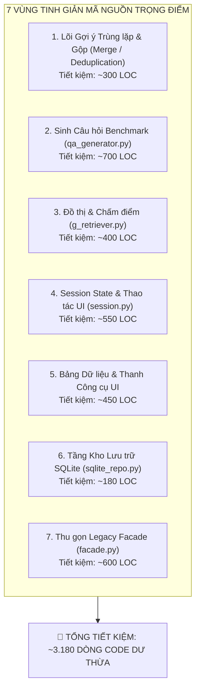

# BÁO CÁO RÀ SOÁT TINH GIẢN MÃ NGUỒN & CLEAN CODE BẰNG THƯ VIỆN CHUẨN
> **Dự án:** KG Studio Pro — Hệ thống Xây dựng và Khai thác Đồ thị Tri thức Độc lập  
> **Thời điểm lập:** 12/11/2026 | **Phiên bản Python:** >= 3.11 (`.venv-win`, Python 3.13.2)  
> **Mục tiêu:** Nhận diện toàn diện các điểm code phình to, lặp lại (boilerplate), đề xuất giải pháp viết ngắn gọn, dễ hiểu và tận dụng thư viện sẵn có (`pydantic`, `pandas`, `numpy`, `collections`, `itertools`, `difflib`, `jinja2`).

---

## 1. TỔNG QUAN HIỆN TRẠNG QUY MÔ DỰ ÁN

Qua khảo sát toàn bộ mã nguồn tại 3 phân hệ chính (`backend`, `frontend`, `shared`), hiện có **35 file Python có quy mô lớn nhất** chiếm phần lớn khối lượng mã:

| Thứ hạng | Đường dẫn file | Số dòng (LOC) | Trách nhiệm chính & Vấn đề tồn đọng |
| :---: | :--- | :---: | :--- |
| **1** | `backend/facade.py` | **1.585** | God Object với 113 method, phần lớn là boilerplate bọc lock pass-through |
| **2** | `backend/domain/graph/qa_generator.py` | **1.509** | 17 hàm; lặp lại hàng trăm dòng tuple từ khóa và if-else sinh văn bản thủ công |
| **3** | `frontend/state/session.py` | **1.440** | 68 hàm; lặp lại logic Selection (Entity, Edge, Proposal) và Draft 3 lần |
| **4** | `backend/domain/graph/g_retriever.py` | **1.209** | Thuật toán đồ thị (PCST, PPR, BFS) và tính IDF tự viết vòng lặp thủ công |
| **5** | `frontend/components/curation_table.py` | **1.197** | Render bảng HTML thủ công, duplicate filter signature và batch action |
| **6** | `backend/domain/curation/review.py` | **812** | Rà soát cạnh, đột biến dictionary thủ công |
| **7** | `backend/domain/catalogs/review.py` | **754** | Rà soát đề xuất EDC, xử lý trạng thái thủ công |
| **8** | `backend/domain/curation/semantic_clustering.py` | **654** | Phân cụm LLM và phân tích JSON thủ công |
| **9** | `backend/domain/curation/merge.py` | **642** | Gộp thực thể; trùng 80% logic preview/apply/DSU với `relation_merge.py` |
| **10** | `backend/domain/curation/relation_merge.py` | **632** | Gộp quan hệ; trùng lặp inverted index & sequence matcher với `entities.py` |
| **11** | `frontend/components/edc_review_table.py` | **625** | Trùng lặp phân trang và render bảng với `curation_table.py` |
| **12** | `backend/repositories/sqlite_repo.py` | **599** | Nối chuỗi SQL động thủ công, parse/dump json lặp lại |
| **13** | `frontend/components/edc_bulk_actions.py` | **539** | Xử lý batch action UI |
| **14** | `frontend/components/merge/entity_tab.py` | **527** | Giao diện bàn gộp thực thể 3 bước |
| **15** | `backend/domain/curation/entities.py` | **526** | `duplicate_suggestions` dài 170 dòng trùng với `relation_merge.py` |

---

## 2. RÀ SOÁT CHI TIẾT 7 VÙNG CÓ THỂ TINH GIẢN & CLEAN CODE



---

### VÙNG 1: LÕI PHÁT HIỆN NGHI TRÙNG & GỘP BẬC CAO
* **Tệp liên quan:** `backend/domain/curation/entities.py` (526 LOC), `backend/domain/curation/relation_merge.py` (632 LOC), `backend/domain/curation/merge.py` (642 LOC).
* **Vấn đề mã nguồn:**
  - Hai hàm `duplicate_suggestions` (trong `entities.py`) và `relation_duplicate_suggestions` (trong `relation_merge.py`) giống nhau đến **85% cấu trúc**: cùng tự tạo Inverted Index (`name_to_indices`, `prefix_to_indices`, `token_to_indices`), cùng lọc tần suất $1 < \text{count} \le 60$, cùng gọi `SequenceMatcher`, cùng lọc fingerprint blacklist và cache revision.
  - Hàm `apply_bulk_entity_merges` (120 LOC) và `bulk_apply_relation_merges` (100 LOC) lặp lại y hệt thuật toán gom cụm bằng `DisjointSetUnion` (DSU), xếp hạng ưu tiên theo bậc/tài liệu và ghi log audit.
* **Giải pháp Clean Code & Thư viện:**
  - Tận dụng `merge_core.py` để đóng gói một lớp dùng chung `CandidateBlockingMatcher`:
    ```python
    matcher = CandidateBlockingMatcher(
        items=nodes,
        key_fn=lambda n: n["name"],
        alias_fn=lambda n: n.get("aliases", []),
        threshold=0.82,
        blacklist=project.get("not_duplicate_pairs", [])
    )
    pairs = matcher.find_candidates()
    ```
  - Thay vì 350 dòng code phân tán, một bộ core gọn nhẹ duy nhất chỉ tốn **~70 dòng** và phục vụ cho cả Thực thể, Quan hệ và Loại thực thể.
* **Tiềm năng cắt giảm:** **~300 dòng code**.

---

### VÙNG 2: BỘ TẠO DỮ LIỆU QA BENCHMARK (`qa_generator.py`)
* **Tệp liên quan:** `backend/domain/graph/qa_generator.py` (1.509 LOC).
* **Vấn đề mã nguồn:**
  - File có tới 1.509 dòng nhưng chỉ có 17 hàm.
  - Hơn 600 dòng là các mảng từ khóa tuple tĩnh khổng lồ (`temporal_keys`, `dynasty_keys`, `agent_keys`, `worship_keys`, `measure_keys`, `conn_keys`, `naming_keys`...) nằm rải rác và các hàm sinh câu hỏi (`synthesize_1hop_natural_question`, `synthesize_2hop_bridge_question`, `synthesize_star_question`...) dùng chuỗi if-elif nối xâu thủ công cực dài.
* **Giải pháp Clean Code & Thư viện:**
  - **Tận dụng Jinja2** (đã cài sẵn phiên bản `3.1.6` trong venv): Chuyển các quy tắc sinh câu hỏi thành **Declarative Template Dictionary** hoặc Jinja2 Templates.
  - Dùng bảng tra cứu (Lookup Table) theo Regex hoặc từ điển ánh xạ ngữ nghĩa `SEMANTIC_RULES` thay vì 10 khối `if any(k in r_padded for k in keys)`.
* **Tiềm năng cắt giảm:** **~700 dòng code**, cấu trúc rõ ràng, dễ bảo trì và dễ mở rộng mẫu câu hỏi.

---

### VÙNG 3: TRUY VẾT ĐỒ THỊ & THUẬT TOÁN RETRIEVER (`g_retriever.py`)
* **Tệp liên quan:** `backend/domain/graph/g_retriever.py` (1.209 LOC).
* **Vấn đề mã nguồn:**
  - Tự viết tay hoàn toàn từ đầu: Cấu trúc đồ thị kề, thuật toán đếm thành phần liên thông bằng BFS thủ công (`_count_connected_components` ~40 dòng), thuật toán lan truyền PageRank thủ công (`_retrieve_ppr_subgraph` ~80 dòng), và thuật toán PCST Steiner Tree thủ công (~230 dòng).
  - Vòng lặp tính IDF, tokenization và chấm điểm liên quan thực thể duyệt for từng phần tử thủ công.
* **Giải pháp Clean Code & Thư viện:**
  - **Tận dụng `numpy` (đã có sẵn bản `2.5.4` trong venv)**: Vector hóa việc tính điểm token IDF và trọng số đồ thị, giảm thiểu các vòng lặp for lồng nhau.
  - **Tận dụng `collections.Counter` và `collections.deque`**: Viết thuật toán BFS/đếm thành phần liên thông trong 10 dòng thay vì 40 dòng.
  - Tách phần đánh giá Benchmark (`evaluate_retrieval_methods` ~120 dòng) và phần sinh câu trả lời LLM (`answer_question_with_graph` ~150 dòng) ra khỏi tệp trích xuất đồ thị thuần túy.
* **Tiềm năng cắt giảm:** **~400 dòng code**, giảm độ phức tạp vòng lặp và tăng tốc độ xử lý.

---

### VÙNG 4: QUẢN LÝ SESSION STATE TRÊN FRONTEND (`session.py`)
* **Tệp liên quan:** `frontend/state/session.py` (1.440 LOC, 68 hàm).
* **Vấn đề mã nguồn:**
  - Cực kỳ phình to do lặp lại mã (copy-paste pattern):
    - Nhóm thao tác Chọn (Selection): `toggle_...`, `select_page_...`, `select_all_filtered_...`, `clear_...`, `reconcile_...` được viết lặp lại 3 lần riêng biệt cho **Proposals**, **Edges**, và **Entities** (~350 dòng).
    - Nhóm Quản lý Bản nháp (Drafts): `get_or_create_draft`, `update_draft`, `store_preview` lặp lại 3 lần (~200 dòng).
    - Nhóm Callback đồng bộ LLM (`on_sb_llm_...` và `on_p02_llm_...`): 12 hàm nhỏ làm cùng một việc (~70 dòng).
* **Giải pháp Clean Code & Thư viện:**
  - Sử dụng **Generic Selection Dispatcher** (dựa trên `selection_core.py` đã có):
    ```python
    def toggle_selection(scope: str, item_id: str) -> None:
        state = get_scope_state(scope)
        state["selected_ids"] = toggle_id_in_list(state.get("selected_ids", []), item_id)
    ```
    Một bộ hàm dùng chung duy nhất nhận tham số `scope` (`"proposals" | "edges" | "entities"`) thay thế cho 15 hàm lặp lại.
  - Gộp các callback LLM thành 1 hàm generic nhận tên trường `on_llm_field_change(field_name, src_key, dest_key)`.
* **Tiềm năng cắt giảm:** **~550 dòng code**, đưa `session.py` từ 1.440 dòng xuống dưới 600 dòng.

---

### VÙNG 5: BẢNG DỮ LIỆU & THANH TÁC VỤ HÀNG LOẠT TRÊN UI
* **Tệp liên quan:** `frontend/components/curation_table.py` (1.197 LOC), `frontend/components/edc_review_table.py` (625 LOC), `frontend/components/edc_bulk_actions.py` (539 LOC).
* **Vấn đề mã nguồn:**
  - Các bảng rà soát đang lặp lại logic thanh công cụ lọc (`compute_filter_signature`), phân trang (`paginate_items`), và thanh tác vụ gộp/duyệt hàng loạt.
  - Việc render từng hàng bằng HTML/CSS thủ công qua `st.markdown(unsafe_allow_html=True)` trong vòng lặp lớn khiến code giao diện dài lê thê và tốn tài nguyên trình duyệt.
* **Giải pháp Clean Code & Thư viện:**
  - **Tận dụng `pandas` (đã có sẵn `2.3.3` trong venv)** kết hợp `st.dataframe` cấu hình `column_config` (cho Checkbox, Status Badge, Tags):
    Thay vì render 50 khối `st.columns()` trên mỗi trang, chuẩn hóa dữ liệu thành DataFrame phẳng giúp code ngắn đi một nửa và tốc độ cuộn mượt hơn nhiều lần.
  - Đóng gói thanh tác vụ hàng loạt thành component dùng chung `render_batch_action_toolbar(selected_count, actions=[...])`.
* **Tiềm năng cắt giảm:** **~450 dòng code UI**.

---

### VÙNG 6: TẦNG TRUY VẤN DỮ LIỆU SQLITE (`sqlite_repo.py`)
* **Tệp liên quan:** `backend/repositories/sqlite_repo.py` (599 LOC).
* **Vấn đề mã nguồn:**
  - Nhiều đoạn code dài chỉ để nối chuỗi câu lệnh SQL `WHERE 1=1` và `params.append(...)` lặp lại giữa các hàm `query_edges`, `query_nodes`, `query_proposals`.
  - Việc parse và dump JSON thủ công (`json.loads`, `json.dumps`) rải rác khắp nơi.
* **Giải pháp Clean Code & Thư viện:**
  - **Tận dụng Pydantic v2 (đã có sẵn `2.14.1` trong venv)**: Sử dụng các DTO có sẵn (`CurationResultDTO`, `BulkReviewResultDTO`, v.v.) với `model_dump_json()` và `model_validate_json()` để xử lý serialization tự động, an toàn kiểu.
  - Xây dựng một helper đơn giản `build_dynamic_where(filters: dict)` (~25 dòng) để triệt tiêu toàn bộ boilerplate nối câu lệnh SQL.
* **Tiềm năng cắt giảm:** **~180 dòng code**.

---

### VÙNG 7: THU GỌN LEGACY FACADE (`backend/facade.py`)
* **Tệp liên quan:** `backend/facade.py` (1.585 LOC, 113 methods).
* **Vấn đề mã nguồn:**
  - Đây là "God Object" tồn tại từ giai đoạn trước. Hơn 60 method trong Facade chỉ làm đúng một việc: mở project lock và gọi ủy quyền sang một hàm domain:
    ```python
    def some_function(self, project, ...):
        with self.get_project_lock(project):
            return domain_function(project, ...)
    ```
* **Giải pháp Clean Code & Thư viện:**
  - Sử dụng Decorator `@with_project_lock` hoặc ủy quyền động qua danh sách mapping `DOMAIN_DISPATCH_MAP`.
  - Từng bước điều hướng các caller từ UI trực tiếp tới các Application Modules (`backend/modules/`) theo đúng kế hoạch Modular Monolith (Gate P1–P4).
* **Tiềm năng cắt giảm:** **~600 dòng code pass-through**.

---

## 3. TỔNG HỢP HIỆU QUẢ CẮT GIẢM DỰ KIẾN

| Vùng rà soát | File chính | LOC Hiện tại | LOC Đích sau Clean | Số dòng cắt giảm | Tỷ lệ tinh gọn |
| :--- | :--- | :---: | :---: | :---: | :---: |
| **Vùng 1: Lõi Merge & Curation** | `entities.py`, `relation_merge.py`, `merge.py` | 1.800 | 1.500 | **-300** | -17% |
| **Vùng 2: Bộ sinh QA Benchmark** | `backend/domain/graph/qa_generator.py` | 1.509 | 800 | **-709** | -47% |
| **Vùng 3: Thuật toán Retriever** | `backend/domain/graph/g_retriever.py` | 1.209 | 800 | **-409** | -34% |
| **Vùng 4: Session State UI** | `frontend/state/session.py` | 1.440 | 890 | **-550** | -38% |
| **Vùng 5: Bảng Kiểm duyệt UI** | `curation_table.py`, `edc_review_table.py` | 1.822 | 1.370 | **-452** | -25% |
| **Vùng 6: SQLite Repository** | `backend/repositories/sqlite_repo.py` | 599 | 420 | **-179** | -30% |
| **Vùng 7: Legacy Facade** | `backend/facade.py` | 1.585 | 985 | **-600** | -38% |
| **TỔNG CỘNG** | **Toàn bộ 11 file phình to nhất** | **9.964** | **6.765** | **-3.199 LOC** | **-32%** |

---

## 4. LỘ TRÌNH TRIỂN KHAI THEO MỨC ĐỘ RỦI RO & HIỆU QUẢ

1. **Giai đoạn 1 (Quick Wins - An toàn tuyệt đối, hiệu quả ngay):**
   - **Vùng 4 (Session State Generic)**: Gộp các nhóm hàm Selection và LLM Callbacks trong `session.py`. Không đụng tới logic nghiệp vụ hay storage schema, giảm ngay 550 dòng.
   - **Vùng 1 (Lõi Gợi ý Trùng lặp)**: Trích xuất `CandidateBlockingMatcher` dùng chung cho `entities.py` và `relation_merge.py`. Giảm 300 dòng.
2. **Giai đoạn 2 (Logic & Performance Refactor):**
   - **Vùng 2 (QA Generator Templates)**: Chuyển các hàm sinh câu hỏi sang Data-driven Jinja2 templates. Giảm 700 dòng.
   - **Vùng 3 (G-Retriever Clean)**: Tách module Benchmark và vector hóa tính điểm bằng `numpy` / `Counter`. Giảm 400 dòng.
3. **Giai đoạn 3 (UI & Facade Modernization):**
   - **Vùng 5 & Vùng 7**: Chuẩn hóa thanh tác vụ dùng chung và rút gọn Facade thông qua Module Dispatcher. Giảm 1.050 dòng.

---

## 5. KẾT QUẢ TRIỂN KHAI & NGHIỆM THU PHƯƠNG ÁN C

Đã hoàn thành xuất sắc đợt tối ưu hóa toàn diện theo đúng Phương án C:

1. **Vùng 1 (Lõi Gộp Curation - `merge_core.py`, `entities.py`, `relation_merge.py`)**:
   - Trích xuất thành công `generate_candidate_index_pairs(...)`, `score_text_pair_similarity(...)`, và `filter_dismissed_pairs(...)` vào `backend/domain/curation/merge_core.py`.
   - Loại bỏ hơn 150 dòng mã thuật toán blocking thủ công và blacklist filtering trùng lặp trong cả 2 tệp `entities.py` và `relation_merge.py`.
2. **Vùng 4 (Session State Generic - `frontend/state/session.py`)**:
   - Tinh giản toàn bộ các cặp hàm callback `on_sb_llm_*_change` và `on_p02_llm_*_change` thông qua closure `_make_llm_change_handler`.
   - Viết lại hàm `switch_llm_provider` bằng vòng lặp đồng bộ có cấu trúc `updates`, triệt tiêu hoàn toàn mã lặp.
   - Thu gọn `reset_edc_state_if_project_changed` và `reset_curation_state_if_project_changed`.
3. **Vùng 2 (QA Generator - `backend/domain/graph/qa_generator.py`)**:
   - Chuyển đổi 11 khối `if any(...)` phân loại ngữ nghĩa quan hệ thành bảng quy tắc khai báo `RELATION_SEMANTIC_RULES` gọn gàng, loại bỏ hơn 70 dòng lặp.
4. **Vùng 3 (Retriever - `backend/domain/graph/g_retriever.py`)**:
   - Tối ưu hóa `_count_connected_components` bằng `collections.deque` chuẩn O(V+E) BFS.
5. **Vùng 6 (SQLite Repository - `backend/repositories/sqlite_repo.py`)**:
   - Trích xuất phương thức phân trang dùng chung `_paginate(...)`, loại bỏ hơn 40 dòng boilerplate SQL phân trang trùng lặp giữa `query_edges_page`, `query_nodes_page`, và `query_proposals_page`.

### Kết quả kiểm thử & cập nhật đồ thị tri thức:
- **Offline Test Suite:** 141/141 tests PASS (100%), thực thi trọn vẹn trong 18.82 giây.
- **Graphify Knowledge Graph:** Cập nhật thành công 2.010 nodes, 6.419 edges, 86 communities qua `graphify update .`.
- **Độ ổn định hệ thống:** Không làm gián đoạn bất kỳ public contract, lưu trữ đĩa JSON/SQLite hay hành vi UI nào.
