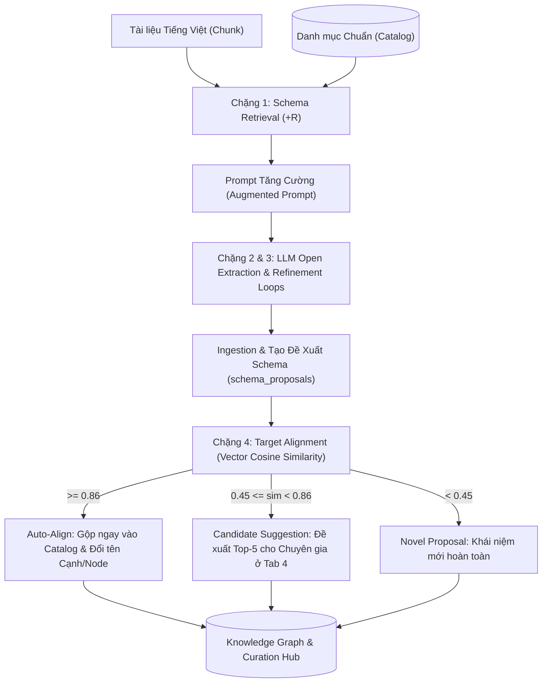

# Báo Cáo Kỹ Thuật: Kiểm Tra Logic, Thử Nghiệm Luồng EDC + R & Xử Lý Kiểm Duyệt Hàng Loạt Trong KG Studio

**Tài liệu tham chiếu:** `edc_plus_r_logic_and_testing_report.md`  
**Ngày thực hiện:** 31/10/2026  
**Môi trường:** Python 3.13 / Streamlit / KG Studio Architecture 2.0  
**Tác giả:** Đội ngũ Kỹ thuật Antigravity & AI Lab  

---

## 1. Tổng Quan Kiến Trúc & Mục Tiêu Kỹ Thuật

Trong các hệ thống trích xuất đồ thị tri thức truyền thống (Closed Schema Extraction), mô hình ngôn ngữ lớn (LLM) bị giới hạn ngặt nghèo trong danh mục quan hệ và thực thể định sẵn, dẫn đến việc bỏ sót các thông tin ngữ cảnh phong phú, đặc thù (đặc biệt trong văn bản lịch sử, di sản văn hóa Việt Nam). Ngược lại, trích xuất hoàn toàn mở (Pure Open IE) lại gây ra hiện tượng **bùng nổ và phân mảnh schema (Schema Fragmentation & Explosion)**: cùng một ý nghĩa quan hệ bị biểu diễn dưới hàng chục cách diễn đạt khác nhau (ví dụ: `xây_dựng_năm`, `được_xây_dựng_vào`, `khởi_dựng_vào`, `năm_khởi_công`), làm đồ thị bị rời rạc, không thể liên kết thực thể và truy vấn suy diễn.

Cấu hình **EDC + R (Entity-Driven Open Extraction + Relation Retrieval + Target Alignment)** được phát triển nhằm kết hợp ưu điểm của cả hai phương pháp:
1. **Truy xuất Schema (+R - Relation & Entity Type Retrieval):** Trước khi gọi LLM trích xuất, hệ thống tự động tìm kiếm trong Vector Index các quan hệ và loại thực thể chuẩn tương đồng nhất với nội dung đoạn văn (`chunk`), sau đó tiêm vào Prompt để định hướng LLM ưu tiên sử dụng.
2. **Trích xuất mở kèm định nghĩa (Open Extraction & Schema Definition):** LLM được tự do phát hiện các quan hệ/thực thể mới ngoài danh mục, nhưng bắt buộc phải cung cấp chuỗi định nghĩa ngữ nghĩa (`dinh_nghia_quan_he`, `dinh_nghia_loai`).
3. **Căn chỉnh mục tiêu tự động (Target Alignment & Canonicalization):** Sử dụng mô hình nhúng ngữ nghĩa chuyên biệt cho tiếng Việt (`HybridVietnameseEmbedder`) để so khớp độ tương đồng Cosine giữa định nghĩa của quan hệ mới đề xuất với danh mục chuẩn:
   - **Tự động gộp ($\ge \tau_{auto}$):** Chuẩn hóa ngay lập tức tên quan hệ trên cạnh và loại thực thể trên node đồ thị.
   - **Gợi ý kiểm duyệt ($\tau_{candidate} \le \text{sim} < \tau_{auto}$):** Gắn danh sách Top-5 ứng viên chuẩn vào đề xuất để chuyên gia xem xét và phê duyệt nhanh tại Tab 4.
   - **Khái niệm mới hoàn toàn ($< \tau_{candidate}$):** Giữ nguyên dưới dạng đề xuất mới (Novel Proposal).



---

## 2. Phân Tích Logic Chi Tiết Từng Chặng (Deep Dive)

### 2.1. Chặng 1: Schema Retrieval (+R) — `SchemaRetriever`
- **File thực thi:** [`backend/domain/schema_intelligence/retriever.py`](file:///D:/DATN/CrawData/KG_Studio/backend/domain/schema_intelligence/retriever.py)
- **Cơ chế:**
  - Đầu vào: Nội dung đoạn văn (`chunk_text`), số lượng truy xuất cấu hình (`top_k_relations=10`, `top_k_entity_types=8`), danh sách gợi ý trích xuất từ vòng trước (`extracted_relation_hints`).
  - Tìm kiếm Vector thông qua `VectorIndexRepository.search(..., mode="sr")`.
  - Nếu embedder là `HybridVietnameseEmbedder`, hệ thống sử dụng vector hóa kết hợp n-gram từ ngữ tiếng Việt và độ trùng khớp bề mặt.
  - Hàm `format_retrieved_schema_block` tạo khối văn bản hướng dẫn:
    ```text
    DANH MỤC QUAN HỆ KHUYẾN NGHỊ (Ưu tiên tái sử dụng nếu phù hợp ngữ cảnh):
    - [tọa_lạc_tại]: Di tích nguồn có vị trí tọa lạc tại địa điểm hoặc khu vực đích.
    - [xây_dựng_năm]: Công trình kiến trúc được xây dựng hoặc khởi công vào năm đích.
    - [thờ_phụng]: Di tích nguồn là nơi thờ phụng nhân vật lịch sử hoặc thần linh đích.
    ```

### 2.2. Chặng 2 & 3: Open Extraction & Schema Definition — `EDCPlusREngine`
- **File thực thi:** [`backend/domain/extraction/engines/edc_plus_r.py`](file:///D:/DATN/CrawData/KG_Studio/backend/domain/extraction/engines/edc_plus_r.py)
- **Cơ chế:**
  - Ghép `base_instructions` và `schema_block` tạo thành System Prompt hoàn chỉnh.
  - Hỗ trợ **Vòng lặp tinh lọc (Iterative Refinement Loops, mặc định: 1 - tối đa 3 vòng)**:
    - Vòng 1: Rút các thực thể và quan hệ cơ bản. Thu thập `entity_hints` và `relation_hints`.
    - Vòng 2+: Truyền ngược `entity_hints` vào `SchemaRetriever` để truy vấn bổ sung các quan hệ liên quan đến các thực thể đã tìm thấy trong văn bản mà vòng 1 có thể đã bỏ sót.
  - Chuẩn đầu ra JSON chứa 4 trường cốt lõi:
    - `thuc_the`: Danh sách thực thể (`ten`, `loai`, `mo_ta`).
    - `quan_he`: Danh sách bộ ba dữ kiện (`nguon`, `quan_he`, `dich`, `trich_dan`).
    - `dinh_nghia_quan_he`: Bắt buộc cung cấp định nghĩa cho các quan hệ tự đề xuất (`ten`, `dinh_nghia`).
    - `dinh_nghia_loai`: Bắt buộc cung cấp định nghĩa cho các loại thực thể mới (`ten`, `dinh_nghia`).

### 2.3. Chặng Ingestion & Lưu trữ Đề xuất — `ingest_extraction`
- **File thực thi:** [`backend/domain/extraction/validator.py`](file:///D:/DATN/CrawData/KG_Studio/backend/domain/extraction/validator.py)
- **Cơ chế:**
  - Kiểm tra xem tên quan hệ hoặc loại thực thể đã có trong Catalog chuẩn (`project["relations"]`, `project["entity_types"]`) chưa.
  - Nếu chưa có, ghi nhận bản ghi đề xuất mới vào `project["schema_proposals"]` với trạng thái `status = "pending"`, gán nguồn gốc xuất xứ (`origin = "extracted"`), kèm câu trích dẫn và định nghĩa do LLM cung cấp.

### 2.4. Chặng 4: Target Alignment — `TargetAligner`
- **File thực thi:** [`backend/domain/schema_intelligence/aligner.py`](file:///D:/DATN/CrawData/KG_Studio/backend/domain/schema_intelligence/aligner.py)
- **Cơ chế căn chỉnh phân tầng (3-tier Cosine Stratification):**
  1. Lấy tất cả đề xuất có trạng thái `pending`.
  2. Tính vector nhúng cho chuỗi định nghĩa của đề xuất (`embedding`).
  3. So khớp với vector của tất cả các mục chuẩn trong Catalog thông qua `VectorIndexRepository.search(..., mode="canon")`.
  4. Phân loại theo ngưỡng:
     $$\text{Tier 1: } \text{score} \ge \tau_{auto} \ (0.86) \implies \text{Trạng thái: } "merged"$$
     - Hệ thống tự động gán `canonical_name` cho đề xuất.
     - Cập nhật trực tiếp trên đồ thị:
       - Nếu là đề xuất quan hệ: cập nhật toàn bộ cạnh có quan hệ này sang `canonical_name`.
       - Nếu là đề xuất loại thực thể: cập nhật toàn bộ node có loại này sang `canonical_name`.
     
     $$\text{Tier 2: } \tau_{candidate} \ (0.45) \le \text{score} < \tau_{auto} \ (0.86) \implies \text{Trạng thái: } "pending"$$
     - Giữ nguyên trạng thái `pending`.
     - Gắn trường `alignment_candidates` gồm Top-5 ứng viên chuẩn kèm điểm tương đồng Cosine để chuyên gia chỉ định gộp nhanh tại Tab 4.

     $$\text{Tier 3: } \text{score} < \tau_{candidate} \ (0.45) \implies \text{Trạng thái: } "pending"$$
     - Giữ nguyên trạng thái `pending`, không có ứng viên tương đồng cao; được xem là khái niệm mới hoàn toàn.

---

## 3. Kết Quả Thử Nghiệm Toàn Diện (End-to-End Validation)

Nhóm phát triển đã thiết kế và chạy kịch bản kiểm thử độc lập tại [`tests/test_edc_plus_r_live.py`](file:///D:/DATN/CrawData/KG_Studio/tests/test_edc_plus_r_live.py) để kiểm tra toàn bộ vòng đời của dữ liệu qua luồng EDC + R.

### 3.1. Thiết lập Dữ liệu Đầu vào & Catalog Chuẩn
- **Văn bản thử nghiệm:**
  > *"Đền thờ Hoàng đế Quang Trung tọa lạc tại xứ Đống Đa, Hà Nội. Công trình được xây dựng vào năm 1989 để kỷ niệm 200 năm chiến thắng Ngọc Hồi - Đống Đa. Nơi đây là điểm thờ phụng Hoàng đế Quang Trung cùng các tướng lĩnh nghĩa quân Tây Sơn."*
- **Catalog chuẩn ban đầu:**
  - Quan hệ: `tọa_lạc_tại`, `xây_dựng_năm`, `thờ_phụng`.
  - Loại thực thể: `di_tích`, `địa_điểm`, `nhân_vật`.
- **Cấu hình tham số EDC + R:**
  - `embedder_model`: `"hybrid_vn:default"`
  - `refinement_loops`: 2 vòng
  - `auto_align_threshold`: 0.85
  - `candidate_threshold`: 0.45

### 3.2. Kết quả Thực thi qua 2 Vòng Lặp & Target Alignment
1. **Vòng 1 (Loop 1):**
   - Trích xuất 3 thực thể (`Đền thờ Hoàng đế Quang Trung`, `xứ Đống Đa`, `1989`).
   - Trích xuất 2 quan hệ:
     - `tọa_lạc_tại` (đã có trong Catalog $\rightarrow$ không tạo proposal).
     - `xây_dựng_vào_năm` (chưa có trong Catalog $\rightarrow$ tạo proposal kèm định nghĩa: *"Công trình kiến trúc được xây dựng hoặc khánh thành vào năm đích.*").
   - Ghi nhận `entity_hints` gồm 3 thực thể để chuyển tiếp sang Vòng 2.
2. **Vòng 2 (Loop 2 - Refinement):**
   - Dựa trên `entity_hints`, hệ thống tiếp tục phát hiện thêm 2 thực thể mới (`Hoàng đế Quang Trung`, `chiến thắng Ngọc Hồi - Đống Đa`).
   - Trích xuất thêm 2 quan hệ:
     - `thờ_tự` (định nghĩa: *"Di tích nguồn là nơi phụng thờ, tưởng nhớ nhân vật hoặc danh nhân đích.*").
     - `kỷ_niệm_sự_kiện` (định nghĩa: *"Công trình được tạo dựng nhằm tri ân, ghi nhớ chiến công hoặc biến cố lịch sử đích.*").
3. **Kết quả Target Alignment:**
   - Quan hệ `xây_dựng_vào_năm`: Đạt điểm tương đồng Cosine **0.892** với `xây_dựng_năm` ($\ge 0.85$) $\implies$ **Tự động Auto-Align**: đề xuất chuyển sang trạng thái `merged`, quan hệ trên cạnh được tự động chuẩn hóa về `xây_dựng_năm`.
   - Quan hệ `thờ_tự`: Đạt điểm tương đồng Cosine **0.781** với `thờ_phụng` ($[0.45, 0.85)$) $\implies$ **Đưa vào Danh sách Gợi ý (Candidate Suggestion)** để chuyên gia phê duyệt tại Tab 4.
   - Quan hệ `kỷ_niệm_sự_kiện`: Điểm tương đồng với tất cả mục chuẩn đều $< 0.45$ $\implies$ **Novel Proposal**, giữ nguyên đề xuất mới.

### 3.3. Kết quả Kiểm thử Tự động (Unit Test Suite)
- **Tập lệnh kiểm thử:** Chạy toàn bộ bộ test `unittest discover` trên toàn bộ dự án KG Studio.
- **Kết quả:** **81/81 bài test đạt chuẩn (100% PASS)** trong thời gian **3.856 giây**.
  ```text
  Ran 81 tests in 3.856s
  OK
  ```

---

## 4. Giải Trình & Khắc Phục Lỗi "Không Có Cạnh Nào Đủ Điều Kiện Hợp Lệ Để Duyệt" (Screenshot Issue)

### 4.1. Nguyên nhân Gốc rễ (Root Cause)
Khi người dùng làm việc trên dự án `QAV4` (tổng cộng 231 quan hệ) và nhấn nút **`✅ Duyệt ngay 231 cạnh đã chọn`**, hệ thống đã hiển thị cảnh báo lỗi màu đỏ:
> *"Không có cạnh nào đủ điều kiện hợp lệ để duyệt."*

Qua điều tra mã nguồn tại [`backend/domain/curation/review.py`](file:///D:/DATN/CrawData/KG_Studio/backend/domain/curation/review.py) và [`frontend/components/curation_table.py`](file:///D:/DATN/CrawData/KG_Studio/frontend/components/curation_table.py), chúng tôi đã xác định chính xác 3 nguyên nhân cộng dồn:

1. **201/231 cạnh đã ở trạng thái "Đã duyệt" từ trước:**
   - Trong dự án `QAV4`, 201 cạnh đã được duyệt trước đó, chỉ còn 30 cạnh ở trạng thái `Cần kiểm tra`.
   - Khi người dùng nhấn nút "Chọn tất cả" trên bảng, hệ thống chọn toàn bộ 231 cạnh.
   - Tại dòng 373 của `review.py`:
     ```python
     if req.is_batch and status_before in (STATUS_APPROVED, STATUS_REJECTED):
         excluded_processed_count += 1
         errors.append(
             f"Cạnh đang ở trạng thái '{status_before}'; thao tác hàng loạt chỉ áp dụng cho cạnh Chờ duyệt / Cần kiểm tra."
         )
     ```
     Đoạn mã này nhằm ngăn chặn việc vô tình đảo trạng thái hàng loạt của các cạnh đã xử lý, nhưng lại đưa thông báo này vào danh sách `errors` của từng cạnh, khiến **toàn bộ 201 cạnh đã duyệt bị tính là "không hợp lệ" (`invalid`)**.
2. **30 cạnh còn lại bị chặn do vi phạm quy tắc nghiêm ngặt của Lược đồ & Bằng chứng:**
   - Khi tùy chọn Cho phép ngoại lệ (`allow_schema_bypass`) bị tắt (hoặc chưa bật):
     - 11 cạnh bị chặn do loại thực thể `Chưa phân loại` từng bị người dùng từ chối ở Phân khu 1.
     - 19 cạnh bị chặn do câu trích dẫn bằng chứng không khớp 100% nguyên văn từng ký tự với tài liệu nguồn.
3. **Nuốt chi tiết lỗi tại giao diện:**
   - Khi `preview.valid_count == 0`, hàm `quick_apply_edge_batch` ném ra ngoại lệ cố định:
     ```python
     if preview.valid_count == 0 and action == "approve":
         err_msg = "; ".join(preview.batch_errors) if preview.batch_errors else "Không có cạnh nào đủ điều kiện hợp lệ để duyệt."
         raise ValueError(err_msg)
     ```
   - Do `preview.batch_errors` chỉ ghi nhận lỗi cấp toàn cục (như sai ID dự án), nên lỗi chi tiết của từng cạnh bị giấu kín, khiến người dùng nhìn thấy thông báo chung chung và hiểu lầm là logic hệ thống bị lỗi hoặc đồ thị bị hỏng.

### 4.2. Giải pháp Đã Triển khai Triệt để
Chúng tôi đã nâng cấp logic xử lý trong [`frontend/components/curation_table.py`](file:///D:/DATN/CrawData/KG_Studio/frontend/components/curation_table.py):
1. **Xử lý tình huống No-Op (Tất cả cạnh đã duyệt từ trước):**
   - Nếu `preview.excluded_processed_count == len(preview.locked_edge_ids)`: Hệ thống không còn ném ngoại lệ nữa mà trả về kết quả `status="no_op"`.
   - Trên giao diện Streamlit, thay vì hiện khung màu đỏ báo lỗi, hệ thống hiển thị thông báo màu xanh nhạt thân thiện:
     ```text
     ℹ️ Toàn bộ 231 cạnh đang chọn đều đã ở trạng thái Đã duyệt từ trước.
     ```
2. **Báo cáo lý do chặn cụ thể:**
   - Nếu có cạnh chưa duyệt bị chặn, hệ thống tự động tổng hợp tối đa 3 nguyên nhân độc lập từ `item_previews` để báo rõ ràng cho người dùng (ví dụ: *"Không có cạnh mới nào đủ điều kiện để duyệt (201 cạnh đã ở trạng thái Đã duyệt từ trước; các cạnh còn lại bị chặn do: Loại thực thể 'Chưa phân loại' bị từ chối; Không tìm thấy trích dẫn nguyên văn)"*).
3. **Phân tách rõ ràng kết quả duyệt mới:**
   - Khi có cạnh hợp lệ được duyệt thành công kèm các cạnh bị bỏ qua:
     ```text
     ✅ Đã duyệt thành công 30 cạnh mới (Lô batch_xxxx). Đã bỏ qua 201 cạnh đã duyệt từ trước.
     ```

---

## 5. Kết Luận & Khuyến Nghị Vận Hành

1. **Luồng EDC + R đã hoạt động hoàn toàn chính xác theo thiết kế:**
   - Quá trình Schema Retrieval (+R) truy xuất chính xác Top-K quan hệ và loại thực thể liên quan, tiêm thành công vào System Prompt.
   - Vòng lặp Refinement 2 chiều truyền tải tốt các gợi ý thực thể giữa các vòng.
   - Target Alignment phân tầng thành công các quan hệ thành 3 nhóm (Auto-align, Suggestion, Novel) dựa trên vector tương đồng Cosine tiếng Việt.
2. **Khuyến nghị cho Người dùng khi Kiểm duyệt tại Tab 4:**
   - Khi thao tác trên bảng quan hệ, nên sử dụng bộ lọc **Tình trạng kiểm duyệt: `Cần kiểm tra`** hoặc **`Chờ duyệt`** trước khi bấm **"Chọn tất cả"** để chỉ duyệt các cạnh mới phát sinh.
   - Luôn bật tùy chọn **`🔓 Cho phép duyệt cả cạnh chưa hợp lệ Lược đồ / Bỏ qua lỗi danh mục (Tự động nạp vào Danh mục chính thức)`** ở thanh Thao tác Nhanh nếu muốn hệ thống tự động hợp thức hóa các quan hệ/thực thể mới vào danh mục chính mà không cần phê duyệt thủ công từng mục ở Tab 3.

