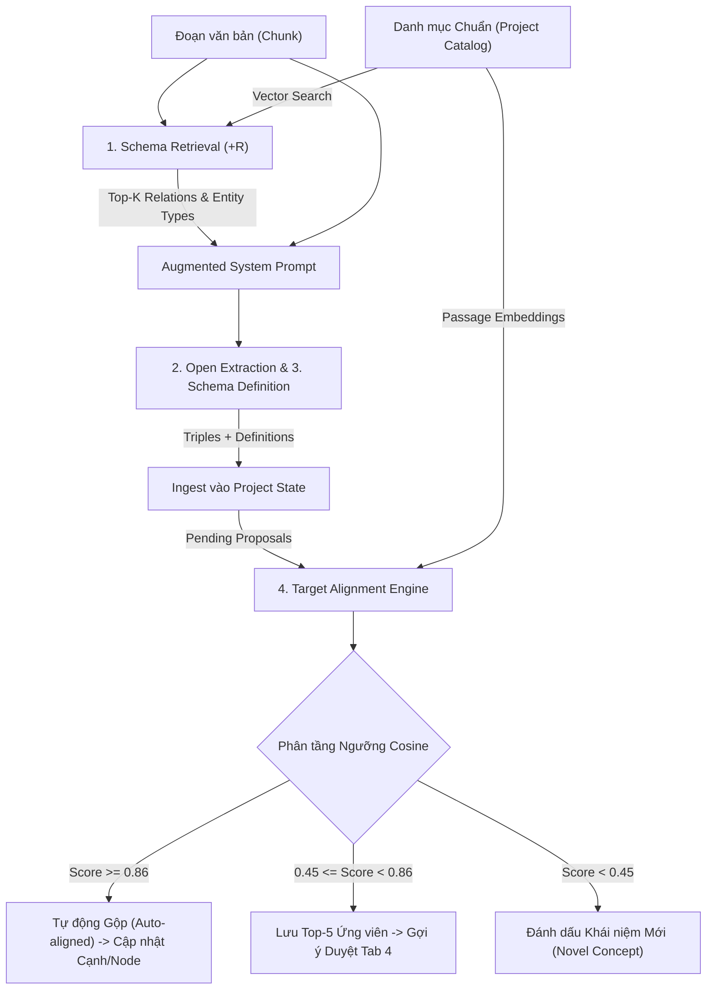
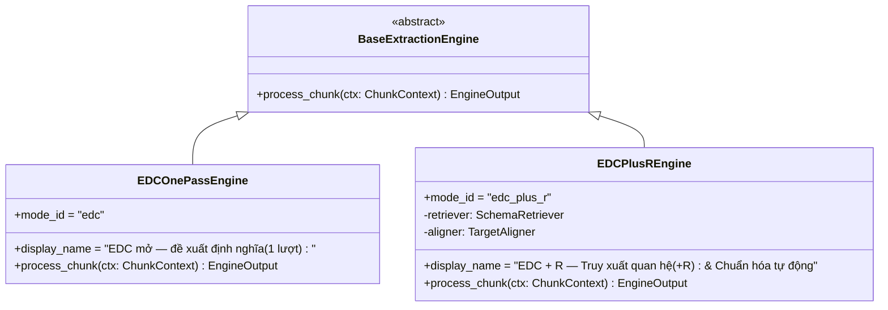
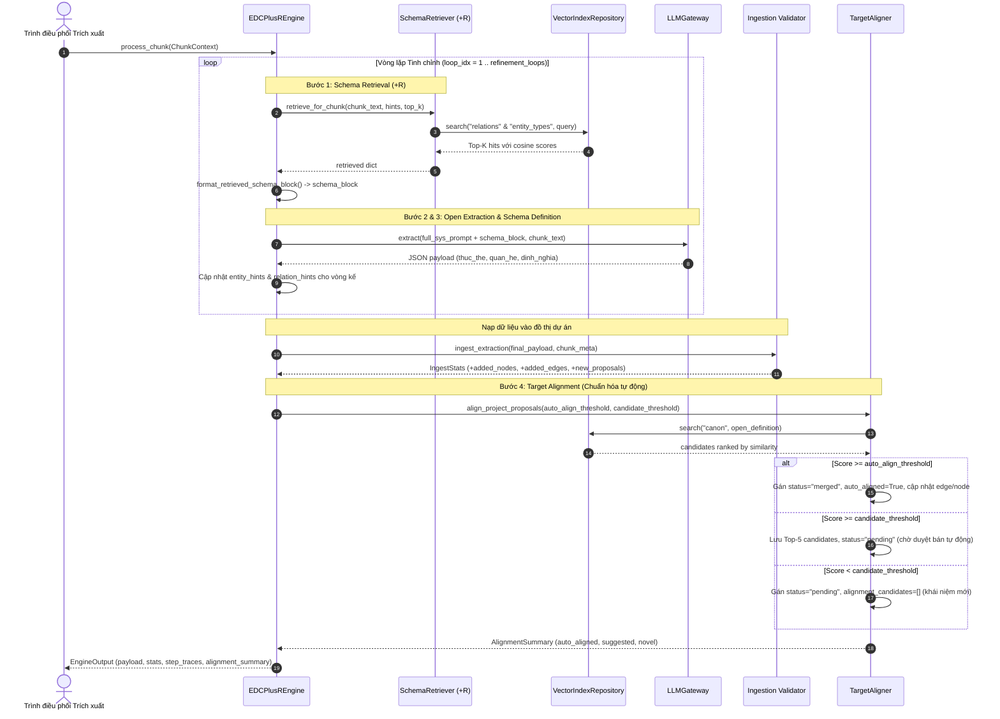
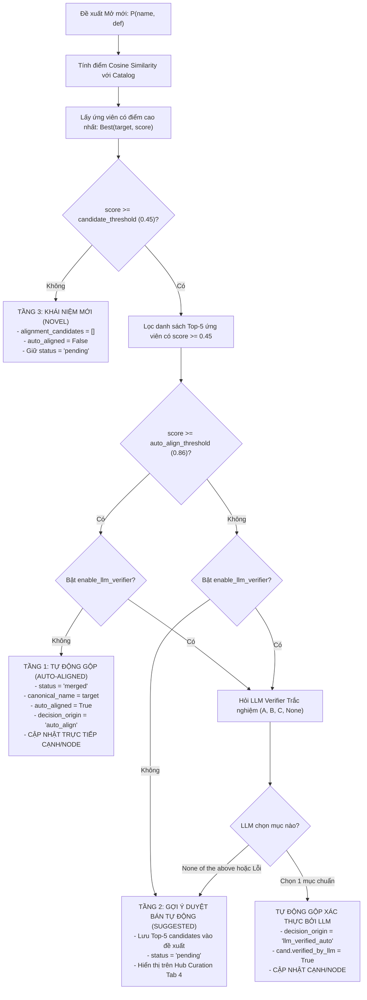
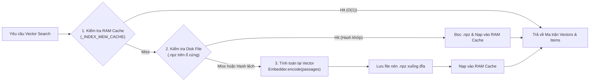

# BÁO CÁO KỸ THUẬT & KIẾN TRÚC LOGIC: EDC+R VÀ TARGET ALIGNMENT (SCHEMA CANONICALIZATION)

> **Mã tài liệu:** `TECH-REP-EDCR-ALIGN-01`  
> **Dự án:** KG Studio — Knowledge Graph Construction & Curation Studio  
> **Vị trí tài liệu:** `KG_Studio/AI/report/edc_r_and_target_alignment_technical_report.md`  
> **Phiên bản:** 2.0 (Hệ thống kiến trúc độc lập sau khi hoàn tất loại bỏ phụ thuộc legacy)  
> **Trạng thái:** Hoàn thành & Đã kiểm thử (72/72 Unit Tests Passed)  

---

## MỤC LỤC
1. [TỔNG QUAN KIẾN TRÚC & ĐỘNG LỰC THIẾT KẾ](#1-tổng-quan-kiến-trúc--động-lực-thiết-kế)
2. [BẢN ĐỒ CÁC FILE & PHÂN TẦNG TRÁCH NHIỆM](#2-bản-đồ-các-file--phân-tầng-trách-nhiệm)
3. [MÔ HÌNH DỮ LIỆU & THAM SỐ CẤU HÌNH (EDCPlusRSettingsDTO)](#3-mô-hình-dữ-liệu--tham-số-cấu-hình-edcplusrsettingsdto)
4. [KIẾN TRÚC ENGINE TRÍCH XUẤT: SO SÁNH EDC MỞ VS EDC+R](#4-kiến-trúc-engine-trích-xuất-so-sánh-edc-mở-vs-edcr)
5. [BỘ TRUY XUẤT LƯỢC ĐỒ ĐÍCH (SCHEMA RETRIEVER - +R)](#5-bộ-truy-xuất-lược-đồ-đích-schema-retriever---r)
6. [BỘ CHUẨN HÓA ĐÍCH TỰ ĐỘNG (TARGET ALIGNER - SCHEMA CANONICALIZATION)](#6-bộ-chuẩn-hóa-đích-tự-động-target-aligner---schema-canonicalization)
7. [HỆ THỐNG VECTOR INDEX & BỘ ĐỆM ĐA TẦNG (VECTOR INDEX REPOSITORY)](#7-hệ-thống-vector-index--bộ-đệm-đa-tầng-vector-index-repository)
8. [CỔNG KẾT NỐI MÔ HÌNH NHÚNG (EMBEDDER GATEWAY)](#8-cổng-kết-nối-mô-hình-nhúng-embedder-gateway)
9. [BẢO VỆ TÍNH TOÀN VẸN HUẤN LUYỆN ML (ML ACTIVE LEARNING INTEGRITY)](#9-bảo-vệ-tính-toàn-vẹn-huấn-luyện-ml-ml-active-learning-integrity)
10. [GIAO DIỆN CẤU HÌNH & VẬN HÀNH (FRONTEND TAB 2 & TAB 4)](#10-giao-diện-cấu-hình--vận-hành-frontend-tab-2--tab-4)
11. [MA TRẬN CẤU HÌNH KHUYẾN NGHỊ (BEST PRACTICES & TUNING GUIDE)](#11-ma-trận-cấu-hình-khuyến-nghị-best-practices--tuning-guide)

---

## 1. TỔNG QUAN KIẾN TRÚC & ĐỘNG LỰC THIẾT KẾ

Trong bài toán xây dựng đồ thị tri thức tự động từ văn bản tiếng Việt tự do (Knowledge Graph Construction - KGC), hệ thống thường đối mặt với sự đánh đổi cơ bản giữa hai trường phái:
- **Trích xuất Đóng (Closed Information Extraction - Closed IE):** LLM bị giới hạn nghiêm ngặt trong một danh mục lược đồ quan hệ và loại thực thể cố định được định nghĩa trước.
  - *Ưu điểm:* Đảm bảo tính nhất quán dữ liệu cao, cấu trúc sạch, không bị phân mảnh.
  - *Nhược điểm:* Bỏ sót hoàn toàn các tri thức mới, quan hệ mới nằm ngoài danh mục ("Schema Incompleteness").
- **Trích xuất Mở Thuần túy (Open Information Extraction - Open IE / EDC 1-Pass):** LLM được tự do phát hiện và đề xuất tên quan hệ, loại thực thể mới theo ngữ cảnh văn bản.
  - *Ưu điểm:* Khả năng bao phủ tri thức tối đa.
  - *Nhược điểm:* Gây ra hiện tượng **bùng nổ từ vựng (Vocabulary Explosion)** và **phân mảnh lược đồ (Schema Drift)**. Cùng một khái niệm vị trí địa lý nhưng LLM có thể đề xuất hàng chục biến thể như: *"tọa lạc tại"*, *"nằm ở"*, *"thuộc địa phận"*, *"có địa chỉ tại"*, *"đặt trụ sở ở"*, khiến đồ thị tri thức bị chia cắt thành các cụm rời rạc.

### Giải pháp Kiến trúc EDC+R và Target Alignment
Để dung hòa cả hai ưu điểm trên, KG Studio triển khai kiến trúc lai hai pha tiên tiến:
1. **EDC+R (Entity-Driven Open Extraction + Relation Retrieval):** Tăng cường truy hồi lược đồ trước khi trích xuất. Sử dụng mô hình nhúng ngữ nghĩa (Semantic Embedding) để tìm kiếm Top-$K$ quan hệ và loại thực thể trong danh mục đích có liên quan mật thiết nhất với văn bản chunk hiện tại, sau đó bơm ngữ cảnh này vào System Prompt. Nhờ đó, LLM được "định hướng" ưu tiên sử dụng lược đồ chuẩn nếu phù hợp, đồng thời vẫn giữ quyền tự do đề xuất định nghĩa mới nếu khái niệm đó thực sự chưa có trong danh mục.
2. **Target Alignment (Chuẩn hóa Đích Tự động / Bán tự động):** Khi LLM phát sinh các đề xuất mở (Schema Proposals), bộ chuẩn hóa đích sẽ tính toán độ tương đồng cosine đa chiều giữa định nghĩa mở của đề xuất với toàn bộ danh mục chuẩn. Dựa trên phân tầng ngưỡng toán học:
   - **Tự động gộp (Auto-align):** Nếu độ tương đồng vượt ngưỡng tự tin cao (mặc định $\ge 0.86$), hệ thống tự động gộp đề xuất về mục chuẩn và cập nhật trực tiếp vào cạnh/node của đồ thị.
   - **Gợi ý duyệt (Candidate Suggestion):** Nếu độ tương đồng nằm trong vùng trung gian (mặc định $[0.45, 0.86)$), hệ thống lưu lại danh sách Top-5 ứng viên kèm điểm số để chuyên gia tri thức thẩm định bán tự động tại Curation Hub (Tab 4).
   - **Mục mới (Novel):** Nếu độ tương đồng thấp ($< 0.45$), hệ thống đánh dấu là tri thức hoàn toàn mới để thêm vào danh mục gốc.



---

## 2. BẢN ĐỒ CÁC FILE & PHÂN TẦNG TRÁCH NHIỆM

Hệ thống được thiết kế theo nguyên tắc phân tầng rõ ràng (Layered Clean Architecture), phân tách độc lập giữa Tầng Mô hình (Schemas), Tầng Nghiệp vụ (Domain), Tầng Tích hợp (Integrations/Repositories), Tầng Cổng điều phối (Facade) và Tầng Giao diện (Frontend).

| Phân tầng (Layer) | Tệp tin (File Path) | Trách nhiệm Kiến trúc Chính |
| :--- | :--- | :--- |
| **Shared / Constants** | `shared/constants.py` | Định nghĩa các hằng số chế độ trích xuất (`MODE_FIXED`, `MODE_EDC`, `MODE_EDC_PLUS_R`), trạng thái duyệt, và bộ tham số mặc định `DEFAULT_EDC_PLUS_R_SETTINGS`. |
| **Shared / Schemas** | `shared/schemas/project.py` | Định nghĩa `EDCPlusRSettingsDTO` chứa logic đóng gói, ép kiểu (clamping) và chuyển đổi từ điển tham số EDC+R. |
| **Shared / Schemas** | `shared/schemas/edc.py` | Định nghĩa DTOs chuẩn hóa cho Target Alignment: `AlignmentCandidateDTO`, `SchemaProposalDTO`, `ProposalDecisionDTO`, `BulkReviewRequestDTO`, `BulkReviewPreviewDTO`, `BulkReviewResultDTO`. |
| **Shared / Templates** | `shared/prompt_templates/__init__.py` | Định nghĩa các khuôn mẫu câu lệnh chỉ dẫn (`format_sr_query`, `format_canon_query`, `format_catalog_passage`) dùng cho embedding retrieval. |
| **Extraction Engine** | `backend/domain/extraction/engines/edc_one_pass.py` | Engine trích xuất mở cơ bản 1 lượt (Basic EDC). Không có truy xuất lược đồ và không có chuẩn hóa tự động trong chu trình chunk. |
| **Extraction Engine** | `backend/domain/extraction/engines/edc_plus_r.py` | Engine nâng cao 4 bước (EDC+R). Điều phối chu trình lặp tinh chỉnh, truy xuất lược đồ (+R) và tự động chuẩn hóa đích trực tuyến (Target Alignment). |
| **Schema Intelligence** | `backend/domain/schema_intelligence/retriever.py` | `SchemaRetriever`: Truy xuất Top-$K$ quan hệ và loại thực thể liên quan nhất từ catalog bằng hybrid query. Định dạng schema block tiêm vào prompt. |
| **Schema Intelligence** | `backend/domain/schema_intelligence/aligner.py` | `TargetAligner`: Tính toán tương đồng ngữ nghĩa, xếp hạng ứng viên chuẩn hóa, phân tầng ngưỡng tự động, hỗ trợ xác thực lại qua LLM Verifier. |
| **Vector Repository** | `backend/repositories/vector_repo.py` | `VectorIndexRepository`: Quản lý bộ đệm hai tầng (RAM Cache + file nén `.npz`), tính toán ma trận embedding, tìm kiếm dot product tối ưu, tự động vô hiệu hóa khi đổi catalog. |
| **Embedder Gateway** | `backend/integrations/embedder_gateway.py` | `EmbedderGateway`: Cổng tích hợp nhúng thống nhất hỗ trợ 3 backend: `hybrid_vn` (N-gram hashing tiếng Việt offline), `sentence_transformers`, và `openai_compatible`. |
| **Domain Exporter** | `backend/domain/dataset_exporter/exporter.py` | `ActiveLearningExporter`: Bộ xuất dữ liệu học chủ động. Đảm bảo chặn $100\%$ các đề xuất tự động chuẩn hóa (`auto_aligned = True`) để bảo vệ dữ liệu huấn luyện ML vàng. |
| **Facade Orchestrator** | `backend/facade.py` | Điểm kết nối duy nhất của Backend: Cung cấp các API lấy/cập nhật cấu hình EDC+R, làm mới ứng viên, chạy căn chỉnh hàng loạt, trích xuất chunk. |
| **Frontend Tab 2** | `frontend/components/prompt_editor.py` | Giao diện cấu hình tham số EDC+R (Sliders, Selectboxes), xem trước Prompt ghép và quản lý các phiên bản Prompt độc lập theo chế độ. |
| **Frontend Tab 4** | `frontend/components/edc_bulk_actions.py` | Thao tác hàng loạt trên Tab 4: Làm mới gợi ý ứng viên theo lựa chọn, tự động điền Top-1 vào bản nháp, xem trước và cam kết lô quyết định. |
| **Frontend Tab 4** | `frontend/components/edc_review_table.py` | Bảng hiển thị đề xuất duyệt EDC với thẻ màu trực quan theo điểm số tương đồng cosine của ứng viên Target Alignment. |

---

## 3. MÔ HÌNH DỮ LIỆU & THAM SỐ CẤU HÌNH (EDCPlusRSettingsDTO)

Cấu hình của EDC+R và Target Alignment được chuẩn hóa bằng lớp thực thể `EDCPlusRSettingsDTO` trong `shared/schemas/project.py`. DTO này đảm bảo mọi tham số từ phía giao diện hoặc tệp JSON đều được kiểm tra biên nghiêm ngặt (Data Clamping) để chống lỗi tràn bộ nhớ hoặc vượt ngưỡng toán học.

### 3.1. Bảng Thông số Kỹ thuật của `EDCPlusRSettingsDTO`

```python
@dataclass
class EDCPlusRSettingsDTO:
    embedder_model: str = "hybrid_vn:default"
    top_k_relations: int = 10
    top_k_entity_types: int = 8
    auto_align_threshold: float = 0.86
    candidate_threshold: float = 0.45
    refinement_loops: int = 1
    enable_llm_verifier: bool = False
```

| Tham số | Kiểu dữ liệu | Mặc định | Miền giới hạn (Clamping) | Ý nghĩa Kỹ thuật & Thực tiễn Nghiệp vụ |
| :--- | :---: | :---: | :---: | :--- |
| `embedder_model` | `str` | `"hybrid_vn:default"` | Định danh chuỗi hợp lệ | Model embedding dùng để tính toán vector biểu diễn của văn bản chunk, định nghĩa danh mục và tên quan hệ. Hỗ trợ mô hình offline nội bộ hoặc SentenceTransformer. |
| `top_k_relations` | `int` | `10` | `[1, 50]` | Số lượng quan hệ chuẩn tối đa được Schema Retriever (+R) truy xuất từ danh mục và tiêm vào System Prompt cho mỗi chunk. |
| `top_k_entity_types` | `int` | `8` | `[1, 50]` | Số lượng loại thực thể chuẩn tối đa được truy xuất và đưa vào gợi ý prompt cho mỗi chunk. |
| `auto_align_threshold` | `float` | `0.86` | `[0.50, 0.99]` | Ngưỡng tương đồng cosine tối thiểu để Target Aligner **tự động gộp** đề xuất mở vào mục chuẩn mà không cần con người xác nhận trước. |
| `candidate_threshold` | `float` | `0.45` | `[0.10, 0.95]` | Ngưỡng tương đồng cosine tối thiểu để một mục trong danh mục được xem là **ứng viên hợp lệ** đưa vào danh sách gợi ý cho con người duyệt. |
| `refinement_loops` | `int` | `1` | `[1, 3]` | Số vòng lặp tự tinh chỉnh (Iterative Refinement) trích xuất của LLM. Vòng $N$ tái sử dụng kết quả thực thể/quan hệ của vòng $N-1$ làm gợi ý truy hồi. |
| `enable_llm_verifier` | `bool` | `False` | `True` / `False` | Bật/Tắt module LLM Verifier: Khi ứng viên đạt ngưỡng gợi ý, LLM sẽ được hỏi câu hỏi trắc nghiệm A/B/C/None để tái thẩm định tính tương đương ngữ nghĩa. |

### 3.2. Cấu trúc Ứng viên Chuẩn hóa (`AlignmentCandidateDTO`)

Mỗi khi Target Aligner quét danh mục chuẩn để tìm kiếm cho một đề xuất mở, kết quả trả về là một danh sách các `AlignmentCandidateDTO` (trong `shared/schemas/edc.py`):

```python
@dataclass
class AlignmentCandidateDTO:
    name: str                           # Tên mục chuẩn trong danh mục (ví dụ: "nằm tại")
    definition: str = ""                # Định nghĩa ngữ nghĩa của mục chuẩn
    description: str = ""               # Mô tả tóm tắt của mục chuẩn
    score: float = 0.0                  # Điểm tương đồng cosine [0.0 - 1.0] (làm tròn 4 số thập phân)
    verified_by_llm: bool = False       # True nếu được LLM Verifier xác nhận chính xác
    reason: str = ""                    # Lý giải (ví dụ: "Trùng khớp tên chuẩn" hoặc "Tương đồng ngữ nghĩa (0.88)")
    catalog_hash: str = ""              # Hash phiên bản danh mục tại thời điểm sinh ứng viên
    model_fingerprint: str = ""         # Fingerprint của mô hình embedding đã tính điểm
```

---

## 4. KIẾN TRÚC ENGINE TRÍCH XUẤT: SO SÁNH EDC MỞ VS EDC+R

Hệ thống KG Studio thiết kế hai engine riêng biệt kế thừa từ `BaseExtractionEngine` (`backend/domain/extraction/base_engine.py`):



### 4.1. Sự Khác biệt Cốt lõi giữa EDC Mở và EDC+R

| Đặc điểm So sánh | Chế độ 2: EDC Mở 1 lượt (`EDCOnePassEngine`) | Chế độ 3: EDC + R (`EDCPlusREngine`) |
| :--- | :--- | :--- |
| **Mã chế độ (`mode_id`)** | `"edc"` | `"edc_plus_r"` |
| **Ngữ cảnh Lược đồ trong Prompt** | Không có gợi ý lược đồ. LLM nhận prompt yêu cầu tự do trích xuất và đề xuất định nghĩa. | Nhận thêm khối `retrieved_schema_block` gồm Top-$K$ quan hệ và loại thực thể liên quan nhất được truy xuất động theo nội dung chunk. |
| **Số vòng lặp trích xuất** | Cố định 1 lượt duy nhất ($L=1$). | Cấu hình được từ 1 đến 3 lượt ($L \in [1, 3]$) tự động tích lũy gợi ý thực thể/quan hệ giữa các vòng. |
| **Target Alignment trực tuyến** | **Không thực hiện** trong chu trình trích xuất chunk. Toàn bộ đề xuất sinh ra ở trạng thái `pending`. | **Tự động thực thi ngay** sau khi nạp chunk. Đề xuất có độ tương đồng $\ge \text{threshold}$ được gộp ngay vào cạnh/node đồ thị. |
| **Dấu vết thực thi (`step_traces`)** | 1 trace: `"EDC Open Extraction + Schema Definition"` | Tối thiểu 3 traces: `"1. Schema Retrieval (+R)"`, `"2. Open Extraction & 3. Schema Definition"`, `"4. Target Alignment"`. |
| **Chi phí Token & Thời gian** | Thấp, chỉ tốn 1 lần gọi LLM. | Cao hơn (1 lần nhúng truy xuất + $L$ lần gọi LLM + 1 lần nhúng căn chỉnh + [tùy chọn] LLM Verifier). |

### 4.2. Chu trình Xử lý 4 Bước Chi tiết trong `EDCPlusREngine.process_chunk`



---

## 5. BỘ TRUY XUẤT LƯỢC ĐỒ ĐÍCH (SCHEMA RETRIEVER - +R)

Được triển khai trong tệp `backend/domain/schema_intelligence/retriever.py`, lớp `SchemaRetriever` chịu trách nhiệm thu hẹp không gian tìm kiếm quan hệ và loại thực thể bằng cách chọn lọc những phần tử trong danh mục có khả năng xuất hiện cao nhất trong đoạn văn chunk.

### 5.1. Thuật toán Xây dựng Câu truy vấn Lai (Hybrid Query Construction)
Để truy xuất chính xác, truy vấn vector không chỉ sử dụng nguyên văn đoạn trích tài liệu mà còn kết hợp với các quan hệ/thực thể đã phát hiện ở vòng lặp trước đó:

$$\text{Query}_{\text{SR}} = \begin{cases} 
\text{chunk\_text} & \text{khi chưa có gợi ý} \\ 
\text{chunk\_text} + \text{"\nQuan hệ gợi ý: "} + \text{join}(\text{hints}) & \text{khi đã có gợi ý từ vòng trước} 
\end{cases}$$

Câu truy vấn này được bao bọc trong khuôn mẫu chỉ dẫn nhúng ngữ nghĩa tiếng Việt (`format_sr_query` trong `shared/prompt_templates/__init__.py`):
```text
Instruct: Truy xuất các mối quan hệ và định nghĩa thực thể phù hợp có mặt trong đoạn văn tiếng Việt sau.
Query: {chunk_text}
```

### 5.2. Cơ chế Ưu tiên Tuyệt đối cho Trùng khớp Danh mục (Exact Match Boost)
Nếu trong các vòng lặp trước hoặc trong văn bản xuất hiện quan hệ đã trùng tên chuẩn với một quan hệ trong catalog (kiểm tra qua hàm chuẩn hóa chuỗi `normal(hint)`), `SchemaRetriever` sẽ ép điểm số của quan hệ đó bằng $1.0$ và đẩy thẳng lên vị trí đầu tiên (`index 0`) của danh sách kết quả, đảm bảo thông tin chuẩn quan trọng nhất không bị trôi khỏi cửa sổ ngữ cảnh:

```python
if extracted_relation_hints:
    seen_names = {normal(item["name"]) for item in rel_hits}
    rel_by_norm = {normal(item["name"]): item for item in rel_catalog}
    for hint in extracted_relation_hints:
        key = normal(hint)
        if key in rel_by_norm and key not in seen_names:
            entry = dict(rel_by_norm[key])
            entry["score"] = 1.0
            rel_hits.insert(0, entry)
            seen_names.add(key)
```

### 5.3. Định dạng Khối Lược đồ Bơm vào Prompt (`format_retrieved_schema_block`)
Khối văn bản kết quả được tạo ra có cấu trúc rõ ràng, chỉ dẫn LLM ưu tiên sử dụng nhưng không cấm đoán đề xuất mới:
```text
GỢI Ý QUAN HỆ CHUẨN LIÊN QUAN ĐẾN ĐOẠN VĂN (Ưu tiên dùng tên chuẩn nếu đúng nghĩa, hoặc tự đề xuất tên mới nếu chưa có):
- nằm tại: Thực thể nguồn có vị trí địa lý thuộc địa điểm hoặc khu vực đích.
- xây dựng năm: Công trình nguồn được khởi công hoặc xây dựng vào năm đích.

GỢI Ý LOẠI THỰC THỂ CHUẨN LIÊN QUAN:
- di tích: Công trình văn hóa lịch sử kiến trúc.
- địa danh: Vùng đất, quận huyện, tỉnh thành.

THỰC THỂ ĐÃ NHẬN DIỆN Ở VÒNG TRƯỚC (Hãy kiểm tra kỹ các mối quan hệ còn sót giữa chúng): Chùa Một Cột, quận Ba Đình
```

---

## 6. BỘ CHUẨN HÓA ĐÍCH TỰ ĐỘNG (TARGET ALIGNER - SCHEMA CANONICALIZATION)

Được triển khai trong tệp `backend/domain/schema_intelligence/aligner.py`, lớp `TargetAligner` là trái tim của cơ chế chuẩn hóa lược đồ tri thức.

### 6.1. Thuật toán Xếp hạng Ứng viên (`rank_candidates`)
Khi một đề xuất mở $P = (\text{name}, \text{definition})$ được sinh ra, `TargetAligner` đối chiếu $P$ với toàn bộ các mục trong danh mục $C = \{c_1, c_2, \dots, c_m\}$.

1. **Chuẩn bị văn bản đối chiếu (Passage Formatting):** Mỗi mục chuẩn trong danh mục được biểu diễn dưới dạng:
   $$\text{Passage}(c_i) = \text{name}_i + \text{" : "} + \text{definition}_i + \text{" | "} + \text{description}_i$$
2. **Khuôn mẫu Truy vấn Chuẩn hóa (Canon Query Instruct):**
   ```text
   Instruct: Cho một mối quan hệ hoặc loại thực thể cùng định nghĩa ngữ cảnh tiếng Việt, hãy truy xuất mục chuẩn tương đương nhất trong danh mục đích.
   Query: {name}: {definition}
   ```
3. **Độ đo Tương đồng Cosine:**
   $$S(P, c_i) = \cos(\mathbf{v}_P, \mathbf{v}_{c_i}) = \frac{\mathbf{v}_P \cdot \mathbf{v}_{c_i}}{\|\mathbf{v}_P\|_2 \|\mathbf{v}_{c_i}\|_2}$$
   *(Lưu ý: Nếu `normal(name) == normal(c_i.name)` thì điểm được gán trực tiếp $S = 1.0$)*.

### 6.2. Phân tầng Quyết định 3 Cấp (Three-Tier Decision Stratification)

Quy trình quyết định tự động trong `align_project_proposals` được thực hiện như sau:



### 6.3. Chi tiết Cập nhật Đồ thị Tức thời khi Tự động Gộp
Khi đề xuất $P$ đủ điều kiện tự động gộp vào tên chuẩn `chosen_target`:
- **Đối với Quan hệ (`p_kind == "relations"`):** Quét toàn bộ `edges` trong `project`, tìm các cạnh có chứa `proposal["id"]` trong danh sách `edge["schema_proposal_ids"]` và đổi trực tiếp:
  $$\text{edge}["\text{relation}"] \leftarrow \text{chosen\_target}$$
- **Đối với Loại Thực thể (`p_kind == "entity_types"`):** Quét toàn bộ `nodes` trong `project`, tìm các node có chứa `proposal["id"]` và đổi trực tiếp:
  $$\text{node}["\text{kind}"] \leftarrow \text{chosen\_target}$$

### 6.4. Logic Thẩm định Độc lập qua LLM Verifier
Nếu cấu hình `enable_llm_verifier = True`, hàm `build_verification_prompt` tạo một câu hỏi trắc nghiệm khách quan với các phương án $A, B, C, \dots$ tương ứng với Top ứng viên, cùng phương án cuối cùng là khái niệm mới hoàn toàn:

```text
Xác định xem quan hệ mở 'tọa lạc ở' có tương đương ngữ nghĩa với mục nào trong danh mục chuẩn dưới đây không.
- Tên đề xuất mở: tọa lạc ở
- Định nghĩa ngữ cảnh: Thực thể nguồn nằm tại vị trí địa lý ở địa điểm đích.
- Ví dụ trích dẫn: Chùa Một Cột tọa lạc tại quận Ba Đình

LỰA CHỌN:
A. 'nằm tại': Thực thể nguồn có vị trí địa lý thuộc địa điểm hoặc khu vực đích.
B. 'giáp ranh': Tiếp giáp địa giới hành chính.
C. Không có mục nào tương đương (đây là khái niệm hoàn toàn mới).

Chỉ trả lời đúng 1 chữ cái (A, B, C, ...):
```
Nếu LLM trả về chữ cái tương ứng với mục chuẩn, hệ thống tự động gộp với nguồn gốc `decision_origin = "llm_verified_auto"`. Nếu LLM chọn phương án "Không có mục nào tương đương", hệ thống sẽ **hủy lệnh tự động gộp**, giữ nguyên đề xuất ở trạng thái chờ con người thẩm định.

---

## 7. HỆ THỐNG VECTOR INDEX & BỘ ĐỆM ĐA TẦNG (VECTOR INDEX REPOSITORY)

Tệp `backend/repositories/vector_repo.py` chịu trách nhiệm quản lý việc tính toán, lưu trữ và tái sử dụng các vector embedding của danh mục chuẩn. Để đạt hiệu năng cao và độ trễ cực thấp trong quá trình trích xuất, hệ thống triển khai kiến trúc **Bộ đệm Hai Tầng (Two-Tier Caching Architecture)**:



### 7.1. Cấu trúc Khóa Cache và Cơ chế Kiểm tra Toàn vẹn (Catalog Hash)
Khóa cache bộ nhớ RAM là một bộ tứ bất biến:
$$\text{CacheKey} = (\text{project\_id}, \text{kind}, \text{model\_fingerprint}, \text{catalog\_hash})$$
Trong đó:
- `catalog_hash`: Được tính bằng $\text{SHA256}(\text{JSON-serialize}(\text{items}))[:16]$. Mọi thay đổi dù là nhỏ nhất (sửa tên, sửa định nghĩa, thêm/bớt quan hệ) đều làm đổi hash ngay lập tức.
- `model_fingerprint`: Mã băm đặc trưng 16 ký tự đại diện cho kiến trúc mô hình, số chiều và tập trọng số từ vựng của embedder.

### 7.2. Tự động Vô hiệu hóa Chỉ mục Lỗi thời (`invalidate_project_indices`)
Khi người dùng sửa danh mục hoặc khôi phục snapshot dự án từ quá khứ, hàm `invalidate_project_indices` sẽ:
1. Xóa toàn bộ các entry liên quan trong `_INDEX_MEM_CACHE`.
2. Duyệt thư mục lưu trữ `data/vector_indices/<project_id>/` và xóa bỏ các tệp `.npz` có `catalog_hash` không còn khớp với danh mục hiện tại.

---

## 8. CỔNG KẾT NỐI MÔ HÌNH NHÚNG (EMBEDDER GATEWAY)

Tệp `backend/integrations/embedder_gateway.py` cung cấp lớp trừu tượng `EmbedderGateway` cho phép hệ thống hoạt động linh hoạt trên nhiều môi trường:

### 8.1. Ba Cơ chế Backend của EmbedderGateway
1. **`hybrid_vn` (Mặc định - Offline Semantic N-Gram Hashing):**
   - Hoạt động độc lập 100%, không cần kết nối mạng, không cần GPU, thời gian khởi động tức thì.
   - Kết hợp mở rộng từ đồng nghĩa tiếng Việt chuyên sâu (`BASE_VIETNAMESE_SYNONYMS` bao gồm các cặp từ phổ biến như: *tọa lạc $\leftrightarrow$ nằm tại*, *thờ $\leftrightarrow$ thờ phụng*, *xây dựng $\leftrightarrow$ khởi công*, *trùng tu $\leftrightarrow$ tu bổ*).
   - Sử dụng kỹ thuật băm N-gram phân tầng:
     - **Word & Bigram Vector:** Trọng số unigram = 1.4, bigram = 2.8.
     - **Character N-Gram Vector:** Trích xuất 3-gram và 4-gram ký tự để bù đắp cho lỗi chính tả hoặc biến thể từ vựng.
     - **Tỉ lệ hòa trộn:** $\mathbf{v} = 0.88 \cdot \mathbf{v}_{\text{word}} + 0.12 \cdot \mathbf{v}_{\text{char}}$, chuẩn hóa $L_2$.
2. **`sentence_transformers` (Local Deep Learning Models):**
   - Tải và chạy các mô hình Transformer tiếng Việt hoặc đa ngôn ngữ (ví dụ: `bkai-foundation-models/vietnamese-bi-encoder`, `intfloat/multilingual-e5-base`).
   - Sử dụng bộ nhớ đệm dùng chung `_ST_MODEL_CACHE` trong tiến trình.
3. **`openai_compatible` (Remote API):**
   - Kết nối tới các dịch vụ API chuẩn OpenAI hoặc trạm máy chủ Ollama cục bộ (ví dụ: `text-embedding-3-small`, `nomic-embed-text`).

---

## 9. BẢO VỆ TÍNH TOÀN VẸN HUẤN LUYỆN ML (ML ACTIVE LEARNING INTEGRITY)

Một trong những đóng góp kiến trúc quan trọng nhất của hệ thống là **Nguyên lý Ngăn chặn Ô nhiễm Dữ liệu Vòng lặp (Feedback Loop Data Contamination Prevention)**.

### 9.1. Bài toán Sụp đổ Mô hình (Model Collapse)
Nếu các đề xuất được tự động gộp bởi máy (`auto_aligned = True` hoặc `decision_origin = "auto_align"`) được đưa vào tập dữ liệu huấn luyện cho các mô hình Active Learning (như `sr_triplets.jsonl` hoặc `canon_pairs.jsonl`), mô hình nhúng sau này sẽ học lại chính những sai số hoặc ảo giác của thuật toán embedding trước đó, dẫn đến suy thoái chất lượng nghiêm trọng.

### 9.2. Rào chắn Chặn Lọc Tuyệt đối trong `exporter.py`
Trong tệp `backend/domain/dataset_exporter/exporter.py`, hàm kiểm tra tính hợp lệ `_is_human_committed_proposal` loại bỏ $100\%$ các đề xuất tự động:

```python
def _is_human_committed_proposal(proposal: dict) -> bool:
    """Chỉ chấp nhận đề xuất do con người đã duyệt và commit, loại trừ auto_aligned / preview / draft."""
    status = str(proposal.get("status", ""))
    if status not in ("merged", "approved"):
        return False
    origin = str(proposal.get("decision_origin", ""))
    if origin in ("auto_align", "llm_verified_auto", "preview", "draft"):
        return False
    if bool(proposal.get("auto_aligned", False)) and origin != "human":
        return False
    return True
```
> [!IMPORTANT]
> **Quy tắc Vàng của Hệ thống:**
> - Mọi thao tác gộp tự động của Target Alignment giúp tăng tốc trích xuất tri thức cho người dùng.
> - Nhưng **CHỈ CÓ** các quyết định gộp/duyệt do chuyên gia con người thẩm định và xác nhận (`decision_origin == "human"`) mới có tư cách được trích xuất thành tập dữ liệu huấn luyện ML.

---

## 10. GIAO DIỆN CẤU HÌNH & VẬN HÀNH (FRONTEND TAB 2 & TAB 4)

### 10.1. Cấu hình Tham số tại Tab 2 (`prompt_editor.py`)
Khi người dùng chọn chế độ **"3. EDC + R — Truy xuất quan hệ & Chuẩn hóa tự động"**, giao diện Streamlit hiển thị một khu vực cấu hình trực quan:
- **Hộp chọn Mô hình Nhúng (`edcr_cfg_embedder`):** Liệt kê các model đã đăng ký trong `data/model_registry/` cùng mô hình mặc định `hybrid_vn:default`.
- **Thanh trượt Top-K Quan hệ (`edcr_cfg_top_k_rel`) & Top-K Loại thực thể (`edcr_cfg_top_k_type`):** Điều chỉnh lượng tri thức lược đồ bơm vào prompt.
- **Thanh trượt Ngưỡng Tự động Chuẩn hóa (`edcr_cfg_auto_align`):** Điều chỉnh độ khắt khe khi máy tự động gộp ($0.50 - 0.99$).
- **Thanh trượt Ngưỡng Gợi ý Ứng viên (`edcr_cfg_cand_thres`):** Điều chỉnh ngưỡng chấp nhận ứng viên ($0.20 - 0.90$).
- **Số vòng lặp Tinh chỉnh (`edcr_cfg_loops`):** Chọn 1, 2 hoặc 3 vòng.
- **Nút "Lưu Cấu hình Tham số EDC+R":** Tự động tạo snapshot dự án trước khi ghi đè cấu hình để đảm bảo an toàn.

### 10.2. Vận hành & Curation tại Hub Kiểm duyệt Tab 4
Tại Tab 4 (`frontend/components/edc_bulk_actions.py` và `edc_review_table.py`):
1. **Thao tác Hàng loạt (Bulk Actions):**
   - **🎯 Làm mới gợi ý cho mục đã chọn:** Kích hoạt `refresh_proposal_candidates` trên danh sách ID được tick chọn. Hệ thống chạy lại vector search và tính toán lại điểm cosine mới nhất.
   - **⚡ Điền ứng viên đầu tiên vào bản nháp:** Tự động lấy ứng viên Top-1 hợp lệ gán vào trường `canonical_name` của bản nháp cho toàn bộ mục được chọn.
   - **📌 Gán đích chung vào bản nháp:** Cho phép chọn 1 mục chuẩn duy nhất trong catalog và gán hàng loạt cho các đề xuất đang chọn.
2. **Quy trình Cam kết Hai Pha (Preview $\rightarrow$ Commit):**
   - Bấm **"🔍 Xem trước"** $\rightarrow$ Hệ thống gọi `preview_proposal_decisions`, tính toán số cạnh và số node sẽ bị ảnh hưởng, kiểm tra xung đột phiên bản mà **chưa làm thay đổi dữ liệu trên đĩa**.
   - Bấm **"🚀 Áp dụng Lô"** $\rightarrow$ Tạo snapshot tự động, cập nhật trạng thái đề xuất, chuyển đổi tên quan hệ/loại thực thể trên đồ thị, và lưu vết vào `edc_idempotency_store`.

---

## 11. MA TRẬN CẤU HÌNH KHUYẾN NGHỊ (BEST PRACTICES & TUNING GUIDE)

Dưới đây là ma trận cấu hình thực nghiệm tối ưu tùy theo quy mô danh mục lược đồ và đặc điểm của tập tài liệu:

| Quy mô & Loại Tài liệu | `top_k_relations` | `top_k_entity_types` | `auto_align_threshold` | `candidate_threshold` | `refinement_loops` | `enable_llm_verifier` | Ghi chú & Đánh giá Đánh đổi |
| :--- | :---: | :---: | :---: | :---: | :---: | :---: | :--- |
| **Danh mục Nhỏ / Miền hẹp**<br/>*(< 20 quan hệ, văn bản lịch sử/di tích)* | `6 - 10` | `4 - 6` | `0.84` | `0.40` | `1` | `False` | Tốc độ trích xuất nhanh nhất, độ phủ cao. Không cần LLM Verifier vì danh mục nhỏ ít bị nhầm lẫn. |
| **Danh mục Chuẩn / Doanh nghiệp**<br/>*(20 - 80 quan hệ, văn bản hành chính, báo chí)* | `10 - 15` | `8 - 10` | **`0.86`** *(mặc định)* | **`0.45`** *(mặc định)* | `1 - 2` | `False` | Cân bằng hoàn hảo giữa độ chính xác tự động hóa và chi phí token. |
| **Danh mục Lớn / Tri thức Mở Phong phú**<br/>*(> 100 quan hệ, sách nghiên cứu tổng hợp)* | `15 - 25` | `10 - 15` | `0.90` | `0.50` | `2` | `True` | Nâng cao ngưỡng tự động gộp lên $0.90$ và bật LLM Verifier để ngăn chặn triệt để hiện tượng gộp nhầm giữa các quan hệ gần nghĩa. |
| **Chế độ Rà soát Cực kỳ Nghiêm ngặt**<br/>*(Yêu cầu dữ liệu chuẩn xác 100%)* | `10` | `8` | `0.98` | `0.35` | `1` | `False` | Đặt ngưỡng tự động gần bằng $1.0$ (chỉ gộp khi trùng tên tuyệt đối), hạ ngưỡng candidate xuống $0.35$ để con người tự quyết định $100\%$ trên Tab 4. |

---

## TỔNG KẾT

Kiến trúc **EDC+R và Target Alignment** trong KG Studio tạo nên một chu trình khép kín, thông minh và an toàn cho bài toán xây dựng đồ thị tri thức:
1. **Chủ động định hướng:** Giảm thiểu bùng nổ từ vựng ngay từ khâu trích xuất thông qua Schema Retriever (`+R`).
2. **Tự động hóa thông minh:** Rút ngắn thời gian kiểm duyệt bằng cơ chế phân tầng ngưỡng tương đồng cosine và tự động gộp (Target Alignment).
3. **An toàn dữ liệu:** Đảm bảo tính toán vẹn dữ liệu huấn luyện ML thông qua các rào chắn cách ly đề xuất máy, đồng thời hỗ trợ cơ chế snapshot rollback và cam kết giao dịch hai pha (Preview $\rightarrow$ Commit).

