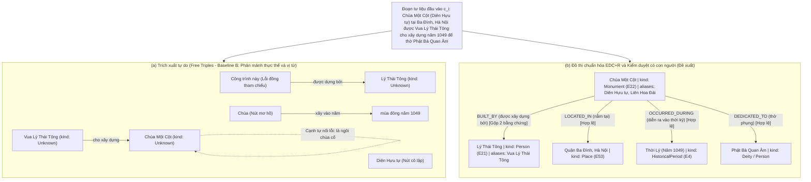
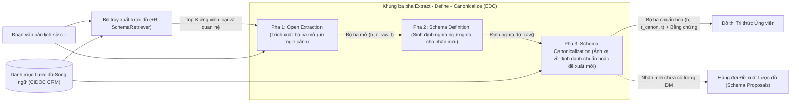
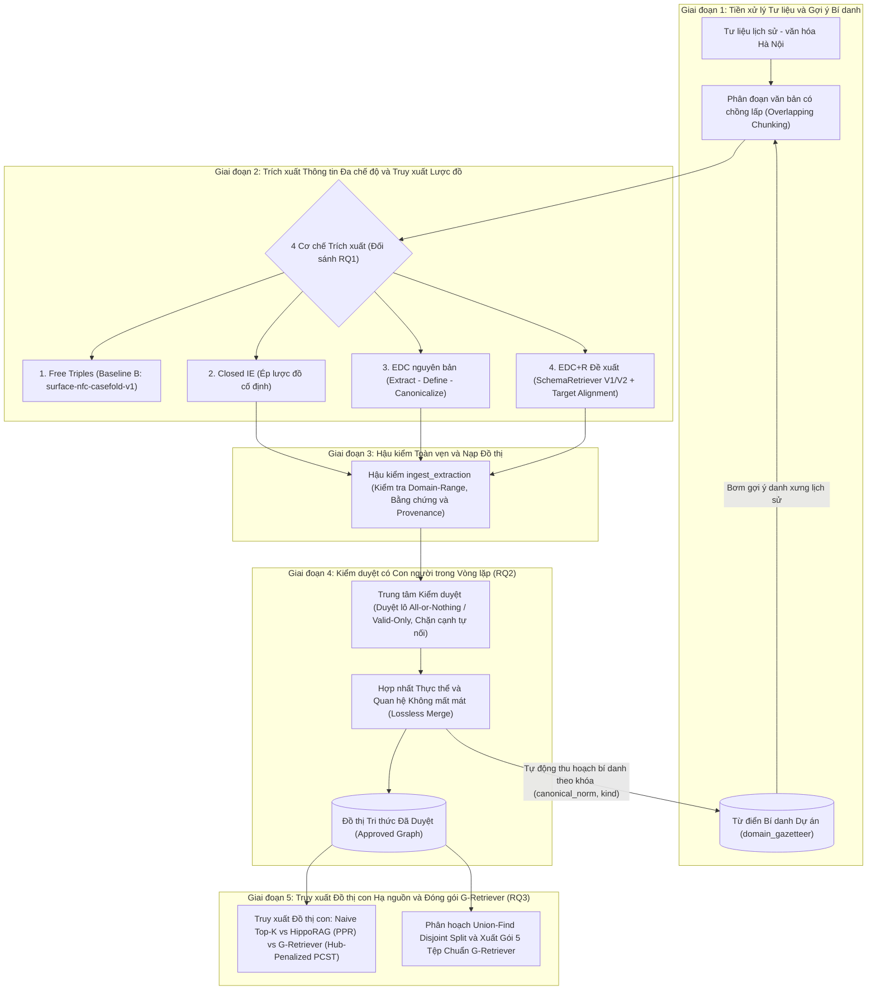
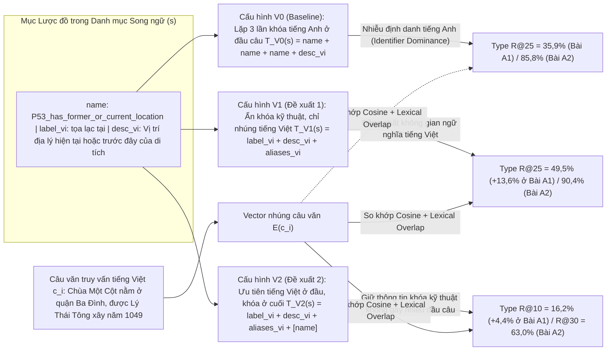
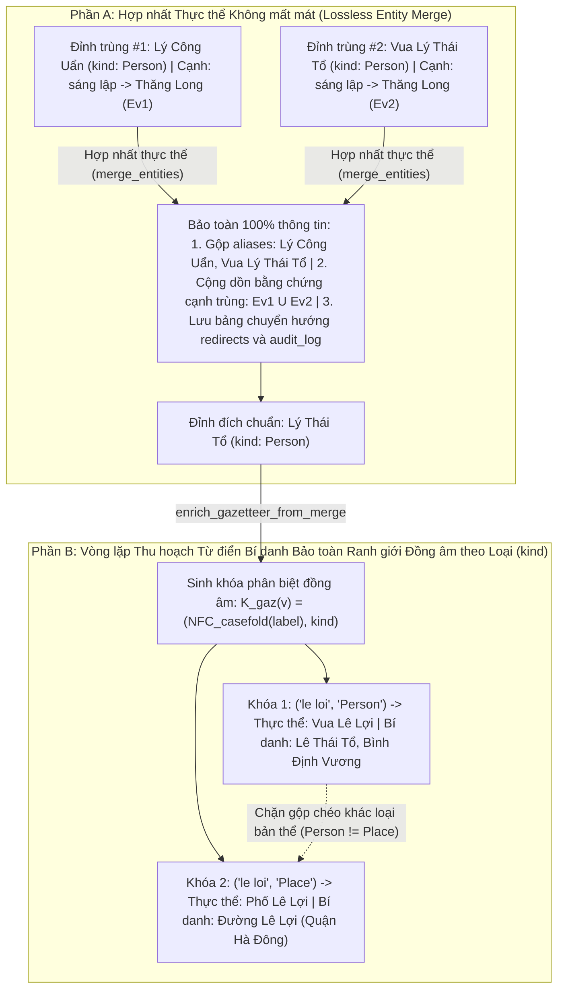
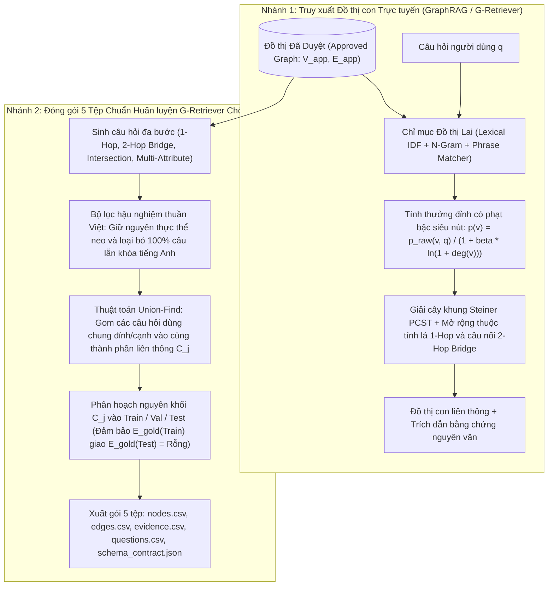
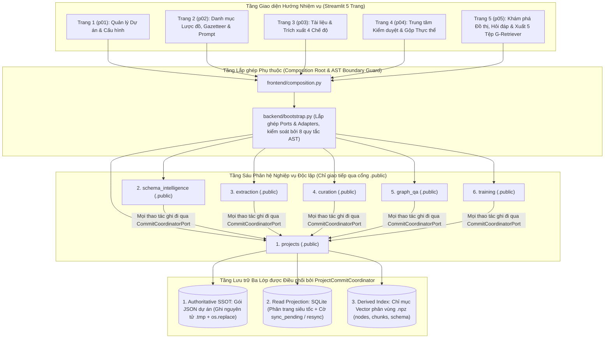
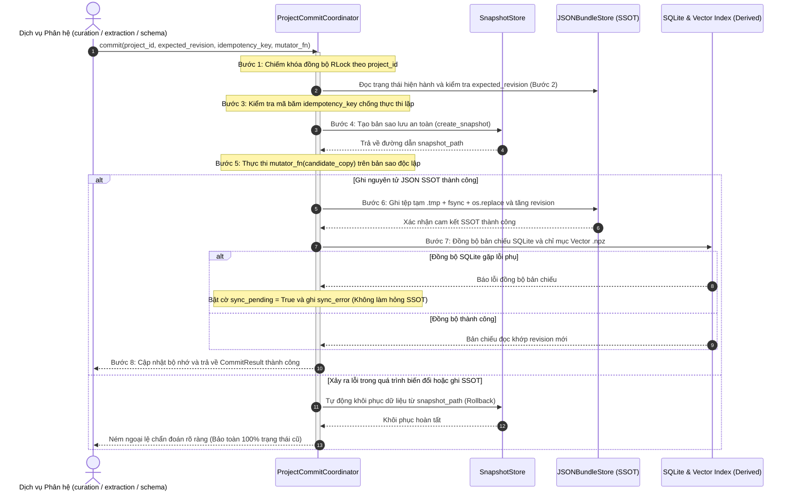

```mermaid
xychart-beta
    title "So sánh Recall@K (%) của SchemaRetriever giữa V0 (Đỏ), V1 (Xanh dương) và V2 (Xanh lá)"
    x-axis ["A1: Rel R@15", "A1: Rel R@30", "A1: Type R@10", "A1: Type R@25", "A2: Rel R@30", "A2: Type R@25"]
    y-axis "Tỷ lệ thu hồi Recall (%)" 0 --> 100
    bar [14.0, 21.7, 11.7, 35.9, 56.1, 85.8]
    bar [14.5, 22.8, 14.3, 49.5, 58.6, 90.4]
    bar [14.1, 22.0, 16.2, 46.8, 63.0, 88.4]
```

```mermaid
xychart-beta
    title "Đối sánh Naive Top-K, HippoRAG (PPR) và G-Retriever (PCST) trên test_edr_v4 và hanoiqafinal1"
    x-axis ["v4: Đích", "v4: Cạnh", "v4: 2-Hop", "v4: LCC", "final1: Đích", "final1: Cạnh", "final1: 2-Hop"]
    y-axis "Tỷ lệ phần trăm (%)" 0 --> 100
    bar [61.7, 80.0, 27.3, 47.8, 91.7, 92.5, 75.8]
    bar [83.3, 90.8, 66.7, 66.9, 100.0, 96.7, 97.0]
    bar [68.3, 84.2, 42.4, 56.1, 98.3, 97.5, 93.9]
```

# Bộ Sơ Đồ Luồng (Mermaid Markdown) & Hình Ảnh Thực Nghiệm ĐATN (Chuẩn Mẫu ĐHBK Hà Nội)

Tài liệu này tổng hợp toàn bộ **11 Hình vẽ (`Hình 1.1` đến `Hình 5.2`)** của quyển Báo cáo Đồ án Tốt nghiệp.
- **Cách sử dụng mã Mermaid:** Em chỉ cần copy khối code `mermaid` bên dưới và dán thẳng vào:
  1. **Mermaid Live Editor:** https://mermaid.live (xuất ra PNG/SVG độ phân giải cao chỉ với 1 cú nhấp chuột).
  2. **Draw.io (diagrams.net):** Vào menu `Arrange` -> `Insert` -> `Advanced` -> `Mermaid...` rồi dán mã vào để chỉnh sửa màu sắc, font chữ tùy ý.
  3. **Notion / Obsidian / VS Code Markdown Preview:** Hiển thị trực tiếp ngay khi dán.

---

## CHƯƠNG 1. GIỚI THIỆU ĐỀ TÀI

### Hình 1.1: Minh họa sự phân mảnh vị từ của trích xuất tự do (Free Triples) so với đồ thị chuẩn hóa EDC+R trên tư liệu lịch sử Hà Nội

- **File ảnh PNG 300 DPI đã vẽ sẵn:** `AI/report/figures/hinh_1_1_free_triples_vs_edc_r.png`
- **Mã Mermaid tương đương (nếu em muốn đưa lên công cụ vẽ sơ đồ luồng):**

---

## CHƯƠNG 2. NỀN TẢNG LÝ THUYẾT

### Hình 2.1: Kiến trúc ba pha của khung trích xuất Extract–Define–Canonicalize (EDC) và cơ chế mở rộng truy xuất lược đồ

---

## CHƯƠNG 3. PHƯƠNG PHÁP ĐỀ XUẤT

### Hình 3.1: Sơ đồ luồng hoạt động tổng thể của giải pháp xây dựng và kiểm duyệt Đồ thị Tri thức di sản Hà Nội

---

### Hình 3.2: So sánh cấu trúc biểu diễn văn bản mục tiêu V0 (nhiễu định danh tiếng Anh) với V1 và V2 trong SchemaRetriever song ngữ

---

### Hình 3.3: Cơ chế hợp nhất thực thể không mất mát (Lossless Merge) và vòng lặp thu hoạch từ điển bí danh bảo toàn ranh giới đồng âm theo loại (kind)

---

### Hình 3.4: Quy trình truy xuất đồ thị con PCST có phạt bậc siêu nút và phân hoạch thành phần liên thông Union-Find xuất gói 5 tệp G-Retriever

---

## CHƯƠNG 4. PHÂN TÍCH LÝ THUYẾT VÀ THIẾT KẾ HỆ THỐNG THỰC NGHIỆM

### Hình 4.1: Kiến trúc Modular Monolith sáu phân hệ nghiệp vụ và cơ chế kiểm soát ranh giới qua giao diện .public của hệ thống KG Studio

---

### Hình 4.2: Biểu đồ tuần tự giao thức cam kết 8 bước của ProjectCommitCoordinator đồng bộ JSON SSOT, SQLite và chỉ mục Vector .npz

---

## CHƯƠNG 5. ĐÁNH GIÁ THỰC NGHIỆM

### Hình 5.1: Biểu đồ so sánh Recall@K của SchemaRetriever giữa các biến thể V0, V1, V2 trên danh mục đầy đủ (Bài A1) và danh mục tinh gọn (Bài A2)

- **File ảnh PNG 300 DPI đã vẽ sẵn (khuyên dùng chèn trực tiếp vào Word):** `AI/report/figures/hinh_5_1_schema_retriever_recall.png`
- **Mã Mermaid `xychart-beta` tương đương:**

---

### Hình 5.2: Biểu đồ đối sánh tỷ lệ thu hồi đáp án đích, thu hồi cạnh chuẩn và nối mạch 2-Hop Bridge giữa Naive Top-K, PPR và PCST

- **File ảnh PNG 300 DPI đã vẽ sẵn (khuyên dùng chèn trực tiếp vào Word):** `AI/report/figures/hinh_5_2_subgraph_retrieval_benchmark.png`
- **Mã Mermaid `xychart-beta` tương đương:**

