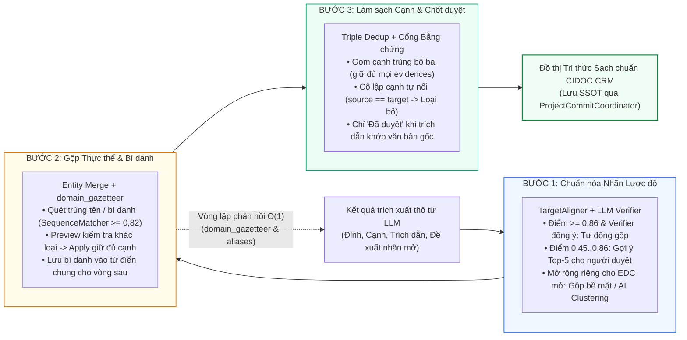
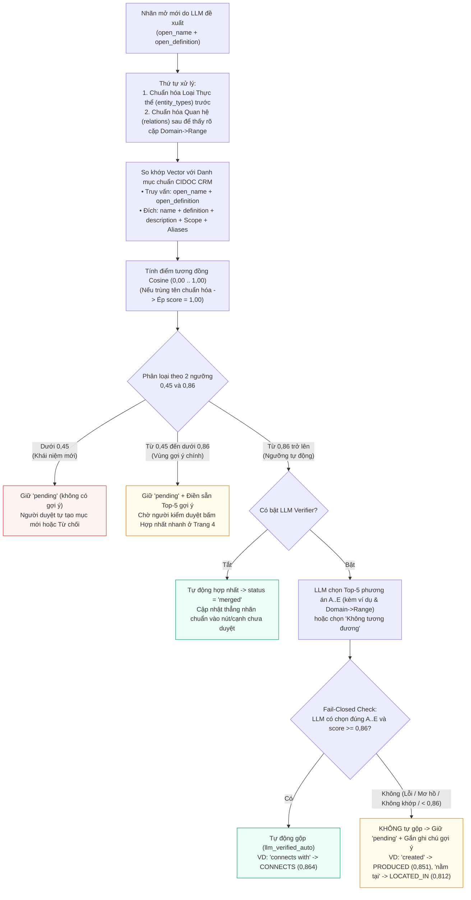
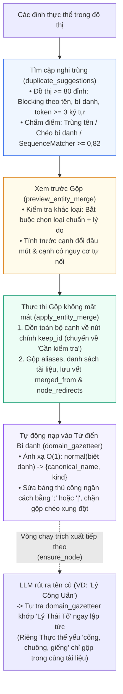
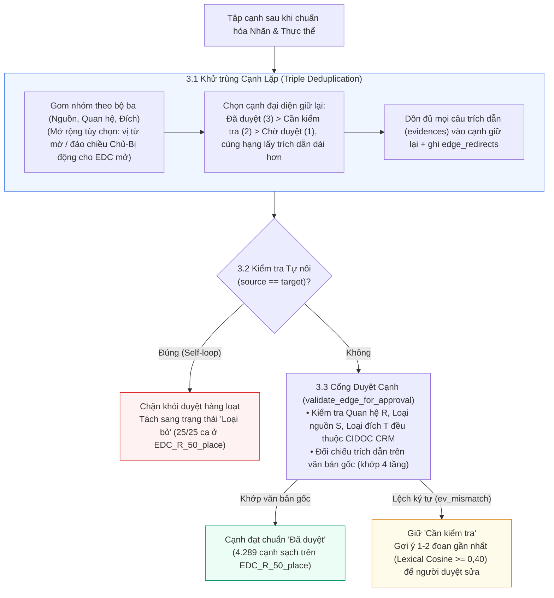

# Bộ Sơ Đồ Tinh Gọn Quy Trình Kiểm Duyệt Tri Thức 3 Bước (KG Studio)

> Tệp này chứa **4 sơ đồ Mermaid tinh gọn** theo đúng **Quy trình Kiểm duyệt 3 Bước Tuyến tính** (khớp 1–1 với 4 khung chừa sẵn trong [Bao_Cao_Cong_Cu_Kiem_Duyet_KG_Studio.docx](Bao_Cao_Cong_Cu_Kiem_Duyet_KG_Studio.docx)).  
> **Cách sử dụng:** Mở từng khối ```mermaid``` bằng [Mermaid Live Editor](https://mermaid.live/) hoặc tiện ích Mermaid trong VS Code, xuất ảnh PNG/SVG rồi dán vào đúng khung `[KHUNG CHỪA SẴN ĐỂ CHÈN SƠ ĐỒ X.1]` trong tệp Word.

---

## Sơ đồ 1.1 — Kiến trúc Quy trình Kiểm duyệt 3 Bước Tuyến tính (Luồng chính EDC+R)

- **Vị trí trong Word:** `Mục 1 — Tổng quan Quy trình Kiểm duyệt 3 Bước trên KG Studio` (Chèn vào `Hình 1.1`).
- **Nội dung thể hiện:** Đường đi thẳng, không chồng chéo từ kết quả trích xuất LLM qua 3 bước nối tiếp nhau để cho ra Đồ thị Tri thức sạch chuẩn `CIDOC CRM`, cùng vòng phản hồi từ điển bí danh về lần trích xuất sau.



---

## Sơ đồ 2.1 — Bước 1: Cơ chế Chấm điểm & Gợi ý Mục đích gần nhất (`TargetAligner`)

- **Vị trí trong Word:** `Mục 2 — Bước 1: Chuẩn hóa Nhãn Lược đồ (Target Alignment & LLM Verifier)` (Chèn vào `Hình 2.1`).
- **Nội dung thể hiện:** Cách `TargetAligner` tính điểm giữa nhãn mở LLM trả ra với danh mục chuẩn `CIDOC CRM`, lý do chạy `entity_types` trước `relations`, phân vùng 3 ngưỡng (`0,45` và `0,86`) và cơ chế an toàn `Fail-Closed` của `LLM Verifier`.



---

## Sơ đồ 3.1 — Bước 2: Gộp Thực thể trùng & Vòng lặp Từ điển Bí danh (`domain_gazetteer`)

- **Vị trí trong Word:** `Mục 3 — Bước 2: Gộp Thực thể trùng lặp & Cơ chế Bí danh` (Chèn vào `Hình 3.1`).
- **Nội dung thể hiện:** Cơ chế gom nhóm ứng viên nhanh (Blocking), chấm điểm tương đồng (`SequenceMatcher >= 0,82`), quy trình an toàn `Preview -> Apply`, lưu vết `node_redirects` và phản hồi trực tiếp sang từ điển `domain_gazetteer` cho lần trích xuất tiếp theo.



---

## Sơ đồ 4.1 — Bước 3: Khử Cạnh Lặp, Cô lập Tự nối & Chốt duyệt Bằng chứng

- **Vị trí trong Word:** `Mục 4 — Bước 3: Làm sạch Cạnh & Chốt duyệt Bằng chứng` (Chèn vào `Hình 4.1`).
- **Nội dung thể hiện:** Ba bước lọc sạch cạnh tuyến tính sau khi nhãn và thực thể đã chuẩn: (1) Gom nhóm cạnh trùng bộ ba bảo toàn mọi trích dẫn, (2) Cô lập cạnh tự nối (`source == target`), và (3) Chỉ chuyển sang `Đã duyệt` khi đủ điều kiện lược đồ và bằng chứng khớp văn bản gốc.


