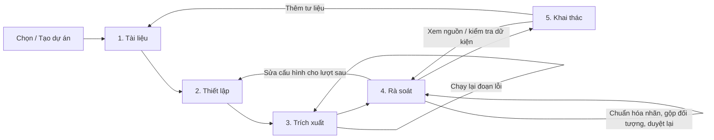

# Đề xuất bố cục và luồng sử dụng KG Studio

- Ngày rà soát: 30/10/2026.
- Căn cứ: [structure.md](../structure.md), `frontend/app.py`, các trang được import thực tế, các component cấu hình và kiểm duyệt.
- Liên quan: [Tối ưu hiệu năng](performance-optimization.md), [Thiết kế duyệt EDC](../features/edc-bulk-review.md), [Thiết kế kiểm duyệt và gộp thực thể](../features/curation-merge.md).
- Phạm vi: phân tích luồng và bố cục từ mã nguồn hiện tại. Chưa kiểm tra ảnh chụp từng kích thước màn hình hoặc thử nghiệm với người dùng; các nhận định về mức độ khó dùng là đánh giá thiết kế cần kiểm chứng.
- Trạng thái: đề xuất; chưa thay đổi mã nguồn hoặc giao diện.

## 1. Nhận định chính

Ứng dụng có nhiều chức năng cần thiết, nhưng người dùng đang phải tự hiểu quan hệ giữa các chức năng để hoàn thành công việc. Số thứ tự 1–5 chưa đủ tạo pipeline: còn thiếu trạng thái đầu vào/đầu ra của từng bước, việc tiếp theo, điều kiện sẵn sàng và đường xử lý khi một bước có lỗi.

Nên tổ chức trải nghiệm quanh mục tiêu **biến tài liệu thành dữ kiện có bằng chứng, đã được kiểm duyệt và có thể sử dụng lại**. Các kỹ thuật EDC, Target Alignment, embedding hoặc ML Lab vẫn được giữ trong khu vực phù hợp, với ngôn ngữ và mức độ hiển thị theo nhu cầu.

Thiết kế đề xuất ưu tiên ba nhóm:

- Người mới: tạo dự án, tải tài liệu, dùng cấu hình gợi ý, chạy thử, duyệt và tải dữ liệu.
- Giảng viên/người nghiên cứu: đối chiếu nguồn, sửa dữ kiện, chuẩn hóa thuật ngữ, gộp đối tượng và truy xuất dữ liệu có nguồn gốc.
- Người chuyên môn kỹ thuật: chỉnh prompt, catalog, mô hình, tham số và xem trace/huấn luyện mà không làm luồng chính quá nặng.

## 2. Những vấn đề cụ thể của bố cục hiện tại

| Hiện trạng theo mã nguồn | Khó khăn có thể tạo ra | Đề xuất |
| --- | --- | --- |
| Điều hướng ngang gồm các nhãn dài như “Danh mục, EDC+R & ML Lab” | Người mới cần hiểu tên kỹ thuật trước khi biết cần làm gì | Đổi thành tên công việc ngắn, có trạng thái từng bước |
| Sidebar chứa chọn/tạo dự án, provider, model, URL, API key, hai slider token và nhiều nút | Cấu hình luôn cạnh tranh với nội dung đang làm; dễ tưởng mọi tham số đều cần chỉnh | Sidebar dành cho dự án và tiến trình; cấu hình kết nối có một nơi chính |
| Token settings có cả ở sidebar và trang trích xuất, với các widget key riêng | Khó nhận biết giá trị nào đã lưu, đang áp dụng hoặc bị thay đổi bởi một widget khác | Một nguồn cấu hình đang áp dụng; trang chạy chỉ hiển thị summary và liên kết chỉnh |
| Trang 1 trộn tổng quan dự án với upload và bảng tài liệu | Dự án mới và dự án đang làm dở cần hai hành động khác nhau nhưng cùng bố cục | Có thẻ “Tiếp tục công việc” và trạng thái rỗng theo dự án |
| Trang 2 đặt chế độ, prompt mở, tham số EDC+R, ML Lab, hai bảng catalog và prompt cố định trong một luồng dọc | Nhiều điểm lưu riêng; khó biết phần nào liên quan chế độ hiện tại. ML Lab đã thu gọn nhưng vẫn thuộc cùng trang cấu hình nghiệp vụ | Một bước thiết lập với cơ bản/nâng cao; prompt theo chế độ; ML Lab là công cụ riêng |
| Hai catalog ba cột đặt cạnh nhau | Mô tả/định nghĩa dài phải đọc trong nửa chiều ngang | Một bảng toàn chiều ngang tại một thời điểm: Loại đối tượng / Loại quan hệ |
| Trích xuất có bảng chọn tài liệu, tham số, tiến độ và trace trên cùng trang | Sau chạy người dùng chưa có điểm chuyển rõ từ “đã chạy” sang “xem và duyệt kết quả” | Tách trạng thái Chuẩn bị / Đang chạy / Kết quả, có hành động tiếp theo |
| Vòng trích xuất có thể báo lỗi từng chunk rồi vẫn có thông báo thành công chung | Dễ hiểu nhầm rằng toàn bộ tài liệu đã trích xuất thành công | Kết quả ghi rõ thành công một phần, số đoạn lỗi và nút chạy lại phần lỗi |
| Hub có điều hướng chính, radio ba phân khu, submode thực thể và tab hành động chi tiết | Người dùng phải giữ nhiều lớp ngữ cảnh; dữ kiện có thể nằm xa nút xử lý | Một hàng đợi rà soát với các góc nhìn rõ, chi tiết mở ngay cạnh dòng |
| Bảng cạnh mở sẵn khoảng tám bộ lọc trước dữ liệu | Bộ lọc chiếm vùng nhìn đầu tiên, khó thấy mục đang cần xử lý | Một hàng tìm kiếm và hai bộ lọc chính; lọc khác mở theo nhu cầu |
| Các hàng số liệu gồm lược đồ chờ, quan hệ chờ, cần kiểm tra, vướng danh mục, nghi trùng | Các nhóm có thể giao nhau; không chỉ ra mục nào nên làm trước | Thẻ hành động theo vấn đề, ghi số lượng và phạm vi, không cộng thành tổng giả |
| Tách khu vực schema và dữ kiện nhưng người dùng phải chuyển qua lại | Một cạnh chưa duyệt được nhưng phải tìm hiểu đề xuất nào đang chặn nó | Nút xử lý nguyên nhân tại ngữ cảnh và quay lại đúng cạnh |
| Trang cuối đặt đồ thị, tải file và form Neo4j cùng cấp | Người chỉ muốn CSV/JSON vẫn gặp cấu hình database | Khai thác đồ thị là chính, Xuất dữ liệu và Kết nối CSDL là tác vụ riêng |
| Thông báo “Toàn vẹn đồ thị hợp lệ 100%” | Dễ bị hiểu là mọi dữ kiện đều đúng về nội dung | Ghi đúng phạm vi: “Không phát hiện lỗi cấu trúc trong các kiểm tra hiện có” |

Các nguyên tắc hỗ trợ đánh giá này gồm hiển thị trạng thái, ngôn ngữ gần người dùng, nhất quán và giảm gánh nặng ghi nhớ; xem [NN/g — Usability Heuristics](https://www.nngroup.com/articles/ten-usability-heuristics/). Đây là cơ sở thiết kế, chưa phải bằng chứng thử nghiệm trên người dùng KG Studio.

## 3. Luồng công việc đề xuất

**Tài liệu → Thiết lập → Trích xuất → Rà soát → Khai thác**

Chọn hoặc tạo dự án là điểm vào workspace. Sau đó mỗi bước có mục tiêu, trạng thái và một hành động chính. Bước đã có cấu hình hợp lệ được dùng lại, không bắt người dùng làm lại mỗi lần thêm tài liệu.



Đây là pipeline có vòng lặp. Không khóa toàn bộ người dùng vào một wizard một chiều. Có thể vào xem bước sau bất kỳ lúc nào; chỉ khóa **hành động** thiếu điều kiện và nêu rõ lý do. Người có kinh nghiệm được chuyển trực tiếp tới danh mục, dữ kiện hoặc đối tượng.

Không bắt duyệt hết mọi đề xuất trong dự án trước khi duyệt một cạnh hợp lệ. Không bắt gộp hết mọi cặp nghi trùng trước khi xuất phần dữ kiện đã duyệt.

## 4. Khung bố cục chung

```text
┌───────────────────────────────────────────────────────────────────────┐
│ KG Studio   Dự án: Nghiên cứu A   Đã lưu • mô hình X   [Cài đặt]       │
├─────────────────┬─────────────────────────────────────────────────────┤
│ QUY TRÌNH       │ 4. Rà soát                                        │
│ 1. Tài liệu  ✓  │ 12 dữ kiện cần kiểm tra • 3 đang vướng danh mục      │
│ 2. Thiết lập ✓  │ [Xử lý 3 mục vướng danh mục]                          │
│ 3. Trích xuất ! ├─────────────────────────────────────────────────────┤
│ 4. Rà soát   ●  │ [Dữ kiện] [Thuật ngữ & loại] [Đối tượng]             │
│ 5. Khai thác    │ Tìm kiếm… | Trạng thái | Tài liệu | Bộ lọc khác      │
│                 ├──────────────────────────────┬──────────────────────┤
│ CÔNG CỤ         │ Danh sách / hàng đợi         │ Chi tiết & nguồn     │
│ Lịch sử         │ A — quan hệ → B              │ Văn bản gốc          │
│ Thiết lập nâng  │ C — quan hệ → D              │ Trích dẫn tô sáng    │
│ cao / ML Lab    │ …                            │ [Duyệt] [Kiểm tra]   │
│                 ├──────────────────────────────┴──────────────────────┤
│                 │ Đã chọn 3  [Xem trước xử lý 3 mục]                   │
└─────────────────┴─────────────────────────────────────────────────────┘
```

Đây là wireframe minh họa, không quy định mọi màn hình đều chia hai cột. Trên laptop hẹp, chi tiết có thể mở thành màn hình riêng với nút quay lại danh sách giữ nguyên ngữ cảnh.

### Quy tắc bố cục

- Dùng một điều hướng chính ở sidebar; bỏ thanh điều hướng ngang trùng chức năng nếu đã chuyển sang sidebar.
- Header chỉ chứa tên dự án, trạng thái lưu, cấu hình đang áp dụng dạng tóm tắt và lối vào cài đặt. Chọn/tạo dự án tại một vị trí nhất quán.
- Đầu mỗi bước trả lời ba câu: đang làm gì, còn thiếu gì, thao tác tiếp theo là gì.
- Mỗi vùng thao tác có một nút chính nổi bật. Trong hàng đợi xử lý một dòng, nút Duyệt của dòng là hành động chính; khi bật chế độ chọn nhiều, thanh lô là hành động chính.
- Tên ngắn, hạn chế emoji lặp; trạng thái luôn có chữ, không chỉ màu hoặc icon.
- Khoảng cách, form, thanh bộ lọc, nút Lưu/Hủy và vị trí thông báo dùng cùng quy ước trên mọi trang.
- Tránh popup cho việc đọc thông thường. Dùng xác nhận cụ thể cho ghi đè danh mục, gộp có ảnh hưởng và khôi phục snapshot; preview đã đầy đủ không cần thêm một hộp xác nhận chung nữa.

## 5. Trạng thái pipeline phải phản ánh dữ liệu

| Bước | Các trạng thái có thể hiển thị | Hành động gợi ý |
| --- | --- | --- |
| Tài liệu | Chưa có / Có tài liệu hợp lệ / Có tài liệu cần kiểm tra | Thêm tài liệu hoặc xem lỗi đọc |
| Thiết lập | Chưa sẵn sàng / Sẵn sàng / Có thay đổi chưa lưu | Chọn kết nối, lưu hoặc kiểm tra cấu hình |
| Trích xuất | Chưa chạy / Đang chạy / Một phần thất bại / Đã xử lý tập chọn | Chạy thử, tiếp tục hoặc chạy lại phần lỗi |
| Rà soát | Chưa có dữ kiện / Còn mục cần xử lý / Có dữ kiện đã duyệt | Xử lý vấn đề cụ thể hoặc xem phần đã duyệt |
| Khai thác | Chưa có dữ kiện đã duyệt / Có dữ liệu sử dụng được / Tệp xuất đã cũ | Đi rà soát hoặc xem/xuất phần đã duyệt |

Tách ba khái niệm: **điều kiện sẵn sàng**, **tiến độ job**, **tình trạng dữ liệu**. Chúng không dùng chung một dấu hoàn tất giả.

- “12/15 đoạn thành công” là tiến độ chạy của một job, không phải 80% độ đúng tri thức.
- “8/20 cạnh đã duyệt” là tiến độ kiểm duyệt trong phạm vi cụ thể, không phải 40% chất lượng toàn dự án.
- Đổi mô hình/prompt không xóa trạng thái kết quả cũ hoặc tự chạy lại. Ghi rõ thay đổi áp dụng cho lượt chạy tiếp theo; mỗi job gắn cấu hình đã chốt.
- Thêm tài liệu làm xuất hiện việc mới, không biến mọi bước cũ thành chưa làm.

## 6. Thiết kế từng bước

### 6.1. Tài liệu

**Mục tiêu:** biết hệ thống sẽ đọc những nguồn nào và có đọc được không.

- Dự án mới hiển thị vùng thả tệp, định dạng hỗ trợ và nút “Thêm tài liệu”. Các ô nguồn/phạm vi nằm trong “Thông tin nguồn” tùy chọn.
- Sau upload, bảng gọn: tên, trạng thái đọc, số trang/ký tự, tình trạng đã trích xuất. ID ở chi tiết.
- Chọn một tài liệu để xem phần văn bản đã đọc; PDF thiếu lớp text có hướng xử lý rõ thay vì để người dùng chờ đến lúc trích xuất thất bại.
- Nút tiếp theo: **“Thiết lập trích xuất”** hoặc **“Trích xuất tài liệu mới”** nếu cấu hình đã sẵn sàng.
- Dự án đang làm dở có thẻ “Tiếp tục”: còn 3 đoạn lỗi hoặc 12 dữ kiện chưa duyệt, dẫn đúng nơi; thống kê tổng quan là thông tin hỗ trợ.

### 6.2. Thiết lập

**Mục tiêu:** chọn cách trích xuất phù hợp mà không phải biết toàn bộ thuật toán.

Ba vùng thông tin:

1. **Kết nối mô hình:** tên kết nối/model, trạng thái, kiểm tra kết nối. URL/key nằm trong form sửa kết nối, không xuất hiện trên mọi màn hình.
2. **Cách trích xuất:** thẻ lựa chọn ngắn, giải thích kết quả và khi dùng; cấu hình hiện có được giữ nguyên nếu người dùng chưa đổi.
3. **Thông tin chuyên môn:** catalog đang dùng và lối vào chỉnh sửa; có thể dùng bộ mẫu phù hợp miền hoặc nhập bộ của người dùng.

| Nhãn giao diện đề xuất | Chế độ kỹ thuật | Giải thích ngắn |
| --- | --- | --- |
| Tự đề xuất từ tài liệu | EDC | Cho phép gợi ý loại/quan hệ mới để người dùng duyệt |
| Tham khảo danh mục có sẵn | EDC+R | Gợi ý thuật ngữ phù hợp từ catalog, vẫn có thể đề xuất mới |
| Chỉ dùng danh mục đã chọn | Closed | Chỉ chấp nhận loại/quan hệ trong danh mục |

Chính sách tự hợp nhất và ngưỡng không được âm thầm thay đổi theo nhãn đơn giản. Ghi rõ đang dùng gợi ý, xác thực hay tự hợp nhất; người dùng chủ động lưu lựa chọn.

Phần **Nâng cao** chứa prompt đúng chế độ, token, kích thước đoạn, overlap, Top-K, ngưỡng và refinement. Người chuyên có thể ghim phần này; chế độ xem đơn giản/chuyên sâu chỉ đổi cách hiển thị, không đổi thuật toán hoặc dữ liệu.

- Hai catalog chuyển thành hai góc nhìn của một editor toàn chiều ngang, giữ đúng `name`, `description`, `definition`.
- Nhập JSON mở preview: thêm bao nhiêu, cập nhật bao nhiêu, tên nào xung đột; ghi đè phải chỉ rõ phạm vi ảnh hưởng.
- Mỗi form có Lưu/Hủy và trạng thái chưa lưu. Tách kết nối cá nhân, cấu hình dự án và mặc định ứng dụng; tên nút ghi đúng phạm vi lưu, không dùng chung “Lưu default” mơ hồ.
- ML Lab nằm trong Công cụ chuyên sâu; không là điều kiện để chạy trích xuất.

Việc để tính năng nâng cao xuất hiện khi cần phù hợp với [NN/g — Progressive Disclosure](https://www.nngroup.com/articles/progressive-disclosure/). Những điều kiện ảnh hưởng kết quả, chi phí hoặc tự động hợp nhất vẫn phải được tóm tắt trong cấu hình đang áp dụng.

### 6.3. Trích xuất

**Mục tiêu:** chạy đúng phạm vi, nhìn thấy tiến độ, biết kết quả và cách xử lý lỗi.

- Trạng thái **Chuẩn bị**: chọn tài liệu, hiển thị số đoạn thực tế và cấu hình tóm tắt. Có hai thao tác rõ: “Chạy thử một phần” và “Trích xuất phần đã chọn”; không mặc định coi chạy toàn bộ là lựa chọn duy nhất.
- Trước chạy chỉ kiểm tra điều kiện thật: tài liệu có text, model được cấu hình, thông số hợp lệ. Kiểm tra kết nối thành công không đồng nghĩa trích xuất JSON chắc chắn thành công.
- Trạng thái **Đang chạy**: tài liệu/đoạn hiện tại, số thành công/lỗi, thời gian đã chạy. Nút dừng sau đoạn hiện tại/tiếp tục chỉ hiển thị khi backend hỗ trợ checkpoint/cancel thực sự.
- Trạng thái **Kết quả**: số đoạn thành công/thất bại, số node/cạnh/proposal được tạo, nút **“Rà soát kết quả vừa tạo”** với filter theo run/job.
- Lỗi hiển thị “3 đoạn chưa xử lý được — Xem và chạy lại”; nhóm theo lý do và giữ kết quả thành công. Raw JSON/trace nằm trong chẩn đoán của mục lỗi hoặc lịch sử job.
- Chạy lại phải chọn rõ phần lỗi/chưa chạy hoặc tạo lần chạy mới; không vô tình trích xuất lại toàn bộ tài liệu và tạo dữ kiện trùng.

Không hiển thị ước tính thời gian/chi phí như số chắc chắn khi chưa có dữ liệu đo hoặc đơn giá phù hợp. Số liệu ước tính phải có nhãn và cơ sở.

### 6.4. Rà soát

**Mục tiêu:** có một nơi quyết định dữ liệu nào đủ tin cậy để sử dụng.

Giữ ý tưởng Hub hợp nhất hiện có, nhưng tổ chức quanh các mục cần xử lý và giảm tầng điều hướng:

- Ba góc nhìn cùng cấp: **Dữ kiện**, **Thuật ngữ & loại**, **Đối tượng**.
- Mặc định sau trích xuất mở kết quả của lượt vừa chạy, không toàn bộ lịch sử dự án.
- Hàng vấn đề phía trên: vướng danh mục, thiếu/không rõ bằng chứng, cần duyệt, nghi trùng. Bấm một thẻ mở đúng danh sách, không chỉ đổi số metric.
- Mặc định bảng chỉ có tìm kiếm, trạng thái và tài liệu; nhãn quan hệ, loại, nguồn/đích, phương thức evidence và sort chuyên sâu ở “Bộ lọc khác”.
- Chi tiết xuất hiện bên cạnh hoặc trang riêng có quay lại; thanh hành động nằm gần dữ kiện/bằng chứng, không buộc cuộn qua bảng dài và lịch sử để tìm nút.

**Dữ kiện:** danh sách và vùng nguồn đối chiếu; Duyệt, Cần kiểm tra, Loại bỏ. Sửa mở form riêng. “Duyệt và xem mục tiếp theo” giảm lặp; giữ filter và thứ tự. Trích dẫn có trong tài liệu không được trình bày là bằng chứng hệ thống đã xác nhận nội dung đúng.

**Thuật ngữ & loại:** hai bảng độc lập cho loại thực thể và loại quan hệ theo plan EDC; vẫn phân biệt schema với dữ kiện. Giữ trạng thái chọn và preview riêng từng bảng. Các nhãn ngắn; người mới có thể xem giải thích và ví dụ.

**Đối tượng:** bảng hồ sơ cụ thể; chọn từ hai node trở lên để mở bàn gộp trong cùng góc nhìn. Bàn gộp là một thao tác có ba bước, không thêm một tầng radio thường trực cho mọi người:

`Đối chiếu → Chọn hồ sơ giữ lại → Xem trước và gộp`.

**Xử lý tại ngữ cảnh:** cạnh vướng schema có nút “Xử lý 2 thuật ngữ liên quan”. Có thể mở danh sách đã lọc hoặc panel nhỏ; sau commit trở về đúng cạnh và kiểm tra lại. Mẫu EDC nhiều mục vẫn mở workspace schema đầy đủ.

**Thao tác lô:** checkbox cho chọn một/nhiều/trang/tất cả kết quả lọc; thanh tác vụ chỉ hiện khi có lựa chọn, ghi rõ số lượng/phạm vi. Preview hiển thị hợp lệ/lỗi; áp dụng một phần là lựa chọn rõ ràng. Mở chi tiết không tự tick hoặc duyệt.

**Lịch sử:** link ở chi tiết và lối vào lịch sử dự án chung; không lặp bảng lịch sử lớn ở cuối mọi phân khu. Khôi phục snapshot phải báo phạm vi toàn dự án và các thay đổi về sau bị ảnh hưởng.

### 6.5. Khai thác

**Mục tiêu:** tìm, hiểu và lấy dữ liệu đã duyệt để phục vụ công việc.

- Mặc định hiển thị phần đã duyệt, số dữ kiện sử dụng được và số mục chưa duyệt bị loại khỏi phạm vi.
- Duyệt bằng bảng hoặc đồ thị; tìm theo đối tượng và mở các quan hệ lân cận. Mỗi cạnh mở được bằng chứng và hồ sơ nguồn.
- Nếu chỉ vẽ một tập con do giới hạn hiệu năng, ghi rõ “Đang hiển thị 60/420 quan hệ phù hợp”, không để người dùng tưởng thiếu dữ liệu.
- **Xuất dữ liệu** cho chọn JSON/CSV và phạm vi; **Sao lưu dự án** là tác vụ riêng; **Kết nối CSDL/Neo4j** nằm trong tích hợp chuyên sâu.
- File đã chuẩn bị phải gắn revision và phạm vi; dữ liệu đổi thì đánh dấu tệp cũ và cung cấp “Tạo lại”. Không chỉ cache theo project ID rồi tải nhầm bản cũ.
- Cho xuất phần hợp lệ khi còn mục chờ, kèm thông tin phạm vi. Không gắn nhãn hoàn tất toàn dự án khi chỉ xuất tập con.

Tìm kiếm đồ thị theo từ khóa/hàng xóm là nâng cấp chức năng riêng nếu chưa có query backend; bố cục cần dành chỗ nhưng không mô tả chúng như đã triển khai.

## 7. Ngôn ngữ, phản hồi và khả năng tiếp cận

| Nhãn kỹ thuật hiện tại | Nhãn chính đề xuất | Chi tiết giữ lại khi cần |
| --- | --- | --- |
| Schema EDC | Thuật ngữ & loại cần duyệt | Loại thực thể / Loại quan hệ; EDC |
| Instance / node | Đối tượng | ID node và loại |
| Edge | Dữ kiện / Quan hệ cụ thể | Bộ ba nguồn–quan hệ–đích |
| Target Alignment | Đối chiếu với danh mục | Cách gợi ý/xác thực và điểm tương đồng |
| Step Traces | Chi tiết xử lý | Các bước, thời gian, tokens và phản hồi gốc |
| `finish_reason=length` | Phản hồi bị dừng do chạm giới hạn đầu ra | Mã lỗi và chi tiết kỹ thuật |
| Sync pending | Đã lưu, đang chờ đồng bộ chỉ mục | JSON commit thành công, SQLite cần đồng bộ lại |

Không dịch “loại thực thể” thành “thực thể” rồi trộn loại với đối tượng cụ thể. Thuật ngữ chuyên môn có thể xuất hiện trong trợ giúp, nhưng nút cần nói rõ hành động và hậu quả.

- Thông báo thành công còn đọc được sau rerun, có liên kết đến kết quả. Lỗi là vấn đề kèm hướng xử lý, không chỉ stack trace hoặc câu “Kiểm tra cấu hình”.
- Nội dung đang chờ/đang chạy/đã lưu/lỗi phải phân biệt. Sau thay đổi không tự đưa focus về đầu trang hoặc reset panel.
- Form có label rõ, thứ tự bàn phím hợp lý, trạng thái focus nhìn thấy được. Màu và emoji chỉ hỗ trợ chữ.
- Trên viewport hẹp, ưu tiên một cột và mở chi tiết có nút quay lại; tránh nhiều cột form nhỏ và thanh ngang quá dài.
- Khi triển khai status message, kiểm tra khả năng thông báo với công nghệ hỗ trợ mà không giật focus; tham khảo [W3C — Status Messages](https://www.w3.org/WAI/WCAG22/Understanding/status-messages.html). Đây không phải tuyên bố ứng dụng đã đạt WCAG.

## 8. Điều hướng và state cần thống nhất

Đặt một nơi quản lý route: `project_id`, `step`, `view`, `focused_id`, filter/cursor, return context và draft. Dùng ID route ổn định như `documents`, `setup`, `extraction`, `review`, `explore`; nhãn tiếng Việt có thể đổi mà không làm mất state.

- Đổi bước không mất bản nháp âm thầm. Có lựa chọn Lưu, giữ nháp hoặc bỏ thay đổi phù hợp hành động; không hỏi lại khi chỉ mở xem.
- Thay filter tuân thủ quy tắc lựa chọn đã thống nhất trong plan EDC/curation; báo các mục bị bỏ chọn.
- Sau commit cập nhật revision, counters và readiness; giữ đúng góc nhìn, đối tượng và vị trí hợp lý.
- Link quay lại lưu cả filter, trang, đối tượng và job; không chỉ tên trang.
- Phân biệt trạng thái “đã kiểm tra kết nối” với cấu hình đang được dùng. Đổi provider/model/key làm kết quả kiểm tra cũ không còn đại diện kết nối mới.
- Không đưa key, raw response, full documents hoặc toàn đồ thị vào URL/state điều hướng. UI dùng query DTO và lazy loading theo báo cáo hiệu năng.

`PipelineSummaryDTO` đề xuất gồm readiness từng bước, job mới nhất, số việc cần làm, phạm vi/revision và next action. Backend tính điều kiện nghiệp vụ; UI không suy luận “hoàn tất” chỉ từ việc từng mở trang.

## 9. Lộ trình triển khai phù hợp

| Đợt | Việc thực hiện | Kết quả cần nhìn thấy |
| --- | --- | --- |
| 1 — Định hướng | Shell/sidebar mới, tên 5 bước, trạng thái, next action, kết nối và token một nơi | Người mới biết bắt đầu và tiếp tục ở đâu |
| 2 — Thiết lập và chạy | Cơ bản/nâng cao, prompt theo mode, catalog toàn chiều ngang, job prepare/run/result | Không phải hiểu EDC/ML Lab để chạy thử; kết quả thành công một phần rõ |
| 3 — Rà soát | Hàng đợi, bộ lọc gọn, list-detail, xử lý schema tại ngữ cảnh, gộp trong góc nhìn đối tượng | Ít chuyển tầng, giữ nguồn và phạm vi thao tác |
| 4 — Khai thác và hoàn thiện | Xem dữ liệu, export theo phạm vi/revision, tích hợp riêng, kiểm tra viewport và bàn phím | Từ dữ kiện tới sản phẩm đầu ra rõ ràng |

Thực hiện cùng hướng tối ưu query/metadata trong [báo cáo hiệu năng](performance-optimization.md). Đợt UI không nên đợi toàn bộ migration storage, nhưng cũng không tạo thêm tổng quan quét toàn đồ thị hoặc panel ẩn vẫn tải mọi log.

File/module chính cần thay khi triển khai: `frontend/app.py`, `frontend/state/session.py`, `frontend/pages/p01_projects_docs.py`, `p02_catalogs_prompts.py`, `p03_extraction.py`, `p04_curation_hub.py`, `p06_graph_export.py`, các table/detail/merge component, `FrontendClient` và query/facade cho pipeline summary. `p04_edc_alignment.py` và `p05_curation_merge.py` hiện là wrapper tương thích, không nên thiết kế lại như hai màn hình độc lập đang hoạt động.

Đưa phần shell/header/step navigation và thông báo vào component dùng chung. Không giải quyết bằng thêm CSS riêng cho từng trang hoặc dựng thêm nhiều nhóm tab lồng nhau.

## 10. Kịch bản nghiệm thu trải nghiệm

1. **Người mới:** tạo dự án → tải một DOCX → xem text → chọn kết nối/chế độ → chạy thử → biết kết quả → duyệt một dữ kiện → tải JSON; không cần mở token, prompt hoặc ML Lab.
2. **Job lỗi một phần:** biết chính xác đoạn nào lỗi, giữ phần thành công, chạy lại đúng phần lỗi, không được thông báo toàn bộ thành công.
3. **Dữ kiện vướng schema:** từ cạnh mở đúng các đề xuất liên quan, duyệt/hợp nhất rồi trở lại đúng cạnh, không mất filter hoặc nhầm duyệt luôn cạnh.
4. **Gộp đối tượng:** chọn hai node trong bảng, so sánh, xem cạnh ảnh hưởng rồi áp dụng; các cạnh đổi ý nghĩa được đưa kiểm tra lại.
5. **Dự án đang làm dở:** mở lại có đề xuất “Tiếp tục rà soát”, vào đúng phạm vi, không buộc tải lại tài liệu/cấu hình.
6. **Người chuyên:** mở nâng cao, sửa prompt và lưu đúng scope; cấu hình áp dụng cho lần chạy mới được nhận biết, không làm đổi trace lịch sử.
7. **Xuất phần đã duyệt:** biết phần nào bị loại, giới hạn hình vẽ khác phạm vi file; thay đổi dữ liệu làm file chuẩn bị cũ được đánh dấu.
8. **Viewport và bàn phím:** thử laptop 1366×768, màn hình rộng và layout hẹp; không mất nút chính, không phải cuộn ngang form, focus không nhảy sau mỗi quyết định.

Đo với khoảng 5–8 người đại diện nhóm không chuyên/chuyên trong vòng thử đầu: tỷ lệ hoàn thành, thời gian tới dữ kiện đầu tiên được duyệt, số lần cần trợ giúp, số lần chuyển sai bước và lỗi thao tác. Cỡ mẫu này dùng tìm vấn đề ban đầu, không đủ để tuyên bố phổ quát về mọi nhóm người dùng.

Các mục tiêu thiết kế ban đầu: luôn xác định được bước hiện tại và hành động tiếp theo; không cần cấu hình một tham số ở hai nơi; thao tác duyệt không reset điều hướng; nội dung/ngữ cảnh và quyết định nằm gần nhau. Chỉ công bố mức cải thiện thời gian hoặc số click sau khi có đo trước/sau.

## 11. Đề xuất ưu tiên

Ưu tiên ngay **khung pipeline + next action + cấu hình một nơi + kết quả chạy rõ ràng**. Sau đó hoàn thiện workspace rà soát và khai thác. Thay màu sắc, icon hoặc khoảng cách riêng lẻ chưa đủ sửa nguyên nhân khiến người dùng phải tự ghép quy trình hiện nay.
