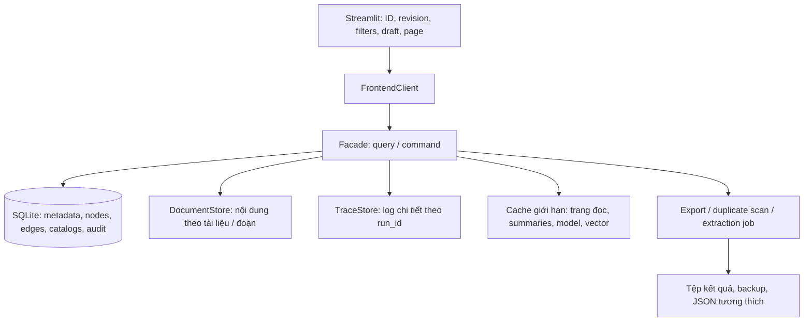

# Hướng dẫn tối ưu hiệu năng và bộ nhớ KG Studio

- Ngày rà soát: **30/10/2026**.
- Đối tượng: AI Agent/kỹ sư tiếp nhận triển khai.
- Căn cứ: [structure.md](../structure.md), mã nguồn frontend/backend và kích thước tệp tại thời điểm rà soát.
- Trạng thái: **Đề xuất và chỉ dẫn triển khai; chưa sửa mã nguồn ứng dụng, chưa chạy benchmark RAM/độ trễ thực tế.**
- Phạm vi: `D:\DATN\CrawData\KG_Studio`, độc lập về mã nguồn với `KG_Studio_MVP`.

## 1. Kết luận và phương án được đề xuất

Hiện tượng nạp nhiều dữ liệu vào RAM có cơ sở từ mã nguồn. Tuy nhiên, việc chậm còn đến từ quét lại dữ liệu, tìm bằng chứng trên toàn văn bản, tìm mọi cặp node và ghi lại toàn bộ dự án. Chỉ thêm cache hoặc đổi thư viện JSON sẽ không xử lý đầy đủ.

Triển khai theo ba chặng có thể kiểm chứng:

1. **Giảm công việc lặp trong kiến trúc hiện tại:** danh sách dự án dùng metadata nhỏ; bỏ tính toán nặng khỏi rerun; chỉ chuẩn bị export khi có yêu cầu; cache có giới hạn và phiên bản đúng.
2. **Tách đường đọc:** UI chỉ giữ mã dự án, revision, bộ lọc, lựa chọn và bản nháp; SQLite trả một trang dữ liệu và chi tiết theo ID. Văn bản, trace và lịch sử không nằm trong state giao diện.
3. **Tách đường ghi:** chuyển dữ liệu có cấu trúc sang SQLite làm nguồn chính sau migration; ghi delta bằng transaction. JSON đầy đủ trở thành định dạng trao đổi/backup tương thích, không còn được ghi sau mỗi lần duyệt cạnh.

**Không đổi vai trò JSON/SQLite ngay trong chặng 1.** Kiến trúc hiện tại coi JSON là nguồn chính và SQLite là bản chỉ mục. Chặng 2 vẫn phải đối chiếu phiên bản chỉ mục; chặng 3 là thay đổi kiến trúc có migration, cutover và kiểm thử phục hồi riêng.

## 2. Các phát hiện đã xác minh

### 2.1. Dung lượng trên đĩa, không phải số RAM đã đo

| Dữ liệu | Kích thước khi rà soát |
| --- | ---: |
| `data/projects/hanoiqa/project.json` | 9.749.606 byte, khoảng 9,30 MiB |
| `data/projects/hanoiqav2/project.json` | 896.550 byte, khoảng 0,86 MiB |
| `data/projects/hanoiqav3/project.json` | 3.512.782 byte, khoảng 3,35 MiB |
| `data/kg_studio.db` | 20.103.168 byte, khoảng 19,17 MiB |

Dung lượng tệp không bằng bộ nhớ Python: `read_text`, `json.loads`, dict/list, các bản sao và chuỗi serialize cùng tồn tại có thể làm peak memory tăng. Chưa đủ dữ liệu để kết luận máy hiện bị thiếu RAM hoặc quy phần lớn độ trễ cho một hàm cụ thể; cần bước đo ở mục 5.

### 2.2. Các đường thực thi gây tải

| Vị trí cần mở | Hiện trạng xác minh được | Tác động và hướng sửa |
| --- | --- | --- |
| `frontend/state/session.py::ensure_session_state` | Nạp dict dự án đầy đủ vào `st.session_state['project']` khi mở/đổi dự án | Mỗi session giữ toàn bộ tài liệu, đồ thị và logs. Không phải mỗi rerun đều gọi `load_project`, nhưng dữ liệu vẫn thường trú trong RAM |
| `frontend/app.py` → `facade.list_projects()` → `json_repo.list_projects()` | Sidebar gọi danh sách dự án mỗi rerun; `_folder_name_of()` dùng `read_text` và `json.loads` toàn bộ từng `project.json` để lấy tên | Có đường đọc toàn bộ nhiều dự án ngay cả khi chỉ mở một. Thay bằng project registry/manifest nhỏ |
| `json_repo.py::find_folder`, `project_dir` | Tìm tên dự án cũng có thể mở và parse các tệp dự án | Không chỉ `load_project` mới đọc full JSON; phải sửa cả định vị thư mục |
| `facade.py::load_project` | Sau nạp JSON luôn gọi `sync_from_project_dict` | Mở dự án làm serialize và dựng lại SQLite, dù dữ liệu chưa đổi |
| `sqlite_repo.py::sync_from_project_dict` | Serialize toàn bộ dict vào `projects.raw_json`; DELETE rồi INSERT lại toàn bộ nodes/edges/proposals; dựng các list tuple để insert | Một thay đổi nhỏ vẫn phải đi qua dữ liệu toàn dự án; SQLite hiện chưa phải kho đọc/ghi độc lập |
| `json_repo.py::save_project` | `deepcopy` dự án, `scrubbed`, serialize JSON mới; giữ backup bytes và chuỗi journal chứa dữ liệu cũ | Peak RAM và lượng ghi đĩa lớn; snapshot tại facade còn tạo thêm bản serialize |
| `catalogs/service.py::compute_project_revision` | Dựng danh sách node/cạnh/đề xuất và serialize để băm | Không băm toàn bộ document text, nhưng vẫn O(N+E+P) cho nhiều lần gọi. Không thay bằng cache theo địa chỉ dict mutable |
| `curation_table.py::filter_and_sort_edges` | Gọi `evidence_context` và kiểm tra schema cho từng cạnh qua lọc; sort priority gọi lại; dựng dòng bảng tiếp tục gọi | Phân trang xảy ra sau các phép tính nặng. Tăng page size hoặc chỉ cắt list không giải quyết |
| `curation/service.py::evidence_context` | Gọi `find_all_quote_spans` toàn văn bản trước khi chọn span/đoạn đã lưu | Có thông tin vị trí nhưng vẫn tìm toàn tài liệu; lặp trên nhiều cạnh cùng tài liệu |
| `p04_curation_hub.py` → `review_stats` | Tổng quan tính schema cho nhiều cạnh, đếm chunk từ text và gọi `duplicate_suggestions` trước khi phân nhánh phân khu | Mở phân khu schema vẫn có thể chạy việc tìm node trùng |
| `curation/service.py::duplicate_suggestions` | Có cache theo project revision/ngưỡng, xóa khi vượt khoảng 32 entry; cache miss duyệt mọi cặp node; giữ bản sao node cho từng cặp; mỗi lần trả về `deepcopy` toàn bộ cặp | Cache có giới hạn số entry, nhưng chưa có ngân sách byte. Revision không liên quan đến tên cũng gây cache miss; kết quả cặp có thể tăng rất nhanh |
| `curation_table.py::filter_and_sort_entities` | Nếu không truyền tập nghi trùng, tự chạy duplicate suggestions dù bộ lọc nghi trùng có thể chưa bật; tính lại bậc node | Cần chỉ chạy theo yêu cầu và dùng bậc/ứng viên đã tính sẵn |
| `edc_review_table.py::filter_and_sort_proposals` | Tính `proposal_impact` cho mọi đề xuất đã lọc trước khi biết có cần sort theo ảnh hưởng; build dòng/chi tiết tính lại | Có thể thành P lần quét đồ thị. Dùng bảng tham chiếu và số liệu dẫn xuất |
| `p03_extraction.py` | Chia đoạn để đếm cho từng tài liệu, tính lại tổng, rồi tạo `all_tasks` chứa toàn bộ record đoạn trước khi chạy | Tạo nhiều substring/dict không cần cùng tồn tại; thay bằng metadata chunk và iterator/batch |
| `p03_extraction.py` → `save_project` | Lưu toàn dự án sau mỗi chunk | Độ trễ lưu tăng dần theo dự án; tổng chi phí nhiều chunk có thể tăng mạnh ngay cả khi LLM không đổi tốc độ |
| `p06_graph_export.py` và `graph/service.py` | Validate/approved graph nhiều lần; `download_button(data=...)` chuẩn bị JSON và ZIP khi render; ZIP dùng `BytesIO` và serialize bản đầy đủ | Chỉ mở trang xuất cũng tạo dữ liệu xuất trong RAM. Giới hạn 60 cạnh ở Graphviz chỉ giới hạn bước vẽ sau đó |
| `vector_repo.py::ensure_index` | Mỗi truy vấn có thể mở `.npz`, parse item JSON và giải nén ma trận | Cache ma trận nhỏ theo model/catalog; chưa cần đổi vector database |
| `embedder_gateway.py::default_embedder` và các caller | Hàm tạo một `EmbedderGateway` mới; SentenceTransformer được giữ trên từng instance | Nếu chọn backend này, các đường tạo instance mới có thể nạp model lặp. Backend mặc định hybrid không có cùng chi phí model |

### 2.3. Những việc đã có, không nên triển khai lại

- `frontend/app.py` đã dùng radio và `if/elif` để render **một trong năm trang**, không còn render mọi trang bằng một bộ `st.tabs`.
- Curation Hub cũng phân nhánh theo phân khu. Cần sửa phần tổng quan chạy trước nhánh, không quy lỗi cho mọi phân khu luôn được render.
- UI đã có phân trang list, state chọn theo ID, preview/apply, snapshot và cơ chế revision. Tối ưu phải giữ hành vi nghiệp vụ đó.
- Duplicate suggestions đã có cache; yêu cầu là đổi khóa, kích thước dữ liệu cache, giới hạn byte và thuật toán tạo ứng viên.
- `structure.md` có một số ví dụ trạng thái/DTO mang tính mô tả; khi migration lấy hằng ở `shared/constants.py`, DTO và fixture hiện tại làm căn cứ, không tự chuyển trạng thái cạnh tiếng Việt thành enum tiếng Anh.

## 3. Kiến trúc đích



### Được giữ trong session

`project_id`, tên, storage mode, revision, bộ lọc, cursor/page, tập chọn nhỏ hoặc token lựa chọn, ID đang mở, bản nháp và ID preview/job. Một trang DTO nhỏ có thể tồn tại tạm trong một rerun.

### Nạp theo yêu cầu

- Trang node/cạnh/proposal, mặc định 50 dòng, trần 200 dòng do backend áp đặt.
- Hồ sơ một node, chi tiết một cạnh, các quan hệ liên quan có phân trang.
- Ngữ cảnh bằng chứng vài trăm đến vài nghìn ký tự và ứng viên vị trí có phân trang.
- Run summary riêng với raw response, prompt và step trace đầy đủ.
- Tài liệu metadata riêng với text đã trích xuất và bản nguồn nếu có lưu. Không giả định ứng dụng hiện đã lưu bản nhị phân nguồn.

Trong chặng 2, legacy write adapter có thể còn nạp dict đầy đủ **tạm ở backend cho một command**, sau đó giải phóng. Đây chỉ là cầu nối: không đạt mục tiêu bounded memory cho thao tác ghi lớn cho đến khi hoàn tất chặng 3. Không gọi dict thiếu trường là `project` rồi truyền vào hàm cũ: hàm có thể coi dữ liệu chưa nạp là mảng rỗng và ghi mất dữ liệu.

## 4. Các nguyên tắc không được phá vỡ

1. Mọi truy vấn đều scope theo `project_id`; tên và vị trí dòng không phải khóa dữ liệu.
2. Kiểm tra schema, bằng chứng, ngoại lệ và hiệu lực phê duyệt vẫn ở backend. Tối ưu không được biến `evidence_found` cũ thành chứng nhận đủ để xuất.
3. Preview không ghi dữ liệu; apply kiểm tra phiên bản và idempotency. Chọn toàn bộ kết quả phải chốt membership tại một revision, không để dữ liệu mới tự gia nhập.
4. Giữ audit, ID cũ, node redirects, bằng chứng nhiều nguồn, quan sát EDC, lý do loại bỏ và metadata mở rộng.
5. JSON là nguồn chính cho đến khi cutover được đánh dấu thành công. Sau cutover SQLite là nguồn chính của dự án đó; tránh hai nguồn cùng được sửa độc lập.
6. Không xóa snapshot hoặc raw logs hiện có để giảm RAM. Tách tải/lưu và quy định retention riêng nếu sau này người dùng muốn dọn dung lượng.
7. Không giữ một mutable project dict dùng chung nhiều session bằng cache resource. Kết nối SQLite cũng không dùng chung tùy tiện giữa thread.

## 5. Bước 0 — Đo baseline trước khi tối ưu

### 5.1. Công việc agent phải thực hiện

1. Đọc lại `structure.md` và các file trong bảng mục 2.2; kiểm tra thay đổi mới từ người dùng/agent khác.
2. Xác định interpreter thực sự chạy app bằng `sys.executable`, phiên bản Python/Streamlit/SQLite, CPU, RAM và vị trí ổ đĩa. `run_windows.cmd` hiện ưu tiên venv của MVP rồi mới đến venv Pro; không mặc định đang dùng một Python khác với tiến trình thực tế.
3. Dùng bản sao fixture hoặc dữ liệu tổng hợp trong thư mục benchmark riêng; không duyệt/gộp thử trên dự án thật. Không khởi chạy LLM trong phép đo UI/storage.
4. Thêm instrumentation có cờ bật/tắt cho: list/open project, query/filter, evidence, proposal impact, duplicate scan, revision, snapshot, JSON save, SQLite sync, export, LLM riêng.
5. Dùng `time.perf_counter()` cho duration, đếm số lần gọi và số bản ghi/byte qua từng tầng. Ghi log timing dạng JSONL; không ghi API key, toàn văn hoặc raw prompt vào log hiệu năng.
6. Dùng `tracemalloc` khi cần tìm allocation Python, kết hợp bộ nhớ tiến trình Windows để thấy phần native/model. `tracemalloc` không phải phép đo đầy đủ RAM của NumPy/PyTorch/model. Xem [tài liệu tracemalloc Python 3.13](https://docs.python.org/3.13/library/tracemalloc.html).
7. Phân biệt cold application cache với warm cache; không gọi lần đầu sau restart là cold disk cache nếu chưa kiểm soát page cache hệ điều hành. Đo model loading riêng.
8. Mỗi kịch bản lặp 20 lần warm, ghi p50/p95 và peak memory; 3 lần cold app cho số liệu khởi động. Không tuyên bố p95 đáng tin từ một lần chạy.

### 5.2. Các bộ dữ liệu và thao tác phải đo

| Bộ | Quy mô tham khảo | Mục đích |
| --- | --- | --- |
| S | Bản sao dự án hiện có | So sánh thực tế trước/sau |
| M | 100 tài liệu, 10.000 node, 50.000 cạnh, 1.000 đề xuất, 5.000 run summaries | Phát hiện full scans và chi phí lưu |
| L | Tăng M khoảng 5 lần, trên máy đủ tài nguyên | Kiểm tra tăng trưởng; không bắt buộc nạp legacy toàn bộ nếu đã vượt ngân sách |

Fixture cần văn bản tiếng Việt, câu trùng ở nhiều vị trí, cạnh nhiều nguồn, node trùng tên nhưng khác đối tượng, schema chờ/từ chối và logs lớn. Ghi rõ kích thước text/trace thực tế, không chỉ số cạnh.

Kịch bản: mở dự án; đổi trang/filter 50 dòng; mở bằng chứng; mở phân khu schema; mở danh sách node; duyệt một cạnh và 100 cạnh; gộp 3 node; chạy duplicate scan theo yêu cầu; trích xuất giả lập 100 chunk; chuẩn bị export; mở 2 session và đổi dự án 10 lần.

Lệnh kiểm tra trước/sau, chạy với interpreter đã chọn trong terminal:

```powershell
Set-Location D:\DATN\CrawData\KG_Studio
python -c "import sys, sqlite3, streamlit; print(sys.executable); print(sys.version); print('sqlite', sqlite3.sqlite_version); print('streamlit', streamlit.__version__)"
python -m unittest discover -s tests -t . -v
```

Ví dụ xem RAM tiến trình, thay `12345` bằng PID app thực tế; tránh cộng lẫn Python của Ollama/ML/ứng dụng khác:

```powershell
$kgStudioProcessId = 12345
Get-Process -Id $kgStudioProcessId | Select-Object Id, ProcessName, WorkingSet64, PrivateMemorySize64, PeakWorkingSet64
```

Đề xuất tạo `tools/benchmark_performance.py` và fixture generator ở bước triển khai. Chưa có hai công cụ này từ tài liệu hiện tại; không đưa lệnh gọi chúng như thể đã tồn tại. Đầu ra đặt tại `AI/report/perf-baseline.json` và `perf-after-<stage>.json`, gồm môi trường, seed, quy mô, timings, allocation và call counts.

## 6. Bước 1 — Giảm xử lý lặp, chưa đổi nguồn lưu chính

### 6.1. Danh sách dự án dùng metadata

1. Tạo manifest nhỏ cho mỗi dự án, ví dụ `project.meta.json`: ID, tên, folder, schema/storage version, data revision và thời gian cập nhật.
2. `list_projects`, `find_folder`, sidebar đọc registry/manifest; không parse toàn bộ dự án. ID→folder phải xử lý trùng slug/đổi tên và giữ đường dẫn trong storage root.
3. Dự án legacy chưa có manifest được lập metadata bằng một lần đọc có kiểm soát rồi lưu lại. Liệt kê dự án không được tự sync cả SQLite.
4. Cache registry ngắn hạn hoặc invalidation theo sự kiện tạo/đổi tên; có đường refresh và rebuild khi metadata thiếu/hỏng.
5. Metadata/revision phải được ghi theo commit/journal của dữ liệu, không ghi trước rồi để dữ liệu cũ. Kích thước/mtime chỉ là gợi ý phát hiện, không phải khóa chống xung đột đáng tin cậy.

**Nghiệm thu:** sau bootstrap, bấm một widget/sidebar không gọi `json.loads(project.json)` cho mọi dự án.

### 6.2. Không làm việc nặng để vẽ số tổng quan

- Tách `review_stats` thành counters rẻ và kết quả job nghi trùng. Chưa chạy job thì hiển thị “Chưa tính”; kết quả cũ ghi revision, không tự làm mới mọi cặp trên đường render.
- Tách đếm chunk khỏi việc dựng toàn bộ chunk text. Cache metadata biên đoạn theo `(doc_id, text_fingerprint, chunk_size, overlap, chunker_version)`; count lấy từ metadata.
- Chỉ tính proposal impact khi cột/sort/chi tiết cần; dựng reverse index `proposal_id → node_ids/edge_ids` một lần theo phiên bản phù hợp thay vì quét P lần.
- Với trạng thái evidence/schema dùng để lọc/sort, cần kết quả dẫn xuất theo phiên bản. Không thể chỉ phân trang trước rồi lọc 50 dòng: cách đó làm sai tổng kết quả và bỏ sót mục cần tìm.
- Tạo form áp dụng bộ lọc để tránh tính lại tìm kiếm sau từng phím gõ. Giữ điều hướng radio có trạng thái đang có; không đưa tất cả vùng vào cơ chế render đồng thời.

### 6.3. Tối ưu đối chiếu bằng chứng

1. Tạo `text_fingerprint` riêng của văn bản đã trích xuất; hash nhị phân upload hiện tại không đủ đại diện cho text nếu text được thay đổi sau đó.
2. Nếu fingerprint đúng và có verified span, so sánh trực tiếp đúng lát cắt; không gọi `find_all_quote_spans` trước.
3. Nếu chưa xác định, tìm trong phạm vi chunk đã lưu; chỉ fallback toàn tài liệu khi cần và giữ nguyên quy tắc phát hiện nhiều vị trí.
4. Tách `EvidenceMatchSummary` nhẹ khỏi ngữ cảnh đầy đủ. Table không cần tạo snippets/candidate context cho mọi cạnh; phần chi tiết mới gọi `get_context`.
5. Cache summary theo ID cạnh + phiên bản cạnh + text fingerprint + matcher version. Không cache cả tài liệu và tất cả context trong mỗi session.
6. Trước approve/export, backend xác minh summary vẫn gắn đúng phiên bản. Nếu stale, kiểm tra lại mục được yêu cầu; không hi sinh tính đúng để tăng tốc.

### 6.4. Cache và tài nguyên có giới hạn

Theo [tài liệu caching của Streamlit](https://docs.streamlit.io/develop/concepts/architecture/caching), cache data có chi phí serialize/copy; resource phù hợp tài nguyên dùng chung nhưng cần quản lý thread safety. Không truyền full project vào decorator để mỗi hit vẫn phải hash dict lớn.

- Cache trang DTO/summary theo ID + revision liên quan + filter/cursor; đặt TTL và giới hạn entry. Bổ sung ngân sách byte ở cache backend khi kết quả có kích thước biến thiên.
- Duplicate cache: trả ID cặp, score, lý do, fingerprint; không nhân bản cả node trong mỗi cặp và không `deepcopy` mọi kết quả trước phân trang. Đã có ngưỡng khoảng 32 entry, cần thay cơ chế clear-all bằng eviction có giới hạn byte/LRU.
- Dùng phiên bản node identity cho matching; thay trạng thái một cạnh không làm chạy lại mọi cặp. Bậc liên kết lấy riêng theo graph revision, không gắn cứng trong cache danh tính.
- Cache embedder/model theo cấu hình và model fingerprint; chỉ nạp khi dùng. Cho giới hạn model thường trú, tránh nạp nhiều model lớn không kiểm soát. Khóa hoặc serialize encode nếu backend model không bảo đảm thread safety.
- Cache ma trận catalog read-only theo `(project_id, kind, catalog_hash, model_fingerprint)`; vẫn giữ phân vùng trên đĩa và invalidation hiện có. Catalog nhỏ có thể nằm RAM, không cần ANN/vector DB chỉ vì full project đang nặng.
- Registry và model cache phải đổi khóa khi artifact thay đổi; không chỉ dùng tên model. Không dùng `gc.collect()` mỗi rerun như cách thay cho giới hạn cache.

### 6.5. Export theo yêu cầu

- Thay gọi serialize trực tiếp trong lúc render bằng nút “Chuẩn bị tệp”. Chỉ job chuẩn bị mới validate/đọc toàn bộ dữ liệu cần xuất.
- Ghi JSON/CSV/ZIP vào tệp tạm trên đĩa bằng iterator/batch; giữ revision/snapshot nhất quán cho toàn bộ job. Tránh `BytesIO` cho gói lớn.
- Với tệp nhỏ, download button có thể nhận kết quả đã chuẩn bị. Truyền file object vào download button không được coi là bảo đảm download stream không tốn RAM; phải đo implementation/runtime thực tế.
- Tệp lớn dùng endpoint download theo luồng hoặc file-serving có kiểm soát; FrontendClient chỉ giữ job/file token. Tệp theo dự án/session, có cleanup TTL và không nhận đường dẫn tùy ý từ client.
- Vẽ đồ thị lấy tập con theo filter/hàng xóm và limit ngay tại query; thống kê tổng lấy riêng. Giới hạn vẽ không đồng nghĩa giới hạn dữ liệu xuất.

**Giới hạn bước 1:** có thể cải thiện phản hồi rõ, nhưng session và thao tác ghi vẫn còn full dict. Không được báo đã giải quyết nạp toàn bộ dữ liệu sau bước này.

## 7. Bước 2 — Chuẩn hóa đường đọc SQLite và DTO phân trang

### 7.1. Nâng read model và theo dõi đồng bộ

1. Thêm migration schema có version, không chỉ `CREATE TABLE IF NOT EXISTS`.
2. Thêm `indexed_source_revision` và trạng thái chỉ mục. Chỉ rebuild khi khác revision nguồn, schema index đổi hoặc có sync pending; không rebuild mọi `load_project`.
3. Nạp metadata + catalog cần thiết cho UI; truy vấn bảng node/cạnh/proposal riêng. Không dùng `SELECT raw_json` rồi parse lại để giả lập lazy loading.
4. SQLite hiện thiếu document text storage riêng, observations đầy đủ, metadata audit/ngoại lệ, nhiều tham chiếu schema và trường mở rộng. Bổ sung các trường/bảng đó trước khi DTO thay thế dict cũ.
5. Dùng JSON mở rộng **theo từng bản ghi** cho trường chưa chuẩn hóa để không mất thông tin; không để `projects.raw_json` là nguồn lấy mọi chi tiết. Chuyển dần quan sát lớn sang bảng có phân trang.
6. Khi index stale: rebuild có kiểm soát hoặc hiển thị đang cập nhật, khóa command dựa trên dữ liệu cũ. Không âm thầm dùng SQLite cũ để duyệt cạnh.

### 7.2. Các hợp đồng đọc cần thêm

```text
list_projects() -> ProjectHeaderDTO[]
get_project_header(project_id) -> metadata, revision, storage_mode
get_project_summary(project_id) -> counters, computed_at, source_revision
query_edges(project_id, filters, order, cursor, limit) -> PageDTO[EdgeRowDTO]
query_nodes(project_id, filters, order, cursor, limit) -> PageDTO[NodeRowDTO]
query_proposals(project_id, kind, filters, order, cursor, limit) -> PageDTO[ProposalRowDTO]
get_edge_detail(project_id, edge_id) -> EdgeDetailDTO
get_entity_profile(project_id, node_id) -> EntityProfileDTO
get_evidence_context(project_id, edge_id, radius, cursor) -> bounded context
list_documents(project_id, cursor, limit) -> PageDTO[DocumentSummaryDTO]
list_runs(project_id, filters, cursor, limit) -> PageDTO[RunSummaryDTO]
get_run_trace(project_id, run_id, cursor, limit) -> trace detail
```

Mọi PageDTO trả `items`, `next_cursor`, `source_revision` và total nếu truy vấn đếm phù hợp. `COUNT` cũng có chi phí, có thể cache theo revision/bộ lọc; không trả tổng sai hoặc gắn giới hạn 500 hiện tại làm tổng dự án.

FrontendClient và REST dùng cùng facade query. UI không import domain để chạy quét list lớn. Chuyển từng vùng sang DTO mới; không viết một adapter tự nạp toàn dự án cho mọi query.

### 7.3. Index và truy vấn

Các index sau là điểm khởi đầu, xác nhận bằng query workload và `EXPLAIN QUERY PLAN`, không tạo mọi tổ hợp filter:

```sql
CREATE INDEX IF NOT EXISTS idx_edges_status_page
ON edges(project_id, status, chunk_number, id);

CREATE INDEX IF NOT EXISTS idx_edges_doc_page
ON edges(project_id, doc_id, chunk_number, id);

CREATE INDEX IF NOT EXISTS idx_edges_source
ON edges(project_id, source, id);

CREATE INDEX IF NOT EXISTS idx_edges_target
ON edges(project_id, target, id);

CREATE INDEX IF NOT EXISTS idx_edges_relation
ON edges(project_id, relation, id);

CREATE INDEX IF NOT EXISTS idx_nodes_kind_name
ON nodes(project_id, kind, name_normalized, id);

CREATE INDEX IF NOT EXISTS idx_proposals_kind_status
ON schema_proposals(project_id, kind, status, id);
```

`name_normalized` là cột **cần migration bổ sung**, không tồn tại mặc định. Dùng chuẩn hóa NFC/casefold thống nhất ở Python; SQLite NOCASE mặc định không thay được chuẩn hóa tên tiếng Việt đầy đủ. Mỗi truy vấn tham số hóa giá trị, whitelist cột sắp xếp.

Ví dụ trang cạnh theo một trạng thái với thứ tự ổn định, sau khi chuẩn hóa `chunk_number` không NULL:

```sql
SELECT id, source, target, relation, status, doc_id, chunk_number
FROM edges
WHERE project_id = :project_id
  AND status = :status
  AND (chunk_number, id) > (:last_chunk, :last_id)
ORDER BY chunk_number, id
LIMIT :limit;
```

Trang đầu bỏ điều kiện cursor. Cursor phải gắn filter/sort/revision; đổi revision thì reload thay vì để bỏ sót/lặp dữ liệu. Có thể giữ LIMIT/OFFSET cho trang nông/nhảy trang nhỏ, nhưng dùng keyset cho duyệt sâu; xem [SQLite row values — scrolling windows](https://www.sqlite.org/rowvalue.html).

Truy vấn quan hệ vào/ra có thể dùng hai nhánh indexed UNION theo source/target và khử edge ID trùng, đặc biệt self-loop. Bộ lọc evidence/schema/priority cần các cột dẫn xuất có version và index phù hợp; không gọi Python matcher cho toàn bộ cạnh sau `fetchall()`.

Tìm chuỗi `%từ khóa%` không được coi sẽ nhanh chỉ nhờ B-tree index. Chỉ bổ sung FTS khi phép đo chứng minh cần; kiểm thử dấu tiếng Việt, tên ngắn, bí danh và semantics tìm kiếm trước khi thay cách lọc hiện tại. Xem cơ sở index/search/sort tại [SQLite Query Planning](https://www.sqlite.org/queryplanner.html).

### 7.4. Phiên bản và dữ liệu dẫn xuất

- Có `data_revision` cho tính đúng toàn dự án; phiên bản hẹp như `catalog_revision`, `node_identity_revision`, `graph_revision`, `document_text_revision` cho invalidation cache.
- Stored revision chỉ được cập nhật trong đường ghi đã khóa/transaction. Chừng nào còn mutation dict tự do, không thể tin một counter cache không bao giờ bị bỏ quên.
- Bảng dẫn xuất: evidence check summary, schema eligibility, node degree, proposal impact count. Ghi nguồn phiên bản dùng tính và trạng thái stale.
- Thay text, catalog, loại node, nhãn hoặc proposal phải invalid đúng tập phụ thuộc. Cạnh có trạng thái cũ nhưng eligibility stale chưa được phép tự đi vào export.
- Trong chế độ JSON còn chính, full hash có thể dùng làm kiểm tra ở ranh giới commit/import; không tính lại nhiều lần chỉ để render một bảng.

### 7.5. Chọn tất cả mà không đẩy hàng trăm nghìn ID về client

Tạo `selection_token` server-side gồm dự án, revision, filter hash, loại đối tượng, membership đã chốt và exclusions. Membership lưu trên đĩa/bảng token, có TTL; số lượng hiển thị lấy từ backend. Apply xác thực token, giới hạn batch và toàn bộ điều kiện nghiệp vụ.

Nếu lô quá lớn cho transaction tương tác, chuyển job: quy định rõ một transaction toàn bộ hay các batch có kết quả từng phần. Không âm thầm đổi hợp đồng all-or-nothing đã công bố. Giữ lựa chọn nhỏ theo ID để trải nghiệm hiện tại đơn giản.

**Nghiệm thu bước 2:** render một trang 50 dòng không giữ document text, toàn bộ edges/nodes hoặc full run logs trong session; chỉ mục cùng revision; nghiệp vụ đơn/lô vẫn đúng. Legacy command có thể còn peak cao và phải ghi rõ trong báo cáo.

## 8. Bước 3 — Tách document/trace và xử lý trích xuất theo luồng

### 8.1. DocumentStore

1. Tách `documents` metadata: ID, tên, hash upload, text fingerprint/version, số ký tự, số trang, vị trí artifact và metadata nguồn.
2. Lưu văn bản đã trích xuất bất biến theo phiên bản trên đĩa hoặc bảng riêng. Lưu page map/biên đoạn để trả text theo vùng; tài liệu lớn nên có các block/segment với `start_char`, `end_char`, text để không cần decode toàn file cho một snippet.
3. Định nghĩa offset theo Unicode code point trên **đúng chuỗi trích xuất đang dùng**, đầu gồm/cuối không gồm. Byte offset UTF-8 khác character offset: không `seek(start_char)` vào tệp UTF-8. Nếu lưu block thì đọc block giao khoảng và ghép đúng vùng; giữ ánh xạ trang.
4. Những câu nằm qua ranh giới block cần đọc thêm block kề, không đánh nhầm thiếu bằng chứng. Chuẩn hóa lại text/newline khi migration có thể làm sai offset, nên mặc định giữ nguyên text gốc.
5. Import chỉ parse một tài liệu/lần, ghi artifact/metadata rồi giải phóng. Một bộ đọc DOCX/PDF có thể vẫn cần RAM theo kích thước tài liệu; mục tiêu là không giữ tất cả tài liệu mọi dự án cùng lúc.
6. Metadata và artifact liên kết bằng fingerprint. Ghi artifact bất biến trước, transaction tham chiếu sau; crash trước transaction chỉ để lại artifact mồ côi có thể dọn, không tạo tham chiếu tới tệp chưa hoàn tất.

### 8.2. TraceStore

`runs` trong DB chỉ chứa summary: ID, doc/chunk, engine/model, status, thời gian, tokens, số node/cạnh, đường dẫn hoặc ID trace. Raw response, prompt và step details lưu artifact riêng theo run hoặc bảng detail có phân trang. API khóa truy cập theo dự án; UI chỉ tải run đang mở.

Catalog và prompt đang hoạt động thường nhỏ, có thể cache; lịch sử prompt và audit lớn vẫn phân trang. Không coi việc tách text là đủ nếu raw responses tiếp tục nằm trong project/session.

### 8.3. Hàng đợi trích xuất

- Thay `all_tasks = [...]` bằng iterator/queue record nhỏ: project/doc/chunk ID, span, fingerprint, trạng thái. Không chứa mọi substring của mọi tài liệu trong hàng đợi.
- Chunk boundaries được tính theo phiên bản splitter và cấu hình; job đọc text của chunk đang xử lý. Đếm tổng từ metadata.
- Xử lý tuần tự hoặc concurrency nhỏ có cấu hình. Không bật nhiều LLM request/model worker để che độ trễ storage khi chưa đo RAM/rate limit.
- Kết quả một chunk được commit cùng nodes/edges/proposals/run summary và checkpoint của chunk; idempotency key bao gồm document text version, span, pipeline/config version và chế độ reprocess phù hợp.
- UI poll status/progress, không tự giữ toàn bộ kết quả run. Có thể dùng job trong process cho MVP có checkpoint bền; dùng worker process riêng nếu cần sống qua restart hoặc nhiều người dùng.
- Tách thời gian LLM, embedding, validate, ingest và save. Không kết luận LLM chậm từ tổng thời gian có full-save bên trong.

## 9. Bước 4 — Chuyển SQLite thành nguồn chính và ghi delta

Đây là bước giúp loại chi phí ghi toàn dự án. Không chỉ thay `json.dump` bằng câu `UPDATE raw_json`.

### 9.1. Mô hình dữ liệu tối thiểu cần đủ

- `projects`: metadata, storage/schema version, revision hiện hành, settings.
- `nodes`, `edges`: toàn bộ trường nghiệp vụ cần thiết và `extra_json` theo bản ghi để giữ extension.
- `catalog_items`, `schema_proposals`, proposal observations/candidates; chuẩn hóa refs từ node/cạnh tới proposal để truy vấn ảnh hưởng trực tiếp/gián tiếp.
- `documents`, text segments/page maps, quan hệ node-document; `runs` và trace references.
- `review_events`, `decision_batches`, `entity_merges`, `node_redirects`, `not_duplicate_pairs`, `request_receipts` và preview/selection tokens có vòng đời.
- Các bảng derived/counters ở mục 7.4.

Lập bảng mapping từ **mọi khóa** trong project legacy đến bảng/cột/artifact, bao gồm khóa chưa được liệt kê tại đây. Giữ project-level `extra_json` nhỏ cho trường chưa biết; không copy lại toàn bộ project vào nó.

### 9.2. Đường ghi mới

1. Command nhận `project_id`, IDs, patch/decision, expected revision và request ID; không nhận full mutable project từ UI.
2. Mở transaction, kiểm tra request receipt và revision hiện hành trong DB. Dùng compare-and-swap revision hoặc khóa ghi phù hợp; `threading.RLock` trong một process không bảo vệ mọi tiến trình.
3. Đọc đúng các record và phụ thuộc cần dùng, validate bằng cùng logic nghiệp vụ. Gộp node có thể tác động nhiều cạnh, cần tính phạm vi thực tế chứ không giả định luôn O(1).
4. UPDATE/INSERT các record thay đổi, audit và receipt; tăng revision một lần cho commit. Rollback toàn bộ tập yêu cầu theo apply mode đã xác định.
5. Invalidate/update summaries và cache theo dependency sau commit. Artifact tham chiếu phải tồn tại và bất biến.
6. Snapshot không serialize toàn dự án trước mỗi thao tác. Dùng audit before/after cho lô thông thường và backup nhất quán theo chính sách; vẫn cung cấp điểm khôi phục phù hợp trước thao tác lớn.
7. JSON/catalog compatibility export là output có revision. Nếu export lỗi sau DB commit, báo export pending; không báo command thất bại rồi áp dụng lại.

### 9.3. Cấu hình SQLite

- Kiểm tra phiên bản SQLite của Python thực tế và thử WAL cho DB local trên máy này; cấu hình busy timeout, transaction ngắn, cursor/connection đóng đúng lúc. Không chạy database WAL trên network share.
- WAL hỗ trợ đọc/ghi đồng thời nhưng vẫn cần quản lý một writer, busy và checkpoint; không phải cách tăng tốc thuật toán O(N²). Tham khảo [SQLite WAL](https://www.sqlite.org/wal.html).
- Bật foreign keys theo connection sau khi schema và migration hỗ trợ đầy đủ; khóa ghép phải scope dự án đúng. Không bật rồi để dữ liệu cũ bị lỗi mà không có báo cáo sửa.
- Không giảm durability hoặc dùng synchronous OFF như mặc định tối ưu. Đo riêng lượng ghi và checkpoint.
- Backup DB đang chạy dùng backup API; không chỉ sao chép file `.db` trong lúc WAL còn hoạt động. Artifact cần manifest phiên bản nhất quán và retention tương ứng. Xem [SQLite Online Backup](https://www.sqlite.org/backup.html).

## 10. Bước 5 — Thay tìm mọi cặp bằng tạo ứng viên có giới hạn

Thực hiện trước hoặc song song chặng chuyển storage khi profiling xác nhận duplicate scan là nút thắt.

1. Chuẩn hóa tên/bí danh một lần theo node identity version.
2. Tạo inverted index tên/bí danh chính xác để tìm các cặp khớp trực tiếp. Không mặc định cặp đó chắc chắn cùng đối tượng.
3. Với fuzzy matching, lấy ứng viên theo token/ngram, độ dài và các blocking key phù hợp; chấm `SequenceMatcher` chỉ trên ứng viên. Không giới hạn cứng theo cùng loại vì các node trùng có thể bị gán khác loại.
4. Lưu `(node_a_id, node_b_id, score, reasons, pair_fingerprint, source_version)`; load hồ sơ node khi mở cặp.
5. Phân trang gợi ý, tạo/làm mới bằng nút hoặc job nền; thay một node chỉ cần xét lại vùng ứng viên liên quan khi thuật toán hỗ trợ.
6. Giới hạn candidate fanout và ngân sách job. Bucket tên phổ biến vẫn có thể sinh O(k²); nếu cắt bớt phải ghi “kết quả giới hạn/chưa quét hết”, không giả làm tổng đầy đủ.
7. Đo recall của danh sách ứng viên với cặp do người dùng xác nhận; tối ưu tốc độ không được âm thầm làm mất toàn bộ cặp khác loại hoặc tên viết tắt.
8. Chỉ thêm ANN/embedding khi matching hiện có chưa đáp ứng chất lượng đã đo; không bắt buộc cài thêm hạ tầng cho bước này.

## 11. Migration, cutover và rollback từng dự án

1. Thêm cờ storage mode, ví dụ `legacy_json`/`sqlite_v2`, và schema migration version. Tách đường query/command rõ; không để mọi request tự import legacy.
2. Backup đầy đủ JSON, catalog, snapshot và DB hiện có. Dùng fixture thử trước, chạy migration với report chỉ đọc/dry-run khi chưa xác nhận mapping.
3. Cho dự án vào maintenance ngắn để không có ghi đồng thời; migration đọc một dự án/lần. Tránh load tất cả dự án vào RAM. Dự án cực lớn cần parser streaming hoặc tách archive có kiểm soát; chọn thêm thư viện chỉ khi phép đo yêu cầu.
4. Import IDs, nguồn, lịch sử và artifacts vào vùng staging; ghi idempotent migration receipt. Catalog riêng đang được loader áp dụng cần được phản ánh đúng, không chỉ lấy bản catalog có thể cũ trong project.json.
5. Đối soát theo số lượng và nội dung/hashes từng loại record, edge endpoints, schema refs, redirects, nhiều bằng chứng, text/offset, request receipts, trạng thái, danh mục và dữ liệu mở rộng. So sánh đồ thị đủ điều kiện xuất theo validator trước/sau.
6. Chạy shadow read và so sánh một số query/filter/sort, chi tiết evidence và tổng số. Không cho shadow write gây hai lần duyệt.
7. Chỉ khi đủ kiểm tra mới đánh dấu cutover trong metadata/transaction điều phối. Ứng dụng đọc storage mode rồi chọn đúng backend, không đoán bằng việc file có tồn tại.
8. Giữ legacy archive chỉ đọc. Sau cutover, chỉnh file JSON ngoài app phải qua import có validate, preview và revision; không tự lặng lẽ ghi đè SQLite.
9. Rollback trước khi có ghi mới có thể trả về archive đã đối soát. Nếu đã có commit mới trong SQLite, phải export trạng thái hiện tại về legacy và xác minh tương thích hoặc restore backup có chấp nhận mất thay đổi được nêu rõ; không chỉ bật cờ rồi mở JSON cũ.
10. Migration bị ngắt phải nhận biết được staging/chưa cutover; chạy lại hoặc dọn staging an toàn. Chưa hoàn tất thì legacy vẫn là nguồn chính.

## 12. Thứ tự sửa file cho agent triển khai

| Thứ tự | File/module | Sản phẩm cần có |
| --- | --- | --- |
| 0 | `tools/benchmark_performance.py` — mới; fixture và instrumentation | Baseline có timings, memory và counters; không phụ thuộc LLM thật |
| 1 | `backend/repositories/json_repo.py`, `frontend/app.py` | Manifest/registry, list/find project không parse full dự án mỗi rerun |
| 2 | `curation/service.py`, `catalogs/service.py`, `p04_curation_hub.py`, các table component | Tổng quan nhẹ, matcher theo span, impact theo nhu cầu, bỏ full duplicate scan trên render mặc định |
| 3 | `backend/integrations/embedder_gateway.py`, `vector_repo.py`, facade callers | Resource reuse và bounded cache đúng fingerprint |
| 4 | Trang export thực tế được import từ `frontend/pages/__init__.py`, `graph/service.py` | Chuẩn bị export theo yêu cầu, file trên đĩa, job/stream cho tệp lớn |
| 5 | `shared/schemas/queries.py` — mới; `sqlite_repo.py`; `backend/domain/queries/` — mới nếu cần | Read DTO/query, indexes, source revision, eligibility/impact/degree projection |
| 6 | `frontend/client.py`, `backend/facade.py`, `backend/api/v1.py` | Query theo ID/page; parity REST/in-process; command không phụ thuộc full dict ở UI |
| 7 | `frontend/state/session.py`, các trang và components | State nhỏ; table server-side; chi tiết/doc/log tải theo yêu cầu |
| 8 | `backend/repositories/document_repo.py`, `trace_repo.py` — mới; documents processor và extraction page | Artifact theo phiên bản, chunk iterator, job checkpoint, không giữ mọi substring |
| 9 | Migration tools, repository transaction/command layer, DTO commands | SQLite authoritative từng dự án, delta writes, receipts/audit và CAS revision |
| 10 | Duplicate candidate repository/service; graph/exporter; tests và tài liệu | Matching có giới hạn, xuất theo luồng, hồi quy và benchmark cuối |

Không nhất thiết đặt toàn bộ logic vào `sqlite_repo.py` hoặc tiếp tục kéo dài `facade.py`. Có thể tách repository query/command và transaction coordinator, nhưng không tạo hai validator nghiệp vụ khác nhau.

## 13. Cấu hình đề xuất, chưa phải khóa hiện có

Thêm mục riêng trong TOML sau khi có code đọc/validate; không chép các khóa này vào cấu hình rồi cho rằng đã tối ưu:

```toml
[performance]
page_size = 50
max_page_size = 200
read_cache_ttl_seconds = 60
read_cache_max_entries = 128
read_cache_max_mb = 64
duplicate_cache_max_mb = 32
max_loaded_embedding_models = 1
export_prepare_on_demand = true
benchmark_enabled = false
```

Đây là giá trị khởi đầu để benchmark, không phải ngân sách tối ưu đã xác nhận trên máy người dùng. Cache byte cap cần code eviction thực sự. Tách bộ nhớ model, ma trận NumPy và kết quả query; giới hạn số entry không đảm bảo giới hạn byte.

## 14. Kiểm thử và tiêu chí nghiệm thu

### 14.1. Kiểm thử tính đúng

- Giữ và chạy các bộ hiện có: `test_standalone_architecture`, `test_edc_bulk_review`, `test_curation_merge`, `test_curation_hub`, `test_llm_package`; không dựa vào con số test pass được ghi sẵn trong structure.
- Bổ sung test repository/query và migration trên thư mục/DB tạm. Test phát hiện full load bằng spy/counter trên đường session/query, không chỉ so sánh output.
- Các filter, sort, pagination và totals trên fixture phải bằng kết quả legacy; hai node cùng tên không bị coi cùng ID, self-loop không đếm sai.
- Stale index/revision, hai session cùng ghi, duplicate request, crash trước/sau commit, export đang chạy có thay đổi, migration ngắt giữa chừng đều có kết quả định nghĩa rõ.
- Cache invalidation: đổi text/catalog/loại node/evidence/status; giữ dấu Unicode và offset; không còn kết quả evidence cũ được xuất nhầm.
- Kiểm tra giữ đầy đủ schema refs, metadata mở rộng, audit, redirects, ngoại lệ và nhiều quan sát sau migration roundtrip.

### 14.2. Điều kiện định lượng đề xuất

Các số dưới là **mục tiêu nghiệm thu ban đầu**, cần ghi rõ máy và fixture; chưa phải kết quả đo được:

| Chỉ tiêu | Mục tiêu/điều kiện |
| --- | --- |
| List project sau bootstrap | 0 lần parse full project JSON trong rerun thông thường |
| Query trang 50 dòng trên bộ M, warm | p95 ≤ 300 ms ở backend; đo riêng thời gian UI/network |
| Đổi trang/filter phổ biến trên bộ M | p95 ≤ 1 giây trong môi trường local, không gọi LLM |
| Mở evidence đã có span hợp lệ | p95 ≤ 300 ms ở backend; không quét toàn bộ text theo từng dòng bảng |
| Render schema/edge page | 0 lần chạy full duplicate-pair scan và 0 lần tạo ZIP/JSON export |
| Session state sau bước 2 | Không chứa full documents/edges/nodes/runs; serialized UI state thường ≤ 2 MiB khi chưa có lựa chọn/draft đặc biệt lớn |
| Query memory | Không tăng tuyến tính theo tổng text/log corpus khi vẫn đọc cùng trang 50 dòng; ghi peak đo thực tế, tách model memory |
| Sửa một cạnh sau cutover | Không serialize project JSON hoặc DELETE/INSERT lại toàn bộ graph; chỉ ghi tập tác động và audit |
| Lặp 100 lần đổi filter / 10 lần đổi dự án | Cache và artifact có giới hạn; không tích lũy bản sao dự án cũ không giới hạn |
| Duplicate scan | Chạy job có progress/cancel và giới hạn ứng viên; không chặn render, báo đúng mức hoàn tất |

Các bộ lọc toàn văn phức tạp hoặc thao tác gộp có nhiều cạnh ảnh hưởng có thể cần ngân sách riêng; không che trường hợp chậm bằng việc chỉ đo trang mặc định. RSS Python có thể không giảm ngay sau giải phóng do allocator; cần xem retained references/allocation và xu hướng ổn định, không chỉ một giá trị RSS tức thời.

### 14.3. Bộ bàn giao sau mỗi chặng

- Danh sách file đã thay đổi và migration/cấu hình kèm theo.
- Bảng baseline/after cùng máy, cùng fixture, có cold/warm, p50/p95, memory và call counts.
- Test đã chạy và kết quả thực tế, kèm giới hạn chưa giải quyết.
- Hướng dẫn rollback cho storage mode hiện tại; cập nhật `structure.md` sau khi code đã đạt kiểm thử.
- Phân biệt rõ: cải thiện UI render; giảm RAM session; giảm peak khi ghi; giảm thời gian LLM. Không dùng một chỉ số thay thế cả bốn.

## 15. Lộ trình khuyến nghị cho lần triển khai đầu

**PR/đợt A:** đo baseline, manifest dự án, tổng quan nhẹ, export theo yêu cầu, tối ưu matcher/cache và tránh duplicate scan ngoài yêu cầu. Đây là phần nên làm trước vì tác động trực tiếp tới độ trễ khi click.

**PR/đợt B:** read model SQLite đầy đủ + DTO server-side + document/trace lazy loading; chuyển UI từng phân khu, giữ legacy write adapter có giới hạn rõ. Đợt này xử lý việc giữ toàn bộ dữ liệu trong session.

**PR/đợt C:** migration từng dự án, SQLite transaction/delta writes, extraction checkpoint và export theo luồng; hoàn thiện candidate matching. Đợt này xử lý peak RAM/chi phí lưu toàn dự án và khả năng tăng quy mô.

Agent không nên mở đầu bằng đổi framework, chuyển tất cả sang Neo4j, thêm Redis/Celery/vector database hoặc nâng số worker. Với quy mô tệp quan sát hiện tại, các đường parse, quét và serialize lặp đã là những điểm có bằng chứng cụ thể để ưu tiên xử lý.
