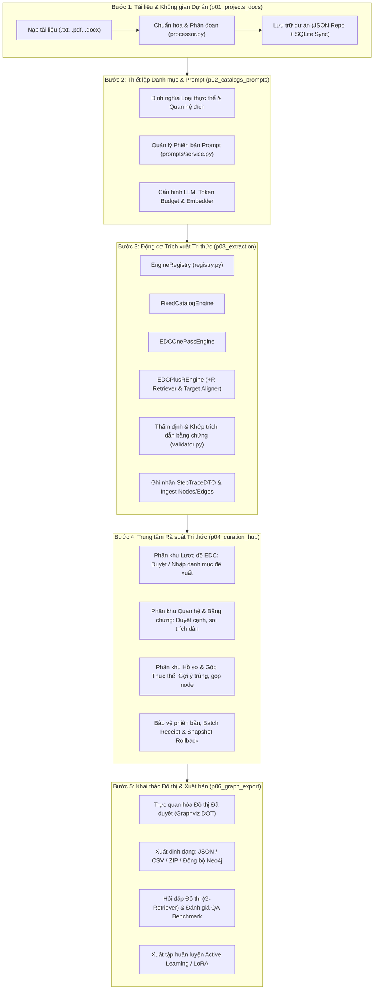
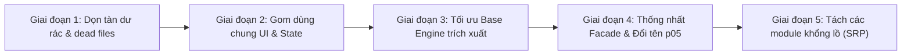

# Báo cáo Đánh giá Kiến trúc Pipeline, Hiện trạng Dư thừa Mã nguồn và Giải pháp Tối ưu Code Dùng chung (KG Studio Pro)

- **Ngày thực hiện:** 10/11/2026
- **Mục tiêu:** Đánh giá chi tiết hiện trạng kiến trúc Pipeline 5 bước, rà soát tình trạng dư thừa/lãng phí mã nguồn (dead code, duplicate boilerplate, redundant proxy), và đề xuất lộ trình tối ưu hóa các thành phần dùng chung (shared components) trong KG Studio Pro.
- **Vị trí tệp báo cáo:** `AI/report/pipeline_architecture_redundancy_and_shared_code_optimization_report.md`
- **Tình trạng kiểm thử hiện tại:** 116/116 test PASS (100%), thời gian thực thi ~8.0s qua `unittest discover tests`.

---

## 1. Tóm tắt Tổng quan (Executive Summary)

Dự án **KG Studio Pro** hiện là một hệ thống trích xuất và kiểm duyệt đồ thị tri thức (Knowledge Graph Construction & Curation Hub) có độ phức tạp cao, tích hợp chặt chẽ giữa xử lý ngôn ngữ tự nhiên (LLM), truy xuất vector ngữ nghĩa (Hybrid Embedder), lưu trữ kép (Atomic JSON + SQLite Sync), và kiểm duyệt con người (Human-in-the-Loop Active Learning).

### Các điểm sáng nổi bật của Pipeline hiện tại:
1. **Kiến trúc luồng 5 bước nghiệp vụ rõ ràng:** Quy trình được quy chuẩn hóa gồm 5 bước tuần tự: (1) Tài liệu $\rightarrow$ (2) Thiết lập $\rightarrow$ (3) Trích xuất $\rightarrow$ (4) Rà soát $\rightarrow$ (5) Khai thác, có cơ chế tính độ sẵn sàng (`compute_pipeline_readiness`) và gợi ý bước tiếp theo theo ngữ cảnh.
2. **Đa động cơ trích xuất linh hoạt (Pluggable Strategy Pattern):** Hỗ trợ 3 chế độ độc lập (`FixedCatalogEngine`, `EDCOnePassEngine`, `EDCPlusREngine`) với bộ ghi vết thực thi (`StepTraceDTO`) và quản lý phiên bản prompt theo mã băm SHA.
3. **Cơ chế bảo vệ dữ liệu mạnh mẽ:** Dual-phase commit (Xem trước $\rightarrow$ Áp dụng), bảo vệ xung đột phiên bản (Optimistic Revision Locking), ghi nhật ký thao tác (Batch Receipts), tạo bản chụp phục hồi (Snapshots Rollback), và đồng bộ an toàn không làm gián đoạn với SQLite (`_sync_sqlite_safe`).

### Các tồn tại chính cần xử lý:
1. **Tồn tại nhiều tàn dư mã nguồn (Dead / Vestigial files & shims):** Sau đợt tái cấu trúc gộp Trang 4 & Trang 5 thành Curation Hub, hệ thống vẫn giữ lại nhiều tệp wrapper rỗng, module chuyển hướng chuyển tiếp (`p05_graph_export.py`, `p04_edc_alignment.py`, `p05_curation_merge.py`, `edc_alignment_panel.py`, `backend/integrations/llm_gateway.py`).
2. **Tầng ủy quyền thừa (Redundant Proxy Layer) giữa Client và Facade:** `frontend/client.py` (~500 dòng) gần như chỉ đóng vai trò forward 1-1 sang `KGStudioFacade`. Điều này dẫn đến sự thiếu nhất quán trong UI khi các component import lẫn lộn cả `get_client()` và `get_facade()`.
3. **Lệch định danh số thứ tự bước:** Bước 5 ("Khai thác") nhưng tệp triển khai chính lại mang tên `p06_graph_export.py`, gây khó hiểu cho người mới tiếp cận codebase.
4. **Lặp lại boilerplate ở tầng giao diện và trạng thái:**
   - 10 hàm callback đồng bộ cấu hình LLM lặp lại trong `frontend/state/session.py`.
   - 15 hàm xử lý lựa chọn ID (cho đề xuất, cạnh, thực thể) lặp lại cấu trúc thao tác dictionary.
   - Thanh điều khiển phân trang (Pagination controls) và thanh nút bấm thao tác hàng loạt (Batch actions) được viết lặp lại 3-4 lần ở các bảng dữ liệu khác nhau.
5. **Các tệp "God Object" quá lớn:** Một số tệp vượt ngưỡng 1.000 - 1.600 dòng (`backend/facade.py` - 1.674 dòng; `backend/domain/curation/merge.py` - 1.565 dòng; `backend/domain/catalogs/service.py` - 1.135 dòng; `frontend/components/curation_table.py` - 1.155 dòng; `frontend/components/entity_merge_panel.py` - 1.371 dòng; `frontend/pages/p06_graph_export.py` - 1.013 dòng).

---

## 2. Phân tích Chi tiết Kiến trúc Pipeline Hiện tại

Hệ thống vận hành theo mô hình kiến trúc phân tầng (Layered Architecture) với luồng dữ liệu 5 bước khép kín:



### 2.1. Chi tiết Luồng Dữ liệu theo 5 Bước Nghiệp vụ

1. **Bước 1: Tài liệu & Không gian Làm việc Dự án (`frontend/pages/p01_projects_docs.py`)**
   - **Đầu vào:** Văn bản thô, tệp PDF, DOCX do người dùng tải lên.
   - **Xử lý:** `processor.py` trích xuất text, chia nhỏ thành các đoạn (chunks) theo kích thước và độ gối đầu (overlap), gán số thứ tự chunk, số trang (page) và tính chữ ký `chunk_hash`.
   - **Lưu trữ:** Ghi nhận vào trường `project["documents"]`. Mỗi tài liệu có `place_scope` và `source_label`.
   - **Hạ tầng:** Dữ liệu lưu dưới dạng JSON nguyên tử tại `data/projects/{slug}/project.json` đồng thời đồng bộ sang SQLite database thông qua `backend/repositories/sqlite_repo.py`.

2. **Bước 2: Thiết lập Danh mục, EDC+R & Quản lý Prompt (`frontend/pages/p02_catalogs_prompts.py`)**
   - **Đầu vào:** Bảng danh mục quan hệ đích (`relations`), loại thực thể đích (`entity_types`), cấu hình EDC+R.
   - **Quản lý Prompt chuyên nghiệp:** `backend/domain/prompts/service.py` lưu trữ lịch sử prompt có versioning, hash SHA-256 chống chỉnh sửa âm thầm, hỗ trợ xem diff và rollback.
   - **Cấu hình Gateway LLM:** `backend/integrations/llm/` hỗ trợ đa nhà cung cấp (Ollama, DeepSeek, OpenAI, Anthropic), quản lý giới hạn token đầu vào/đầu ra và tự động tính toán kích thước đoạn văn bản tối ưu.

3. **Bước 3: Trích xuất Tri thức Đa chế độ & Tracing (`frontend/pages/p03_extraction.py`)**
   - **Cấu trúc Strategy Pattern:** Sử dụng `BaseExtractionEngine` và `EngineRegistry` để định tuyến yêu cầu xử lý:
     - `FixedCatalogEngine`: Trích xuất đóng theo danh mục cố định đã định nghĩa từ Bước 2.
     - `EDCOnePassEngine`: Chế độ trích xuất mở (Open Information Extraction), LLM tự đề xuất định nghĩa quan hệ và loại thực thể mới.
     - `EDCPlusREngine`: Quy trình lặp (Iterative Refinement) tích hợp `SchemaRetriever` truy xuất schema liên quan nhất theo ngữ nghĩa vector chunk, gọi LLM trích xuất mở, sau đó tự động kích hoạt `TargetAligner` để tính điểm tương đồng Cosine chuẩn hóa các đề xuất vào danh mục mục tiêu.
   - **Thẩm định & Ingest:** `backend/domain/extraction/validator.py` kiểm tra cấu trúc JSON, khớp trích dẫn bằng chứng nguyên văn (`evidence_in_chunk`), phát hiện trùng lặp thực thể cục bộ, và bổ sung node/edge vào dự án kèm thông tin nguồn gốc (document ID, chunk number, page, character span).
   - **Hỗ trợ xử lý song song:** `facade.extract_chunks_parallel()` sử dụng `ThreadPoolExecutor` kèm cơ chế khóa thread-safe `threading.RLock()` trên từng dự án để tránh race-condition khi ghi dữ liệu.

4. **Bước 4: Trung tâm Rà soát Tri thức Hợp nhất (`frontend/pages/p04_curation_hub.py`)**
   - Tích hợp 3 phân khu nghiệp vụ theo thứ tự ưu tiên làm sạch:
     - **Phân khu 1 - Lược đồ EDC (`edc_review_table.py` & `edc_bulk_actions.py`):** Lọc và duyệt hàng loạt các đề xuất quan hệ/loại thực thể. Tự động chuyển đổi các đề xuất đã duyệt vào danh mục chính thức và cập nhật lại các cạnh đang chờ.
     - **Phân khu 2 - Kiểm duyệt Quan hệ & Bằng chứng (`curation_table.py` & `evidence_panel.py`):** Kiểm tra trạng thái hợp lệ của quan hệ so với danh mục (`inspect_edge_schema_status`), duyệt/chuyển trạng thái cạnh (Chờ duyệt, Cần kiểm tra, Đã duyệt, Loại bỏ), xem ngữ cảnh trích dẫn trực tiếp trong văn bản gốc.
     - **Phân khu 3 - Hồ sơ Thực thể & Gộp trùng lặp (`entity_merge_panel.py` & `curation_table.py`):** Tính bậc đồ thị, tìm kiếm thực thể nghi trùng lặp theo chỉ mục đảo và Levenshtein (`entities.py`), phân cụm ngữ nghĩa (`semantic_clustering.py`), và thực thi gộp N thực thể thành 1 thực thể chuẩn với cơ chế ghi nhận lịch sử chuyển hướng (`node_redirects`) và bảo toàn toàn bộ liên kết cạnh.
   - **Bảo vệ toàn vẹn:** Cả duyệt EDC và duyệt Curation đều áp dụng quy trình 2 pha nghiêm ngặt: `Preview` (xác thực ràng buộc, tính hash dự kiến) $\rightarrow$ `Apply` (khóa kiểm tra revision, cập nhật dữ liệu, ghi batch receipt và lưu snapshot phục hồi).

5. **Bước 5: Khai thác Đồ thị, Đánh giá & Xuất bản (`frontend/pages/p06_graph_export.py`)**
   - **Trực quan hóa:** Sinh đồ thị tương tác từ các cạnh "Đã duyệt" (Approved Graph) qua Graphviz DOT.
   - **Đa kênh xuất bản:** Xuất JSON chuẩn, xuất bảng CSV (nodes, edges), xuất gói nén ZIP đầy đủ, hoặc đồng bộ trực tiếp sang cơ sở dữ liệu đồ thị Neo4j.
   - **Khai thác Nâng cao:**
     - Mô-đun G-Retriever (`g_retriever.py`): Truy xuất đồ thị con liên quan và gọi LLM trả lời câu hỏi kèm lập luận dựa trên tri thức có bằng chứng.
     - Bộ sinh Benchmark QA (`qa_generator.py`): Tự động tạo câu hỏi trắc nghiệm/tự luận từ đồ thị tri thức để đánh giá hiệu năng truy xuất.
     - Xuất tập dữ liệu huấn luyện (`dataset_exporter/exporter.py`): Xuất định dạng JSONL phục vụ tinh chỉnh mô hình LoRA và bộ thu hồi lược đồ (Schema Retriever) theo chuẩn Active Learning.

---

## 3. Hiện trạng Dư thừa Mã nguồn Không Cần thiết (Redundant & Dead Code Analysis)

Qua quá trình rà soát AST, lược đồ quan hệ tệp và cây phụ thuộc thực tế, phát hiện các nhóm mã nguồn dư thừa rõ rệt sau đây:

### 3.1. Nhóm Tệp Tàn dư / Module Chết (Dead / Vestigial Files)

| Đường dẫn tệp | Số dòng | Hiện trạng & Lý do dư thừa | Mức độ rủi ro khi xóa/dọn |
| :--- | :---: | :--- | :---: |
| `frontend/pages/p05_graph_export.py` | 7 | Chỉ chứa 1 dòng import `from frontend.pages.p06_graph_export import render_graph_export_page` và gán `__all__`. Là tàn dư từ đợt đổi số thứ tự trang. | Rất thấp (An toàn) |
| `frontend/pages/p04_edc_alignment.py` | 13 | Module chuyển hướng trung gian: chỉ định nghĩa hàm `render_edc_alignment_page` gọi `render_curation_hub_page(project, default_tab="schema")`. | Rất thấp (An toàn) |
| `frontend/pages/p05_curation_merge.py` | 13 | Module chuyển hướng trung gian: chỉ định nghĩa hàm `render_curation_merge_page` gọi `render_curation_hub_page(project, default_tab="edges")`. | Rất thấp (An toàn) |
| `frontend/components/edc_alignment_panel.py` | 23 | Chỉ chứa 2 hàm ủy quyền: `render_edc_mode_settings` (gọi sang `prompt_editor.py`) và `render_edc_alignment_curation` (gọi vòng sang `p04_edc_alignment.py`). Không có bất kỳ trang nào gọi đến. | Rất thấp (An toàn) |
| `backend/integrations/llm_gateway.py` | 10 | Tệp shim 10 dòng re-export toàn bộ gói `backend.integrations.llm`. Hiện tại nhiều nơi vẫn import qua file này thay vì import trực tiếp từ package. | Thấp (Cần cập nhật import) |

### 3.2. Tầng Ủy quyền Thừa: `FrontendClient` (`frontend/client.py`)

- **Độ dài:** 498 dòng mã.
- **Vấn đề:** 
  - `FrontendClient` được thiết kế ban đầu với ý đồ hỗ trợ chế độ Client-Server qua REST API (`api_base_url`). Tuy nhiên, trong thực tế toàn bộ ứng dụng chạy dạng Streamlit nguyên khối trong cùng một tiến trình Python.
  - Ngoại trừ phương thức `get_embedding_models()` có một đoạn `urllib.request` kiểm tra URL, **toàn bộ hơn 30 phương thức còn lại của `FrontendClient` chỉ đơn thuần chuyển tiếp lời gọi sang `self.facade.<tên_phương_thức>(...)`**:
    ```python
    # Ví dụ điển hình lặp đi lặp lại trong frontend/client.py:
    def preview_proposal_decisions(self, project: dict, req: BulkReviewRequestDTO | dict) -> BulkReviewPreviewDTO:
        return self.facade.preview_proposal_decisions(project, req)

    def apply_proposal_decisions(self, project: dict, req: BulkReviewRequestDTO | dict, *, preview=None) -> BulkReviewResultDTO:
        return self.facade.apply_proposal_decisions(project, req, preview=preview)

    def preview_curation_decisions(self, project: dict, req: CurationReviewRequestDTO | dict) -> CurationPreviewDTO:
        return self.facade.preview_curation_decisions(project, req)
    ```
  - **Hệ quả tiêu cực:** Gây ra tình trạng "lưỡng quyền" (Architectural Ambiguity) ở tầng giao diện. Trong cùng một file component (như `frontend/components/prompt_editor.py` hoặc `frontend/pages/p04_curation_hub.py`), lập trình viên phải gọi cả hai:
    ```python
    facade = get_facade()
    client = get_client()
    ```
    Một số hành động gọi qua `client`, một số hành động khác lại gọi qua `facade`, gây khó khăn cho việc bảo trì và gia tăng số lượng mã nguồn không đem lại giá trị kiến trúc thực tế.

### 3.3. Lệch Định danh Thứ tự Bước (`p06_graph_export.py`)

- Quy trình nghiệp vụ hiện hữu là **Quy trình 5 Bước**:
  1. `p01_projects_docs.py` (Tài liệu)
  2. `p02_catalogs_prompts.py` (Thiết lập)
  3. `p03_extraction.py` (Trích xuất)
  4. `p04_curation_hub.py` (Rà soát)
  5. Bước 5 lại là `p06_graph_export.py`!
- Sự tồn tại đồng thời của `p05_graph_export.py` (wrapper) và `p06_graph_export.py` (thực thi) là kết quả của việc sáp nhập trang 4 và trang 5 trước đây mà không đổi tên tệp trang xuất bản cuối cùng.

### 3.4. Boilerplate Đồng bộ Trạng thái Cấu hình LLM trong `session.py`

Trong `frontend/state/session.py` (từ dòng 1326 đến dòng 1385), có **10 hàm callback riêng biệt** chỉ để làm một nhiệm vụ duy nhất: chép giá trị giữa widget Sidebar (`sb_...`), widget Trang 2 (`p02_...`) và trạng thái chuẩn (`llm_...`):

```python
# Lặp lại 5 cặp hàm giống hệt nhau:
def on_sb_llm_key_change() -> None:
    val = str(st.session_state.get("sb_llm_key", "")).strip()
    st.session_state["llm_api_key"] = val
    st.session_state["p02_llm_key"] = val

def on_p02_llm_key_change() -> None:
    val = str(st.session_state.get("p02_llm_key", "")).strip()
    st.session_state["llm_api_key"] = val
    st.session_state["sb_llm_key"] = val

# Tương tự cho model, url, max_in, max_out... (tổng cộng 60 dòng code lặp)
```

### 3.5. Sự Lặp lại của Logic Quản lý Lựa chọn ID trong `session.py`

Dù đã có module hạt nhân `frontend/state/selection_core.py`, trong `session.py` vẫn tồn tại **15 hàm phân loại theo 3 nhóm đối tượng riêng biệt** (Đề xuất EDC, Cạnh quan hệ, Thực thể) có thân hàm thực thi tương tự 90%:
- Nhóm 1: `toggle_proposal_selection`, `select_page_proposals`, `select_all_filtered_proposals`, `clear_proposal_selection`, `reconcile_selection_with_filter`
- Nhóm 2: `toggle_edge_selection`, `select_page_edges`, `select_all_filtered_edges`, `clear_edge_selection`, `reconcile_edge_selection_with_filter`
- Nhóm 3: `toggle_entity_selection`, `select_page_entities`, `select_all_filtered_entities`, `clear_entity_selection`, `reconcile_entity_selection_with_filter`

Sự khác biệt duy nhất giữa 3 nhóm này chỉ là đối tượng dictionary trạng thái (`get_edc_table_state` vs `get_curation_section_state`) và nhãn danh từ ("mục", "cạnh", "thực thể").

### 3.6. Lặp lại Boilerplate trong các Động cơ Trích xuất (Extraction Engines)

Cả 3 file `fixed_catalog.py`, `edc_one_pass.py` và `edc_plus_r.py` đều lặp lại các đoạn logic hạ tầng:
1. **Ghi đè và hoàn nguyên chế độ trích xuất an toàn:**
   ```python
   prev_mode = project.get("extraction_mode")
   project["extraction_mode"] = MODE_XYZ
   try:
       ...
   finally:
       if prev_mode is not None:
           project["extraction_mode"] = prev_mode
   ```
2. **Khóa luồng ghi nhận kết quả (Lock synchronization):**
   ```python
   if ctx.lock:
       with ctx.lock:
           stats = _do_ingest()
   else:
       stats = _do_ingest()
   ```
3. **Trích xuất thông tin phiên bản Prompt:** Lặp lại 4 dòng tra cứu `get_active_prompt_version` và băm nội dung.
4. **Bóc tách chữ ký yêu cầu:** Lặp lại việc trích `prep.request_hash` và `prep.to_dict()`.

### 3.7. Các Tệp "God Object" Cần Phân rã Trách nhiệm

1. **`backend/facade.py` (1.674 dòng):**
   - Đảm nhận quá nhiều vai trò: Quản lý I/O tệp dự án, kiểm tra lock, kiểm tra revision, đồng bộ SQLite, cấu hình prompt, truy xuất schema vector, trích xuất song song, commit kiểm duyệt, điều phối quan hệ, điều phối thực thể, truy vấn đồ thị con, và ủy quyền sang G-Retriever/QA generator.
2. **`backend/domain/catalogs/service.py` (1.135 dòng):**
   - Tiêu đề là dịch vụ danh mục (catalogs), nhưng chứa tới hơn 700 dòng logic nghiệp vụ của hệ thống duyệt đề xuất EDC (`preview_proposal_decisions`, `apply_proposal_decisions`, `schema_review_issue`, `batch_proposal_impacts`). Logic này nên thuộc về phân hệ `schema_intelligence` hoặc `edc`.
3. **`frontend/pages/p06_graph_export.py` (1.013 dòng):**
   - Chứa cùng lúc: Giao diện trực quan hóa đồ thị DOT, bảng xuất dữ liệu và đồng bộ Neo4j, toàn bộ giao diện hỏi đáp G-Retriever (~335 dòng), giao diện chạy benchmark đánh giá retrieval (~104 dòng), và giao diện xuất dữ liệu huấn luyện Active Learning / LoRA (~220 dòng).
4. **`frontend/components/entity_merge_panel.py` (1.371 dòng):**
   - Chứa 4 tab rất lớn trong cùng một tệp: Gộp thực thể, Gộp quan hệ, Khử trùng lặp bộ ba (Triple dedup), và Gộp loại thực thể.

---

## 4. Khả năng Tối ưu Hóa và Gom Mã nguồn Dùng chung (Shared Code Optimization)

Dưới đây là các phương án tối ưu cụ thể, giúp giảm thiểu đáng kể số lượng dòng mã dư thừa mà vẫn bảo toàn 100% tính năng và độ ổn định của hệ thống:

### 4.1. Gom Thành phần Điều khiển Phân trang và Thanh Thao tác Lựa chọn UI

Hiện tại, cả bảng Cạnh, bảng Thực thể trong `curation_table.py` và hai bảng Đề xuất trong `edc_review_table.py` đều viết lặp lại các cột Streamlit để hiển thị phân trang và chọn dòng.

**Giải pháp:** Bổ sung vào `frontend/components/shared_curation_ui.py` hai hàm giao diện dùng chung:

```python
def render_pagination_controls(
    current_page: int,
    total_pages: int,
    page_size: int,
    page_size_options: list[int] = [10, 25, 50, 100],
    key_prefix: str = "shared",
) -> tuple[int, int]:
    """Thành phần phân trang chuẩn hóa dùng chung cho mọi bảng dữ liệu."""
    col_size, col_page = st.columns([1, 1.2])
    new_size = col_size.selectbox(
        "Số dòng/trang",
        page_size_options,
        index=page_size_options.index(page_size) if page_size in page_size_options else 1,
        key=f"{key_prefix}_page_size",
    )
    new_page = col_page.number_input(
        f"Trang (1..{total_pages})",
        min_value=1,
        max_value=max(1, total_pages),
        value=current_page,
        step=1,
        key=f"{key_prefix}_page_num",
    )
    return int(new_page), int(new_size)
```

```python
def render_selection_action_bar(
    selected_count: int,
    page_item_count: int,
    filtered_item_count: int,
    total_count: int,
    item_noun: str = "mục",
    key_prefix: str = "shared",
    on_select_page: Callable | None = None,
    on_select_all_filtered: Callable | None = None,
    on_clear: Callable | None = None,
) -> None:
    """Thanh công cụ thao tác chọn theo lô dùng chung chuẩn giao diện."""
    b1, b2, b3, b4 = st.columns([1.2, 1.5, 1.0, 2.5])
    if b1.button(f"☑️ Chọn trang này ({page_item_count})", key=f"{key_prefix}_btn_sel_page", width="stretch"):
        if on_select_page:
            on_select_page()
            st.rerun()
    if b2.button(f"🌐 Chọn tất cả lọc ({filtered_item_count})", key=f"{key_prefix}_btn_sel_all", width="stretch"):
        if on_select_all_filtered:
            on_select_all_filtered()
            st.rerun()
    if b3.button("✖️ Bỏ chọn", key=f"{key_prefix}_btn_clear", width="stretch"):
        if on_clear:
            on_clear()
            st.rerun()
    b4.markdown(f"**Đã chọn `{selected_count}`** / `{filtered_item_count}` kết quả lọc ({total_count} tổng số {item_noun})")
```

*Hiệu quả ước tính:* Giảm ~220 dòng mã UI lặp lại giữa `curation_table.py` và `edc_review_table.py`, đảm bảo giao diện phân trang đồng nhất 100% trên toàn ứng dụng.

### 4.2. Khái quát hóa Bộ Quản lý Lựa chọn (Generic Selection Handler) trong `session.py`

Thay vì viết 15 hàm lặp lại cho 3 loại thực thể/cạnh/đề xuất, ta có thể xây dựng một hàm cấp phát chung dựa trên `frontend/state/selection_core.py`:

```python
def manage_state_selection(
    state_dict: dict[str, Any],
    action: str,  # 'toggle', 'select_page', 'select_all', 'clear', 'reconcile'
    *,
    item_id: str = "",
    is_selected: bool = False,
    is_eligible: bool = True,
    page_ids: list[str] | None = None,
    all_filtered_ids: list[str] | None = None,
    visible_eligible_ids: set[str] | None = None,
    prev_filter_sig: str = "",
    new_filter_sig: str = "",
    item_noun: str = "mục",
) -> Any:
    """Xử lý tập trung toàn bộ các thao tác danh sách ID lựa chọn."""
    if action == "toggle":
        state_dict["selected_ids"] = toggle_id_in_list(state_dict["selected_ids"], item_id, is_selected, is_eligible)
        return list(state_dict["selected_ids"])
    elif action == "select_page":
        state_dict["selected_ids"] = append_unique_ids(state_dict["selected_ids"], page_ids or [])
        return list(state_dict["selected_ids"])
    elif action == "select_all":
        state_dict["selected_ids"] = list(dict.fromkeys(all_filtered_ids or []))
        return list(state_dict["selected_ids"])
    elif action == "clear":
        state_dict["selected_ids"] = []
        state_dict["filter_prune_notice"] = ""
    elif action == "reconcile":
        kept, pruned, notice = reconcile_id_selection(
            state_dict["selected_ids"], visible_eligible_ids or set(), prev_filter_sig, new_filter_sig, item_noun=item_noun
        )
        state_dict["selected_ids"] = kept
        state_dict["filter_prune_notice"] = notice
        return pruned
```

*Hiệu quả ước tính:* Giữ nguyên các hàm public API cũ để tương thích 100% với các test hiện tại nhưng rút gọn thân hàm của 15 hàm này từ ~250 dòng xuống còn ~40 dòng.

### 4.3. Rút gọn Callbacks Đồng bộ Cấu hình LLM

Thay 10 hàm callback riêng biệt bằng một hàm đồng bộ chung hoặc hàm sinh callback:

```python
def _sync_llm_widget(param_canonical: str, widget_src: str, widget_target: str, is_int: bool = False) -> None:
    raw = st.session_state.get(widget_src, 0 if is_int else "")
    val = int(raw) if is_int else str(raw).strip()
    st.session_state[param_canonical] = val
    st.session_state[widget_target] = val

# Khởi tạo gọn nhẹ:
def on_sb_llm_key_change() -> None: _sync_llm_widget("llm_api_key", "sb_llm_key", "p02_llm_key")
def on_p02_llm_key_change() -> None: _sync_llm_widget("llm_api_key", "p02_llm_key", "sb_llm_key")
```

### 4.4. Tối ưu Hóa Template Method Pattern cho `BaseExtractionEngine`

Bổ sung các phương thức hỗ trợ dùng chung vào lớp cha `BaseExtractionEngine` trong `backend/domain/extraction/base_engine.py`:

```python
class BaseExtractionEngine(ABC):
    mode_id: str = ""
    display_name: str = ""

    def get_prompt_version_info(self, project: dict) -> tuple[str, str, str]:
        """Lấy thông tin phiên bản prompt đang hoạt động (version_id, content_hash, base_instructions)."""
        ver = get_active_prompt_version(project, self.mode_id)
        if not ver:
            return "", "", ""
        return ver.get("id", ""), ver.get("content_hash", ""), ver.get("content", "")

    def safe_ingest(self, ctx: ChunkContext, ingest_fn: Callable[[], dict], target_mode: str) -> dict:
        """Thực thi ingest có khóa và bảo toàn extraction_mode ban đầu của dự án."""
        prev_mode = ctx.project.get("extraction_mode")
        ctx.project["extraction_mode"] = target_mode
        try:
            if ctx.lock:
                with ctx.lock:
                    return ingest_fn()
            return ingest_fn()
        finally:
            if prev_mode is not None:
                ctx.project["extraction_mode"] = prev_mode
```

*Hiệu quả ước tính:* Loại bỏ khối `try...finally` và `if ctx.lock` trùng lặp trong cả 3 động cơ `fixed_catalog.py`, `edc_one_pass.py` và `edc_plus_r.py`.

### 4.5. Chuẩn Hóa Tầng Giao Tiếp: Facade làm Điểm Truy Cập Duy Nhất

Vì KG Studio Pro hiện vận hành 100% độc lập cục bộ, không có phân tách tiến trình hay microservices, phương án tối ưu và trực tiếp nhất là:
1. **Chuẩn hóa truy cập thông qua `KGStudioFacade`:** Tầng giao diện frontend chỉ cần gọi `facade = get_facade()` đồng nhất.
2. **Thu gọn `FrontendClient`:** Nếu cần giữ lại `FrontendClient` để phục vụ mở rộng REST API tương lai, hãy chuyển đổi `FrontendClient` thành một adapter mỏng kế thừa trực tiếp hoặc sử dụng `__getattr__` ủy quyền tự động sang `KGStudioFacade` thay vì viết lặp thủ công 500 dòng code.

---

## 5. Lộ trình Đề xuất Tái cấu trúc theo Phân kỳ An toàn (Phased Roadmap)

Để đảm bảo an toàn tuyệt đối, không gây đứt gãy hồi quy và duy trì 100% test pass ở mọi thời điểm, quá trình tái cấu trúc nên được tiến hành theo 5 giai đoạn:



### Giai đoạn 1: Dọn dẹp An toàn các Tệp Tàn dư và Import Chết (Ưu tiên Cao, Rủi ro Thấp)
- **Hành động:**
  - Xóa bỏ các tệp rỗng/tàn dư: `frontend/components/edc_alignment_panel.py`, `frontend/pages/p04_edc_alignment.py`, `frontend/pages/p05_curation_merge.py`.
  - Cập nhật các import tương ứng trong `frontend/pages/__init__.py` và `frontend/components/__init__.py`.
  - Chuyển toàn bộ các import từ `backend.integrations.llm_gateway` sang trực tiếp `backend.integrations.llm`.
- **Kiểm chứng:** Chạy toàn bộ 116 bài kiểm thử hiện hành, đảm bảo pass 100%.

### Giai đoạn 2: Gom Dùng chung Thành phần UI và State Callbacks (Ưu tiên Trung bình)
- **Hành động:**
  - Triển khai `render_pagination_controls()` và `render_selection_action_bar()` trong `shared_curation_ui.py`.
  - Tái cấu trúc phần điều khiển phân trang trong `curation_table.py` và `edc_review_table.py` sử dụng component chung.
  - Tối ưu hóa 10 hàm callback LLM và 15 hàm lựa chọn ID trong `frontend/state/session.py`.
- **Kiểm chứng:** Kiểm tra luồng UI trên Streamlit và chạy `tests/test_curation_hub.py`, `tests/test_code_cleanup.py`.

### Giai đoạn 3: Tối ưu Hóa Lớp Cơ sở Động cơ Trích xuất (Base Engine)
- **Hành động:**
  - Bổ sung helper `safe_ingest` và `get_prompt_version_info` vào `BaseExtractionEngine`.
  - Thu gọn mã nguồn trong `fixed_catalog.py`, `edc_one_pass.py` và `edc_plus_r.py`.
- **Kiểm chứng:** Chạy `tests/test_parallel_extraction.py`, `tests/test_edc_plus_r_live.py`.

### Giai đoạn 4: Chuẩn hóa Tên Tệp Bước 5 và Tầng Client-Facade
- **Hành động:**
  - Đổi tên `frontend/pages/p06_graph_export.py` thành `frontend/pages/p05_graph_export.py` (loại bỏ file stub 7 dòng cũ). Cập nhật router trong `frontend/app.py` và các test fixture.
  - Chuẩn hóa các component frontend chỉ sử dụng một điểm truy cập `facade = get_facade()`. Đơn giản hóa `frontend/client.py`.
- **Kiểm chứng:** Chạy `tests/test_layout_pipeline.py`.

### Giai đoạn 5: Tách Phân rã các Mô-đun Khổng lồ (Modularization)
- **Hành động:**
  - Tách các tab con trong `frontend/pages/p06_graph_export.py` (G-Retriever QA, Benchmark, Active Learning) thành các component riêng trong `frontend/components/`.
  - Di chuyển logic duyệt đề xuất EDC (~700 dòng) từ `backend/domain/catalogs/service.py` sang một module chuyên biệt `backend/domain/schema_intelligence/edc_service.py`.
  - Phân rã `frontend/components/entity_merge_panel.py` thành các component tab độc lập (Entity merge, Relation merge, Triple dedup, Entity type merge).
- **Kiểm chứng:** Bộ test đầy đủ 116 tests.

---

## 6. Kết luận (Conclusion)

Hệ thống Pipeline của **KG Studio Pro** hiện tại đã đạt độ hoàn thiện cao về mặt tính năng nghiệp vụ, tính toàn vẹn dữ liệu và cơ chế kiểm duyệt tri thức hai pha an toàn. Toàn bộ 116 bài kiểm thử tự động đang vượt qua 100%.

Tuy nhiên, do trải qua nhiều đợt nâng cấp và hợp nhất (đặc biệt là đợt chuyển đổi từ 6 trang sang 5 bước với Curation Hub hợp nhất), dự án đang tích lũy một lượng mã nguồn dư thừa nhất định:
- **~1.200 dòng mã** có thể loại bỏ hoặc thu gọn ngay lập tức thông qua việc dọn dead files, đơn giản hóa `FrontendClient`, và dùng chung các điều khiển UI phân trang/lựa chọn.
- Việc thực hiện theo **Lộ trình 5 giai đoạn an toàn** nêu trên sẽ giúp kiến trúc dự án trở nên gọn gàng, tăng tốc độ bảo trì, loại bỏ sự nhầm lẫn giữa Facade và Client, đồng thời chuẩn hóa thứ tự các bước từ 1 đến 5 một cách hoàn toàn mạch lạc.
