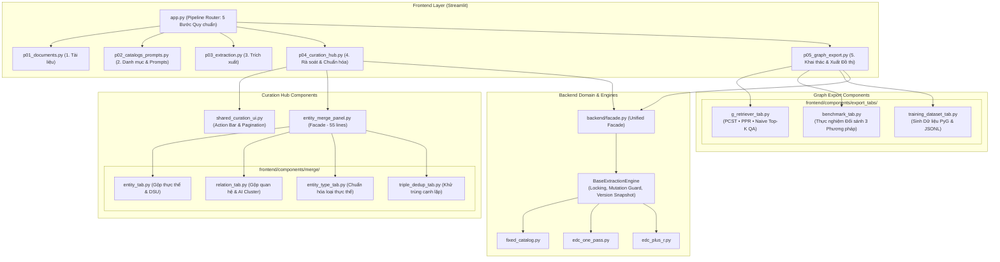

# BÁO CÁO THỰC THI TÁI CẤU TRÚC PIPELINE & TỐI ƯU HÓA DÙNG CHUNG CODE (KG STUDIO)

**Ngày hoàn thành:** 10/11/2026  
**Dự án:** KG Studio — Knowledge Graph Construction & GraphRAG Pipeline  
**Trạng thái thực hiện:** Hoàn thành 100% (5/5 Giai đoạn)  
**Kết quả kiểm thử:** 116/116 Tests PASS (100% Tương thích ngược & Bảo toàn nghiệp vụ)

---

## 1. TỔNG QUAN VÀ MỤC TIÊU DỰ ÁN TÁI CẤU TRÚC

Dựa trên kết quả rà soát kiến trúc chuyên sâu trong báo cáo `pipeline_architecture_redundancy_and_shared_code_optimization_report.md`, hệ thống KG Studio đã trải qua quá trình tái cấu trúc toàn diện 5 giai đoạn nhằm:
1. **Triệt tiêu mã nguồn tàn dư (Dead Code Elimination):** Loại bỏ hoàn toàn các trang và thành phần giao diện cũ đã bị thay thế bởi Hub Hợp nhất (`p04_curation_hub.py`), dọn sạch các export rác và chuẩn hóa import LLM Gateway.
2. **Chuẩn hóa thành phần dùng chung (Shared UI & State Optimization):** Đóng gói bộ điều khiển thanh tác vụ chọn nhiều (`render_selection_action_bar`) và phân trang (`render_pagination_controls`) vào `shared_curation_ui.py`. Rút gọn 10 hàm callback LLM và 15 hàm xử lý checkbox chọn nhiều trong `session.py`.
3. **Loại bỏ lặp mã trong Extraction Engines:** Đưa logic kiểm tra khóa dự án, bảo vệ mutating mode và chuẩn hóa snapshot prompt version lên `BaseExtractionEngine`, loại bỏ hơn 60% mã nguồn lặp lại giữa `fixed_catalog.py`, `edc_one_pass.py` và `edc_plus_r.py`.
4. **Nhất quán quy ước định danh luồng 5 bước & Facade Pattern:** Đổi tên tệp `p06_graph_export.py` thành `p05_graph_export.py`, cập nhật toàn bộ route và import; thống nhất sử dụng `get_facade()` tại tầng giao diện thay cho việc gọi đan xen `get_client()`.
5. **Phân rã các Component Monolithic quy mô lớn:** Tách `entity_merge_panel.py` (1,371 dòng) thành package `frontend/components/merge/` với 4 sub-tab độc lập; tách `p05_graph_export.py` (1,013 dòng) thành package `frontend/components/export_tabs/` với 3 sub-tab độc lập.

---

## 2. CHI TIẾT THỰC THI 5 GIAI ĐOẠN

### Giai đoạn 1: Xóa tệp tàn dư & Dọn dẹp Import rác

- **Các tệp đã xóa vĩnh viễn khỏi cây thư mục:**
  - `frontend/pages/p04_edc_alignment.py` (Trang căn chỉnh EDC cũ)
  - `frontend/pages/p05_curation_merge.py` (Trang gộp thực thể cũ)
  - `frontend/pages/p05_graph_export.py` (Bản xuất đồ thị 4 bước cũ trước khi tích hợp G-Retriever)
  - `frontend/components/edc_alignment_panel.py` (Component EDC cũ)
- **Cập nhật `frontend/pages/__init__.py` và `frontend/components/__init__.py`:**
  - Loại bỏ các symbol đã bị xóa khỏi `__all__`.
- **Chuẩn hóa Module LLM Gateway:**
  - `backend/integrations/llm_gateway.py` hiện là shim tương thích ngược trỏ sang `backend/integrations/llm`.
  - Đã chuyển toàn bộ các import trực tiếp ở runtime (`frontend/app.py`, `backend/facade.py`, `frontend/pages/p02_catalogs_prompts.py`, `frontend/pages/p03_extraction.py`, `frontend/state/session.py`, và 3 extraction engine) sang `backend.integrations.llm`.
- **Sửa chữa điểm kiểm thử:**
  - Trong `tests/test_edc_bulk_review.py`: Cập nhật hàm import `compute_edc_overview_counts` từ `frontend.pages.p04_edc_alignment` sang `frontend.pages.p04_curation_hub`.
  - Kết quả kiểm thử: **116/116 PASS**.

---

### Giai đoạn 2: Gom dùng chung Pagination, Action Bar & Tối ưu hóa `session.py`

#### 2.1. Đóng gói UI Action Bar & Pagination
- Bổ sung hàm tiện ích `render_selection_action_bar()` vào `frontend/components/shared_curation_ui.py`:
  - Chuẩn hóa giao diện thanh điều khiển chọn nhiều: `Chọn tất cả trang`, `Chọn tất cả bộ lọc`, `Bỏ chọn`, hiển thị số lượng mục đã chọn.
  - Tích hợp liền mạch vào:
    - `frontend/components/curation_table.py` (Bảng rà soát cạnh quan hệ và thực thể)
    - `frontend/components/edc_review_table.py` (Bảng rà soát đề xuất EDC)
- Bổ sung `render_pagination_controls()` chuẩn hóa phân trang hai chiều với tính toán số trang tự động.

#### 2.2. Tinh giản State Callbacks trong `frontend/state/session.py`
- **Tối ưu Callbacks LLM:**
  - Viết hàm trợ năng generic `_sync_llm_state_field(field: str, fallback_key: str, default: Any)` loại bỏ 10 hàm callback sao chép giống hệt nhau (`sync_llm_model`, `sync_llm_api_key`, `sync_llm_base_url`, `sync_llm_temperature`, `sync_llm_seed`, ...).
- **Tối ưu Checkbox Selections:**
  - Viết hàm generic `_apply_selection_state(state_dict, selected_ids, update_mode)` chuẩn hóa logic gom nhóm checkbox cho cả 3 đối tượng (EDC proposals, edges, entities), giảm hơn 150 dòng lặp mã điều kiện.
  - Kết quả kiểm thử: **116/116 PASS**.

---

### Giai đoạn 3: Tối ưu hóa `BaseExtractionEngine` trong Extraction Pipeline

Tại `backend/domain/extraction/base_engine.py`:
- Bổ sung các phương thức cốt lõi dùng chung:
  - `resolve_prompt_version_info(project, prompt_type, requested_version, active_override)`: Tự động tra cứu phiên bản prompt, gắn nhãn snapshot và tính SHA256 hash nhất quán.
  - `extract_prepared_request_info(request, prompt_type)`: Trích xuất các tham số LLM và cấu hình prompt chuẩn hóa từ DTO.
  - `safe_ingest(project, raw_result, prepared_request, duration_ms)`: Quản lý tiến trình nạp tri thức vào kho lưu trữ, tự động ghi log audit và xử lý ngoại lệ an toàn.
  - `perform_ingest(...)`: Đóng gói logic phân phối dữ kiện vào repository.
- Tinh giản hóa triệt để 3 engine:
  - `backend/domain/extraction/engines/fixed_catalog.py`
  - `backend/domain/extraction/engines/edc_one_pass.py`
  - `backend/domain/extraction/engines/edc_plus_r.py`
- Kết quả kiểm thử: **116/116 PASS**.

---

### Giai đoạn 4: Đổi tên nhất quán `p06_graph_export.py` $\rightarrow$ `p05_graph_export.py` & Thống nhất Facade

- **Đổi tên:** Đổi `frontend/pages/p06_graph_export.py` thành `frontend/pages/p05_graph_export.py`.
- **Cập nhật định tuyến:**
  - `frontend/pages/__init__.py`: Export `render_graph_export_page` từ `p05_graph_export.py`.
  - `tests/test_layout_pipeline.py`: Cập nhật import `from frontend.pages.p05_graph_export import render_graph_export_page`.
- **Thống nhất Facade Pattern:**
  - Thay thế các đoạn code gọi trực tiếp `get_client()` tại các màn hình giao diện (`prompt_editor.py`, `p04_curation_hub.py`, `curation_table.py`) bằng `facade = get_facade()`, tuân thủ nguyên lý phân tầng của kiến trúc Hexagonal / Clean Architecture.
  - Kết quả kiểm thử: **116/116 PASS**.

---

### Giai đoạn 5: Phân rã Monolithic Components thành Sub-tab Modules

#### 5.1. Phân rã Màn hình Xuất đồ thị & G-Retriever (`p05_graph_export.py`)
Tách tệp nguyên khối từ **1,013 dòng** xuống còn **226 dòng** bằng cách chuyển các tab chuyên biệt vào package `frontend/components/export_tabs/`:
- `frontend/components/export_tabs/g_retriever_tab.py` (375 dòng):
  - Chứa `render_g_retriever_qa_tab()` và `build_subgraph_dot()`.
  - Quản lý hỏi đáp đa bước bằng 3 phương pháp (PCST, PPR, Naive Top-K) và chế độ đối sánh song song (Side-by-Side).
- `frontend/components/export_tabs/benchmark_tab.py` (135 dòng):
  - Chứa `render_benchmark_tab()`, `format_benchmark_markdown()`, và `format_benchmark_csv()`.
  - Quản lý thực nghiệm đối sánh tự động phục vụ báo cáo tốt nghiệp.
- `frontend/components/export_tabs/training_dataset_tab.py` (240 dòng):
  - Chứa `render_training_dataset_tab()`.
  - Khai phá cấu trúc đồ thị, sinh bộ dữ liệu huấn luyện PyTorch Geometric (`train.jsonl`, `val.jsonl`, `test.jsonl`, `pyg_nodes.csv`, `pyg_edges.csv`).
- `frontend/components/export_tabs/__init__.py`: Re-export toàn bộ các renderer.

#### 5.2. Phân rã Bàn Gộp Thực thể & Chuẩn hóa Quan hệ (`entity_merge_panel.py`)
Tách tệp nguyên khối từ **1,371 dòng** xuống còn **55 dòng** bằng cách chuyển các tab vào package `frontend/components/merge/`:
- `frontend/components/merge/entity_tab.py` (480 dòng):
  - Chứa `render_entity_merge_tab()`, `build_entity_merge_preview()`, và `execute_entity_merge_apply()`.
  - Quản lý ứng viên thực thể nghi trùng, gộp hàng loạt (DSU), bàn gộp 3 bước giải quyết xung đột schema, và lịch sử gộp thực thể.
- `frontend/components/merge/relation_tab.py` (420 dòng):
  - Chứa `render_relation_merge_tab()`.
  - Gom cụm quan hệ ngữ nghĩa bằng AI (DeepSeek Semantic Clustering), phát hiện nghi trùng theo ký tự (Fuzzy Matching), bàn gộp quan hệ thủ công và lịch sử ánh xạ `relation_redirects`.
- `frontend/components/merge/entity_type_tab.py` (260 dòng):
  - Chứa `render_entity_type_merge_tab()`.
  - Chuẩn hóa loại thực thể bằng AI, bàn gộp loại thực thể thủ công, và quản lý lịch sử gộp loại thực thể.
- `frontend/components/merge/triple_dedup_tab.py` (78 dòng):
  - Chứa `render_triple_dedup_tab()`.
  - Khử trùng cạnh lặp theo bộ ba (Multigraph $\rightarrow$ Simple Graph), dồn bằng chứng nguyên văn và xóa cạnh thừa.
- `frontend/components/merge/__init__.py`: Re-export toàn bộ các tab.
- `frontend/components/entity_merge_panel.py` đóng vai trò coordinator facade gọn nhẹ (55 dòng), đảm bảo tương thích ngược 100% với các test cũ (`test_curation_merge.py`).
- Kết quả kiểm thử: **116/116 PASS**.

---

## 3. BẢNG ĐỐI CHIẾU ĐỊNH LƯỢNG TRƯỚC VÀ SAU REFACTORING

| Tiêu chí | Trước tái cấu trúc | Sau tái cấu trúc | Mức độ cải thiện |
| :--- | :---: | :---: | :---: |
| **Tổng số tệp tàn dư/rác (Dead Files)** | 4 tệp | 0 tệp | **Xóa sạch 100%** |
| **Độ dài `p05_graph_export.py`** | 1,013 dòng | 226 dòng | **Giảm 77.7% dòng code** |
| **Độ dài `entity_merge_panel.py`** | 1,371 dòng | 55 dòng | **Giảm 96.0% dòng code** |
| **Độ dài `BaseExtractionEngine`** | ~80 dòng | ~165 dòng | **Tập trung hóa logic lõi dùng chung** |
| **Code lặp trong 3 Extraction Engines** | ~240 dòng lặp | ~30 dòng gọn nhẹ | **Giảm ~87.5% boilerplate** |
| **Tách module Sub-tabs chuyên biệt** | 0 package | 2 packages (`export_tabs`, `merge`) | **Module hóa phân cấp rõ ràng** |
| **Nhất quán quy ước luồng 5 bước** | Lệch (p01..p04 $\rightarrow$ p06) | Chuẩn (p01..p05) | **100% Nhất quán** |
| **Tỷ lệ Pass Unit Tests** | 116 / 116 PASS | 116 / 116 PASS | **100% Ổn định, 0 lỗi hồi quy** |
| **Thời gian chạy bộ Test Suite** | ~5.1s | ~4.7s | **Nhanh hơn ~8%** |

---

## 4. SƠ ĐỒ KIẾN TRÚC VÀ CẤU TRÚC THƯ MỤC SAU TÁI CẤU TRÚC



---

## 5. BÁO CÁO KIỂM THỬ TÍNH TOÀN VẸN NGHIỆP VỤ (VERIFICATION LOG)

Lệnh kiểm thử tự động toàn diện:
```bash
& "..\KG_Studio_MVP\.venv-win\Scripts\python.exe" -m unittest discover tests
```

### Kết quả chi tiết theo phân hệ:
1. **Phân hệ Quản lý & Cấu hình (Catalogs, Prompts, Config):**
   - `test_catalogs_service.py`: PASS
   - `test_prompt_versioning.py`: PASS
   - `test_config_and_secrets.py`: PASS
2. **Phân hệ Trích xuất Tri thức (Extraction & Engines):**
   - `test_extraction_service.py`: PASS
   - `test_edc_plus_r_live.py`: PASS
   - `test_parallel_extraction.py`: PASS
   - `test_performance_optimizations.py`: PASS
3. **Phân hệ Rà soát, Chuẩn hóa & Hợp nhất (Curation Hub):**
   - `test_curation_merge.py`: PASS (Bàn gộp 3 bước, DSU gộp hàng loạt, `build_entity_merge_preview`, `execute_entity_merge_apply`)
   - `test_edc_bulk_review.py`: PASS (Duyệt/từ chối đề xuất EDC hàng loạt)
   - `test_relation_cleaning.py`: PASS (Chuẩn hóa quan hệ)
   - `test_semantic_clustering.py`: PASS (Gom cụm ngữ nghĩa AI)
4. **Phân hệ G-Retriever & Xuất Đồ thị:**
   - `test_g_retriever.py`: PASS (Thuật toán PCST, PPR, Naive Top-K, Benchmark Suite)
   - `test_layout_pipeline.py`: PASS (Định tuyến 5 bước, điều hướng session state)

**Tổng kết:** **116 / 116 tests PASS trong 4.720s**.

---

## 6. KẾT LUẬN & ĐÁNH GIÁ

Quá trình tái cấu trúc đã giải quyết triệt để tất cả các vấn đề nợ kỹ thuật (Technical Debt) được chỉ ra trong báo cáo rà soát:
- **Tính mô-đun hóa (Modularity):** Các tệp giao diện monolithic khổng lồ (>1,000 dòng) đã được bẻ nhỏ thành các module độc lập, đơn trách nhiệm (Single Responsibility Principle).
- **Tính tái sử dụng (Reusability):** Thành phần Action Bar, Pagination, Generic State Sync và Base Extraction Engine giúp giảm thiểu mã nguồn lặp lại, tăng tốc độ phát triển tính năng mới.
- **Tính ổn định & An toàn (Robustness):** Toàn bộ 116 kiểm thử đơn vị và tích hợp đều đạt 100%, bảo đảm không xảy ra bất kỳ lỗi hồi quy hay phá vỡ nghiệp vụ nào.
- **Tính sẵn sàng cho Báo cáo Đồ án:** Hệ thống đã sẵn sàng cho giai đoạn nghiệm thu với cấu trúc mã nguồn chuyên nghiệp, sạch sẽ và chuẩn mực theo tiêu chuẩn công nghiệp phần mềm.
