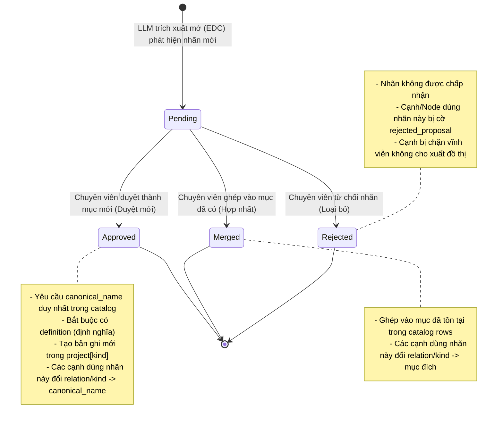
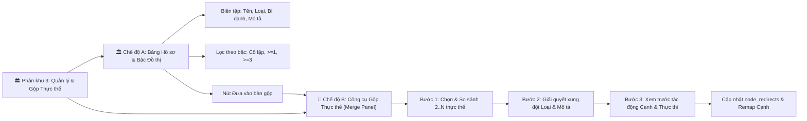

# BÁO CÁO TOÀN DIỆN VỀ CƠ CHẾ & LOGIC TẠI TAB 4: TRUNG TÂM KIỂM DUYỆT & CHUẨN HÓA TRI THỨC (KNOWLEDGE CURATION HUB)

- **Mã tài liệu:** `KG-TECH-DOC-TAB4-CURATION-HUB`
- **Dự án:** KG Studio Pro — Hệ thống Xây dựng & Khai phá Đồ thị Tri thức Đa nguồn
- **Phạm vi:** Toàn bộ cơ chế, logic nghiệp vụ, thuật toán, máy trạng thái, kiểm tra an toàn và kiến trúc của Màn hình 4 (`p04_curation_hub.py`)
- **Phiên bản kiến trúc:** Hợp nhất Chuẩn hóa Lược đồ (Schema EDC) & Kiểm duyệt Đồ thị (Graph Curation)
- **Ngày biên soạn:** 31/10/2026

---

## MỤC LỤC TỔNG QUAN

1. [Tổng quan & Vị trí Kiến trúc của Tab 4 trong KG Studio](#1-tổng-quan--vị-trí-kiến-trúc-của-tab-4-trong-kg-studio)
2. [Bảng Chỉ số Sức khỏe Đồ thị & Cầu nối Điều hướng Liên phân khu](#2-bảng-chỉ-số-sức-khỏe-đồ-thị--cầu-nối-điều-hướng-liên-phân-khu)
3. [Phân khu 1: Chuẩn hóa Lược đồ (Schema EDC & Target Alignment)](#3-phân-khu-1-chuẩn-hóa-lược-đồ-schema-edc--target-alignment)
   - 3.1. Bản chất nghiệp vụ & Mô hình dữ liệu Đề xuất Lược đồ
   - 3.2. Vòng đời & Máy trạng thái Đề xuất (State Machine)
   - 3.3. Thuật toán Phân tích Tác động Ngược $O(N + E)$ (`batch_proposal_impacts`)
   - 3.4. Ma trận Kiểm tra Xung đột Lô Đề xuất (Batch Conflicts & Validation)
   - 3.5. Bộ Chuẩn hóa Đích Tự động (Target Aligner & ML Verification)
   - 3.6. Chính sách Bảo vệ Dữ liệu Huấn luyện Con người (Gold-standard ML Constraint)
4. [Phân khu 2: Duyệt Quan hệ & Đối chiếu Bằng chứng (Edge Curation & Evidence Inspection)](#4-phân-khu-2-duyệt-quan-hệ--đối-chiếu-bằng-chứng-edge-curation--evidence-inspection)
   - 4.1. Bản chất nghiệp vụ & Bảng Dữ kiện Cạnh Quan hệ
   - 4.2. Bộ lọc 8 Tiêu chí Kết hợp & Thuật toán Băm Chữ ký Bộ lọc
   - 4.3. Thuật toán Xếp hạng Ưu tiên Cần duyệt (`_edge_priority_rank`)
   - 4.4. Cổng Kiểm tra Nghiêm ngặt trước Phê duyệt (`validate_edge_for_approval`)
   - 4.5. Khung Đối chiếu Hai Cột (Two-column Evidence Inspector)
   - 4.6. Cơ chế Tìm kiếm Bằng chứng, Fingerprint & Highlight Span
   - 4.7. Cơ chế Xác nhận Ngoại lệ Bằng chứng (Evidence Override)
   - 4.8. Cơ chế Duyệt Hàng loạt & Khóa Phiên bản (Batch Curation & Revision Protection)
   - 4.9. Ma trận Tác động khi Chỉnh sửa Cạnh (`update_edge`)
5. [Phân khu 3: Quản lý Hồ sơ Thực thể & Gộp Thực thể Trùng lặp (Entity Resolution)](#5-phân-khu-3-quản-lý-hồ-sơ-thực-thể--gộp-thực-thể-trùng-lặp-entity-resolution)
   - 5.1. Chế độ A: Bảng Hồ sơ Thực thể & Tính toán Bậc Đồ thị (`node_degrees`)
   - 5.2. Biên tập Hồ sơ Thực thể & Ma trận Ảnh hưởng Cạnh (`update_node`)
   - 5.3. Chế độ B: Thuật toán Phát hiện Thực thể Nghi trùng lặp (`duplicate_suggestions`)
   - 5.4. Cơ chế Đánh dấu Loại trừ Vĩnh viễn "Khác đối tượng" (`mark_pair_not_duplicate`)
   - 5.5. Quy trình Bàn Gộp Thực thể 3 Bước (3-step Entity Merge Staging)
   - 5.6. Thuật toán Ánh xạ lại Đầu mút Cạnh, node_redirects & Bảo toàn ID
   - 5.7. Nhóm Quan hệ Trùng lặp Hiển thị (`compute_apparent_duplicate_edge_groups`)
6. [Các Cơ chế Nền tảng Dùng chung (Cross-Cutting Foundations)](#6-các-cơ-chế-nền-tảng-dùng-chung-cross-cutting-foundations)
   - 6.1. Module Dùng chung `shared_curation_ui.py`
   - 6.2. Bộ nhớ đệm & Chỉ mục Phân trang SQLite (`sqlite_repo.py`)
   - 6.3. Kiểm soát Đồng thời Lạc quan (Optimistic Concurrency Control)
   - 6.4. Truy vết Lịch sử & Khôi phục Snapshot Dự án
7. [Bảng Tổng hợp Ma trận Trạng thái & So sánh Nghiệp vụ](#7-bảng-tổng-hợp-ma-trận-trạng-thái--so-sánh-nghiệp-vụ)

---

## 1. TỔNG QUAN & VỊ TRÍ KIẾN TRÚC CỦA TAB 4 TRONG KG STUDIO

Trong kiến trúc tổng thể 5 bước của KG Studio:
1. `1. Dự án & Tài liệu`: Khởi tạo không gian làm việc, nạp và chia nhỏ (chunking) tài liệu.
2. `2. Danh mục, EDC+R & ML Lab`: Định nghĩa ontology ban đầu, cấu hình prompt template và quản trị versioning.
3. `3. Trích xuất & Trace`: Thực thi các pipeline LLM trích xuất thực thể, quan hệ và bằng chứng từ văn bản.
4. **`4. Rà soát & Chuẩn hóa Tri thức (Knowledge Curation Hub)`: Điểm kiểm soát chất lượng (Gatekeeper) tập trung toàn bộ tri thức trước khi xuất khẩu.**
5. `5. Khai thác & Xuất đồ thị`: Trực quan hóa tương tác đồ thị 2D/3D, phân tích cụm tri thức, đồng bộ sang Neo4j, xuất định dạng JSON-LD/CSV/ZIP.

### Mô hình Hợp nhất 3-trong-1 (The Unified Knowledge Curation Hub)
Trước đây, hệ thống tách rời màn hình duyệt lược đồ mở EDC (Tab 4 cũ) và màn hình duyệt bộ ba quan hệ & gộp thực thể (Tab 5 cũ). Sự phân mảnh này dẫn đến hai điểm nghẽn nghiêm trọng:
- **Xung đột khái niệm (Terminology Collision):** Cả hai nơi đều có nút "Hợp nhất / Merge", khiến chuyên viên kiểm duyệt nhầm lẫn giữa việc gộp *nhãn khái niệm trừu tượng (Schema Category)* và gộp *thực thể đối tượng cá thể (Entity Instance)*.
- **Đứt gãy luồng công việc (Workflow Friction):** Khi duyệt một quan hệ ở Tab 5 bị cờ `Vướng danh mục (schema_blocked)`, người dùng phải thoát sang Tab 4, duyệt xong lại quay về tìm lại vị trí cạnh cũ.

Kiến trúc mới tại `p04_curation_hub.py` hợp nhất toàn bộ vào **Trung tâm Rà soát & Chuẩn hóa Tri thức** gồm 3 phân khu nghiệp vụ tương hỗ chặt chẽ:

```mermaid
flowchart TD
    subgraph Hub["🎯 TAB 4: KNOWLEDGE CURATION HUB"]
        Dashboard["📊 Unified Health Dashboard (6 chỉ số sức khỏe)"]
        Nav["🧭 Sub-Navigation Radio (3 Phân khu)"]
        
        subgraph Sec1["📐 Phân khu 1: Chuẩn hóa Lược đồ (Schema EDC)"]
            PropType["Loại thực thể đề xuất (entity_types)"]
            PropRel["Quan hệ đề xuất (relations)"]
            TargetAlign["Bộ chuẩn hóa đích tự động (Target Aligner)"]
            BatchSchema["Lô quyết định Lược đồ & Snapshot Undo"]
        end
        
        subgraph Sec2["🔬 Phân khu 2: Duyệt Quan hệ & Bằng chứng"]
            EdgeTable["Bảng Cạnh Quan hệ (Filter 8 tiêu chí + Priority Rank)"]
            EvidenceInsp["Khung đối chiếu 2 cột (Fact vs Văn bản trích đoạn HTML)"]
            OverrideGate["Cổng kiểm tra Schema + Override bằng chứng"]
            BatchEdge["Lô quyết định Quan hệ & Snapshot Undo"]
        end
        
        subgraph Sec3["🏛️ Phân khu 3: Quản lý & Gộp Thực thể (Entity Resolution)"]
            NodeProfile["Chế độ A: Bảng Hồ sơ Thực thể & Bậc đồ thị (Degrees)"]
            MergeTool["Chế độ B: Bàn gộp 3 bước (2..N Nodes)"]
            DupDetect["Phát hiện nghi trùng lặp (Blocking Keys + Fuzzy)"]
            Rewriter["Ánh xạ lại đầu mút cạnh + Bảng node_redirects"]
        end
    end
    
    Dashboard --> Nav
    Nav --> Sec1
    Nav --> Sec2
    Nav --> Sec3
    
    Sec1 --"Cung cấp danh mục hợp lệ"--> Sec2
    Sec2 --"Phát hiện quan hệ vướng danh mục (Jump Bridge)"--> Sec1
    Sec1 --"Hồi đáp ngữ cảnh quay lại (Return Context)"--> Sec2
    Sec2 --"Dẫn xuất danh sách Node hoạt động"--> Sec3
    Sec3 --"Gộp Node làm đổi đầu mút cạnh -> Chuyển về Cần kiểm tra"--> Sec2
```



---

## 2. BẢNG CHỈ SỐ SỨC KHỎE ĐỒ THỊ & CẦU NỐI ĐIỀU HƯỚNG LIÊN PHÂN KHU

### 2.1. Bảng 6 Chỉ số Sức khỏe Đồ thị & Lược đồ (Unified Metrics)
Ngay khi mở Tab 4, hệ thống tải tổng quan tình trạng tri thức qua 6 chỉ số:
1. **📐 Lược đồ chờ duyệt (`edc_counts['pending']`):** Số lượng đề xuất loại thực thể hoặc quan hệ mới do LLM sinh ra trong chế độ EDC/EDC+R đang ở trạng thái `pending`.
2. **🔬 Quan hệ chờ duyệt (`cur_stats['pending']`):** Số lượng các cạnh quan hệ cá thể trích xuất từ văn bản đang chờ chuyên viên xác thực.
3. **⚠️ Cần kiểm tra (`cur_stats['check']`):** Số lượng quan hệ bị nghi ngờ do: LLM đánh dấu độ tin cậy thấp, vừa trải qua việc sửa đổi dữ kiện, hoặc do đầu mút thực thể vừa bị gộp làm đổi loại thực thể.
4. **⛔ Vướng danh mục (`cur_stats['schema_blocked']`):** Số lượng quan hệ có quan hệ hoặc loại thực thể nguồn/đích chưa nằm trong danh mục chính thức đã duyệt, hoặc đang bị chặn bởi một đề xuất lược đồ `pending`/`rejected`.
5. **🔀 Cặp nghi trùng (`cur_stats['duplicate_pairs']`):** Số lượng cặp thực thể đối tượng có tên/bí danh nghi trùng lặp (được tính theo thuật toán Candidate Blocking & Fuzzy Similarity, có lưu cache theo phiên bản).
6. **📊 Quy mô Đồ thị (`cur_stats['nodes'] / cur_stats['edges']`):** Tổng kích thước mạng lưới tri thức hiện hành.

### 2.2. Thẻ Hành động Nhanh (Action Cards)
Bên dưới thanh chỉ số là 3 phím bấm hành động theo ngữ cảnh (Contextual Triggers):
- Nếu `schema_blocked > 0` hoặc `pending proposals > 0`: Nút nổi bật màu Primary kích hoạt chuyển ngay đến **Phân khu 1** để giải phóng tắc nghẽn lược đồ.
- Nếu `pending edges > 0`: Nút chuyển sang **Phân khu 2** để rà soát dữ kiện.
- Nếu `duplicate_pairs > 0`: Nút màu Primary chuyển sang **Phân khu 3** ở đúng chế độ gộp thực thể để làm sạch node trùng.

### 2.3. Cầu nối Ngữ cảnh Tháo gỡ Tắc nghẽn (Cross-section Navigation Bridge)
Đây là cơ chế giải quyết triệt để sự đứt gãy luồng công tác khi một cạnh ở Phân khu 2 bị cờ `⛔ Vướng danh mục`:
1. Tại Khung Soi chiếu Bằng chứng của cạnh bị chặn, hệ thống phân tích `inspect_edge_schema_status` và tìm ra danh sách `blocking_proposal_ids`.
2. Hệ thống hiển thị nút: `🔗 Mở đề xuất [Tên đề xuất] ở Phân khu 1 để xử lý`.
3. Khi chuyên viên nhấn nút, hàm `navigate_to_edc_proposal_from_curation` lưu thông tin vào `st.session_state["_curation_return_context"]` gồm: `project_id`, `proposal_id`, `edge_id`, `section="edges"`, và kích hoạt chuyển sang Phân khu 1.
4. Tại Phân khu 1, một Banner màu xanh da trời xuất hiện ở đầu trang:
   > *"🔗 Bạn vừa chuyển từ Phân khu Quan hệ sang để xử lý đề xuất EDC `[ID]` đang chặn cạnh `[Edge ID]`."*
5. Đi kèm banner là nút bấm `↩️ Quay lại mục đang kiểm duyệt ở Phân khu Quan hệ`. Khi người dùng duyệt hoặc hợp nhất đề xuất xong, chỉ cần nhấn nút này, hệ thống sẽ gọi `return_to_curation_from_edc`, đưa người dùng trở lại đúng Phân khu 2 với cạnh cũ đang được chọn tiêu điểm (`focused_edge_id`).

---

## 3. PHÂN KHU 1: CHUẨN HÓA LƯỢC ĐỒ (SCHEMA EDC & TARGET ALIGNMENT)

### 3.1. Bản chất Nghiệp vụ & Mô hình Dữ liệu Đề xuất Lược đồ
Phân khu 1 hoạt động hoàn toàn trên **Lớp Lược đồ (Schema / Ontology Layer)**. Nó xử lý hai loại danh mục:
- `entity_types` (Loại thực thể): Ví dụ: `Di tích lịch sử`, `Danh lam thắng cảnh`, `Nhân vật lịch sử`, `Triều đại`.
- `relations` (Loại quan hệ): Ví dụ: `nằm tại`, `được xây dựng năm`, `thờ phụng`, `thuộc quyền quản lý của`.

Mỗi đề xuất lược đồ (`schema_proposal`) được hình thành trong quá trình trích xuất mở (Extraction Mode = `edc` hoặc `edc_plus_r`) có cấu trúc dữ liệu:
```json
{
  "id": "prop_8f3a92...",
  "kind": "relations", // hoặc "entity_types"
  "name": "thờ_vị",
  "definition": "Quan hệ chỉ một ngôi đền, chùa hoặc di tích thờ phụng một nhân vật tôn giáo hoặc lịch sử cụ thể",
  "description": "Di tích thờ phụng nhân vật",
  "status": "pending", // "pending" | "approved" | "merged" | "rejected"
  "canonical_name": "", // Gán khi status là approved hoặc merged
  "auto_aligned": false,
  "decision_origin": "", // "human" | "auto_align" | "llm_verified_auto"
  "observations": [
    {
      "doc_id": "doc_01",
      "chunk_hash": "a1b2...",
      "example": "Đền Quán Thánh — thờ_vị → Huyền Thiên Trấn Vũ",
      "evidence": "Đền Quán Thánh là nơi thờ thần Huyền Thiên Trấn Vũ..."
    }
  ],
  "alignment_candidates": [
    {
      "name": "thờ phụng",
      "score": 0.92,
      "definition": "Công trình tín ngưỡng thờ vị thánh, thần hoặc danh nhân",
      "verified_by_llm": false
    }
  ],
  "created_at": "2026-10-31T08:00:00Z"
}
```

### 3.2. Vòng đời & Máy Trạng thái Đề xuất (State Machine)



- **Hành động `approve` (Duyệt thành mục mới):**
  - Chuyển `status = "approved"`.
  - Tạo mục mới vào danh mục chính thức của dự án (`project["relations"]` hoặc `project["entity_types"]`).
  - Yêu cầu bắt buộc: `canonical_name` không được rỗng, không được trùng với mục đã có trong danh mục (nếu trùng hệ thống yêu cầu chuyển sang `merge`), và phải có `definition` để phục vụ làm ngữ cảnh cho LLM trong các lượt trích xuất sau.
- **Hành động `merge` (Hợp nhất vào mục danh mục có sẵn):**
  - Chuyển `status = "merged"`.
  - Gán `canonical_name` bằng tên của mục danh mục đích đã chọn.
  - Tự động thay thế tên quan hệ trên toàn bộ các cạnh liên quan hoặc loại thực thể trên toàn bộ các node liên quan thành tên chuẩn.
- **Hành động `reject` (Loại bỏ):**
  - Chuyển `status = "rejected"`.
  - `canonical_name = ""`. Các cạnh và node liên quan lập tức bị cờ `rejected_proposal`. Chuyên viên bắt buộc phải chỉnh sửa lại cạnh thủ công ở Phân khu 2 hoặc xóa bỏ cạnh.

### 3.3. Thuật toán Phân tích Tác động Ngược $O(N + E)$ (`batch_proposal_impacts`)
Khi chuyên viên xem trước một quyết định lược đồ (hoặc hàng loạt quyết định), hệ thống cần trả lời ngay: *Đề xuất này ảnh hưởng đến bao nhiêu node, bao nhiêu cạnh trực tiếp và bao nhiêu cạnh gián tiếp?*

Thay vì duyệt lặp từng đề xuất quét toàn bộ đồ thị gây độ phức tạp $O(P \times (N + E))$ làm treo giao diện, backend thực hiện thuật toán **Chỉ mục ngược một lần quét (Single-pass Inverted Index)** đạt độ phức tạp $O(N + E)$:
1. **Bước 1 - Quét Node ($O(N)$):** Xây dựng hai bản đồ liên kết: `prop_to_nodes: dict[proposal_id, list[node_id]]` và `node_to_props: dict[node_id, set[proposal_id]]`.
2. **Bước 2 - Quét Cạnh ($O(E)$):**
   - Lấy `direct_props` trực tiếp gắn trên cạnh (`edge["schema_proposal_ids"]`).
   - Lấy `indirect_props` từ hai đầu mút của cạnh: `node_to_props[edge.source] | node_to_props[edge.target]`.
   - Ghi nhận `edge["id"]` vào `prop_to_direct_edges` và `prop_to_indirect_edges`.
3. **Bước 3 - Tổng hợp kết quả:** Trả về cấu trúc tác động cho từng `proposal_id` với thời gian tính toán tức thì.

### 3.4. Ma trận Kiểm tra Xung đột Lô Đề xuất (Batch Conflicts & Validation)
Hàm `preview_proposal_decisions` thực thi kiểm tra tính hợp lệ đa tầng trước khi cho phép áp dụng lô:
- **Kiểm tra Trùng lặp Nội tại:** Cùng một đề xuất xuất hiện nhiều lần với hành động mâu thuẫn trong cùng một lô sẽ bị từ chối ngay.
- **Xung đột Duyệt mới Trùng tên:** Không cho phép 2 đề xuất khác nhau cùng chọn hành động `approve` với cùng một tên chuẩn mới trong cùng một lô.
- **Xung đột Hợp nhất vào Mục mới tạo:** Không cho phép đề xuất A chọn `merge` vào một mục mà đề xuất B vừa mới `approve` trong cùng lô đó (nhằm tránh phụ thuộc vòng và lỗi thứ tự thực thi).
- **Xung đột Tác động trên cùng Node hoặc Cạnh:** Nếu một Node có chứa 2 đề xuất lược đồ loại thực thể, mà lô quyết định chỉ định 2 kết quả khác nhau (ví dụ một cái đổi thành `Nhân vật`, một cái đổi thành `Địa danh`), hệ thống lập tức bắt lỗi:
  $$\text{Conflict: Node } X \text{ có tác động mâu thuẫn giữa các đề xuất } P_1, P_2$$

### 3.5. Bộ Chuẩn hóa Đích Tự động (Target Aligner & ML Verification)
Module `backend/domain/schema_intelligence/aligner.py` đảm nhận việc tự động đối chiếu các nhãn mở với danh mục chuẩn thông qua mô hình Embedding:
1. **Vector Embedding Search:** Biểu diễn vector của `open_name + open_definition` được đối chiếu với vector của toàn bộ các mục danh mục đích (`VectorIndexRepository`). Điểm tương đồng được tính bằng Cosine Similarity trong khoảng $[0.0, 1.0]$.
2. **Quy tắc Phân ngưỡng Tự động:**
   - **Tự động Hợp nhất (Auto-align):** Nếu Cosine Score $\ge \text{auto\_align\_threshold}$ (mặc định $0.86$), đề xuất tự động được chuyển sang trạng thái `merged`, gán `canonical_name = candidate.name` và đánh dấu `auto_aligned = True`.
   - **Gợi ý Xem xét (Candidate Suggestion):** Nếu $0.45 \le \text{Score} < 0.86$, hệ thống xếp hạng ứng viên và lưu vào danh sách `alignment_candidates` kèm huy hiệu điểm số để chuyên viên tham khảo khi duyệt tay.
   - **Khái niệm Hoàn toàn mới (Novel Proposal):** Nếu Score $< 0.45$, hệ thống cảnh báo đây là khái niệm mới, khuyến nghị duyệt thành mục mới (`approve`).
3. **LLM Verifier (Xác thực lại bằng LLM):** Khi tùy chọn `enable_llm_verifier=True`, hệ thống sinh một prompt trắc nghiệm gửi tới LLM Gateway, đưa ra tên mở, ngữ cảnh, ví dụ trích dẫn và danh sách các lựa chọn $A, B, C...$. Chỉ khi LLM chọn đúng mục danh mục tương ứng thì mới kích hoạt tự động gộp.

### 3.6. Chính sách Bảo vệ Dữ liệu Huấn luyện Con người (Gold-standard ML Constraint)
Đây là một quy tắc kiến trúc tối quan trọng của KG Studio:
> **Ràng buộc:** Toàn bộ các đề xuất có cờ `auto_aligned = True` và các cạnh quan hệ được tự động chuẩn hóa bởi máy **bị cách ly và đánh dấu cờ nguồn gốc `decision_origin = "auto_align"` hoặc `"llm_verified_auto"`**.
> 
> Khi hệ thống xuất tập dữ liệu huấn luyện (Training Set / Fine-tuning Data) tại hàm `export_training_datasets`, **hệ thống lọc bỏ 100% các mục `auto_aligned = True`**, chỉ giữ lại các quyết định do con người trực tiếp phê chuẩn (`decision_origin = "human"`). Điều này ngăn ngừa triệt để hiện tượng suy thoái dữ liệu (Model Collapse / Data Poisoning) khi dùng dữ liệu AI để huấn luyện lại AI.

---

## 4. PHÂN KHU 2: DUYỆT QUAN HỆ & ĐỐI CHIẾU BẰNG CHỨNG (EDGE CURATION & EVIDENCE INSPECTION)

### 4.1. Bản chất Nghiệp vụ & Bảng Dữ kiện Cạnh Quan hệ
Phân khu 2 là trung tâm kiểm duyệt các **Dữ kiện thực tế (Fact Triples)** trích xuất từ tài liệu. Mỗi dòng trong bảng đại diện cho một cạnh có hướng:
$$\text{Source Node } (S) \xrightarrow{\quad\text{Relation }(R)\quad} \text{Target Node } (T)$$
Kèm theo câu trích dẫn chứng minh nguyên văn (`evidence`) và tọa độ trích xuất trong tài liệu gốc (`doc_id`, `chunk_number`, `start_char`, `end_char`).

### 4.2. Bộ lọc 8 Tiêu chí Kết hợp & Thuật toán Băm Chữ ký Bộ lọc
Bảng quan hệ được trang bị bộ lọc đa chiều (Khu vực A):
1. **Trạng thái (`status`):** Tất cả, Chờ duyệt (`pending`), Cần kiểm tra (`check`), Đã duyệt (`approved`), Loại bỏ (`rejected`).
2. **Tài liệu nguồn (`doc_id`):** Lọc theo từng tài liệu cụ thể.
3. **Quan hệ (`relation`):** Lọc theo tên quan hệ chuẩn hóa.
4. **Thực thể liên quan (`entity_id`):** Lọc tất cả các cạnh mà thực thể này là nguồn hoặc đích.
5. **Loại thực thể (`entity_kind`):** Lọc theo loại thực thể của hai đầu mút.
6. **Tình trạng bằng chứng (`evidence_state`):** Khớp văn bản (`matched`), Không tìm thấy (`not_found`), Đã xác nhận ngoại lệ (`override`), Xuất hiện nhiều vị trí (`ambiguous`).
7. **Tình trạng danh mục (`schema_state`):** Hợp lệ (`valid`), Bị chặn (`blocked`), Còn đề xuất chờ (`pending_proposal`), Đề xuất bị từ chối (`rejected_proposal`), Ngoài danh mục (`out_of_catalog`).
8. **Tìm kiếm văn bản (`search`):** Khớp chuỗi không dấu trên tên nguồn, đích, quan hệ, trích dẫn và ghi chú kiểm duyệt.

**Thuật toán Băm Chữ ký Bộ lọc (`compute_edge_filter_signature`):**
Mọi giá trị của 8 tiêu chí trên được chuẩn hóa JSON và băm SHA-256 lấy 16 ký tự đầu:
$$\text{Signature} = \text{SHA256}(\text{JSON}(\text{Filters}))[:16]$$
Khi chữ ký này thay đổi giữa các lượt hiển thị, hệ thống tự động nhận diện người dùng đã đổi tiêu chí tìm kiếm, từ đó tự động đưa số trang về `Trang 1` và giải phóng các dòng đang được chọn tích lũy.

### 4.3. Thuật toán Xếp hạng Ưu tiên Cần duyệt (`_edge_priority_rank`)
Để chuyên viên kiểm duyệt không bị phân tâm bởi các dữ kiện đã sạch, danh sách cạnh mặc định được sắp xếp theo hàm lượng cần chú ý (Severity-first Ranking):
$$\text{Rank}(e) = \big(\text{status\_order}(e),\; \text{issue\_rank}(e),\; \text{edge\_id}\big)$$
- **`status_order`:** `check` (0 - Cao nhất) $\rightarrow$ `pending` (1) $\rightarrow$ `approved` (2) $\rightarrow$ `rejected` (3).
- **`issue_rank`:** Khởi tạo bằng $0$.
  - Nếu bằng chứng không tìm thấy trong tài liệu (`not found`): $\text{issue\_rank} \mathrel{-}= 2$ (đẩy lên trước).
  - Nếu vướng danh mục (`status_code != 'valid'`): $\text{issue\_rank} \mathrel{-}= 1$ (đẩy lên trước).

### 4.4. Cổng Kiểm tra Nghiêm ngặt trước Phê duyệt (`validate_edge_for_approval`)
Một cạnh **chỉ được phép phê duyệt (`status = approved`)** nếu vượt qua toàn bộ 5 chốt chặn của hàm kiểm định thống nhất:
1. **Chốt chặn Đầu mút Đồ thị:** Cả `source` và `target` phải tồn tại trong danh sách node đang hoạt động của dự án. Nếu node bị xóa do gộp hoặc lỗi, cạnh bị chặn phê duyệt.
2. **Chốt chặn Quan hệ Rỗng:** Tên quan hệ không được để trống.
3. **Chốt chặn Tài liệu Gốc:** Tài liệu nguồn `doc_id` phải tồn tại trong dự án và nội dung văn bản không được rỗng.
4. **Cổng Lược đồ Độc lập 3 Thành phần (Granular 3-Component Schema Gate):**
   Thay vì gom chung các đề xuất gây nghẽn liên đới, hệ thống tách bạch kiểm định theo 3 thành phần độc lập:
   - **Thành phần Quan hệ ($R$):** Nếu `relation` đã có trong danh mục quan hệ đã duyệt $\implies$ Hợp lệ 100% về quan hệ (bỏ qua không xét chặn). Nếu chưa có, chỉ rõ tên đề xuất quan hệ đang chờ hoặc bị từ chối.
   - **Thành phần Node Nguồn ($S$):** Nếu loại thực thể nguồn `src_node.kind` đã có trong danh mục loại thực thể đã duyệt $\implies$ Hợp lệ 100% về loại nguồn. Nếu chưa có, chỉ rõ loại thực thể nguồn đang chờ duyệt.
   - **Thành phần Node Đích ($T$):** Nếu loại thực thể đích `tgt_node.kind` đã có trong danh mục loại thực thể đã duyệt $\implies$ Hợp lệ 100% về loại đích. Nếu chưa có, chỉ rõ loại thực thể đích đang chờ duyệt.
   - **Điều kiện Đạt chuẩn:** Khi cả 3 thành phần ($R, S.kind, T.kind$) đều nằm trong danh mục chính thức $\implies$ Cạnh đạt trạng thái Hợp lệ (`valid`) 100%. Nếu có thành phần bị vướng, hệ thống gán nhãn huy hiệu tương ứng (`⛔ Quan hệ chờ duyệt`, `⛔ Loại nguồn chờ duyệt`, `⛔ Loại đích chờ duyệt`, `❌ Đề xuất bị từ chối`) và giải thích chi tiết chính xác thành phần gây lỗi.
5. **Cổng Cạnh Tự nối (Self-loop Check):**
   - Nếu $\text{source} == \text{target}$ (cạnh tự trỏ vào chính mình):
     - Trong chế độ duyệt lô: **Bị loại bỏ tự động khỏi lô duyệt**, vì tự nối tiềm ẩn rủi ro lỗi logic đồ thị.
     - Trong chế độ duyệt đơn: Bắt buộc người duyệt phải tích vào ô xác nhận `"Cạnh tự nối này có ý nghĩa ngữ nghĩa"` (`self_loop_confirmed=True`) và bắt buộc nhập ghi chú giải trình.
6. **Cổng Bằng chứng Trích dẫn (Evidence Gate):**
   - Câu trích dẫn bằng chứng `evidence` không được rỗng.
   - Bằng chứng phải tìm thấy nguyên văn trong văn bản gốc. Nếu không tìm thấy, hệ thống kích hoạt yêu cầu xác nhận ngoại lệ (Override Requirement).

### 4.5. Khung Đối chiếu Hai Cột (Two-column Evidence Inspector)
Khi chọn một dòng trong bảng cạnh, Khung đối chiếu chi tiết mở ra ở Khu vực B với layout hai cột song song:
- **Cột Trái (Dữ kiện Đề xuất & Cổng Danh mục):**
  - Hiển thị bộ ba: Node Nguồn $\rightarrow$ Quan hệ $\rightarrow$ Node Đích kèm loại thực thể.
  - Nhãn mở ban đầu do LLM sinh ra và định nghĩa ngữ cảnh.
  - Tên mô hình AI và ID lượt chạy (Run ID) đã trích xuất ra cạnh này.
  - Tình trạng danh mục và nút bấm cầu nối chuyển sang Trang 4 nếu bị vướng.
  - Form kiểm duyệt đơn: Chọn trạng thái (`approved`, `check`, `rejected`), mã lý do từ chối chuẩn (`REJECTION_REASON_CODES`), ô nhập ghi chú và ô lý do ngoại lệ.
- **Cột Phải (Ngữ cảnh Văn bản Gốc & Định vị Đoạn văn):**
  - Tên tài liệu nguồn, số trang (nếu có), số thứ tự chunk.
  - Khung văn bản HTML với thẻ highlight trực quan.
  - Bộ chọn vị trí trích dẫn khi có nhiều vị trí trùng khớp (`ambiguous`).

### 4.6. Cơ chế Tìm kiếm Bằng chứng, Fingerprint & Highlight Span
Hàm `evidence_context` trong `backend/domain/curation/evidence.py` thực hiện định vị trích dẫn trên văn bản theo cơ chế tối ưu hai luồng:
1. **Đường nhanh (Direct Slice Check - $O(1)$):**
   - Tài liệu gốc được gán một vân tay SHA-256 (`doc_fingerprint`) dựa trên độ dài và nội dung văn bản.
   - Nếu vân tay tài liệu hiện tại khớp với vân tay lưu trên cạnh (`saved_fp == cur_fp`), hệ thống cắt trực tiếp lát cắt ký tự `text[start_char : end_char]`.
   - Nếu lát cắt khớp chính xác với câu bằng chứng, hệ thống trả về kết quả ngay lập tức mà không cần quét văn bản.
2. **Đường chậm (Full Scan Fallback):**
   - Nếu vân tay thay đổi hoặc tọa độ chưa có:
     - Quét tìm kiếm chính xác (`str.find`) tất cả các vị trí xuất hiện của câu trích dẫn trong văn bản gốc.
     - Nếu không tìm thấy chính xác: Sử dụng Regular Expression chuẩn hóa khoảng trắng (`\s+`) để tìm kiếm qua các dấu xuống dòng và dấu cách thừa (`match_method = "normalized"`).
   - **Xử lý Đa vị trí (Ambiguity Detection):** Nếu tìm thấy từ 2 vị trí trở lên trong tài liệu, hệ thống đánh dấu `ambiguous = True`, hiển thị danh sách các vị trí (kèm số ký tự bắt đầu/kết thúc) để chuyên viên bấm chọn ghim vị trí chuẩn xác nhất (`select_edge_evidence_span`).
3. **Hiển thị HTML Nổi bật An toàn (`format_highlighted_evidence_html`):**
   - Văn bản trước trích dẫn, câu trích dẫn và văn bản sau trích dẫn đều được xử lý qua `html.escape` để chống tấn công XSS.
   - Câu trích dẫn được bọc trong thẻ `<mark>` màu vàng với style bo góc nổi bật:
   ```html
   <div style='padding:12px;border:1px solid #cbd5e1;background:#f8fafc...'>
     [Văn bản trước]
     <mark style='background:#fde047;padding:2px 4px;font-weight:600;'>[Câu trích dẫn]</mark>
     [Văn bản sau]
   </div>
   ```

### 4.7. Cơ chế Xác nhận Ngoại lệ Bằng chứng (Evidence Override)
Trong thực tế văn bản lịch sử hoặc báo chí, có những trường hợp LLM tóm lược dữ kiện đúng về bản chất nhưng câu trích dẫn bị cắt ngắn hoặc biến dạng một vài chữ, khiến đối chiếu nguyên văn thất bại (`found = False`).
- Nếu chuyên viên muốn chấp nhận dữ kiện này: Hệ thống **ngăn cấm việc phê duyệt âm thầm**.
- Bắt buộc chuyên viên phải kích hoạt cơ chế **Ngoại lệ bằng chứng (Evidence Override)**:
  - Nhập rõ ràng `override_reason` (Lý do ngoại lệ, tối thiểu không được để trống).
  - Chọn phương thức `override_method` (mặc định: `manual_verification` - Chuyên viên đã tự đọc và kiểm chứng ngoài văn bản).
  - Cạnh được lưu với cờ `override = True`, `match_method = "override"`.
  - Hệ thống tự động ghi nhật ký vào `review_note`:
    `[Ngoại lệ bằng chứng] <Lý do> — <Tên người duyệt>`

### 4.8. Cơ chế Duyệt Hàng loạt & Khóa Phiên bản (Batch Curation & Revision Protection)
Chức năng duyệt hàng loạt tại Phân khu 2 cho phép áp dụng quyết định trên $10, 50$ hoặc hàng trăm cạnh cùng lúc:
1. **Khóa Phiên bản (Revision Lock):**
   - Khi chuyên viên nhấn `Xem trước lô duyệt`, hệ thống tính toán `compute_project_revision(project)` và lưu vào `CurationPreviewDTO`.
   - Khi nhấn `Áp dụng lô duyệt`, hệ thống so sánh phiên bản hiện tại của dự án với `expected_revision`. Nếu dự án bị thay đổi bởi phiên làm việc khác hoặc do vừa gộp node, hệ thống từ chối áp dụng và yêu cầu xem trước lại (Optimistic Concurrency Control).
2. **Hai Chế độ Áp dụng:**
   - **`all_or_nothing` (An toàn tuyệt đối):** Nếu trong lô có dù chỉ 1 cạnh bị lỗi validation (ví dụ vướng danh mục hoặc thiếu bằng chứng chưa override), toàn bộ lô bị hủy bỏ, không có cạnh nào bị thay đổi trạng thái.
   - **`valid_only` (Áp dụng các cạnh hợp lệ):** Hệ thống chỉ áp dụng các cạnh vượt qua kiểm định; các cạnh bị lỗi được giữ nguyên trạng thái cũ kèm báo cáo lỗi chi tiết từng cạnh.
3. **Lưu vết Lịch sử Lô (`curation_decision_batches`):**
   Mỗi lần áp dụng lô, một bản ghi nhật ký được sinh ra lưu đầy đủ: `batch_id`, `actor`, `apply_mode`, danh sách `applied_ids`, danh sách `skipped_ids`, `revision_before`, `revision_after` và danh sách kết quả chi tiết từng dòng.

### 4.9. Ma trận Tác động khi Chỉnh sửa Cạnh (`update_edge`)
Khi chuyên viên chỉnh sửa một cạnh trong Khung đối chiếu (đổi Source, Target, Relation, Document hoặc Text Evidence), hệ thống áp dụng Ma trận ảnh hưởng nghiêm ngặt:
- **Đổi Ngữ nghĩa (Đổi Node nguồn, Node đích, Tên quan hệ, Bằng chứng hoặc Tài liệu):**
  - Cạnh tự động bị chuyển trạng thái về **`check` (Cần kiểm tra)** (trừ trường hợp cạnh đang ở trạng thái `rejected`).
  - **Thu hồi toàn bộ hiệu lực phê duyệt cũ:** Xóa ngày duyệt (`reviewed_at = ""`), xóa cờ ngoại lệ (`override = False`, `override_reason = ""`), xóa cờ xác nhận tự nối (`self_loop_confirmed = False`).
  - Xóa tọa độ ký tự cũ (`verified_start_char = None`).
  - Tự động chạy lại hàm `recheck_edge_evidence` để đối chiếu trích dẫn trên tài liệu mới.
- Ghi nhận đầy đủ trạng thái `before` và `after` vào `project["curation_history"]`.

---

## 5. PHÂN KHU 3: QUẢN LÝ HỒ SƠ THỰC THỂ & GỘP THỰC THỂ TRÙNG LẶP (ENTITY RESOLUTION)

Phân khu 3 là nơi quản trị các **Đối tượng Thực thể Cá thể (Entity Instances / Nodes)** trong đồ thị tri thức. Phân khu này gồm hai chế độ hiển thị:



### 5.1. Chế độ A: Bảng Hồ sơ Thực thể & Tính toán Bậc Đồ thị (`node_degrees`)
Hệ thống hiển thị danh sách toàn bộ các thực thể hiện hữu trong đồ thị.
- **Tính toán Bậc Đồ thị theo thời gian thực:**
  Hàm `node_degrees(project)` quét qua tập cạnh (bỏ qua các cạnh đã bị `rejected`) để tính toán:
  - Bậc vào (`in-degree`): Số lượng quan hệ trỏ đến thực thể.
  - Bậc ra (`out-degree`): Số lượng quan hệ xuất phát từ thực thể.
  - Tổng bậc (`total-degree`): $in + out$.
- **Bộ lọc Thực thể Chuyên dụng:**
  - Lọc theo loại thực thể (`kind`).
  - Lọc theo bậc kết nối: Tất cả, Thực thể cô lập ($total = 0$), Thực thể có liên kết ($total \ge 1$), Thực thể trung tâm ($total \ge 3$).
  - Lọc thực thể nghi trùng: Chỉ hiện các thực thể đang nằm trong danh sách gợi ý nghi trùng lặp.
  - Lọc tình trạng danh mục: Hợp lệ hay vướng đề xuất loại thực thể chưa duyệt.

### 5.2. Biên tập Hồ sơ Thực thể & Ma trận Ảnh hưởng Cạnh (`update_node`)
Bên dưới bảng danh sách là Khung Chỉnh sửa Hồ sơ Thực thể (`render_entity_profile_inspector`):
- **Sửa Tên, Bí danh, Mô tả:** Cập nhật thông tin thực thể, giữ nguyên ID, ghi audit log vào `curation_history`. Trạng thái của các cạnh nối với thực thể này **được giữ nguyên** vì không làm thay đổi phân loại ontology.
- **Đổi Loại Thực thể (`kind`):**
  - Loại thực thể mới bắt buộc phải nằm trong danh mục `entity_types` đã duyệt.
  - **Ma trận Ảnh hưởng Cạnh:** Khi một node bị đổi loại thực thể, **toàn bộ các cạnh quan hệ có node này làm nguồn hoặc đích lập tức bị chuyển trạng thái về `check` (Cần kiểm tra)** (trừ các cạnh đang bị `rejected`), đồng thời thu hồi mọi phê duyệt và ngoại lệ trước đó. Điều này đảm bảo tính đúng đắn ngữ nghĩa của đồ thị (ví dụ một node đổi từ `Địa danh` thành `Nhân vật` thì quan hệ `nằm tại` trước đó bắt buộc phải được chuyên viên rà soát lại).

### 5.3. Chế độ B: Thuật toán Phát hiện Thực thể Nghi trùng lặp (`duplicate_suggestions`)
Để phát hiện các thực thể trùng lặp trong hàng ngàn node mà không gây nghẽn trình duyệt, hệ thống áp dụng kỹ thuật **Candidate Blocking kết hợp Inverted Index**:
1. **Tiền xử lý Chuẩn hóa:** Chuẩn hóa toàn bộ tên chính và các bí danh của các node bằng `normal(text)` (chuyển chữ thường, bỏ dấu tiếng Việt, chuẩn hóa khoảng trắng).
2. **Khóa Chặn (Blocking Keys / Inverted Index):**
   - `name_to_indices`: Gom các node có tên chuẩn hóa trùng nhau.
   - `alias_to_indices`: Gom các node có bí danh giao nhau.
   - `token_to_indices`: Đánh chỉ mục ngược theo từng từ tố ($\ge 3$ ký tự) xuất hiện trong tên.
   - `prefix_to_indices`: Đánh chỉ mục ngược theo tiền tố 3 ký tự đầu.
3. **Gom Cặp Ứng viên (Candidate Pairs):**
   - Gom các cặp có cùng tên hoặc bí danh.
   - Chỉ đối chiếu sâu các cặp chia sẻ chung token hoặc prefix có tần suất xuất hiện hợp lý ($1 < \text{count} \le 60$), loại bỏ các stop words phổ biến.
4. **Tính Điểm Tương đồng (Similarity Scoring):**
   - Kiểm tra trùng tên chuẩn hóa: Lý do `"Trùng tên chuẩn hóa"`, Điểm $= 1.0$.
   - Kiểm tra tên là bí danh của nhau: Lý do `"Tên này là bí danh của tên kia"`.
   - Kiểm tra bí danh chung: Lý do `"Có bí danh chung"`.
   - Tính toán độ tương đồng xâu bằng `difflib.SequenceMatcher.ratio()`. Nếu $\text{score} \ge \text{fuzzy\_threshold}$ (mặc định $0.82$), đưa vào danh sách nghi trùng.
5. **Bộ nhớ đệm 3 Tầng (`_DUPLICATE_SUGGESTIONS_CACHE`):**
   Kết quả được cache theo khóa `(project_id, project_revision, fuzzy_threshold)`. Khi người dùng tương tác trên UI mà không làm thay đổi dữ liệu đồ thị, thuật toán $O(1)$ trả về kết quả ngay lập tức từ RAM.

### 5.4. Cơ chế Đánh dấu Loại trừ Vĩnh viễn "Khác đối tượng" (`mark_pair_not_duplicate`)
Khi hệ thống gợi ý 2 thực thể nghi trùng (ví dụ: *Trần Hưng Đạo* [Nhân vật] và *Đường Trần Hưng Đạo* [Địa danh]), nếu chuyên viên xác định đây là hai thực thể khác nhau:
- Nhấn nút **`🚫 Khác đối tượng (Không gợi ý lại)`**.
- Hệ thống tính toán một dấu vân tay cặp (`_node_pair_fingerprint`) dựa trên: `id`, `name`, `kind`, `aliases` của cả 2 node.
- Lưu bản ghi vào danh sách `project["not_duplicate_pairs"]`.
- Trong các lần quét tiếp theo, chừng nào thông tin của 2 node chưa bị sửa đổi, hệ thống sẽ tự động lọc bỏ cặp này khỏi danh sách gợi ý. Nếu một trong hai node bị sửa đổi thông tin (vân tay thay đổi), gợi ý sẽ được kích hoạt lại để đảm bảo an toàn.

### 5.5. Quy trình Bàn Gộp Thực thể 3 Bước (3-step Entity Merge Staging)
Khi cần gộp $2, 3$ hoặc $N$ thực thể đồng nghĩa về một thực thể đại diện duy nhất, hệ thống hướng dẫn chuyên viên qua quy trình 3 bước chặt chẽ:

#### Bước 1: Chọn và So sánh Đối chiếu Thực thể
- Chọn từ 2 thực thể trở lên thông qua ô đa chọn (`multiselect`) hoặc nhấn `➕ Đưa cặp này vào bàn gộp` từ bảng gợi ý.
- Bảng đối chiếu đặt các thực thể cạnh nhau để so sánh: ID, Tên, Loại, Danh sách bí danh, Mô tả, Số tài liệu xuất hiện và Bậc kết nối.

#### Bước 2: Giải quyết Xung đột Dữ liệu & Chọn Hồ sơ Chuẩn
- **Chỉ định Thực thể Đích (`keep_id`):** Chuyên viên bắt buộc phải chọn rõ ràng 1 thực thể giữ lại ID (mặc định gợi ý thực thể có bậc kết nối cao nhất). Các thực thể còn lại gọi là `drop_ids`.
- **Tên Chuẩn (`canonical_name`):** Nhập tên chính thức cho thực thể sau gộp. Toàn bộ tên cũ của các thực thể bị gộp tự động được chuyển thành bí danh (`aliases`).
- **Xử lý Xung đột Loại Thực thể (`canonical_kind`):**
  - Nếu các thực thể đem gộp có loại khác nhau: Hệ thống bật cảnh báo màu vàng:
    `⚠️ Xung đột loại thực thể: [...]. Bắt buộc nhập lý do giải quyết xung đột.`
  - Chuyên viên bắt buộc phải chọn loại thực thể chuẩn từ danh mục và nhập trường `kind_resolution_note`.
- **Xử lý Xung đột Mô tả (`canonical_description`):**
  - Không tự động nối chuỗi máy móc nếu các thực thể có mô tả khác nhau.
  - Chuyên viên chủ động chọn giữ mô tả của node nào hoặc nhập mô tả tổng hợp mới.

#### Bước 3: Xem trước Tác động & Thực thi An toàn
Nhấn nút `🔍 Xem trước tác động gộp`:
- Hệ thống chạy hàm `preview_entity_merge` mô phỏng toàn bộ tác động lên đồ thị mà chưa ghi dữ liệu.
- Hiển thị thống kê tác động: Số cạnh bị đổi đầu mút, số cạnh phát sinh tự nối mới, số cạnh bị hủy hiệu lực duyệt do đổi loại node, và danh sách các nhóm cạnh trùng lặp.
- Chỉ khi bản xem trước hợp lệ (`valid = True`), nút `✅ Xác nhận gộp thực thể an toàn` mới được kích hoạt.

### 5.6. Thuật toán Ánh xạ lại Đầu mút Cạnh, `node_redirects` & Bảo toàn ID
Hàm `apply_entity_merge` thực thi việc gộp với 4 nguyên tắc bảo toàn dữ liệu:
1. **Bảo toàn 100% ID Cạnh và Bằng chứng (Edge Preservation):**
   Hệ thống **tuyệt đối không xóa bất kỳ cạnh nào**, kể cả khi sau khi gộp hai cạnh trở nên giống hệt nhau về bộ ba $(S, R, T)$. Mỗi cạnh đại diện cho một câu trích dẫn độc lập từ tài liệu và phải được bảo toàn nguyên vẹn ID và lịch sử trích xuất.
2. **Ánh xạ lại Đầu mút Cạnh (Endpoint Remapping):**
   - Quét qua toàn bộ danh sách cạnh trong dự án.
   - Nếu `edge.source in drop_ids` $\rightarrow$ `edge.source = keep_id`.
   - Nếu `edge.target in drop_ids` $\rightarrow$ `edge.target = keep_id`.
   - Lưu lại lịch sử đầu mút cũ vào `edge["endpoint_history"]` để phục vụ truy vết.
3. **Cập nhật Bảng Chuyển hướng Phẳng (`node_redirects`):**
   Hệ thống duy trì một bảng tra cứu trong dự án:
   ```json
   "node_redirects": {
     "node_cu_01": "node_dich_keep",
     "node_cu_02": "node_dich_keep"
   }
   ```
   Thuật toán làm phẳng (Flattening) đảm bảo không bao giờ sinh ra chuỗi chuyển hướng bắc cầu ($A \to B \to C$) hoặc vòng lặp ($A \to B \to A$). Toàn bộ các khóa trỏ đến `drop_ids` đều được cập nhật trỏ thẳng về `keep_id`.
4. **Loại bỏ Node khỏi Danh sách Hoạt động:**
   Các node trong `drop_ids` được xóa khỏi mảng `project["nodes"]`, nhưng toàn bộ thông tin gốc của chúng được sao lưu vào thuộc tính `merged_from` của `target_node`.

### 5.7. Nhóm Quan hệ Trùng lặp Hiển thị (`compute_apparent_duplicate_edge_groups`)
Sau khi gộp hai thực thể, có thể phát sinh trường hợp hai cạnh khác nhau trước đây nay cùng có chung:
$$\big(\text{keep\_id},\; \text{relation},\; \text{target}\big) \quad\text{hoặc}\quad \big(\text{source},\; \text{relation},\; \text{keep\_id}\big)$$
Hệ thống sử dụng hàm `compute_apparent_duplicate_edge_groups` để gom nhóm các cạnh này theo bộ ba $(S, R, T)$ và hiển thị cảnh báo đối chiếu:
- Hiển thị danh sách các cạnh trùng bộ ba kèm ID từng cạnh.
- Cho phép chuyên viên xem từng câu trích dẫn của từng cạnh.
- Chuyên viên có thể giữ cả hai cạnh (nếu hai tài liệu khác nhau cùng khẳng định một dữ kiện để tăng độ tin cậy) hoặc chủ động loại bỏ (`reject`) cạnh thừa.

---

## 6. CÁC CƠ CHẾ NỀN TẢNG DÙNG CHUNG (CROSS-CUTTING FOUNDATIONS)

### 6.1. Module Dùng chung `shared_curation_ui.py`
Toàn bộ mã nguồn lặp lại giữa các bảng đã được đóng gói vào module dùng chung chuẩn hóa:
- **`paginate_items(items, page, page_size)`:** Thuật toán phân trang mảng thống nhất, tính toán chính xác `total_pages`, `start_idx`, `end_idx` và lát cắt dữ liệu an toàn.
- **`compute_filter_hash(payload)`:** Hàm băm SHA-256 chữ ký bộ lọc dùng chung cho mọi bảng.
- **`render_sqlite_resync_banner(project, key_prefix)`:** Hiển thị thanh cảnh báo màu vàng khi dự án có cờ `sync_pending = True` (do vừa nạp file JSON từ bên ngoài hoặc khôi phục snapshot) và cung cấp nút bấm đồng bộ lại CSDL SQLite một chạm.
- **`render_decision_batch_history(...)`:** Component hiển thị toàn bộ lịch sử các lô quyết định kiểm duyệt (cả lược đồ, quan hệ và thực thể), hiển thị số lượng applied/skipped, bảng chi tiết từng dòng và nút bấm khôi phục Snapshot toàn vẹn.

### 6.2. Bộ nhớ đệm & Chỉ mục Phân trang SQLite (`sqlite_repo.py`)
Đối với các dự án lớn có hàng chục nghìn quan hệ:
- CSDL SQLite nội bộ lưu trữ các bảng `edges`, `nodes`, `schema_proposals`, `documents`.
- Các chỉ mục chuyên biệt phục vụ phân trang tốc độ cao:
  - `idx_edges_status_page ON edges(project_id, status, chunk_number, id)`
  - `idx_edges_doc_page ON edges(project_id, doc_id, chunk_number, id)`
- Hàm `query_edges_page` thực thi truy vấn phân trang trực tiếp trong SQLite với câu lệnh SQL tối ưu:
  ```sql
  SELECT * FROM edges 
  WHERE project_id = ? AND status = ? 
  ORDER BY chunk_number ASC, id ASC 
  LIMIT ? OFFSET ?
  ```
  Giúp thời gian tải trang luôn đạt dưới $15\text{ms}$ bất kể quy mô dự án.

### 6.3. Kiểm soát Đồng thời Lạc quan (Optimistic Concurrency Control)
Để ngăn ngừa hiện tượng ghi đè dữ liệu (Race Condition) khi người dùng mở nhiều tab hoặc nhiều người cùng thao tác:
- Mỗi khi dự án thay đổi, hàm `compute_project_revision(project)` tính toán một mã băm SHA-256 đại diện cho phiên bản trạng thái hiện tại.
- Tương tự, `compute_catalog_hash(project)` đại diện cho phiên bản danh mục lược đồ.
- Mọi DTO yêu cầu thao tác lô (`CurationReviewRequestDTO`, `BulkReviewRequestDTO`, `EntityMergeRequestDTO`) đều mang theo trường `expected_revision`.
- Nếu trạng thái dự án tại thời điểm nhấn `Apply` khác với thời điểm `Preview`, backend từ chối thực thi và thông báo:
  > *"Trạng thái dự án hoặc danh mục đã thay đổi kể từ lúc xem trước (revision mismatch). Vui lòng xem trước lại."*

### 6.4. Truy vết Lịch sử & Khôi phục Snapshot Dự án
1. **Lịch sử Quyết định Chi tiết (`curation_history`):**
   Mỗi thao tác duyệt đơn, duyệt lô, sửa cạnh, sửa node, gộp node đều tự động chèn một bản ghi audit log mang ID duy nhất (`uid`), định danh người thực hiện (`actor`), thời gian ISO (`now_iso`), nguồn gốc quyết định (`decision_origin`), cùng bản sao dữ liệu nguyên trạng trước (`before`) và sau (`after`).
2. **Khôi phục Snapshot Dự án (Project Rollback):**
   - Trước mỗi thao tác thay đổi dữ liệu lớn (duyệt lô hoặc gộp thực thể), hệ thống tự động gọi `facade.create_snapshot(project)` lưu một bản sao trạng thái hoàn chỉnh vào thư mục `.snapshots/`.
   - Tại component lịch sử lô quyết định, người dùng có thể xem lại bất kỳ lô nào trong quá khứ và nhấn nút **`↩️ Khôi phục Snapshot`**.
   - Hệ thống khôi phục toàn vẹn 100% dữ liệu dự án về thời điểm trước khi lô đó được thực hiện, đồng thời đánh dấu `sync_pending = True` để đồng bộ lại SQLite.

---

## 7. BẢNG TỔNG HỢP MA TRẬN TRẠNG THÁI & SO SÁNH NGHIỆP VỤ

### 7.1. Ma trận Tác động Trạng thái Cạnh Quan hệ khi có Biến động

| Sự kiện tác động | Trạng thái Cạnh trước sự kiện | Trạng thái Cạnh sau sự kiện | Xử lý Phê duyệt & Ngoại lệ cũ |
| :--- | :--- | :--- | :--- |
| **Sửa quan hệ / đổi trích dẫn bằng chứng** | `approved` / `pending` | `check` (Cần kiểm tra) | Xóa ngày duyệt, xóa cờ override, chạy lại `recheck_evidence` |
| **Sửa quan hệ / đổi trích dẫn bằng chứng** | `rejected` | `rejected` (Giữ nguyên) | Giữ nguyên trạng thái loại bỏ |
| **Đổi loại thực thể nguồn hoặc đích** | `approved` / `pending` | `check` (Cần kiểm tra) | Thu hồi phê duyệt cũ, bắt buộc rà soát lại |
| **Gộp Node: Cùng loại thực thể, không sinh tự nối** | `approved` / `pending` / `rejected` | Giữ nguyên trạng thái cũ | Giữ nguyên hiệu lực duyệt của cạnh |
| **Gộp Node: Phát sinh tự nối mới ($S == T$)** | `approved` / `pending` | `check` (Cần kiểm tra) | Thu hồi duyệt cũ, gắn cờ `self_loop_after_merge` |
| **Gộp Node: Khác loại thực thể đầu mút** | `approved` / `pending` | `check` (Cần kiểm tra) | Thu hồi duyệt cũ, yêu cầu kiểm tra lại ngữ nghĩa |
| **Đề xuất EDC bị từ chối (`rejected`) ở Phân khu 1** | Bất kỳ trạng thái nào | Bị cờ `rejected_proposal` | Chặn tuyệt đối không cho phép phê duyệt hoặc xuất đồ thị |
| **Đề xuất EDC được duyệt (`approved`/`merged`)** | Đang vướng danh mục | Giải phóng cờ chặn | Cạnh trở thành hợp lệ (`valid`), sẵn sàng để duyệt |

### 7.2. Phân định Rạch ròi giữa Gộp Lược đồ (Phân khu 1) và Gộp Thực thể (Phân khu 3)

| Tiêu chí so sánh | Phân khu 1: Chuẩn hóa Lược đồ (Schema EDC) | Phân khu 3: Gộp Thực thể (Entity Resolution) |
| :--- | :--- | :--- |
| **Đối tượng tác động** | Khái niệm phân loại trừu tượng (`entity_types`, `relations`) | Đối tượng cá thể cụ thể trong đồ thị (`nodes`) |
| **Ví dụ đối tượng** | `Di tích lịch sử`, `Nhân vật`, `thờ phụng`, `nằm tại` | `Văn Miếu - Quốc Tử Giám`, `Chu Văn An`, `Hà Nội` |
| **Nguồn gốc phát sinh** | Mô hình trích xuất mở LLM đề xuất nhãn mới | Dữ liệu văn bản trích xuất nhắc đến cùng 1 đối tượng dưới nhiều tên |
| **Kết quả thao tác** | Cập nhật Ontology chính thức của dự án | Hợp nhất N node thành 1 node duy nhất, remap cạnh |
| **Bảo toàn Cạnh** | Đổi tên chuỗi nhãn `relation` trên cạnh | Giữ nguyên 100% ID cạnh, chỉ chuyển hướng đầu mút `source`/`target` |
| **Tự động hóa** | Hỗ trợ Target Aligner tự động nếu Cosine $\ge 0.86$ | **Không bao giờ tự động gộp**, bắt buộc con người xác nhận 3 bước |
| **Ảnh hưởng Huấn luyện ML** | Mục tự động bị loại khỏi tập gold-standard training | Không ảnh hưởng đến gold-standard của ontology |

---

## 8. KẾT LUẬN & HƯỚNG DẪN VẬN HÀNH DÀNH CHO CHUYÊN VIÊN RÀ SOÁT

Quy trình chuẩn hóa và kiểm duyệt tri thức tại Tab 4 là **chốt chặn chất lượng quan trọng nhất** của hệ thống KG Studio. Để tối ưu hóa hiệu suất và chất lượng đồ thị đầu ra, chuyên viên kiểm duyệt nên vận hành theo trình tự chuẩn 4 giai đoạn:

1. **Giai đoạn 1 (Xử lý Lược đồ tại Phân khu 1):** Rà soát toàn bộ đề xuất loại thực thể và quan hệ `pending`. Chấp thuận các mục mới đạt chuẩn, hợp nhất các mục đồng nghĩa vào danh mục có sẵn. Khi phân khu 1 sạch đề xuất chờ, toàn bộ các cạnh ở phân khu 2 sẽ được giải phóng khỏi cờ chặn `⛔ Vướng danh mục`.
2. **Giai đoạn 2 (Duyệt Quan hệ & Bằng chứng tại Phân khu 2):** Sử dụng bộ lọc theo mức độ ưu tiên để rà soát các cạnh `Cần kiểm tra` và `Chờ duyệt`. Đối chiếu văn bản gốc tại Khung soi chiếu hai cột. Áp dụng duyệt hàng loạt cho các dữ kiện có bằng chứng khớp nguyên văn, và thực hiện duyệt đơn kèm lý do ngoại lệ cho các trường hợp đặc biệt.
3. **Giai đoạn 3 (Khử trùng lặp Thực thể tại Phân khu 3):** Quét danh sách cặp thực thể nghi trùng. Sử dụng Bàn gộp 3 bước để gộp các thực thể đồng nghĩa về thực thể chuẩn đại diện (`keep_id`), giải quyết triệt để xung đột loại thực thể và mô tả. Đánh dấu `Khác đối tượng` cho các cặp không phải là một.
4. **Giai đoạn 4 (Kiểm tra Toàn vẹn & Chuyển bước):** Quan sát Bảng chỉ số sức khỏe tổng thể. Khi số lượng `Lược đồ chờ duyệt = 0`, `Quan hệ chờ duyệt = 0`, `Cần kiểm tra = 0`, `Vướng danh mục = 0`, chuyên viên an tâm bấm **`➡️ Chuyển sang Bước 5: Khai thác & Xuất đồ thị`** để trực quan hóa và đồng bộ tri thức lên Neo4j/JSON-LD.

