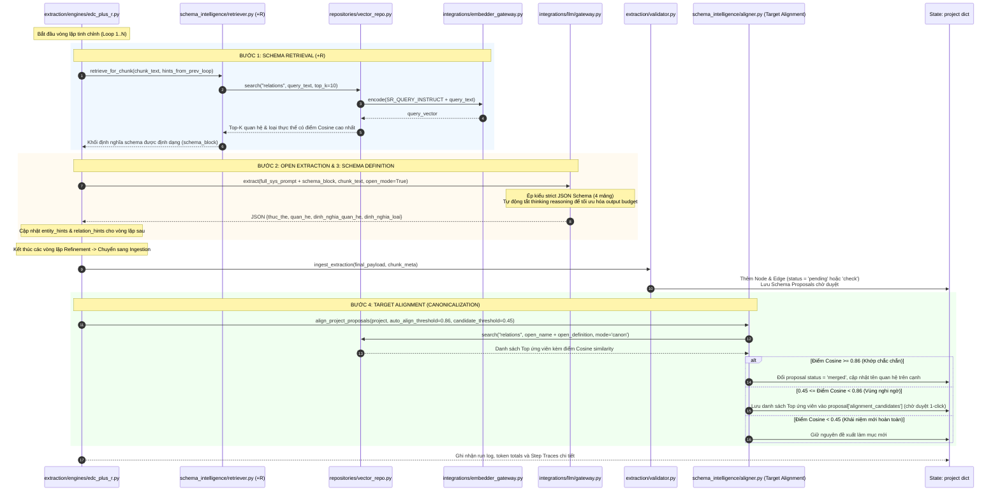
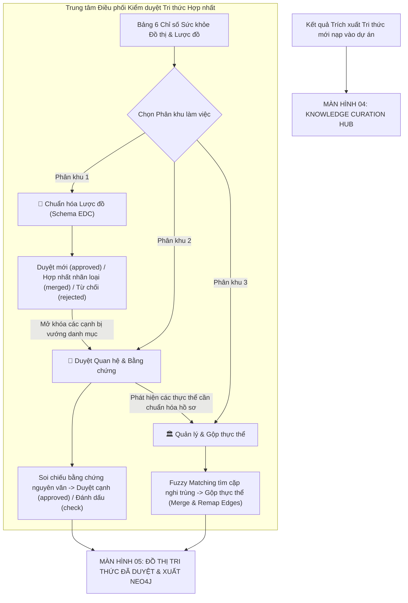
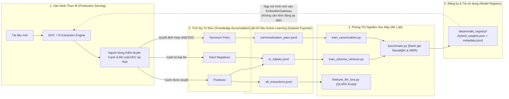
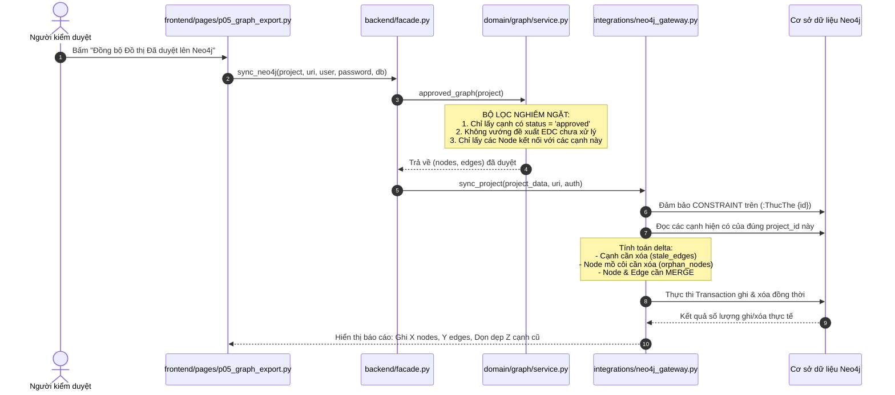

# KIẾN TRÚC HỆ THỐNG VÀ BẢN ĐỒ LUỒNG DỮ LIỆU KG_STUDIO PRO
> **Mục tiêu tài liệu**: Tài liệu này là **Single Source of Truth (SSOT)** về toàn bộ cấu trúc mã nguồn, trách nhiệm từng file, mô hình dữ liệu (DTOs, State Schemas) và các luồng di chuyển dữ liệu (Data Flow Pipelines) của hệ thống **KG_Studio Pro** (`D:\DATN\CrawData\KG_Studio`).
>
> **Dành cho AI Agent kế thừa / Kỹ sư phát triển**: Sau khi đọc xong tài liệu này, AI Agent có thể hiểu rõ 100% bản đồ dự án, tự tin mở rộng, sửa đổi, thêm engine hoặc debug bất kỳ tầng nào mà **không cần quét lại toàn bộ mã nguồn** của dự án.

---

## 1. TỔNG QUAN KIẾN TRÚC (HIGH-LEVEL SYSTEM ARCHITECTURE)

Dự án **KG_Studio Pro** được thiết kế theo mô hình **Clean Modular Architecture** kết hợp với kiến trúc học máy hướng sản phẩm (**Production ML & Active Learning System**). Dự án hoàn toàn độc lập với bản nguyên mẫu cũ (`KG_Studio_MVP`), 0% phụ thuộc vào các module di sản.

### 1.1. Bốn Phân Tầng Cốt Lõi (4 Core Tiers)

```mermaid
graph TB
    subgraph "TIER 1: FRONTEND LAYER (Streamlit 5-Page Navigation)"
        FE_APP["frontend/app.py (Entrypoint - 5 Tabs)"]
        FE_PAGES["frontend/pages/ (p01 -> p05 Hub)"]
        FE_COMP["frontend/components/ (Shared UI, Curation, EDC, ML Lab)"]
        FE_CLIENT["frontend/client.py (FrontendClient)"]
        FE_STATE["frontend/state/session.py (Central State Manager)"]
    end

    subgraph "TIER 2: BACKEND & API LAYER (Headless / Decoupled)"
        FACADE["backend/facade.py (KGStudioFacade - SSOT Orchestrator)"]
        REST_API["backend/api/v1.py & backend/main.py (REST Endpoints)"]
        
        subgraph "Domain & Use-Cases"
            DOC_PROC["domain/documents/processor.py"]
            CAT_SVC["domain/catalogs/service.py"]
            ENG_REG["domain/extraction/registry.py (Pluggable Engines)"]
            ENG_EDC_R["domain/extraction/engines/edc_plus_r.py"]
            SR_MOD["domain/schema_intelligence/retriever.py (+R)"]
            ALIGN_MOD["domain/schema_intelligence/aligner.py (Target Alignment)"]
            CUR_SVC["domain/curation/service.py"]
            GRAPH_SVC["domain/graph/service.py"]
            EXP_AL["domain/dataset_exporter/exporter.py"]
        end
        
        subgraph "Repositories (Data Access Layer)"
            REPO_JSON["repositories/json_repo.py"]
            REPO_SQLITE["repositories/sqlite_repo.py (kg_studio.db)"]
            REPO_VEC["repositories/vector_repo.py (.npz Indices)"]
        end

        subgraph "Integrations (External Gateways)"
            GATE_EMBED["integrations/embedder_gateway.py"]
            GATE_LLM["integrations/llm/ (Modular Gateway, Token Budget & Clients)"]
            GATE_NEO4J["integrations/neo4j_gateway.py"]
        end
    end

    subgraph "TIER 3: SHARED LAYER (Zero Training-Serving Skew)"
        SHARED_CONST["shared/constants.py"]
        SHARED_TEXT["shared/text_utils.py (tokenize_vn, NFC, sha)"]
        SHARED_CAT["shared/catalog_utils.py (Catalog v2 & atomic_write)"]
        SHARED_PROMPT["shared/prompt_templates/"]
        SHARED_SCHEMAS["shared/schemas/ (DTOs: edc, curation, graph, training)"]
        SHARED_CFG["shared/config_loader.py"]
    end

    subgraph "TIER 4: ML LAB (Offline / Human-in-the-Loop Active Learning)"
        ML_TRAIN_SR["ml_lab/trainers/train_schema_retriever.py"]
        ML_TRAIN_ALIGN["ml_lab/trainers/train_canonicalizer.py"]
        ML_LORA["ml_lab/trainers/finetune_llm_lora.py"]
        ML_BENCH["ml_lab/evaluation/benchmark.py (Recall@K, MRR)"]
    end

    FE_CLIENT --> FACADE
    REST_API --> FACADE
    FACADE --> DOC_PROC & CAT_SVC & ENG_REG & CUR_SVC & GRAPH_SVC & EXP_AL
    ENG_EDC_R --> SR_MOD & ALIGN_MOD
    SR_MOD --> REPO_VEC & GATE_EMBED
    ALIGN_MOD --> REPO_VEC & GATE_EMBED & GATE_LLM
    EXP_AL --> "data/training_exports/ (*.jsonl)"
    "data/training_exports/ (*.jsonl)" --> ML_TRAIN_SR & ML_TRAIN_ALIGN & ML_LORA
    ML_TRAIN_SR & ML_TRAIN_ALIGN --> "data/model_registry/ (Checkpoints & Meta)"
    "data/model_registry/ (Checkpoints & Meta)" -.-> GATE_EMBED
    
    TIER_2 -.-> SHARED_SCHEMAS & SHARED_TEXT & SHARED_CONST & SHARED_CAT
    TIER_4 -.-> SHARED_SCHEMAS & SHARED_TEXT & SHARED_PROMPT
```

### 1.2. Triết Lý Thiết Kế Trọng Tâm

1. **Zero Training-Serving Skew (Khử lệch pha Train - Serve)**:
   - Các kịch bản huấn luyện trong `ml_lab/` và các pipeline phục vụ trực tiếp trong `backend/` đều dùng chung:
     - Cùng một bộ tách từ tiếng Việt: `shared.text_utils.tokenize_vn`
     - Cùng một mẫu câu lệnh embedding (Instruct templates): `shared.prompt_templates.SR_QUERY_INSTRUCT` và `CANON_QUERY_INSTRUCT`
     - Cùng định dạng văn bản danh mục (Passage formatting): `shared.prompt_templates.format_catalog_passage`
     - Cùng các cấu trúc dữ liệu chuẩn: `shared.schemas.*`
2. **Pluggable Architecture (Kiến trúc cắm rút)**:
   - Thêm Engine trích xuất mới chỉ cần kế thừa `BaseExtractionEngine` và đăng ký vào `EngineRegistry`.
   - Thêm Backend nhúng vector chỉ cần mở rộng `EmbedderGateway` (hỗ trợ offline `hybrid_vn`, HuggingFace `sentence_transformers`, và OpenAI/Ollama API).
   - Thêm LLM Provider chỉ cần khai báo ProviderSpec trong `backend/integrations/llm/providers.py` và triển khai trong `clients.py`.
3. **Dual Persistence & Partitioned Indexing**:
   - `json_repo.py`: Đảm bảo lưu trữ JSON chi tiết từng dự án, hỗ trợ Snapshot quay ngược thời gian.
   - `sqlite_repo.py`: Cơ sở dữ liệu quan hệ cục bộ (`data/kg_studio.db`) cho truy vấn và thống kê tốc độ cao.
   - `vector_repo.py`: Chỉ mục vector `.npz` phân vùng độc lập theo `model_fingerprint`. Đổi mô hình không làm hỏng chỉ mục cũ.
4. **Unified Knowledge Curation Hub**:
   - Gộp việc chuẩn hóa danh mục lược đồ (EDC Schema Proposals) và kiểm duyệt đồ thị (Quan hệ, Thực thể, Gộp node) thành 1 trung tâm điều phối duy nhất (Tab 4). Loại bỏ hoàn toàn sự phân mảnh điều hướng và đứt đoạn luồng công việc.

---

## 2. BẢN ĐỒ CHI TIẾT TỪNG FILE VÀ TÁC DỤNG (FILE INVENTORY & SPECIFICATIONS)

### 2.1. Nhóm File Gốc (Root Entrypoints & Packaging)

| Đường dẫn file | Trách nhiệm & Tác dụng |
| :--- | :--- |
| `pyproject.toml` | Khai báo chuẩn đóng gói Python package `kg-studio` v2.0.0, định nghĩa core dependencies (`streamlit`, `openai`, `anthropic`, `neo4j`, `pypdf`, `python-docx`, `graphviz`, `numpy`) và optional dependencies (`[api]`, `[embed]`, `[ml]`). |
| `run_app.py` | Điểm khởi chạy chính từ terminal. Kiểm tra cấu hình (`--check-config`) hoặc bật tiến trình Streamlit độc lập trên cổng cấu hình (`8502`). Tự cấu hình encoding UTF-8 chống lỗi hiển thị trên Windows console. |
| `run_windows.cmd` | File batch script khởi chạy 1-click cho người dùng Windows, tự động ưu tiên nạp môi trường ảo `.venv-win\Scripts\python.exe`. |
| `README.md` | Tài liệu hướng dẫn cài đặt, khởi chạy, API endpoints và chạy kiểm thử tự động. |

---

### 2.2. Nhóm Cấu Hình (`config/`)

| Đường dẫn file | Trách nhiệm & Tác dụng |
| :--- | :--- |
| `config/default.toml` | Cấu hình tập trung cho toàn bộ ứng dụng: thông số UI, cổng máy chủ (`port=8502`, `api_port=8000`), thông số LLM mặc định (Provider `deepseek`, model `deepseek-flash`, token ngân sách `max_tokens=16384`, `max_input_tokens=32000`), thông số chia chunk (`chunk_size=4800`, `overlap=50`), ngưỡng mặc định của EDC+R (`top_k=10`, `auto_align=0.86`, `candidate=0.45`), và cấu hình Neo4j. |
| `config/logging.yaml` | Định dạng format log chuẩn hệ thống (`console` StreamHandler). |
| `config/catalogs/relations.json` | Danh mục gốc v2 gồm các quan hệ tiếng Việt được định nghĩa chặt chẽ theo 3 trường: `name`, `description`, `definition`. Dùng làm template khởi tạo dự án. |
| `config/catalogs/entity_types.json` | Danh mục gốc v2 gồm các loại thực thể tiếng Việt chuẩn hóa cho miền di sản, văn hóa, lịch sử và địa danh. |

---

### 2.3. Tầng Dùng Chung (`shared/` - Zero Training-Serving Skew)

Tầng này **không phụ thuộc** vào Backend, Frontend hay ML Lab. Nó là thư viện nền tảng mà mọi phân hệ khác đều import:

| File / Module | Trách nhiệm & Tác dụng |
| :--- | :--- |
| `shared/__init__.py` | Re-export các hằng số, hàm chuẩn hóa văn bản và hàm sinh ID cốt lõi. |
| `shared/constants.py` | Định nghĩa hằng số bất biến của hệ thống: chế độ trích xuất (`MODE_FIXED = "closed"`, `MODE_EDC = "edc"`, `MODE_EDC_PLUS_R = "edc_plus_r"`), trạng thái kiểm duyệt (`STATUS_PENDING`, `STATUS_CHECK`, `STATUS_APPROVED`, `STATUS_REJECTED`), schema version (v2), prompt EDC cơ sở (`DEFAULT_EDC_PROMPT`), và bộ cấu hình EDC+R mặc định (`DEFAULT_EDC_PLUS_R_SETTINGS`). |
| `shared/text_utils.py` | Bộ công cụ xử lý văn bản: `normal()` (chuẩn hóa Unicode NFC, gộp khoảng trắng, lowercase), `tokenize_vn()` (tách từ đơn và từ ghép đôi bigram tiếng Việt bằng Regex Unicode), `sha()` (băm SHA-256 xác định), `uid()` (sinh ID ngắn 14 ký tự hex ngẫu nhiên), `slug()` (chuyển tên tiếng Việt sang slug ASCII an toàn), `safe_filename()` (lọc tên tệp upload chống path traversal), `scrubbed()` (đệ quy xóa API key và secret trước khi ghi đĩa). |
| `shared/catalog_utils.py` | Xử lý danh mục Catalog v2 và hợp đồng JSON EDC: `validate_catalog()` (kiểm tra chặt 3 trường `name`, `description`, `definition`), `parse_catalog()`, `catalog_bytes()`, `atomic_write()` (ghi file tạm `.tmp` rồi replace atomic chống hỏng đĩa khi mất điện/crash), `edc_prompt()` (ghép hợp đồng 4 mảng JSON), `validate_edc_payload()` (kiểm tra đầu ra LLM phải đủ đúng 4 mảng `thuc_the`, `quan_he`, `dinh_nghia_quan_he`, `dinh_nghia_loai`). |
| `shared/config_loader.py` | Nạp cấu hình từ `config/default.toml` (hoặc biến môi trường `KG_STUDIO_CONFIG`), giải quyết đường dẫn tuyệt đối (`resolve_path`), hàm `save_llm_token_config_to_toml()` lưu cấu hình token động từ giao diện vào file toml. |
| `shared/prompt_templates/__init__.py` | Định nghĩa mẫu template chỉ dẫn nhúng vector thống nhất: `SR_QUERY_INSTRUCT` (truy xuất quan hệ từ văn bản), `CANON_QUERY_INSTRUCT` (truy xuất mục chuẩn hóa từ quan hệ mở), và hàm `format_catalog_passage(name, definition, description)` để chuẩn hóa định nghĩa mục danh mục thành một văn bản duy nhất phục vụ embedding. |
| `shared/schemas/project.py` | Khai báo Dataclass: `EDCPlusRSettingsDTO` (cấu hình thuật toán EDC+R) và `ProjectSummaryDTO` (thống kê tóm tắt dự án). |
| `shared/schemas/graph.py` | Khai báo Dataclass: `NodeDTO`, `EdgeDTO`, `EvidenceDTO`, và `StepTraceDTO` (ghi nhận chi tiết từng bước trích xuất, thời gian thực thi ms, và siêu dữ liệu). |
| `shared/schemas/edc.py` | Khai báo Dataclass: `AlignmentCandidateDTO` (ứng viên chuẩn hóa kèm điểm Cosine, lý do, cờ LLM verified, `catalog_hash`, `model_fingerprint`), `SchemaProposalDTO` (đề xuất danh mục EDC mở kèm `decision_origin`), và bộ DTO duyệt hàng loạt: `ProposalDecisionDTO`, `BulkReviewRequestDTO`, `BulkReviewPreviewDTO`, `BulkReviewResultDTO`. |
| `shared/schemas/curation.py` | Khai báo Dataclass phục vụ kiểm duyệt đồ thị và gộp thực thể: `EdgeReviewDecisionDTO`, `CurationReviewRequestDTO`, `CurationPreviewDTO`, `CurationResultDTO`, `EntityMergeRequestDTO`, `EntityMergePreviewDTO`, `EntityMergeResultDTO`. |
| `shared/schemas/queries.py` | Khai báo Dataclass phục vụ truy vấn phân trang nhẹ (Read Model DTOs): `ProjectHeaderDTO`, `PageDTO`, `EdgeRowDTO`, `NodeRowDTO`, `ProposalRowDTO`. |
| `shared/schemas/training_records.py` | Khai báo Dataclass tập dữ liệu huấn luyện: `SRTripletRecord` (truy xuất +R: query, positive, negative), `CanonicalizationPairRecord` (chuẩn hóa đích: open vs canonical), và `SFTInstructionRecord` (Fine-tune LLM theo ChatML format). |

---

### 2.4. Tầng Dịch Vụ & Nghiệp Vụ Backend (`backend/`)

#### A. Cổng kết nối dịch vụ ngoài (`backend/integrations/`)
- `embedder_gateway.py`:
  - Lớp `EmbedderGateway`: Bộ điều hợp nhúng vector.
  - Chế độ 1 (`hybrid_vn`): Hoạt động offline 100% trên CPU không cần GPU/mạng, kết hợp mạng từ vựng tiếng Việt, bảng từ đồng nghĩa di tích/lịch sử (`BASE_VIETNAMESE_SYNONYMS`), băm N-gram ký tự (3-gram, 4-gram) với L2-normalization và nạp trực tiếp trọng số đã học từ `data/model_registry/`.
  - Chế độ 2 (`sentence_transformers`): Nạp các mô hình SBERT / BGE-M3 cục bộ hoặc checkpoint fine-tuned.
  - Chế độ 3 (`openai_compatible`): Gọi API `/v1/embeddings` tới Ollama hoặc OpenAI.
  - Hàm `list_registered_models()`: Quét thư mục `data/model_registry/` để tự động phát hiện các mô hình đã huấn luyện bởi `ml_lab/`.
- `neo4j_gateway.py`:
  - Lớp `Neo4jGateway`: Kiểm tra kết nối (`test_connection`) và đồng bộ đồ thị tri thức đã duyệt sang Neo4j (`sync_project`).
  - Sử dụng tham số hóa hoàn toàn Cypher (Parameterized queries), tạo ràng buộc duy nhất (`CONSTRAINT`), và đồng bộ idempotent có scoped theo `project_id`. Tự động dọn dẹp các cạnh cũ bị loại bỏ (`DELETE_EDGES`) và các node mồ côi (`DELETE_ORPHAN_NODES`).
- **Phân hệ Tích hợp LLM Đa Nhà Cung Cấp (`backend/integrations/llm/`)**:
  - `llm/gateway.py`: Lớp `LLMGateway` (và hàm singleton `get_llm_gateway()`). Điều phối các yêu cầu trích xuất tri thức, tự động điều chỉnh token budget đầu vào/đầu ra, lựa chọn response format (`json_object` hoặc `json_schema`), gọi thẩm định quan hệ nghi ngờ (`verify_alignment_choice`).
  - `llm/clients.py`: Triển khai các client chuyên biệt: `OpenAICompatibleClient` (dùng chung cho OpenAI, Ollama, Qwen DashScope), `DeepSeekClient` (tự động nhận diện và gửi cờ tắt thinking mode `extra_body={"thinking": {"type": "disabled"}}`), `AnthropicClient` (giao tiếp API Messages của Claude). Tự động chuẩn hóa `base_url` (cắt bỏ hậu tố `/chat/completions` nếu người dùng nhập thừa để chống lỗi 404).
  - `llm/token_budget.py`: Quản lý hồ sơ giới hạn token của từng mô hình (`TokenProfile`). Cung cấp các hàm:
    - `recommend_token_limits(provider, model)`: Tự động đề xuất mức `max_input_tokens`, `max_output_tokens`, `recommended_chunk_size` tối ưu theo model. Có hồ sơ chuyên biệt `_DEEPSEEK_FLASH` (hỗ trợ trần output tới 65,536 tokens, context 1M).
    - `fit_chunk_to_input_budget(chunk, system_prompt, max_input)`: Cắt tỉa văn bản đầu vào thông minh để không bao giờ vượt ngân sách prompt.
    - `clamp_output_tokens(provider, model, max_tokens)`: Kẹp token đầu ra an toàn theo trần API của nhà cung cấp.
  - `llm/errors.py`: Phân loại lỗi LLM thành các nhóm chuẩn: `auth`, `model`, `rate_limit`, `connection`, `timeout`, `format`, `token_limit` (kèm cờ nhận diện khi câu trả lời bị cắt ngang do chạm giới hạn token `finish_reason=length`).
  - `llm/parsing.py`: Làm sạch chuỗi phản hồi từ LLM (`clean_llm_json`), bóc tách markdown codeblock ` ```json ... ``` `, tự động sửa và đóng các ngoặc JSON bị cắt ngắn do hết token.
  - `llm/providers.py`: Quản lý danh sách nhà cung cấp (`DeepSeek`, `OpenAI`, `Anthropic`, `Qwen`, `Ollama`), base URL mặc định và danh sách model ID tương ứng.

#### B. Tầng Lưu trữ dữ liệu (`backend/repositories/`)
- `base.py`: Lớp trừu tượng `ProjectRepository` (`list_projects`, `load_project`, `save_project`).
- `json_repo.py`: Triển khai `JsonProjectRepository`. Lưu trữ dự án vật lý tại `data/projects/<slug>/project.json` kèm 2 file catalog `relations.json` và `entity_types.json`. Đảm bảo tính tương thích ngược với mọi định dạng dữ liệu cũ (`ensure_project_shape`). Hỗ trợ tạo và khôi phục Snapshot (`snapshots/*.json`).
- `sqlite_repo.py`: Triển khai `SQLiteProjectRepository` trên file CSDL `data/kg_studio.db`. Tự động khởi tạo và đồng bộ 4 bảng: `projects`, `nodes`, `edges`, `schema_proposals`. Cho phép truy vấn cạnh theo trạng thái, theo tên quan hệ với tốc độ cao.
- `vector_repo.py`: Triển khai `VectorIndexRepository` tại `data/vector_indices/<project_id>/model_<fingerprint>/`. Lưu trữ vector embeddings nén `.npz`. Tự động tái tính toán chỉ mục khi nội dung danh mục thay đổi (kiểm tra qua `catalog_hash`), và tự động phân vùng khi người dùng chuyển đổi mô hình embedding mà không ghi đè dữ liệu cũ.

#### C. Nghiệp vụ cốt lõi Domain (`backend/domain/`)
- `documents/processor.py`: Đọc nội dung tệp nhị phân DOCX (qua `python-docx`), PDF text (qua `pypdf`), và TXT; tự động nhận diện trang (`page_at`); hàm `chunk_records()` chia nhỏ văn bản theo ranh giới đoạn/câu (`\n\n`, `\n`, `. `, `; `, `, `) với kích thước và độ chồng lấp cấu hình được, gán vị trí ký tự `start_char`, `end_char` và hash đoạn để truy vết bằng chứng.
- `catalogs/service.py`: Quản lý danh mục quan hệ và loại thực thể; ủy quyền quản lý prompt sang `prompts/service.py`; quản lý đề xuất EDC (`propose_term`, `prepare_edc`); xử lý quyết định kiểm duyệt đơn (`decide_proposal`) và duyệt hàng loạt theo lô (`preview_proposal_decisions`, `apply_proposal_decisions` hỗ trợ cả `all_or_nothing` và `valid_only`, kiểm tra xung đột trên cùng node/cạnh, kiểm tra trùng tên mới trong lô) cùng tính toán ảnh hưởng trực tiếp + gián tiếp qua đổi loại node (`proposal_impact`).
- `prompts/service.py`: Quản lý phiên bản prompt theo cấu hình (`closed`, `edc`, `edc_plus_r`) độc lập cho từng dự án. Đảm bảo tính lũy đẳng migration (`ensure_project_prompt_history`), quản lý version bất biến kèm content hash SHA-256, không thay đổi catalog/model khi khôi phục, hỗ trợ so sánh text diff (`diff_prompt_versions`) và cung cấp prompt active cho cả 3 engine.
- `extraction/validator.py`: Hàm `validate_extraction()` làm sạch JSON, đối chiếu danh mục quan hệ, kiểm tra bằng chứng xuất hiện nguyên văn (`evidence_in_chunk`); hàm `ensure_node()` thêm hoặc tái sử dụng thực thể; hàm `ingest_extraction()` tiếp nhận kết quả trích xuất từ LLM, lưu các node/edge ở trạng thái chờ duyệt (không bao giờ tự duyệt tự động).
- `extraction/base_engine.py`: Định nghĩa cấu trúc `ChunkContext`, `EngineOutput`, và lớp trừu tượng `BaseExtractionEngine`.
- `extraction/registry.py`: Lớp `EngineRegistry` quản lý các engine theo mô hình Singleton / Factory.
- `extraction/engines/fixed_catalog.py`: Engine 1 (Chế độ Danh mục cố định `closed`). Gửi toàn bộ danh mục quan hệ trong prompt, loại bỏ các quan hệ ngoài danh mục.
- `extraction/engines/edc_one_pass.py`: Engine 2 (Chế độ EDC mở 1 lượt `edc`). Cho phép mô hình tự do đề xuất quan hệ/loại thực thể mới kèm định nghĩa, đưa vào danh sách đề xuất chờ duyệt.
- `extraction/engines/edc_plus_r.py`: Engine 3 (**EDC + R** - Vòng lặp tinh chỉnh + Schema Retriever + Target Alignment).
  - Vòng 1 đến N (`refinement_loops`): Schema Retriever truy xuất Top-K mục sát nhất bơm vào prompt; LLM trích xuất mở; trích xuất các thực thể và quan hệ làm gợi ý cho vòng tiếp theo.
  - Kết thúc vòng lặp: Chạy `TargetAligner` để tự động ánh xạ hoặc gợi ý ứng viên chuẩn hóa trong danh mục đích.
  - Ghi nhận chi tiết từng bước vào `step_traces`.
- `schema_intelligence/retriever.py`: Lớp `SchemaRetriever` (`+R`). Sử dụng `VectorIndexRepository` tìm kiếm tương đồng Cosine giữa đoạn văn bản (kèm quan hệ gợi ý từ vòng trước) và toàn bộ danh mục quan hệ / loại thực thể. Định dạng khối gợi ý schema bơm vào system prompt.
- `schema_intelligence/aligner.py`: Lớp `TargetAligner` (Target Alignment). Tách biệt rõ 2 nghiệp vụ: (1) `refresh_candidates_for_proposals()` chỉ tìm ứng viên cho đúng tập `proposal_ids` được chọn mà không đổi trạng thái kiểm duyệt; (2) `align_project_proposals()` tự động chuẩn hóa theo ngưỡng cấu hình và đánh dấu `auto_aligned=True`, `decision_origin="auto_align"`. Gắn `catalog_hash` và `model_fingerprint` cho từng ứng viên để phát hiện gợi ý cũ (stale).
- `curation/`: Phân khu kiểm duyệt tri thức được tổ chức thành các module trách nhiệm hẹp và liên kết qua `service.py` (Facade):
  - `curation/common.py`: Tiện ích tra cứu thực thể, quan hệ, tài liệu và chuẩn hóa chuỗi (`clean_display_text`, `clean_aliases`, `doc_fingerprint`, `find_node`, `find_edge`, `resolve_active_node_id`).
  - `curation/evidence.py`: Đối chiếu câu trích dẫn bằng chứng trên văn bản gốc, định vị span ký tự (`evidence_context`, `select_edge_evidence_span`, `recheck_edge_evidence`).
  - `curation/validation.py`: Kiểm tra tính hợp lệ về schema và bằng chứng để duyệt hoặc xuất cạnh (`inspect_edge_schema_status`, `validate_edge_for_approval`, `is_edge_exportable`, `approvable_edges`).
  - `curation/review.py`: Duyệt đơn, duyệt hàng loạt và chỉnh sửa quan hệ kèm bảo vệ phiên bản (`set_edge_status`, `preview_curation_decisions`, `apply_curation_decisions`, `update_edge`).
  - `curation/entities.py`: Quản lý hồ sơ thực thể, bậc liên kết, phát hiện cặp nghi trùng lặp và thống kê (`node_degrees`, `duplicate_suggestions`, `update_node`, `review_stats`, `token_totals`).
  - `curation/merge.py`: Xem trước và thực thi gộp N thực thể an toàn (`preview_entity_merge`, `apply_entity_merge`, `merge_nodes`), bảo toàn cạnh và cập nhật bảng `node_redirects`.
  - `curation/service.py`: Điểm re-export công khai tương thích ngược 100% cho toàn bộ phân khu Curation.
- `graph/service.py`: Kiểm tra toàn vẹn đồ thị (`validate_integrity`: kiểm tra node mồ côi, ID trùng, cạnh thiếu bằng chứng), trích xuất đồ thị đã duyệt (`approved_graph`), sinh file JSON (`approved_json_bytes`), CSV (`csv_bytes`), và đóng gói sao lưu ZIP (`export_zip`).
- `dataset_exporter/exporter.py`: Lớp `ActiveLearningExporter`. Chỉ nhận nhãn con người từ các quyết định đã commit (`decision_origin="human"`, `status="Đã duyệt"`), loại trừ các mục `auto_aligned=True` chưa được con người xác nhận hoặc các cạnh chỉ mới khớp trích dẫn nguồn nhưng chưa được duyệt. Xuất thành 3 tập dữ liệu JSONL chuẩn: `sr_triplets.jsonl`, `canonicalization_pairs.jsonl`, `sft_extractions.jsonl`.

#### D. Lớp điều phối trung tâm Facade & REST API
- `facade.py`: Lớp `KGStudioFacade` (và hàm singleton `get_facade()`). Đóng gói toàn bộ các use-case của hệ thống thành một giao diện duy nhất, quản lý khóa dự án (`RLock`), kiểm tra `expected_revision`, idempotency theo `request_id`, tạo snapshot trước commit, lưu bundle JSON có rollback và đồng bộ SQLite/Vector.
- `api/v1.py`: Hàm `handle_api_request(method, path, body)` xử lý định tuyến REST API (`/api/v1/health`, `/api/v1/models`, `/api/v1/projects`, `/api/v1/projects/{name}/retrieve-schema`, `/api/v1/projects/{name}/align-target`, `/api/v1/projects/{name}/export-training-data`, `/api/v1/projects/{name}/edc-review/preview`, `/apply`, `/refresh-candidates`, `/resync`).
- `main.py`: Entrypoint máy chủ REST API độc lập (cổng 8000), có khả năng chạy qua FastAPI / Uvicorn nếu môi trường có sẵn, hoặc tự động kích hoạt HTTPServer tích hợp sẵn của Python.
- `workers/job_manager.py`: Lớp `JobManager` quản lý các tác vụ xử lý đồng bộ và bất đồng bộ có theo dõi tiến độ (`progress`, `status`, `message`).

---

### 2.5. Tầng Giao Diện Đa Trang (`frontend/`)

Được thiết kế theo kiến trúc mỏng (Thin Client), giao tiếp với dữ liệu qua `KGStudioFacade` hoặc `FrontendClient`. Giao diện hiện được tổ chức thành **5 màn hình chuẩn**:

| File / Module | Trách nhiệm & Tác dụng |
| :--- | :--- |
| `frontend/app.py` | Entrypoint Streamlit. Quản lý Sidebar (chọn dự án, tạo dự án mới, cấu hình kết nối LLM Provider / Model ID / Base URL / API Key / Sliders token đầu vào và đầu ra lên tới 65,536 / Nút auto theo model / Nút lưu default.toml), điều hướng 5 Màn hình chính. |
| `frontend/client.py` | Lớp `FrontendClient` (và hàm `get_client()`). Bọc lời gọi sang Facade hoặc HTTP REST API. |
| `frontend/state/selection_core.py` | Thao tác danh sách ID thuần cho việc lựa chọn dòng trên giao diện (`toggle_id_in_list`, `append_unique_ids`, `reconcile_id_selection`), đảm bảo giữ nguyên thứ tự, kiểu dữ liệu và chuỗi thông báo. |
| `frontend/state/session.py` | Quản lý `st.session_state` tập trung. Khai báo `PAGE_LABELS` (5 nhãn trang), quản lý trạng thái bảng (`_edc_tables`), trạng thái phân khu (`_curation_sections`), ngữ cảnh điều hướng quay lại (`_curation_return_context`), tự động dọn dẹp state khi đổi dự án. |
| `frontend/components/shared_curation_ui.py` | **Component Dùng Chung cốt lõi**: Khử bỏ mã nguồn trùng lặp giữa các trang. Cung cấp: `render_sqlite_resync_banner` (cảnh báo đồng bộ SQLite), `paginate_items` (thuật toán phân trang chuẩn), `compute_filter_hash` (băm chữ ký bộ lọc SHA256), `render_decision_batch_history` (xem lịch sử lô quyết định và khôi phục snapshot). |
| `frontend/components/edc_review_table.py` | Bảng duyệt đề xuất EDC độc lập cho từng nhóm (`entity_types` / `relations`): lọc đa chiều, phân trang, chọn theo ID, mở xem chi tiết và duyệt đơn. Sử dụng `paginate_items` từ module dùng chung. |
| `frontend/components/edc_bulk_actions.py` | Thanh thao tác hàng loạt EDC: làm mới gợi ý, điền ứng viên Top-1 vào bản nháp, gán đích hợp nhất chung, bảng xem trước (Preview), và thực thi áp dụng lô (`all_or_nothing` hoặc `valid_only`). |
| `frontend/components/curation_table.py` | Bảng kiểm duyệt quan hệ và bảng thực thể: phân loại theo độ ưu tiên, kiểm tra trạng thái chứng cứ, duyệt hàng loạt cạnh, hiển thị bậc liên kết của thực thể. Sử dụng `paginate_items` dùng chung. |
| `frontend/components/evidence_panel.py` | Khung hiển thị và đối chiếu bằng chứng trích xuất với văn bản gốc (đánh dấu vị trí đoạn, trang, câu trích dẫn) và thanh tra hồ sơ chi tiết của thực thể (Inspector). |
| `frontend/components/entity_merge_panel.py` | Công cụ phát hiện cặp thực thể nghi trùng lặp (dựa trên Fuzzy matching & Jaccard), giao diện chọn thực thể đại diện (canonical), chỉnh sửa bí danh và thực thi gộp node an toàn. |
| `frontend/components/prompt_editor.py` | Component quản lý phiên bản prompt độc lập theo 3 chế độ (`closed`, `edc`, `edc_plus_r`), quản lý draft theo cặp `project_id + configuration_id`, nút lưu version mới, hủy sửa, xem trước request hoàn chỉnh (Preview Parity) và lịch sử khôi phục. |
| `frontend/components/edc_alignment_panel.py` | Widget ủy quyền tương thích sang `prompt_editor.py` và cấu hình EDC+R. |
| `frontend/components/ml_lab_panel.py` | Widget ML Lab nhúng trong Màn hình 2: nút bấm 1-click xuất dataset Active Learning, nút huấn luyện Schema Retriever, nút huấn luyện Target Aligner, chạy benchmark và sinh gói QLoRA. |
| `frontend/components/step_traces_viewer.py` | Widget trực quan hóa chi tiết từng bước thực thi của EDC+R kèm thẻ provenance nguồn gốc prompt version, content hash, request hash và xem lại chính xác system/user prompt đã gửi. |
| `frontend/pages/p01_projects_docs.py` | **Màn hình 1: Tổng quan Dự án & Tài liệu**. Xem thống kê KPIs tổng quan (tài liệu, đoạn văn, node, edge, approved, tokens) và Upload / Quản lý tài liệu nguồn (.txt, .docx, .pdf). |
| `frontend/pages/p02_catalogs_prompts.py` | **Màn hình 2: Thiết lập Phương pháp & Danh mục**. Centralized LLM Connection Card, Prompt Management Panel (soạn thảo prompt có versioning theo 3 mode, xem trước request), quản lý danh mục toàn màn hình (`relations.json`, `entity_types.json`), và phòng thí nghiệm ML Lab. |
| `frontend/pages/p03_extraction.py` | **Màn hình 3: Trích xuất & Trace**. Danh sách chọn tài liệu trực quan (Checklist hiển thị tên, dung lượng ký tự, ước tính số đoạn, trạng thái đã trích xuất trước đó; các nút Chọn tất cả, Bỏ chọn hết, Chỉ chọn file chưa chạy), cấu hình chunk/overlap, thanh tiến trình thời gian thực, nhật ký trích xuất và Step Traces. |
| `frontend/pages/p04_curation_hub.py` | **Màn hình 4: Trung tâm Kiểm duyệt & Chuẩn hóa Tri thức (Knowledge Curation Hub)**. Hợp nhất toàn diện Tab 4 & Tab 5 cũ. Gồm: Bảng 6 chỉ số sức khỏe đồ thị & lược đồ tổng thể, khung thông báo tháo gỡ quan hệ vướng danh mục liền mạch, và thanh chuyển 3 phân khu nghiệp vụ:<br>- *Phân khu 1: Chuẩn hóa Lược đồ (Schema EDC)*<br>- *Phân khu 2: Duyệt Quan hệ & Bằng chứng*<br>- *Phân khu 3: Quản lý & Gộp thực thể* |
| `frontend/pages/p04_edc_alignment.py` | File ủy quyền tương thích ngược (Backward-compatible wrapper) dẫn vào Phân khu 1 của Curation Hub. |
| `frontend/pages/p05_curation_merge.py` | File ủy quyền tương thích ngược dẫn vào Phân khu 2 & 3 của Curation Hub. |
| `frontend/pages/p05_graph_export.py` / `p06_graph_export.py` | **Màn hình 5: Đồ thị Tri thức Đã duyệt & Xuất Dữ liệu** *(Đánh số lại từ Tab 6)*. Kiểm tra toàn vẹn đồ thị (mồ côi, ID trùng), vẽ biểu đồ Graphviz tương tác, tải xuống JSON đồ thị đã duyệt, tải gói sao lưu ZIP đầy đủ (JSON + CSV), và đồng bộ Idempotent lên cơ sở dữ liệu đồ thị Neo4j. |

---

### 2.6. Tầng Phòng Thí Nghiệm Học Máy (`ml_lab/`)

Phân hệ nghiên cứu và huấn luyện mô hình độc lập, hoạt động hoàn toàn tách rời khỏi luồng phục vụ người dùng:

| File / Module | Trách nhiệm & Tác dụng |
| :--- | :--- |
| `ml_lab/configs/default_train_config.json` | Cấu hình siêu tham số mặc định cho việc huấn luyện: learning rate, positive boost, negative decay, lora_r, lora_alpha, epochs. |
| `ml_lab/trainers/dataset_io.py` | Tiện ích đọc dữ liệu huấn luyện JSONL tập trung (`load_jsonl`), giữ trật tự bản ghi, loại trừ dòng trắng và hỗ trợ UTF-8 chuẩn xác. |
| `ml_lab/trainers/train_schema_retriever.py` | Huấn luyện mô hình **Schema Retriever (`+R`)** từ tập `sr_triplets.jsonl`. Tự động cập nhật trọng số từ vựng ngữ nghĩa và mạng từ đồng nghĩa tiếng Việt, đánh giá `Recall@1`, `Recall@3`, `Recall@5`, `MRR` trước và sau khi học, rồi xuất mô hình kèm `metadata.json` vào `data/model_registry/<model_name>/`. |
| `ml_lab/trainers/train_canonicalizer.py` | Huấn luyện mô hình **Target Alignment (Schema Canonicalizer)** từ tập `canonicalization_pairs.jsonl`. Tối ưu hóa ma trận tương đồng ngữ nghĩa giữa khái niệm mở và mục chuẩn đích. |
| `ml_lab/trainers/finetune_llm_lora.py` | Đọc `sft_extractions.jsonl`, chuyển đổi sang định dạng ChatML tiêu chuẩn (`sft_chatml_dataset.jsonl`), và tự động sinh mã nguồn kịch bản huấn luyện QLoRA (`run_qlora_train.py`) sử dụng thư viện HuggingFace `peft` + `trl` `SFTTrainer`. |
| `ml_lab/evaluation/benchmark.py` | Chạy bảng xếp hạng (Leaderboard) đánh giá khách quan toàn bộ các mô hình nhúng có trong `data/model_registry/` dựa trên tập kiểm thử chuẩn theo tiêu chí `MRR` và `Recall@5`. |

---

### 2.7. Tầng Dữ Liệu Vật Lý (`data/`)

| Đường dẫn thư mục | Nội dung & Định dạng lưu trữ |
| :--- | :--- |
| `data/projects/<slug>/` | Chứa dữ liệu của từng dự án (ví dụ `hanoiqa`, `hanoiqav2`). Bao gồm: `project.json` (toàn bộ tài liệu, node, edge, run logs), `project.meta.json` (metadata manifest nhỏ để đọc nhanh không tốn RAM), `relations.json` (danh mục quan hệ riêng), `entity_types.json` (danh mục thực thể riêng), và thư mục `snapshots/` (các bản sao lưu tức thời). |
| `data/kg_studio.db` | Cơ sở dữ liệu SQLite quan hệ phục vụ lập chỉ mục, truy vấn nhanh và đồng bộ trạng thái (kèm 7 chỉ mục B-tree tối ưu phân trang `idx_edges_*`, `idx_nodes_*`, `idx_proposals_*`). |
| `data/vector_indices/<proj>/model_<fp>/` | Lưu trữ các tệp chỉ mục vector nén `relations_index.npz` và `entity_types_index.npz` phân vùng theo chữ ký mô hình (hỗ trợ in-memory RAM caching). |
| `data/training_exports/` | Chứa các bộ dữ liệu xuất từ vòng lặp Active Learning: `sr_triplets.jsonl`, `canonicalization_pairs.jsonl`, `sft_extractions.jsonl`. |
| `data/model_registry/<model_name>/` | Kho lưu trữ các mô hình đã được huấn luyện bởi ML Lab, mỗi thư mục con chứa `hybrid_weights.json` (hoặc trọng số PyTorch) và `metadata.json` chứa thông tin chỉ số hiệu năng (Recall, MRR). |

---

### 2.8. Tầng Công Cụ & Đo Lường Hiệu Năng (`tools/`)

| Đường dẫn file | Trách nhiệm |
| :--- | :--- |
| `tools/benchmark_performance.py` | Công cụ đo lường hiệu năng và bộ nhớ chuẩn (Baseline vs Post-Optimization). Đo p50, p95 thời gian và peak memory qua `tracemalloc` trên các quy mô S (nhỏ) và M (vừa) mà không phụ thuộc LLM. |

---

### 2.9. Tầng Kiểm Thử (`tests/`)

Hệ thống sở hữu bộ kiểm thử tự động toàn diện với **62 bài test (100% PASS)** bao phủ toàn bộ kiến trúc từ backend đến frontend:

| Đường dẫn file | Trách nhiệm kiểm thử |
| :--- | :--- |
| `tests/test_code_cleanup.py` | Kiểm thử tính tương đương logic sau dọn dẹp mã nguồn: `load_jsonl`, `selection_core`, re-export parity giữa `service.py` và các module curation con, an toàn đồng bộ SQLite `_sync_sqlite_safe`, và bảo vệ phiên bản `_check_revision_conflict`. |
| `tests/test_prompt_versions.py` | Kiểm thử quản lý phiên bản prompt độc lập 3 mode, lưu đơn điệu, no-op khi trùng hash, khôi phục tạo version mới, so sánh diff, preview-execution parity, và lưu vết provenance trong runs. |
| `tests/test_performance_optimizations.py` | Kiểm thử tối ưu hiệu năng: manifest `project.meta.json`, in-memory registry cache, fast `review_stats` counters, direct-slice `evidence_context`, reverse-index `batch_proposal_impacts`, vector repo RAM cache, và phân trang SQLite có chỉ mục. |
| `tests/test_curation_hub.py` | Kiểm thử Trung tâm Kiểm duyệt Hợp nhất: kiểm tra thuật toán phân trang dùng chung (`paginate_items`), băm chữ ký bộ lọc (`compute_filter_hash`), tổng hợp số liệu đề xuất EDC, kiểm tra cơ cấu 5 nhãn trang `PAGE_LABELS`, và khả năng render không lỗi cả 3 phân khu của Hub. |
| `tests/test_standalone_architecture.py` | Bộ kiểm thử kiến trúc độc lập (5 bài test lớn): Quét AST toàn bộ mã nguồn xác nhận 0% dependency vào module cũ; kiểm thử Schema Retriever và Target Aligner; kiểm thử trích xuất đa vòng lặp EDC+R; kiểm thử luồng xuất dữ liệu Active Learning và gọi REST API; kiểm tra nạp dữ liệu dự án thực tế. |
| `tests/test_edc_bulk_review.py` | Kiểm thử chuyên sâu duyệt EDC hàng loạt: tách 2 bảng độc lập, chọn theo ID, lọc & phân trang, áp dụng `all_or_nothing` và `valid_only`, chặn xung đột trên cùng node/cạnh, kiểm tra đồng thời đa phiên, rollback I/O JSON, resync SQLite và khôi phục snapshot. |
| `tests/test_curation_merge.py` | Kiểm thử kiểm duyệt đồ thị & gộp thực thể: kiểm tra bằng chứng trích xuất, đối chiếu ngữ cảnh văn bản gốc, phát hiện cặp nghi trùng, gộp node an toàn (chuyển hướng cạnh, chống self-loop), điều hướng qua lại giữa cạnh bị chặn và đề xuất EDC trong Hub. |
| `tests/test_llm_package.py` | Kiểm thử tầng tích hợp LLM: kiểm tra các LLM client, làm sạch chuỗi JSON, tự động sửa ngoặc JSON bị cắt ngắn do hết token, kẹp ngân sách token đầu vào/đầu ra, chuẩn hóa URL loại bỏ `/chat/completions` thừa, và xác nhận cờ tắt thinking mode cho DeepSeek. |

---

## 3. CẤU TRÚC DỮ LIỆU & STATE SCHEMAS (DATA CONTRACTS)

### 3.1. Cấu trúc Cốt lõi của File `project.json`
Mỗi dự án trong `data/projects/<slug>/project.json` tuân thủ Schema Dictionary sau:
```python
{
    "name": str,                      # Tên dự án (duy nhất, dùng làm slug)
    "project_id": str,                # Mã định danh dự án
    "extraction_mode": str,           # "closed" | "edc" | "edc_plus_r"
    "prompt": str,                    # System prompt trích xuất hiện hành
    "prompt_versions": list[dict],    # Lịch sử các phiên bản prompt đã lưu
    "documents": [                    # Danh sách tài liệu đã tải lên
        {
            "id": str,                # Mã tài liệu (uuid / hash)
            "name": str,              # Tên tệp (vd: baocao.docx)
            "text": str,              # Toàn bộ nội dung văn bản đã giải mã
            "chars": int,             # Số lượng ký tự
            "place_scope": str,       # Phạm vi địa lý / di tích (tùy chọn)
            "source_label": str,      # Nhãn nguồn tư liệu
            "pages": list[dict]       # Danh sách trang (đối với PDF)
        }
    ],
    "relations": list[dict],          # Danh mục quan hệ của dự án [{name, description, definition}]
    "entity_types": list[dict],       # Danh mục loại thực thể [{name, description, definition}]
    "prompt_history_schema_version": 1,
    "prompt_bindings": dict[str, str], # Ánh xạ chế độ -> ID phiên bản active {"closed", "edc", "edc_plus_r"}
    "prompt_versions": list[dict],    # Lịch sử các phiên bản prompt bất biến [{id, version, content, content_hash...}]
    "nodes": [                        # Danh sách thực thể cụ thể (Instance Graph)
        {
            "id": str,                # Khóa chính của node
            "name": str,              # Tên thực thể cụ thể (vd: Chùa Một Cột)
            "kind": str,              # Loại thực thể (vd: di tích)
            "attributes": dict,       # Thuộc tính mở rộng
            "status": str             # "pending" | "approved"
        }
    ],
    "edges": [                        # Danh sách quan hệ cụ thể giữa 2 node
        {
            "id": str,                # Khóa chính của cạnh
            "source": str,            # ID node nguồn
            "target": str,            # ID node đích
            "relation": str,          # Tên quan hệ (vd: nằm tại)
            "evidence": str,          # Câu văn bản chứng minh nguyên văn
            "doc_id": str,            # ID tài liệu chứa bằng chứng
            "chunk_number": int,      # Thứ tự đoạn văn bản
            "page": int | None,       # Số trang (nếu có)
            "status": str             # "pending" | "check" | "approved" | "rejected"
        }
    ],
    "schema_proposals": [             # Đề xuất lược đồ mới do LLM sinh ra
        {
            "id": str,                # ID đề xuất
            "kind": str,              # "entity_types" | "relations"
            "name": str,              # Tên do LLM đề xuất (vd: Chứng nhận di sản)
            "definition": str,        # Định nghĩa do LLM cung cấp
            "description": str,       # Mô tả ngắn
            "status": str,            # "pending" | "approved" | "merged" | "rejected"
            "decision_origin": str,   # "human" | "auto_align"
            "canonical_name": str,    # Tên chuẩn đích sau khi hợp nhất
            "alignment_candidates": [ # Gợi ý từ Target Aligner
                {"name": str, "score": float, "verified_by_llm": bool}
            ],
            "observations": list[dict]# Danh sách vị trí xuất hiện trong tài liệu
        }
    ],
    "schema_decision_batches": list[dict],   # Lịch sử các lô quyết định EDC đã commit
    "curation_decision_batches": list[dict], # Lịch sử các lô duyệt quan hệ đã commit
    "entity_merges": list[dict],             # Lịch sử các thao tác gộp thực thể
    "node_redirects": dict[str, str],        # Bảng ánh xạ node đã gộp (old_id -> canonical_id)
    "runs": list[dict],                      # Nhật ký các lượt gọi LLM kèm Step Traces
    "sync_pending": bool,                    # Cờ báo hiệu lỗi đồng bộ SQLite cần resync
    "sync_error": str,                       # Chi tiết lỗi đồng bộ nếu có
    "revision": str                          # Chữ ký hash chống xung đột đồng thời
}
```

### 3.2. Cấu trúc Quản trị Phiên làm việc Streamlit (`st.session_state`)
Trong `frontend/state/session.py`, dữ liệu phiên được tổ chức tập trung:
- `active_project_name`: Tên dự án đang được mở.
- `active_page`: Nhãn màn hình đang chọn trong `PAGE_LABELS` (1 trong 5 nhãn).
- `curation_hub_active_tab`: Phân khu đang mở trong Curation Hub (`"schema"`, `"edges"`, `"entities"`).
- `_curation_return_context`: Ngữ cảnh ghi nhớ khi chuyển từ cạnh bị chặn sang duyệt đề xuất EDC và quay lại.
- `llm_provider`, `llm_model`, `llm_base_url`, `llm_api_key`: Cấu hình LLM hiện hành.
- `llm_max_input_tokens`, `llm_max_output_tokens`: Ngân sách token đầu vào / đầu ra điều chỉnh qua thanh trượt (hỗ trợ tới 65,536 output tokens).
- `extraction_chunk_size`: Kích thước đoạn văn trích xuất.
- `_edc_tables`: Quản lý lựa chọn, bộ lọc, bản nháp độc lập cho từng nhóm EDC (`entity_types`, `relations`).
- `_curation_sections`: Quản lý lựa chọn và bộ lọc độc lập cho từng phân khu Curation (`edges`, `entities`, `merge`).

---

## 4. BẢN ĐỒ CÁC LUỒNG DỮ LIỆU CỐT LÕI (CORE DATA FLOW PIPELINES)

### 4.1. Luồng 1: Tiếp Nhận & Chia Đoạn Tài Liệu (Document Ingestion Pipeline)

```mermaid
sequenceDiagram
    autonumber
    actor User as Người dùng
    participant UI as frontend/pages/p01_projects_docs.py
    participant Facade as backend/facade.py
    participant Processor as domain/documents/processor.py
    participant Repo as repositories/json_repo.py

    User->>UI: Tải lên tệp (.pdf, .docx, .txt)
    UI->>Facade: add_document(project, name, binary_data)
    Facade->>Processor: document_payload(file_name, binary)
    Note over Processor: Giải mã text, trích xuất số trang (PDF) hoặc đoạn (DOCX)
    Processor-->>Facade: Trả về {'text', 'pages', 'warnings'}
    Facade->>Facade: Kiểm tra trùng SHA-256 nội dung với tài liệu cũ
    Facade->>Repo: save_project(project)
    Repo-->>UI: Lưu thành công, hiển thị danh sách tài liệu
    
    User->>UI: Bắt đầu trích xuất tại Màn hình 03
    UI->>Facade: document_chunks(document, chunk_size, overlap)
    Facade->>Processor: chunk_records(text, limit, overlap)
    Note over Processor: Cắt đoạn ưu tiên ranh giới câu (\n\n, \n, ., ;, ,)<br/>Gán start_char, end_char, chunk_hash, page_from, page_to
    Processor-->>UI: Trả về danh sách records sẵn sàng cho Extraction Engine
```

---

### 4.2. Luồng 2: Quy Trình Trích Xuất EDC + R (Iterative Refinement with Schema Retriever Pipeline)



---

### 4.3. Luồng 3: Quy Trình Kiểm Duyệt Tri Thức Tại Curation Hub (Tab 4)



---

### 4.4. Luồng 4: Vòng Lặp Học Chủ Động Khép Kín (Active Learning & ML Lab Feedback Loop)



---

### 4.5. Luồng 5: Đồng Bộ Đồ Thị Đã Duyệt Lên Neo4j (Neo4j Idempotent Sync)



---

## 5. HƯỚNG DẪN KẾ THỪA CHO AI AGENT & LẬP TRÌNH VIÊN (DEVELOPER EXTENSION GUIDE)

Khi tiếp nhận dự án để bổ sung tính năng hoặc bảo trì, hãy tuân theo các quy tắc thiết kế bất biến sau:

### 5.1. Quy ước Streamlit 1.66+ Bắt Buộc (Critical UI Rules)
- **Tuyệt đối không dùng `use_container_width=True`**: Tham số này đã bị deprecated từ Streamlit 1.66+. Luôn sử dụng `width='stretch'` (cho độ rộng đầy đủ) hoặc `width='content'` (cho độ rộng co giãn tự nhiên).
- **Quy tắc về `st.container(height=...)`**: Trong Streamlit 1.66+, giá trị `height` **không bao giờ được là `None`** (sẽ gây ra `StreamlitInvalidHeightError`). Phải truyền một số nguyên pixel (vd. `height=280`) hoặc chuỗi `'content'` / `'stretch'`.
  ```python
  # Cú pháp chuẩn an toàn:
  with st.container(border=True, height=280 if len(items) > 4 else 'content'):
  ```

### 5.2. Quy tắc Điều Chỉnh Token Budget cho LLM (DeepSeek-Flash & reasoning models)
- Mô hình `deepseek-flash` hỗ trợ context tới 1,000,000 tokens và output tới 65,536 tokens.
- **Thinking Mode**: Với tác vụ trích xuất tri thức có cấu trúc JSON, **luôn tắt thinking mode** bằng cách gửi `disable_reasoning=True` và `extra_body={"thinking": {"type": "disabled"}}`. Nếu bật thinking mode, các reasoning token sẽ ngốn sạch quota `max_tokens` đầu ra và làm đứt đoạn JSON kết quả (`finish_reason=length`).
- Khi cần tăng token đầu ra: Kéo thanh trượt tại Sidebar hoặc Tab 3 lên tới `65,536 tokens` và bấm nút **`💾 Lưu vào default.toml`**.

### 5.3. Cách Thêm Một Bộ Trích Xuất Mới (New Extraction Engine)
1. Tạo file mới trong `backend/domain/extraction/engines/my_new_engine.py`.
2. Tạo class kế thừa `BaseExtractionEngine`:
   ```python
   from backend.domain.extraction.base_engine import BaseExtractionEngine, ChunkContext, EngineOutput

   class MyNewEngine(BaseExtractionEngine):
       mode_id = "my_custom_mode"
       display_name = "Tên Chế Độ Hiển Thị"

       def process_chunk(self, ctx: ChunkContext) -> EngineOutput:
           # Logic trích xuất riêng của bạn...
           return EngineOutput(...)
   ```
3. Đăng ký engine vào `backend/domain/extraction/registry.py`:
   ```python
   self.register(MyNewEngine())
   ```
4. Giao diện người dùng và API sẽ tự động nhận diện chế độ mới qua `available_extraction_modes()`.

### 5.4. Cách Thêm Một Cổng Embedder Mới
1. Mở `backend/integrations/embedder_gateway.py`.
2. Thêm phương thức mã hóa trong hàm `encode()` của `EmbedderGateway` cho backend mới của bạn (ví dụ Cohere, VoyageAI hoặc local ONNX).
3. Cập nhật thuộc tính `fingerprint` để đảm bảo hệ thống tự tạo phân vùng Vector Index `.npz` riêng tại `data/vector_indices/` mà không xung đột chỉ mục của các model khác.

### 5.5. Các Lệnh Kiểm Thử & Vận Hành Chuẩn
- **Kiểm tra cấu hình**:
  ```powershell
  python run_app.py --check-config
  ```
- **Chạy toàn bộ bộ kiểm thử tự động (34 bài tests - 100% PASS)**:
  ```powershell
  python -m unittest discover -s tests -t . -v
  ```
- **Khởi chạy ứng dụng Web (Streamlit UI cổng 8502)**:
  ```powershell
  .\run_windows.cmd
  ```
- **Khởi chạy máy chủ REST API độc lập (cổng 8000)**:
  ```powershell
  python -m backend.main --host 127.0.0.1 --port 8000
  ```
- **Chạy quy trình huấn luyện Offline trong ML Lab**:
  ```powershell
  python -m ml_lab.trainers.train_schema_retriever --dataset data/training_exports/sr_triplets.jsonl --model-name sr-v2
  python -m ml_lab.trainers.train_canonicalizer --dataset data/training_exports/canonicalization_pairs.jsonl --model-name aligner-v2
  python -m ml_lab.evaluation.benchmark --dataset data/training_exports/sr_triplets.jsonl
  ```

---
*Tài liệu được cập nhật và chuẩn hóa bởi Antigravity AI Engine (Bản phát hành v2.1.0 - Knowledge Curation Hub Unified). Giữ nguyên định dạng này để hỗ trợ ngữ cảnh cho các AI Agent trong tương lai.*
