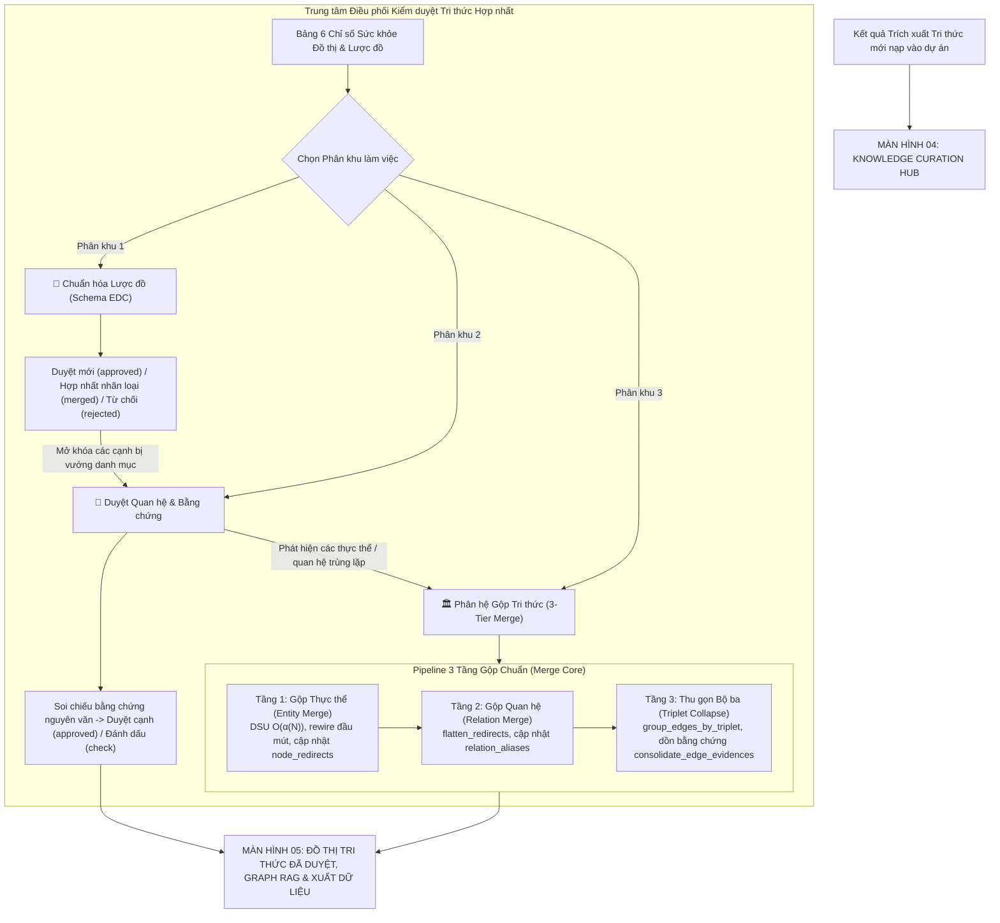
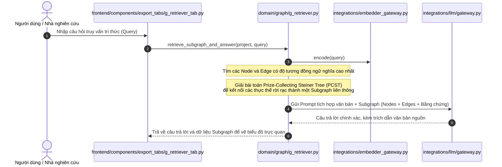
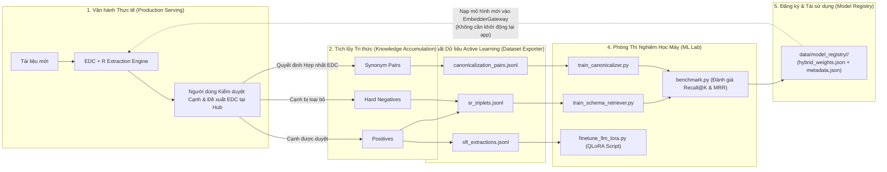
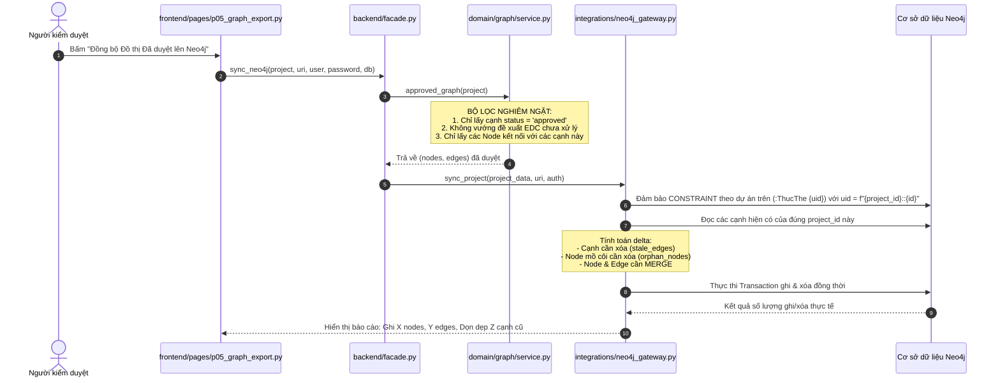

# KIẾN TRÚC HỆ THỐNG VÀ BẢN ĐỒ LUỒNG DỮ LIỆU KG_STUDIO PRO
> **Mục tiêu tài liệu**: Tài liệu này là **Single Source of Truth (SSOT)** về toàn bộ cấu trúc mã nguồn, trách nhiệm từng file, mô hình dữ liệu (Pydantic v2 DTOs, State Schemas) và các luồng di chuyển dữ liệu (Data Flow Pipelines) của hệ thống **KG_Studio Pro** (`D:\DATN\CrawData\KG_Studio`).
>
> **Dành cho AI Agent kế thừa / Kỹ sư phát triển**: Sau khi đọc xong tài liệu này, AI Agent có thể hiểu rõ 100% bản đồ dự án, tự tin mở rộng, sửa đổi, thêm engine hoặc debug bất kỳ tầng nào mà **không cần quét lại toàn bộ mã nguồn** của dự án.

---

## 1. TỔNG QUAN KIẾN TRÚC (HIGH-LEVEL SYSTEM ARCHITECTURE)

Dự án **KG_Studio Pro** được thiết kế theo mô hình **Clean Modular Architecture** kết hợp với kiến trúc học máy hướng sản phẩm (**Production ML & Active Learning System**), đồ thị truy xuất tri thức (**G-Retriever Graph RAG**) và chuẩn hóa mô hình dữ liệu bằng **Pydantic v2**. Dự án hoàn toàn độc lập với bản nguyên mẫu cũ (`KG_Studio_MVP`), 0% phụ thuộc vào các module di sản.

### 1.1. Bốn Phân Tầng Cốt Lõi (4 Core Tiers)

```mermaid
graph TB
    subgraph "TIER 1: FRONTEND LAYER (Streamlit 5-Page Navigation)"
        FE_ROOT["app.py / run_app.py (Streamlit Entrypoints)"]
        FE_APP["frontend/app.py (App Shell & Sidebar)"]
        FE_PAGES["frontend/pages/ (p01 -> p05 Hub)"]
        FE_MERGE["frontend/components/merge/ (Entity, Relation, Triple Tabs)"]
        FE_EXP["frontend/components/export_tabs/ (G-Retriever, Benchmark, Export)"]
        FE_COMP["frontend/components/ (Shared Curation UI, Review Tables)"]
        FE_CLIENT["frontend/client.py (FrontendClient - In-Process Direct Call)"]
        FE_STATE["frontend/state/session.py (Central State Manager)"]
    end

    subgraph "TIER 2: BACKEND LAYER (Headless / Decoupled Domain Logic)"
        FACADE["backend/facade.py (KGStudioFacade - Central Orchestrator)"]
        STDLIB_API["backend/api/v1.py & backend/main.py (Stdlib HTTP Server)"]
        
        subgraph "Domain & Use-Cases"
            DOC_PROC["domain/documents/processor.py (Chunking & Parsing)"]
            CAT_SVC["domain/catalogs/service.py (Catalog Management)"]
            ENG_REG["domain/extraction/registry.py (Pluggable Engines)"]
            ENG_EDC_R["domain/extraction/engines/edc_plus_r.py"]
            SR_MOD["domain/schema_intelligence/retriever.py (+R)"]
            ALIGN_MOD["domain/schema_intelligence/aligner.py (Target Alignment)"]
            
            subgraph "Curation Subsystem"
                CUR_SVC["domain/curation/service.py"]
                CUR_CORE["domain/curation/merge_core.py (DSU, Flatten, Deduplication)"]
                CUR_MERGE["domain/curation/merge.py (3-Tier Merge Pipeline)"]
                CUR_SEM["domain/curation/semantic_clustering.py"]
                CUR_REV["domain/curation/review.py"]
            end
            
            subgraph "Graph & QA Subsystem"
                GRAPH_SVC["domain/graph/service.py"]
                G_RET["domain/graph/g_retriever.py (G-Retriever Graph RAG)"]
                QA_GEN["domain/graph/qa_generator.py (Benchmark QA Generator)"]
                KGQA_BND["domain/graph/kgqa_bundle.py (G-Retriever 5-File Bundle Exporter)"]
            end
            
            EXP_AL["domain/dataset_exporter/exporter.py (Active Learning Exporter)"]
        end
        
        subgraph "Repositories (Data Access Layer)"
            REPO_JSON["repositories/json_repo.py (Atomic JSON & Snapshots)"]
            REPO_SQLITE["repositories/sqlite_repo.py (Incremental Upsert Sync)"]
            REPO_VEC["repositories/vector_repo.py (Partitioned .npz Indices)"]
        end

        subgraph "Integrations (External Gateways)"
            GATE_EMBED["integrations/embedder_gateway.py (Hybrid VN & Local Embedders)"]
            GATE_LLM["integrations/llm/ (Token Budget, Clients, Error Handlers)"]
            GATE_NEO4J["integrations/neo4j_gateway.py (Idempotent Cypher Sync)"]
        end
    end

    subgraph "TIER 3: SHARED LAYER (Pydantic v2 & Zero Training-Serving Skew)"
        SHARED_BASE["shared/schemas/base.py (SchemaModel - Pydantic v2)"]
        SHARED_SCHEMAS["shared/schemas/ (curation, edc, graph, project, queries, training)"]
        SHARED_CONST["shared/constants.py"]
        SHARED_TEXT["shared/text_utils.py (tokenize_vn, normal NFC, sha, uid)"]
        SHARED_CAT["shared/catalog_utils.py (Catalog v2 & atomic_write)"]
        SHARED_PROMPT["shared/prompt_templates/"]
        SHARED_CFG["shared/config_loader.py"]
    end

    subgraph "TIER 4: ML LAB (Offline / Human-in-the-Loop Active Learning)"
        ML_TRAIN_SR["ml_lab/trainers/train_schema_retriever.py"]
        ML_TRAIN_ALIGN["ml_lab/trainers/train_canonicalizer.py"]
        ML_LORA["ml_lab/trainers/finetune_llm_lora.py"]
        ML_BENCH["ml_lab/evaluation/benchmark.py (Recall@K, MRR)"]
    end

    FE_ROOT --> FE_APP --> FE_PAGES
    FE_PAGES --> FE_COMP & FE_MERGE & FE_EXP
    FE_COMP --> FE_CLIENT --> FACADE
    STDLIB_API --> FACADE
    FACADE --> DOC_PROC & CAT_SVC & ENG_REG & CUR_SVC & GRAPH_SVC & G_RET & QA_GEN & EXP_AL
    FACADE --> REPO_JSON & REPO_SQLITE
    CUR_MERGE --> CUR_CORE
    ENG_EDC_R --> SR_MOD & ALIGN_MOD
    SR_MOD --> REPO_VEC & GATE_EMBED
    ALIGN_MOD --> REPO_VEC & GATE_EMBED & GATE_LLM
    EXP_AL --> "data/training_exports/ (*.jsonl)"
    "data/training_exports/ (*.jsonl)" --> ML_TRAIN_SR & ML_TRAIN_ALIGN & ML_LORA
    ML_TRAIN_SR & ML_TRAIN_ALIGN --> "data/model_registry/ (Checkpoints & Meta)"
    "data/model_registry/ (Checkpoints & Meta)" -.-> GATE_EMBED
    
    TIER_2 -.-> SHARED_SCHEMAS & SHARED_BASE & SHARED_TEXT & SHARED_CONST & SHARED_CAT
    TIER_4 -.-> SHARED_SCHEMAS & SHARED_TEXT & SHARED_PROMPT
```

### 1.2. Triết Lý Thiết Kế Trọng Tâm

1. **In-Process Direct Execution (Chạy trực tiếp, không cồng kềnh)**:
   - Streamlit UI kết nối thẳng vào `KGStudioFacade` qua `FrontendClient` mà không cần bật tiến trình mạng trung gian, đảm bảo tốc độ phản hồi tối đa cho môi trường nghiên cứu và demo.
   - Khi cần phục vụ API bên ngoài, `backend/main.py` kích hoạt máy chủ HTTP chuẩn của Python (`http.server.HTTPServer`) không phụ thuộc thêm thư viện ngoài.
2. **Pydantic v2 Type Safety & Zero Boilerplate**:
   - Tất cả DTOs trong `shared/schemas/` kế thừa `SchemaModel` (Pydantic v2 `BaseModel`), tự động validate và ép kiểu dữ liệu an toàn.
   - Loại bỏ hoàn toàn mã nguồn ép kiểu thủ công (`dict.get()`, `asdict()`, `from_dict()`) trong tầng Domain, duy trì tính tương thích ngược tuyệt đối với các hàm nhận `dict`.
3. **Unified Curation & 3-Tier Merge Core**:
   - Cơ chế gộp tri thức được chuẩn hóa thành pipeline 3 tầng rõ ràng: **Gộp Thực thể (Entity Merge)** $\to$ **Gộp Quan hệ (Relation Merge)** $\to$ **Gộp / Khử trùng Bộ ba (Triplet Deduplication)**.
   - Các thuật toán dùng chung cốt lõi (Disjoint Set Union với path compression $O(\alpha(N))$, chuỗi chuyển hướng chống chu trình `flatten_redirects`, chuẩn hóa khóa cặp đối xứng `normalize_pair_key`, gom nhóm theo bộ ba `group_edges_by_triplet`, dồn bằng chứng `consolidate_edge_evidences`) được tập trung hóa tại `merge_core.py`.
4. **Incremental SQLite Upsert & Dual Persistence**:
   - `json_repo.py`: Đảm bảo lưu trữ JSON chi tiết từng dự án, hỗ trợ Snapshot quay ngược thời gian.
   - `sqlite_repo.py`: Cơ sở dữ liệu quan hệ cục bộ (`data/kg_studio.db`) tối ưu hóa với kỹ thuật đồng bộ tăng dần (`ON CONFLICT DO UPDATE SET`), phân vùng xóa theo hiệu tập hợp (Set difference deletion), và chỉ mục B-tree phân trang SSOT.
5. **Graph RAG (G-Retriever) & Benchmark Generation**:
   - Tích hợp kỹ thuật G-Retriever Graph RAG: trích xuất đồ thị con tối ưu qua thuật toán heuristic cây Steiner (PCST), ánh xạ văn bản - đồ thị vào câu lệnh ngữ cảnh để LLM trả lời câu hỏi kèm truy vết nguồn.
   - Trình sinh câu hỏi đánh giá tổng hợp (`qa_generator.py`) từ đồ thị đã duyệt, tạo các bộ benchmark chuẩn hóa cho đánh giá hệ thống.
6. **Zero Training-Serving Skew (Khử lệch pha Train - Serve)**:
   - Toàn bộ pipeline phục vụ và kịch bản huấn luyện Active Learning trong `ml_lab/` đều chia sẻ cùng bộ tách từ `tokenize_vn`, cùng logic format truy vấn có điều kiện theo họ mô hình (`should_use_e5_instruct()` chỉ bật tiền tố `Instruct:` cho E5/Instruct, không ép lên `bge-m3`/`hybrid_vn`), cùng `format_catalog_passage(..., aliases, domain, range)` (`PASSAGE_TEMPLATE_VERSION = "v2-domain-range"`), và cùng chuẩn DTOs.

---

## 2. BẢN ĐỒ CHI TIẾT TỪNG FILE VÀ TÁC DỤNG (FILE INVENTORY & SPECIFICATIONS)

### 2.1. Nhóm File Gốc (Root Entrypoints & Packaging)

| Đường dẫn file | Trách nhiệm & Tác dụng |
| :--- | :--- |
| `app.py` | **Điểm khởi chạy Streamlit chính**: File ngắn gọn tại thư mục gốc, import và thực thi `frontend.app.main()`. Cho phép chạy ngay lệnh chuẩn: `streamlit run app.py`. |
| `pyproject.toml` | Khai báo chuẩn đóng gói Python package `kg-studio` v2.0.0. Định nghĩa các core dependencies (`streamlit`, `pydantic>=2.9.0`, `openai`, `anthropic`, `neo4j`, `pypdf`, `python-docx`, `graphviz`, `numpy`) và optional dependencies (`[embed]`, `[ml]`). Hoàn toàn sạch bóng các ràng buộc phụ thuộc framework ngoài không cần thiết. |
| `run_app.py` | Điểm khởi chạy có tham số dòng lệnh từ terminal: kiểm tra cấu hình (`--check-config`), cấu hình encoding UTF-8 chống lỗi hiển thị trên Windows console, và chạy ứng dụng Streamlit. |
| `run_windows.cmd` | File batch script khởi chạy 1-click cho người dùng Windows, tự động ưu tiên nạp môi trường ảo `.venv-win\Scripts\python.exe`. |
| `README.md` | Tài liệu tổng quan dự án, hướng dẫn cài đặt và sử dụng. |
| `AGENTS.md` | Hướng dẫn và quy tắc ứng xử dành cho AI Agent, quy định vận hành đồ thị tri thức mã nguồn `graphify`. |

---

### 2.2. Nhóm Cấu Hình (`config/`)

| Đường dẫn file | Trách nhiệm & Tác dụng |
| :--- | :--- |
| `config/default.toml` | Cấu hình tập trung cho toàn bộ ứng dụng: thông số UI, cổng máy chủ (`port=8502`, `api_port=8000`), thông số LLM mặc định (Provider `deepseek`, model `deepseek-chat`, token ngân sách `max_tokens=16384`, `max_input_tokens=32000`), thông số chia chunk (`chunk_size=4800`, `overlap=50`), ngưỡng mặc định của EDC+R (`top_k=10`, `auto_align=0.86`, `candidate=0.45`), và cấu hình Neo4j. |
| `config/logging.yaml` | Định dạng format log chuẩn hệ thống (`console` StreamHandler). |
| `config/catalogs/relations.json` | Danh mục gốc v2 gồm các quan hệ tiếng Việt được định nghĩa chặt chẽ theo 3 trường: `name`, `description`, `definition`. Dùng làm template khởi tạo dự án. |
| `config/catalogs/entity_types.json` | Danh mục gốc v2 gồm các loại thực thể tiếng Việt chuẩn hóa cho miền di sản, văn hóa, lịch sử và địa danh. |

---

### 2.3. Tầng Dùng Chung (`shared/` - Pydantic v2 & Zero Training-Serving Skew)

Tầng này **không phụ thuộc** vào Backend, Frontend hay ML Lab. Nó là thư viện nền tảng mà mọi phân hệ khác đều import:

| File / Module | Trách nhiệm & Tác dụng |
| :--- | :--- |
| `shared/__init__.py` | Re-export các hằng số, hàm chuẩn hóa văn bản và hàm sinh ID cốt lõi. |
| `shared/constants.py` | Định nghĩa bốn chế độ trích xuất (`closed`, `edc`, `edc_plus_r`, `free_triples`), trạng thái kiểm duyệt, schema version (v2), prompt EDC và prompt baseline tự do riêng, cùng bộ cấu hình EDC+R mặc định. |
| `shared/text_utils.py` | Bộ công cụ xử lý văn bản: `normal()` (chuẩn hóa Unicode NFC, gộp khoảng trắng, lowercase), `tokenize_vn()` (tách từ đơn và từ ghép đôi bigram tiếng Việt bằng Regex Unicode), `sha()` (băm SHA-256 xác định), `uid()` (sinh ID ngắn 14 ký tự hex ngẫu nhiên), `slug()` (chuyển tên tiếng Việt sang slug ASCII an toàn), `safe_filename()` (lọc tên tệp upload chống path traversal), `scrubbed()` (đệ quy xóa API key và secret trước khi ghi đĩa). |
| `shared/catalog_utils.py` | Xử lý danh mục Catalog v2 và hợp đồng JSON EDC: `OPTIONAL_CATALOG_FIELDS` (`domain`, `range`) và trường `aliases`, `validate_catalog()`, `parse_catalog()`, `catalog_bytes()`, `catalog_csv_bytes()`, `atomic_write()` (ghi file tạm `.tmp` rồi replace atomic chống hỏng đĩa khi crash), `edc_prompt()`, `validate_edc_payload()`. |
| `shared/config_loader.py` | Nạp cấu hình từ `config/default.toml` (hoặc biến môi trường `KG_STUDIO_CONFIG`), giải quyết đường dẫn tuyệt đối (`resolve_path`), hàm `save_llm_token_config_to_toml()` lưu cấu hình token động từ giao diện vào file toml. |
| `shared/prompt_templates/__init__.py` | Định nghĩa mẫu template nhúng vector thống nhất (`PASSAGE_TEMPLATE_VERSION = "v2-domain-range"`): `should_use_e5_instruct()`, `format_sr_query()`, `format_canon_query()`, `format_catalog_passage(name, definition, description, *, aliases, domain, range)`. |
| `shared/schemas/base.py` | **Nền tảng Pydantic v2**: Lớp `SchemaModel` kế thừa `pydantic.BaseModel` với `ConfigDict(arbitrary_types_allowed=True, populate_by_name=True, extra="allow")`. Cung cấp phương thức `.to_dict()` và `.from_dict()` bảo đảm tính tương thích ngược 100%. |
| `shared/schemas/project.py` | Pydantic DTOs: `EDCPlusRSettingsDTO` (cấu hình thuật toán EDC+R) và `ProjectSummaryDTO` (thống kê tóm tắt dự án). |
| `shared/schemas/graph.py` | Pydantic DTOs: `NodeDTO`, `EdgeDTO`, `EvidenceDTO`, và `StepTraceDTO` (ghi nhận chi tiết từng bước trích xuất, thời gian thực thi ms, và siêu dữ liệu). |
| `shared/schemas/edc.py` | Pydantic DTOs: `AlignmentCandidateDTO` (kèm `catalog_hash`, `model_fingerprint`), `SchemaProposalDTO`, và bộ DTO duyệt hàng loạt: `ProposalDecisionDTO`, `BulkReviewRequestDTO`, `BulkReviewPreviewDTO`, `BulkReviewResultDTO`. |
| `shared/schemas/curation.py` | Pydantic DTOs: `EdgeReviewDecisionDTO`, `CurationReviewRequestDTO`, `CurationPreviewDTO`, `CurationResultDTO` (bổ sung `invalidated_approved_count`), `EntityMergeRequestDTO`, `EntityMergePreviewDTO`, `EntityMergeResultDTO`. |
| `shared/schemas/queries.py` | Pydantic DTOs phục vụ truy vấn phân trang nhẹ (Read Model): `ProjectHeaderDTO`, `PageDTO`, `EdgeRowDTO`, `NodeRowDTO`, `ProposalRowDTO`. |
| `shared/schemas/training_records.py` | Pydantic DTOs tập dữ liệu huấn luyện: `SRTripletRecord`, `CanonicalizationPairRecord`, `SFTInstructionRecord`. |
| `shared/schemas/prompts.py` | Pydantic DTOs phiên bản prompt: `PromptVersionDTO`, `PromptVersionDiffDTO`, `PromptHistoryDTO`. |

---

### 2.4. Tầng Dịch Vụ & Nghiệp Vụ Backend (`backend/`)

#### A. Cổng kết nối dịch vụ ngoài (`backend/integrations/`)
- `embedder_gateway.py`: Lớp `EmbedderGateway` hỗ trợ chế độ nhúng offline CPU `hybrid_vn`, HuggingFace `sentence_transformers`, và `openai_compatible` (tích hợp sẵn preset `"ollama:bge-m3"` 1024 chiều qua `http://localhost:11434/v1`). Hàm `list_registered_models()` tự động phát hiện mô hình từ `data/model_registry/`.
- `neo4j_gateway.py`: Lớp `Neo4jGateway` đồng bộ đồ thị tri thức đã duyệt sang Neo4j (`sync_project`), bảo đảm Cypher Parameterized, CONSTRAINT theo từng dự án (`FOR (n:ThucThe) REQUIRE n.uid IS UNIQUE` với `uid = f"{project_id}::{nid}"`), thuộc tính cạnh `r.trang_thai`, lọc bằng chứng hợp lệ và tự dọn dẹp cạnh cũ/node mồ côi.
- **Phân hệ Tích hợp LLM Đa Nhà Cung Cấp (`backend/integrations/llm/`)**:
  - `llm/gateway.py`: Lớp `LLMGateway` điều phối yêu cầu trích xuất, tự động điều chỉnh token budget, gọi thẩm định quan hệ nghi ngờ (`verify_alignment_choice`).
  - `llm/clients.py`: Triển khai các client chuyên biệt: `OpenAICompatibleClient`, `DeepSeekClient` (tự động gửi cờ tắt thinking mode `extra_body={"thinking": {"type": "disabled"}}`), `AnthropicClient`. Tự động cắt bỏ hậu tố `/chat/completions` thừa.
  - `llm/token_budget.py`: Hồ sơ giới hạn token (`TokenProfile`), tự động đề xuất trần token cho DeepSeek, OpenAI, Qwen; kẹp token an toàn.
  - `llm/errors.py`: Phân loại lỗi LLM chuẩn (`auth`, `model`, `rate_limit`, `connection`, `timeout`, `format`, `token_limit`).
  - `llm/parsing.py`: Làm sạch chuỗi phản hồi từ LLM, tự động sửa ngoặc JSON bị cắt ngắn do hết token.
  - `llm/providers.py`: Quản lý danh sách nhà cung cấp (`DeepSeek`, `OpenAI`, `Anthropic`, `Qwen`, `Ollama`).

#### B. Tầng Lưu trữ dữ liệu (`backend/repositories/`)
- `base.py`: Lớp trừu tượng `ProjectRepository` (`list_projects`, `load_project`, `save_project`).
- `json_repo.py`: Triển khai `JsonProjectRepository`. Lưu trữ dự án vật lý tại `data/projects/<slug>/project.json` kèm 2 file catalog. Hỗ trợ tạo và khôi phục Snapshot (`snapshots/*.json`).
- `sqlite_repo.py`: Triển khai `SQLiteProjectRepository` trên file CSDL `data/kg_studio.db`. **Đồng bộ gia tăng thông minh (Incremental Upsert Sync)**: thay vì xóa sạch ghi lại, hệ thống sử dụng cú pháp `INSERT ... ON CONFLICT DO UPDATE SET` và tính toán hiệu tập hợp để xóa cạnh bị loại bỏ, kết hợp 7 chỉ mục B-tree tối ưu hóa truy vấn phân trang SSOT.
- `vector_repo.py`: Triển khai `VectorIndexRepository` tại `data/vector_indices/<project_id>/model_<fingerprint>/`. Lưu trữ vector embeddings nén `.npz`, gắn khóa `passage_template_version` và kiểm tra khớp chiều vector (dim) khi nạp cache.

#### C. Nghiệp vụ cốt lõi Domain (`backend/domain/`)
- `documents/processor.py`: Đọc nội dung DOCX, PDF, TXT; hàm `chunk_records()` chia nhỏ văn bản theo ranh giới đoạn/câu, gán vị trí ký tự `start_char`, `end_char` và hash đoạn để truy vết bằng chứng.
- `catalogs/` (**Phân hệ Quản lý Danh mục & Đề xuất EDC**):
  - `catalogs/core.py`: Quản lý danh mục quan hệ và loại thực thể; băm xác định `compute_catalog_hash`, `compute_project_revision` (streaming SHA-256 $O(V+E+P)$), `compute_decisions_hash`, `compute_full_request_hash`, quản lý prompt settings.
  - `catalogs/proposals.py`: Tiếp nhận đề xuất (`propose_term`, `prepare_edc`), phát hiện ứng viên cũ `is_proposal_candidates_stale`, tính phạm vi ảnh hưởng đa đề xuất `batch_proposal_impacts` qua reverse-index $O(N+E)$.
  - `catalogs/review.py`: Chính sách và thực thi duyệt đề xuất schema (`decide_proposal`, `preview_proposal_decisions`, `apply_proposal_decisions`), đảm bảo preview không ghi đĩa và apply kiểm tra xung đột revision/catalog hash.
  - `catalogs/service.py`: Barrel re-export công khai toàn bộ API của phân hệ Catalogs tương thích ngược 100%.
- `prompts/service.py`: Quản lý phiên bản prompt theo cấu hình (`closed`, `edc`, `edc_plus_r`) độc lập cho từng dự án, quản lý version bất biến kèm content hash SHA-256.
- `extraction/`:
  - `extraction/validator.py`: Làm sạch JSON, kiểm tra bằng chứng xuất hiện nguyên văn (`evidence_in_chunk`), hàm `ingest_extraction()` tiếp nhận kết quả trích xuất từ LLM.
  - `extraction/base_engine.py`: Lớp trừu tượng `BaseExtractionEngine`, `ChunkContext`, `EngineOutput`.
  - `extraction/registry.py`: Lớp `EngineRegistry` quản lý các engine theo mô hình Singleton / Factory.
  - `extraction/engines/fixed_catalog.py`: Engine 1 (Chế độ Danh mục cố định `closed`).
  - `extraction/engines/edc_one_pass.py`: Engine 2 (Chế độ EDC mở 1 lượt `edc`).
  - `backend/modules/extraction/application/free_triples_engine.py`: Baseline B (`free_triples`), nhận LLM port được inject, xuất triples thô mà không sinh định nghĩa/chuẩn hóa hoặc nhập đồ thị. `free_triples_runs.py` ghi artifacts qua commit coordinator và xuất JSON độc lập; xem [hợp đồng baseline](report/free-triples-baseline-implementation.md).
  - `backend/modules/graph_qa/domain/baseline_graph.py`: Dựng KG baseline chỉ đọc từ public run source của extraction. Dùng `normal()` cho khóa node; giữ predicate, surface forms, cạnh lặp, self-loop và nguồn từng triple. `GraphQAApplicationService` điều phối qua `BaselineRunSourcePort` được inject tại bootstrap, không ghi graph vào project.
  - `shared/schemas/graph_input.py`: `GraphSnapshotDTO`, request dựng baseline và contracts gold facts độc lập. Snapshot dùng chung cho graph approved, baseline và file ngoài; JSON `kg-studio.graph.v1` round-trip kèm manifest, diagnostics, fingerprint. Index cache lấy fingerprint nội dung thực thay vì chỉ đếm nodes/edges. Legacy project API còn fallback tương thích; snapshot route không fallback.
  - `backend/modules/graph_qa/application/graph_benchmark.py`: Chạy cùng PCST/PPR/Naive Top-K với gold facts do người chấm cung cấp variants; đo fact coverage và retrieval recall không phụ thuộc ID giữa các KG. Không phải bộ chấm precision/F1 ngữ nghĩa tự động.
  - `extraction/engines/edc_plus_r.py`: Engine 3 (**EDC + R** - Vòng lặp tinh chỉnh + Schema Retriever + Target Alignment).
- `schema_intelligence/`:
  - `schema_intelligence/retriever.py`: Lớp `SchemaRetriever` (`+R`) tìm kiếm tương đồng Cosine giữa đoạn văn bản và danh mục.
  - `schema_intelligence/aligner.py`: Lớp `TargetAligner` tự động chuẩn hóa quan hệ mở về danh mục chuẩn đích hoặc gợi ý ứng viên Top-K.
- `curation/` (**Phân khu Kiểm duyệt & Gộp Tri thức**):
  - `curation/merge_core.py`: **Module Thuật toán Gộp Dùng Chung**:
    - `DisjointSetUnion`: DSU với path compression $O(\alpha(N))$ phân cụm thành phần liên thông.
    - `flatten_redirects` & `update_redirect_map`: Phẳng hóa chuỗi chuyển hướng nhiều bậc ($A \to B \to C \Rightarrow A \to C$), cập nhật map chuyển hướng không tạo vòng lặp và tự động loại bỏ self-redirection của `keep_id`. Dùng chung cho node, relation và edge redirects.
    - `normalize_pair_key`: Chuẩn hóa khóa của cặp đối xứng $(A, B) \equiv (B, A)$.
    - `group_edges_by_triplet`: Gom nhóm cạnh theo bộ ba `(source, normal(relation), target)`.
    - `sort_edges_by_priority` & `rank_representative_edge`: Xếp hạng cạnh đại diện ưu tiên `APPROVED (3)` > `CHECK (2)` > `PENDING (1)`, ưu tiên bằng chứng dài hơn.
    - `consolidate_edge_evidences`: Dồn 100% bằng chứng, chunk, quote và original relation vào cạnh đại diện không trùng ID.
    - `generate_candidate_index_pairs`: Thuật toán Inverted Index & Token Blocking gom cặp ứng viên nghi trùng lặp $O(N \log N)$ dùng chung cho cả thực thể và quan hệ.
    - `score_text_pair_similarity`: Chấm điểm tương đồng xâu ký tự và trích xuất lý do trùng lặp bằng `difflib.SequenceMatcher`.
    - `filter_dismissed_pairs`: Lọc bỏ danh sách cặp đã đánh dấu không trùng lặp (blacklist đối xứng) linh hoạt cho cả thực thể và quan hệ.
    - `consolidate_node_attributes`: Gom toàn bộ bí danh (`aliases`), tài liệu (`documents`), mã đề xuất (`schema_proposal_ids`), quan sát EDC (`edc_observations`) và lịch sử `merged_from` từ các thực thể bị gộp vào thực thể giữ lại. Dùng chung cho cả preview, single merge và bulk merge.
    - `remap_graph_edges_endpoints`: Cập nhật hoặc mô phỏng đầu mút cạnh khi gộp thực thể. Thống nhất logic đổi source/target, phát hiện cạnh tự nối (`self-loop`), hạ cấp về `CHECK` khi phát sinh tự nối hoặc đổi kind, lưu `endpoint_history` và `curation_history`.
    - `_clone_project_for_merge_mutation`: Tạo bản sao nông có chọn lọc tối ưu $O(V+E)$ khi gộp thực thể và quan hệ.
  - `curation/merge.py`: Quy trình gộp thực thể (`preview_entity_merge`, `apply_entity_merge`, `apply_bulk_entity_merges`, `merge_nodes`), tái sử dụng 100% các hàm từ `merge_core.py` và re-export các hàm gộp quan hệ từ `relation_merge.py`.
  - `curation/relation_merge.py`: Gợi ý quan hệ nghi trùng (`relation_duplicate_suggestions`), lõi thực thi gộp quan hệ thống nhất `_execute_relation_merge_core` phục vụ cho cả gộp đơn (`apply_relation_merge`) và gộp hàng loạt (`bulk_apply_relation_merges`), thu gọn cạnh trùng bộ ba (`collapse_duplicate_edges`), và đánh dấu không trùng (`mark_relation_pair_not_duplicate`, `mark_relation_pairs_not_duplicate_bulk`).
  - `curation/semantic_clustering.py`: Phân cụm ngữ nghĩa thực thể và quan hệ dựa trên TF-IDF, N-gram và vector embeddings.
  - `curation/common.py`: Tiện ích tra cứu thực thể, quan hệ, tài liệu (`clean_display_text`, `clean_aliases`, `find_node`, `find_edge`, `resolve_active_node_id`).
  - `curation/evidence.py`: Đối chiếu câu trích dẫn bằng chứng trên văn bản gốc, định vị span ký tự (`evidence_context`, `select_edge_evidence_span`, `recheck_edge_evidence`).
  - `curation/validation.py`: Kiểm tra tính hợp lệ về schema và bằng chứng (`inspect_edge_schema_status`, `validate_edge_for_approval`, `approvable_edges`).
  - `curation/review.py`: Duyệt đơn, duyệt hàng loạt cạnh (`preview_curation_decisions`, `apply_curation_decisions`).
  - `curation/entities.py`: Quản lý hồ sơ thực thể, bậc liên kết, gợi ý trùng lặp (`node_degrees`, `duplicate_suggestions`, `update_node`, `review_stats`).
  - `curation/gazetteer.py`: Quản lý Từ điển Bí danh cấp dự án (`domain_gazetteer`), phân tích/xuất JSON & CSV hỗ trợ cả dạng 1-1 lẫn gom nhóm 1-N `aliases` ngăn cách `;`/`|` (`split_gazetteer_aliases`, `list_grouped_gazetteer_entries`, `expand_grouped_gazetteer_rows`, `parse_gazetteer_bytes`, `gazetteer_to_json_bytes`, `gazetteer_to_csv_bytes`), làm giàu tự động từ gộp thực thể (`enrich_gazetteer_from_merge`) và CRUD/nạp mẫu (`upsert_gazetteer_entry`, `delete_gazetteer_entry`, `replace_gazetteer_entries`, `merge_gazetteer_entries`, `clear_gazetteer`, `preload_gazetteer_template`).
  - `curation/service.py`: Điểm re-export công khai tương thích ngược 100% cho toàn bộ phân khu Curation.
- `graph/` (**Phân khu Đồ thị & Graph RAG**):
  - `graph/service.py`: Kiểm tra toàn vẹn đồ thị (`validate_integrity`), trích xuất đồ thị đã duyệt (`approved_graph`), sinh file JSON, CSV, ZIP.
  - `graph/g_retriever.py`: **G-Retriever Graph RAG Engine**: Trích xuất đồ thị con tri thức phục vụ sinh câu trả lời RAG (tách token chuỗi `_` cho quan hệ CIDOC CRM, loại cạnh `STATUS_REJECTED`, không fallback khi approved rỗng, điều hướng PCST giảm chi phí hub mượt + PPR bảo toàn khối lượng xác suất nút treo, tham số `domain_topic` phi miền và giới hạn `max_input_tokens`).
  - `graph/qa_generator.py`: **Benchmark QA Generator**: Sinh tự động các cặp câu hỏi - đáp (Multi-hop QA, Factoid QA) dựa trên đồ thị đã duyệt; mặc định `disjoint_split=True` phân chia `train/val/test` không rò rỉ cạnh qua Union-Find thành phần liên thông và khớp `target_entity_id` cho `Explainable Path`.
  - `graph/kgqa_bundle.py`: **G-Retriever 5-File Bundle Exporter**: Module thuần domain đóng gói và xuất bộ 5 tệp chuẩn huấn luyện G-Retriever (`nodes.csv`, `edges.csv`, `evidence.csv`, `questions.csv`, `schema_contract.json` UTF-8 BOM), giữ nguyên loại thực thể/quan hệ gốc của dự án, gom bí danh theo ranh giới đồng âm, dồn bằng chứng đa nguồn trên cạnh, sinh đủ `single_hop` (`forward`/`reverse`), `multi_hop` (`forward->forward` & `reverse->forward`), `list` cùng `gold_paths`/`evidence_edges`/`evidence`, và hậu kiểm kết quả Paraphrase LLM (`apply_paraphrased_kgqa_results`) giữ thực thể hạt giống & chống lộ đáp án.
- `dataset_exporter/exporter.py`: Lớp `ActiveLearningExporter` xuất dữ liệu con người đã duyệt thành 3 tập JSONL chuẩn: `sr_triplets.jsonl`, `canonicalization_pairs.jsonl`, `sft_extractions.jsonl`.

#### D. Các Phân Hệ Modular Monolith (`backend/modules/`)
Kiến trúc đích Modular Monolith theo nghiệp vụ với Ports & Adapters có chọn lọc, được điều phối bởi Composition Root (`backend/bootstrap.py`):

1. **Phân hệ Quản lý Dự án & Điều phối Commit (`backend/modules/projects/`)**:
   - `ports.py`: Định nghĩa Port trừu tượng `ProjectStorePort` (lưu trữ bundle JSON authoritative) và `ReadProjectionPort` (truy vấn đọc nhanh SQLite SSOT).
   - `application/service.py`: `ProjectsApplicationService` điều phối tác vụ dự án: tạo, nạp, lưu, snapshot, khôi phục, thống kê tóm tắt và phân trang SQLite (tự động resync khi revision lệch và gắn cờ freshness `sync_pending` / `sync_error`).
   - `application/commit_coordinator.py`: `ProjectCommitCoordinator` - Trọng tài điều phối Transactional Commit 8 bước duy nhất cho toàn hệ thống (kiểm tra RLock, idempotency replay/conflict, revision validation, atomic JSON save kèm snapshot rollback, an toàn SQLite sync và vector invalidation).
   - `public.py`: Hợp đồng API công khai của phân hệ Projects.

2. **Phân hệ Schema Intelligence & EDC Review (`backend/modules/schema_intelligence/`)**:
   - `ports.py`: Port `SchemaVectorIndexPort` và `SchemaEmbedderPort`.
   - `application/service.py`: `SchemaIntelligenceApplicationService` điều phối quản lý danh mục, tiếp nhận đề xuất mở, tính phạm vi ảnh hưởng, xem trước (preview) và áp dụng (apply) quyết định duyệt EDC hàng loạt/đơn lẻ bắt buộc qua `ProjectCommitCoordinator` (fail-closed nếu thiếu coordinator), cùng tác vụ Target Alignment và Schema Retrieval (+R).
   - `public.py`: Hợp đồng API công khai của phân hệ Schema Intelligence.

3. **Phân hệ Trích Xuất & Quản Lý Prompt (`backend/modules/extraction/`)**:
   - `ports.py`: Port `DocumentParserPort` và `LLMExtractionPort`.
   - `application/service.py`: `ExtractionApplicationService` điều phối nạp tài liệu, chia đoạn (chunking), quản lý phiên bản prompt bất biến có kiểm tra `expected_revision` theo từng chế độ trích xuất (`closed`, `edc`, `edc_plus_r`), chuẩn bị và xem trước prepared extraction requests, và trích xuất tri thức song song qua ThreadPool an toàn đa luồng (lưu run lỗi đã che khóa bí mật và ghi đầy đủ provenance).
   - `public.py`: Hợp đồng API công khai của phân hệ Extraction.

4. **Phân hệ Kiểm Duyệt & Gộp Tri Thức (`backend/modules/curation/`)**:
   - `ports.py`: Port `CurationLLMPort` phục vụ gom cụm ngữ nghĩa AI.
   - `application/service.py`: `CurationApplicationService` điều phối duyệt cạnh, chỉnh sửa sự thật fact, gộp thực thể/quan hệ/bộ ba 3 tầng (tự động hạ các cạnh `APPROVED` bị ảnh hưởng về `CHECK`), đối chiếu bằng chứng span ký tự, gom cụm ngữ nghĩa, và cam kết transactional bắt buộc qua `ProjectCommitCoordinator`.
   - `public.py`: Hợp đồng API công khai của phân hệ Curation.

5. **Phân hệ Đồ Thị Con & Graph QA (`backend/modules/graph_qa/`)**:
   - `ports.py`: Port `Neo4jPort`.
   - `application/service.py`: `GraphQAApplicationService` điều phối kiểm tra toàn vẹn đồ thị, trích xuất đồ thị con qua G-Retriever (PCST / HippoRAG), sinh câu hỏi benchmark QA tự động, đồng bộ Cypher sang Neo4j, và xuất tệp JSON/CSV/ZIP.
   - `public.py`: Hợp đồng API công khai của phân hệ Graph QA.

6. **Phân hệ Huấn Luyện & Active Learning (`backend/modules/training/`)**:
   - `ports.py`: Port `TrainingDatasetExporterPort`.
   - `application/service.py`: `TrainingApplicationService` điều phối trích xuất 3 tập dữ liệu huấn luyện chuẩn từ các quyết định con người đã duyệt (SR Triplets, Canonicalization Pairs, SFT Extractions), đóng vai trò ranh giới an toàn kết nối với `ml_lab/`.
   - `public.py`: Hợp đồng API công khai của phân hệ Training.

#### E. Composition Root, Facade & Máy chủ API
- `bootstrap.py`: **Composition Root** duy nhất (`AppContainer`, `get_container()`). Khởi tạo các adapter hạ tầng (JSON repo, SQLite repo, Vector repo, Embedder gateway, Neo4j gateway) và inject vào 6 application services. Không chứa logic nghiệp vụ và không thực hiện I/O nặng khi import.
- `facade.py`: Lớp `KGStudioFacade` (và hàm singleton `get_facade()`). Compatibility boundary cho UI và API, ủy quyền toàn bộ tác vụ sang 6 Application Services trong `backend/modules/` tương ứng.
- `api/v1.py`: Hàm `handle_api_request(method, path, body)` xử lý định tuyến REST API độc lập, gọi use cases qua module application services thay vì truy cập trực tiếp repository.
- `main.py`: Entrypoint máy chủ REST API chuẩn sử dụng thư viện `http.server.HTTPServer` của Python (cổng 8000), không phụ thuộc bất kỳ framework ngoài nào.

---

### 2.5. Tầng Giao Diện Đa Trang (`frontend/`)

Được thiết kế theo kiến trúc mỏng (Thin Client), giao tiếp với dữ liệu qua `KGStudioFacade` hoặc `FrontendClient`. Giao diện hiện được tổ chức thành **5 màn hình chuẩn**:

| File / Module | Trách nhiệm & Tác dụng |
| :--- | :--- |
| `frontend/app.py` | Entrypoint Streamlit & App Shell (`_inject_scoped_styles()`, theme light contrast cao kết hợp `.streamlit/config.toml`). Sidebar tối giản tách rõ mở/tạo dự án, hiển thị thẻ tóm tắt kết nối AI chỉ đọc (liên kết sang Bước 2 để chỉnh sửa), và điều hướng 5 Màn hình chính. |
| `frontend/composition.py` | **Composition Root cho Frontend**: Cung cấp Application Services (`ProjectsApplicationService`) và Facade cho UI components, bảo đảm components không tự khởi tạo repositories/facade hoặc can thiệp trực tiếp vào storage/transactions. |
| `frontend/client.py` | Lớp `FrontendClient` (cùng `get_client()` và `reset_client()`). Bọc lời gọi sang Facade chạy trực tiếp trong cùng tiến trình (In-Process) hoặc qua HTTP REST API nếu có cấu hình `KG_STUDIO_API_URL`, đồng thời tự động rebind khi `FrontendComposition.facade` hoặc `api_base_url` thay đổi. |
| `frontend/state/selection_core.py` | Thao tác danh sách ID thuần cho việc lựa chọn dòng trên giao diện (`toggle_id_in_list`, `append_unique_ids`, `reconcile_id_selection`). |
| `frontend/state/` (`core.py`, `curation_state.py`, `edc_state.py`, `llm_state.py`, `navigation.py`, `session.py`) | Quản lý `st.session_state` theo DAG tách biệt miền: `core.py` (hằng số `PAGE_LABELS`, điều hướng cơ bản và nhóm primitive đồng bộ widget dùng `key=` không truyền `value=`/`index=`/`default=`: `bump_sync_nonce`, `sync_keyed_value`, `sync_keyed_choice`, `sync_keyed_multiselect`, `sync_keyed_int`), `edc_state.py` (trạng thái bảng & bản nháp Phân khu 1 `_edc_tables`, `_curation_return_context`), `curation_state.py` (Phân khu 2 & 3 `_curation_sections` kèm `ordered_edge_ids`), `llm_state.py` (đồng bộ provider/API key LLM), `navigation.py` (`compute_pipeline_readiness`, `ensure_session_state`), và `session.py` (facade re-export tường minh qua `__all__` giữ tương thích ngược). |
| `frontend/components/shared_curation_ui.py` | **Component Dùng Chung cốt lõi**: `render_sqlite_resync_banner`, `paginate_items` (thuật toán phân trang chuẩn), `compute_filter_hash`, `render_selection_action_bar` (nêu rõ phạm vi trang hiện tại vs toàn bộ kết quả lọc), `render_decision_batch_history`. |
| `frontend/components/edc_review_table/` (`__init__.py`, `logic.py`, `drawer.py`, `table_view.py`) | Package bảng duyệt đề xuất EDC độc lập theo lớp (`logic.py` lọc/phân trang thuần, `table_view.py` hiển thị bộ lọc & bảng chọn, `drawer.py` chi tiết quan sát & quyết định đơn lẻ; `__init__.py` re-export tường minh). |
| `frontend/components/edc_bulk_actions/` (`__init__.py`, `logic.py`, `view.py`) | Package thanh thao tác hàng loạt EDC: `logic.py` (dựng preview & execute batch), `view.py` (làm mới gợi ý, điền ứng viên Top-1, gán đích hợp nhất, xem trước & thực thi; `__init__.py` re-export tường minh). |
| `frontend/components/curation_table/` (`__init__.py`, `edge_logic.py`, `edge_view.py`, `entity_logic.py`, `entity_view.py`) | Package kiểm duyệt Phân khu 2 & 3 tách lớp logic/view cho cạnh và thực thể (`edge_logic.py` / `entity_logic.py` tính toán thuần, `edge_view.py` / `entity_view.py` render bảng & thao tác hàng loạt; `__init__.py` re-export tường minh gồm `paginate_items`). |
| `frontend/components/evidence_panel/` (`__init__.py`, `html_format.py`, `edge_inspector.py`, `entity_inspector.py`) | Package khung đối chiếu bằng chứng hai cột (`html_format.py` tô sáng span HTML, `edge_inspector.py` điều hướng `◀️ Mục trước` / `Mục tiếp ▶️` theo `edge_id` + gợi ý Lexical Cosine 2 tầng + quyết định đơn lẻ, `entity_inspector.py` hồ sơ thực thể). |
| `frontend/components/entity_merge_panel.py` | Component ủy quyền điều hướng sang phân hệ gộp thực thể. |
| **Phân hệ Gộp Tri thức (`frontend/components/merge/`)** | |
| `components/merge/entity_logic.py` | Logic thuần cho xem trước, thực thi gộp thực thể và định dạng thông báo nạp bí danh vào `domain_gazetteer`. |
| `components/merge/entity_tab.py` | Tab gộp thực thể (tổ chức thành các section helper): phát hiện cặp nghi trùng (Fuzzy matching + Jaccard + Embeddings), chọn thực thể đại diện, giải quyết xung đột thuộc tính, thẻ tóm tắt tác động, thực thi gộp node an toàn (re-export tường minh từ `entity_logic.py`). |
| `components/merge/relation_tab.py` | Tab gộp quan hệ (tổ chức thành 4 section helper + coordinator): phát hiện nhãn quan hệ tương đương bằng AI & Fuzzy, gộp nhãn quan hệ và rewire các cạnh liên quan. |
| `components/merge/entity_type_tab.py` | Tab gộp loại thực thể: chuẩn hóa phân loại thực thể về nhãn đại diện. |
| `components/merge/triple_dedup_tab.py` | Tab thu gọn bộ ba: phát hiện các cạnh trùng `(source, relation, target)`, dồn bằng chứng và hợp nhất về 1 cạnh đại diện duy nhất. |
| `frontend/components/prompt_editor.py` | Component chọn phương pháp (`ENGINE_SPECS`: tách biệt radio xem mô tả với nút áp dụng `btn_apply_proj_mode`), được phân rã thành 5 section helper (`_render_mode_selector_and_apply`, `_render_prompt_draft_editor`, `_render_prompt_request_preview`, `_render_prompt_version_history`, `_render_edc_plus_r_settings`) cho 4 chế độ (`fixed`, `edc`, `edc_plus_r`, `free_triples`). |
| `frontend/components/ml_lab_panel.py` | Widget ML Lab (hỗ trợ `use_expander=False` để tránh nested expander ở Bước 2): xuất dataset Active Learning, huấn luyện Schema Retriever, huấn luyện Target Aligner, chạy benchmark. |
| `frontend/components/pipeline_banner.py` | Thẻ tóm tắt trạng thái dự án & tiến độ 5 bước (`render_pipeline_header` chỉ hiển thị trạng thái, không cạnh tranh nút điều hướng với Sidebar) và `render_step_next_action` (`type="secondary"`). |
| `frontend/components/step_traces_viewer.py` | Widget trực quan hóa từng bước thực thi của Engine kèm thẻ provenance (hỗ trợ `use_expander=False` khi nhúng trong expander chi tiết kỹ thuật tại Bước 3). |
| **Phân hệ Xuất & Graph RAG (`frontend/components/export_tabs/`)** | |
| `components/export_tabs/g_retriever_tab.py` | Giao diện tương tác **G-Retriever Graph RAG** (tách helper đọc cấu hình LLM, chọn câu hỏi mẫu, tham số nghiên cứu, đối sánh 3 phương pháp song song & hiển thị kết quả đơn lẻ): tách phần hỏi đáp người dùng trực diện khỏi expander `🔬 Tham số thuật toán & Chế độ đối sánh (Nghiên cứu)`. |
| `components/export_tabs/benchmark_tab.py` | Dùng chung cho mọi nguồn graph: demo câu hỏi tự sinh trên cùng graph hoặc nạp JSON gold facts độc lập để đối sánh giữa KG; export metadata và invalidation khi graph/gold/budget đổi. |
| `components/export_tabs/training_dataset_tab.py` | Giao diện xuất tập dữ liệu huấn luyện Active Learning (`sr_triplets`, `canonicalization_pairs`, `sft_extractions`). |
| `components/export_tabs/gretriever_bundle_section.py` | Tab 5 tách biệt hoàn toàn với bản cũ: giao diện đơn luồng (tùy chọn Paraphrase LLM hậu kiểm thực thể/đáp án + 1 nút tạo & 1 nút tải ZIP đúng 5 tệp chuẩn G-Retriever: `nodes.csv`, `edges.csv`, `evidence.csv`, `questions.csv`, `schema_contract.json`). |
| `components/gazetteer_panel.py` | Giao diện thiết lập Từ điển Bí danh Dự án tại Bước 2 (`render_gazetteer_setup_tab`: nạp/xuất file JSON & CSV, nạp mẫu, bảng `st.data_editor` gom nhóm 1 chủ thể — N bí danh ngăn cách `;`/`|` kèm dropdown `kind` từ `entity_types` và kiểm tra xung đột bí danh). |
| `components/graph_view.py` | Trình sinh DOT Graphviz dùng chung cho graph approved/baseline/external với bảng màu tương phản cao cho nền sáng (`#EFF6FF`, `#1D4ED8`). |
| `frontend/pages/p01_projects_docs.py` | **Màn hình 1: Tư liệu Nguồn**. Thống kê tiếp tục dự án, nạp file tách rõ trạng thái chưa lưu / đã lưu và giữ kết quả từng file (`_p01_upload_report_*`), bảng tài liệu tinh gọn 4 cột kèm expander chi tiết và giới hạn xem trước `3,000` ký tự. |
| `frontend/pages/p02_catalogs_prompts.py` | **Màn hình 2: Phương pháp & Thiết lập (SSOT cấu hình)**. Kết nối AI duy nhất (nêu rõ phạm vi `default.toml` / `.secrets.toml` / session), bộ chọn phương pháp, quản lý 3 tab Danh mục/Từ điển (kèm cảnh báo khi đang bật Baseline B), và ML Lab (`use_expander=False`). |
| `frontend/pages/p03_extraction.py` | **Màn hình 3: Trích xuất & Trace**. Thẻ tóm tắt AI & Phương pháp chỉ đọc (liên kết về Bước 2), danh sách chọn tài liệu, expander thông số phân đoạn/đa luồng, minh bạch chi phí/API cho nút Dry-run & Run, và nhật ký tách tóm tắt với chi tiết kỹ thuật. |
| `frontend/pages/p04_curation_hub.py` | **Màn hình 4: Trung tâm Kiểm duyệt & Chuẩn hóa Tri thức (Knowledge Curation Hub)**. Gồm 6 chỉ số sức khỏe, tháo gỡ quan hệ vướng danh mục, và 3 phân khu nghiệp vụ:<br>- *Phân khu 1: Chuẩn hóa Lược đồ (Schema EDC)*<br>- *Phân khu 2: Duyệt Quan hệ & Bằng chứng*<br>- *Phân khu 3: Quản lý & Gộp thực thể (tự động nạp bí danh sau gộp vào Từ điển Dự án kèm thông báo)* |
| `frontend/pages/p05_graph_export.py` | **Màn hình 5: Graph RAG & Xuất Dữ liệu**. Chọn nguồn qua `components/graph_source.py`, hiển thị banner phân biệt rõ đồ thị Đã duyệt / Baseline B / File ngoài, gồm 5 tab tách bạch: Tab 1 Khám phá Graph RAG, Tab 2 Bản đồ & Xuất 11 tệp cũ, Tab 3 Benchmark, Tab 4 Sinh QA & PyG (Bản cũ), và Tab 5 Xuất Bộ 5 Tệp Chuẩn G-Retriever. |

---

### 2.6. Tầng Phòng Thí Nghiệm Học Máy (`ml_lab/`)

Phân hệ nghiên cứu và huấn luyện mô hình độc lập, hoạt động hoàn toàn tách rời khỏi luồng phục vụ người dùng:

| File / Module | Trách nhiệm & Tác dụng |
| :--- | :--- |
| `ml_lab/configs/default_train_config.json` | Cấu hình siêu tham số mặc định: learning rate, positive boost, negative decay, lora_r, lora_alpha, epochs. |
| `ml_lab/trainers/dataset_io.py` | Tiện ích đọc dữ liệu huấn luyện JSONL tập trung (`load_jsonl`), giữ trật tự bản ghi, loại trừ dòng trắng và hỗ trợ UTF-8 chuẩn xác. |
| `ml_lab/trainers/train_schema_retriever.py` | Huấn luyện mô hình **Schema Retriever (`+R`)** từ tập `sr_triplets.jsonl`. Đánh giá `Recall@1`, `Recall@3`, `Recall@5`, `MRR` trước và sau khi học, rồi xuất mô hình kèm `metadata.json` vào `data/model_registry/<model_name>/`. |
| `ml_lab/trainers/train_canonicalizer.py` | Huấn luyện mô hình **Target Alignment (Schema Canonicalizer)** từ tập `canonicalization_pairs.jsonl`. Tối ưu hóa ma trận tương đồng ngữ nghĩa giữa khái niệm mở và mục chuẩn đích. |
| `ml_lab/trainers/finetune_llm_lora.py` | Đọc `sft_extractions.jsonl`, chuyển đổi sang định dạng ChatML tiêu chuẩn, và tự động sinh mã nguồn kịch bản huấn luyện QLoRA (`run_qlora_train.py`). |
| `ml_lab/evaluation/benchmark.py` | Chạy bảng xếp hạng (Leaderboard) đánh giá khách quan toàn bộ các mô hình nhúng có trong `data/model_registry/` dựa trên tiêu chí `MRR` và `Recall@5`. |

---

### 2.7. Tầng Dữ Liệu Vật Lý (`data/`)

| Đường dẫn thư mục | Nội dung & Định dạng lưu trữ |
| :--- | :--- |
| `data/projects/<slug>/` | Chứa dữ liệu của từng dự án (ví dụ `hanoiqa`, `hanoiqav2`). Bao gồm: `project.json` (toàn bộ tài liệu, node, edge, run logs), `project.meta.json` (metadata manifest nhỏ để đọc nhanh không tốn RAM), `relations.json` (danh mục quan hệ riêng), `entity_types.json` (danh mục thực thể riêng), và thư mục `snapshots/` (các bản sao lưu tức thời). |
| `data/kg_studio.db` | Cơ sở dữ liệu SQLite quan hệ phục vụ lập chỉ mục, truy vấn nhanh và đồng bộ trạng thái (kèm 7 chỉ mục B-tree tối ưu phân trang `idx_edges_*`, `idx_nodes_*`, `idx_proposals_*`). |
| `data/vector_indices/<proj>/model_<fp>/` | Lưu trữ các tệp chỉ mục vector nén `relations_index.npz` và `entity_types_index.npz` phân vùng theo chữ ký mô hình (hỗ trợ in-memory RAM caching). |
| `data/training_exports/` | Chứa các bộ dữ liệu xuất từ vòng lặp Active Learning: `sr_triplets.jsonl`, `canonicalization_pairs.jsonl`, `sft_extractions.jsonl`. |
| `data/model_registry/<model_name>/` | Kho lưu trữ các mô hình đã được huấn luyện bởi ML Lab (`hybrid_weights.json` hoặc trọng số PyTorch kèm `metadata.json`). |

---

### 2.8. Tầng Công Cụ & Đo Lường Hiệu Năng (`tools/`)

| Đường dẫn file | Trách nhiệm |
| :--- | :--- |
| `tools/benchmark_performance.py` | Công cụ đo lường hiệu năng và bộ nhớ chuẩn (Baseline vs Post-Optimization). Đo p50, p95 thời gian và peak memory qua `tracemalloc` trên các quy mô S (nhỏ) và M (vừa) mà không phụ thuộc LLM. |

---

### 2.9. Tầng Kiểm Thử (`tests/`)

Kiểm thử được thu bằng unittest discovery; số lượng và kết quả phải lấy từ lần chạy thực tế, không suy ra từ báo cáo cũ. Bộ mới gồm kiểm thử baseline, fake-provider gateway và Streamlit AppTest; kết quả của đợt bổ sung baseline được ghi tại [báo cáo triển khai](report/free-triples-baseline-implementation.md). Chạy trong workspace tạm bằng `tools/run_isolated_tests.py` để không chạm dữ liệu thật.

| Đường dẫn file | Trách nhiệm kiểm thử |
| :--- | :--- |
| `tests/test_code_cleanup.py` | Kiểm thử tính tương đương logic sau dọn dẹp mã nguồn: `load_jsonl`, `selection_core`, re-export parity giữa `service.py` và các module curation con, an toàn đồng bộ SQLite `_sync_sqlite_safe`. |
| `tests/test_prompt_versions.py` | Kiểm thử quản lý phiên bản prompt độc lập theo mode, lưu đơn điệu, no-op khi trùng hash, khôi phục tạo version mới, so sánh diff, preview-execution parity, và lưu vết provenance trong runs. |
| `tests/test_performance_optimizations.py` | Kiểm thử tối ưu hiệu năng: manifest `project.meta.json`, in-memory registry cache, fast `review_stats` counters, direct-slice `evidence_context`, reverse-index `batch_proposal_impacts`, vector repo RAM cache, và phân trang SQLite có chỉ mục. |
| `tests/test_curation_hub.py` | Kiểm thử Trung tâm Kiểm duyệt Hợp nhất: kiểm tra thuật toán phân trang dùng chung (`paginate_items`), băm chữ ký bộ lọc (`compute_filter_hash`), tổng hợp số liệu đề xuất EDC, kiểm tra cơ cấu 5 nhãn trang `PAGE_LABELS`, và khả năng render không lỗi cả 3 phân khu của Hub. |
| `tests/test_standalone_architecture.py` | Bộ kiểm thử kiến trúc độc lập: Quét AST toàn bộ mã nguồn xác nhận 0% dependency vào module cũ; kiểm thử Schema Retriever và Target Aligner; kiểm thử trích xuất đa vòng lặp EDC+R; kiểm thử luồng xuất dữ liệu Active Learning; kiểm tra nạp dữ liệu dự án thực tế. |
| `tests/test_edc_bulk_review.py` | Kiểm thử chuyên sâu duyệt EDC hàng loạt: tách 2 bảng độc lập, chọn theo ID, lọc & phân trang, áp dụng `all_or_nothing` và `valid_only`, chặn xung đột trên cùng node/cạnh, kiểm tra đồng thời đa phiên, rollback I/O JSON, resync SQLite và khôi phục snapshot. |
| `tests/test_curation_merge.py` | Kiểm thử kiểm duyệt đồ thị & gộp tri thức: kiểm tra bằng chứng trích xuất, đối chiếu ngữ cảnh văn bản gốc, phát hiện cặp nghi trùng, gộp node an toàn (chuyển hướng cạnh, chống self-loop), gộp quan hệ, thu gọn cạnh trùng bộ ba và dồn bằng chứng qua `merge_core.py`. |
| `tests/test_semantic_clustering.py` | Kiểm thử thuật toán phân cụm ngữ nghĩa thực thể và quan hệ dựa trên tương đồng vector và TF-IDF. |
| `tests/test_g_retriever.py` | Kiểm thử engine **G-Retriever Graph RAG**: truy xuất đồ thị con qua Steiner Tree, định dạng ngữ cảnh text-graph, sinh câu trả lời kèm bằng chứng. |
| `tests/test_kgqa_bundle_export.py` | Kiểm thử xuất Bộ 5 tệp Chuẩn G-Retriever (`nodes.csv`, `edges.csv`, `evidence.csv`, `questions.csv`, `schema_contract.json`), toàn vẹn tham chiếu chéo, Paraphrase LLM giữ thực thể/chống lộ đáp án và UI AppTest trên `p05_graph_export.py`. |
| `tests/test_layout_pipeline.py` | Kiểm thử pipeline phân tích layout và chia nhỏ văn bản (chunking) theo ranh giới câu/đoạn. |
| `tests/test_parallel_extraction.py` | Kiểm thử trích xuất song song nhiều chunk tài liệu an toàn đa luồng. |
| `tests/test_relation_cleaning.py` | Kiểm thử làm sạch và chuẩn hóa nhãn quan hệ tiếng Việt. |
| `tests/test_secrets_manager.py` | Kiểm thử bộ lọc làm sạch secret và API key trước khi lưu đĩa. |
| `tests/test_llm_package.py` | Kiểm thử tầng tích hợp LLM: kiểm tra các LLM client, làm sạch chuỗi JSON, tự động sửa ngoặc JSON bị cắt ngắn do hết token, kẹp ngân sách token đầu vào/đầu ra, chuẩn hóa URL loại bỏ `/chat/completions` thừa, và xác nhận cờ tắt thinking mode cho DeepSeek. |
| `tests/test_architecture_boundaries.py` | Bộ kiểm thử tĩnh AST gồm 8 quy tắc ranh giới Modular Monolith (ngăn cross-module private import, domain/shared boundary, kiểm soát allowlist). |
| `tests/test_p0_p1_fixes.py` | Bộ kiểm thử hồi quy P0 (`CR-01`..`CR-08`) + P1 (`HI-01`..`HI-08`): round-trip catalog CIDOC `domain`/`range`/`aliases`, `expected_revision` prompt version, evidence override & lọc cặp bỏ qua, invalidation khi bulk merge, fail-closed thiếu coordinator & SQLite auto-resync, GraphRAG/Neo4j/disjoint QA split, fail-closed Verifier & che khóa bí mật khi lỗi song song. |

---

## 3. CẤU TRÚC DỮ LIỆU & STATE SCHEMAS (DATA CONTRACTS)

### 3.1. Cấu trúc Cốt lõi của File `project.json`
Mỗi dự án trong `data/projects/<slug>/project.json` tuân thủ Schema Dictionary sau:
```python
{
    "name": str,                      # Tên dự án (duy nhất, dùng làm slug)
    "project_id": str,                # Mã định danh dự án
    "extraction_mode": str,           # "closed" | "edc" | "edc_plus_r"
    "prompt": str,                    # System prompt trích xuất hiện hành
    "prompt_history_schema_version": 1,
    "prompt_bindings": dict[str, str], # Ánh xạ chế độ -> ID phiên bản active {"closed", "edc", "edc_plus_r"}
    "prompt_versions": list[dict],    # Lịch sử các phiên bản prompt bất biến [{id, version, content, content_hash...}]
    "documents": [                    # Danh sách tài liệu đã tải lên
        {
            "id": str,                # Mã tài liệu (uuid / hash)
            "name": str,              # Tên tệp (vd: baocao.docx)
            "text": str,              # Toàn bộ nội dung văn bản đã giải mã
            "chars": int,             # Số lượng ký tự
            "place_scope": str,       # Phạm vi địa lý / di tích (tùy chọn)
            "source_label": str,      # Nhãn nguồn tư liệu
            "pages": list[dict]       # Danh sách trang (đối với PDF)
        }
    ],
    "relations": list[dict],          # Danh mục quan hệ của dự án [{name, description, definition, domain?, range?, aliases?}]
    "entity_types": list[dict],       # Danh mục loại thực thể [{name, description, definition, domain?, range?, aliases?}]
    "nodes": [                        # Danh sách thực thể cụ thể (Instance Graph)
        {
            "id": str,                # Khóa chính của node
            "name": str,              # Tên thực thể cụ thể (vd: Chùa Một Cột)
            "kind": str,              # Loại thực thể (vd: di tích)
            "attributes": dict,       # Thuộc tính mở rộng
            "aliases": list[str],     # Các tên gọi khác
            "documents": list[str],   # Danh sách ID tài liệu xuất hiện
            "status": str             # "pending" | "approved"
        }
    ],
    "edges": [                        # Danh sách quan hệ cụ thể giữa 2 node
        {
            "id": str,                # Khóa chính của cạnh
            "source": str,            # ID node nguồn
            "target": str,            # ID node đích
            "relation": str,          # Tên quan hệ (vd: nằm tại)
            "original_relation": str, # Tên quan hệ ban đầu do LLM sinh ra
            "evidence": str,          # Câu văn bản chứng minh nguyên văn
            "evidences": list[dict],  # Danh sách tất cả bằng chứng dồn từ các cạnh trùng
            "doc_id": str,            # ID tài liệu chứa bằng chứng
            "chunk_number": int,      # Thứ tự đoạn văn bản
            "start_char": int | None, # Vị trí ký tự bắt đầu trong đoạn
            "end_char": int | None,   # Vị trí ký tự kết thúc trong đoạn
            "page": int | None,       # Số trang (nếu có)
            "status": str             # "pending" | "check" | "approved" | "rejected"
        }
    ],
    "schema_proposals": [             # Đề xuất lược đồ mới do LLM sinh ra
        {
            "id": str,                # ID đề xuất
            "kind": str,              # "entity_types" | "relations"
            "name": str,              # Tên do LLM đề xuất (vd: Chứng nhận di sản)
            "definition": str,        # Định nghĩa do LLM cung cấp
            "description": str,       # Mô tả ngắn
            "status": str,            # "pending" | "approved" | "merged" | "rejected"
            "decision_origin": str,   # "human" | "auto_align"
            "canonical_name": str,    # Tên chuẩn đích sau khi hợp nhất
            "alignment_candidates": [ # Gợi ý từ Target Aligner
                {"name": str, "score": float, "verified_by_llm": bool, "catalog_hash": str}
            ],
            "observations": list[dict]# Danh sách vị trí xuất hiện trong tài liệu
        }
    ],
    "schema_decision_batches": list[dict],   # Lịch sử các lô quyết định EDC đã commit
    "curation_decision_batches": list[dict], # Lịch sử các lô duyệt quan hệ đã commit
    "entity_merges": list[dict],             # Lịch sử các thao tác gộp thực thể
    "relation_merges": list[dict],           # Lịch sử các thao tác gộp quan hệ
    "node_redirects": dict[str, str],        # Bảng ánh xạ node đã gộp (old_id -> canonical_id)
    "relation_redirects": dict[str, str],    # Bảng ánh xạ quan hệ đã gộp (old_rel -> canonical_rel)
    "edge_redirects": dict[str, str],        # Bảng ánh xạ cạnh đã thu gọn (dup_edge_id -> kept_edge_id)
    "not_duplicate_pairs": list[dict],       # Cặp thực thể con người xác nhận là khác nhau
    "not_duplicate_relation_pairs": list[dict], # Cặp quan hệ con người xác nhận là khác nhau
    "runs": list[dict],                      # Nhật ký các lượt gọi LLM kèm Step Traces
    "sync_pending": bool,                    # Cờ báo hiệu lỗi đồng bộ SQLite cần resync
    "sync_error": str,                       # Chi tiết lỗi đồng bộ nếu có
    "revision": str                          # Chữ ký hash chống xung đột đồng thời
}
```

### 3.2. Cấu trúc Quản trị Phiên làm việc Streamlit (`st.session_state`)
Trong `frontend/state/session.py`, dữ liệu phiên được tổ chức tập trung:
- `active_project_name`: Tên dự án đang được mở.
- `active_page`: Nhãn màn hình đang chọn trong `PAGE_LABELS` (1 trong 5 nhãn).
- `curation_hub_active_tab`: Phân khu đang mở trong Curation Hub (`"schema"`, `"edges"`, `"entities"`).
- `_curation_return_context`: Ngữ cảnh ghi nhớ khi chuyển từ cạnh bị chặn sang duyệt đề xuất EDC và quay lại.
- `llm_provider`, `llm_model`, `llm_base_url`, `llm_api_key`: Cấu hình LLM hiện hành.
- `llm_max_input_tokens`, `llm_max_output_tokens`: Ngân sách token đầu vào / đầu ra điều chỉnh qua thanh trượt.
- `extraction_chunk_size`: Kích thước đoạn văn trích xuất.
- `_edc_tables`: Quản lý lựa chọn, bộ lọc, bản nháp độc lập cho từng nhóm EDC (`entity_types`, `relations`).
- `_curation_sections`: Quản lý lựa chọn và bộ lọc độc lập cho từng phân khu Curation (`edges`, `entities`, `merge`).
- `_wsync::<widget_key>` & `_*_nonce`: Thẻ đồng bộ pre-render cho các widget dùng `key=` (tránh xung đột `value=`/`index=`/`default=` với Session State API, tự kẹp số trang / dọn lựa chọn hết hiệu lực khi đổi bộ lọc hoặc đổi dự án).

---

## 4. BẢN ĐỒ CÁC LUỒNG DỮ LIỆU CỐT LÕI (CORE DATA FLOW PIPELINES)

### 4.1. Luồng 1: Tiếp Nhận & Chia Đoạn Tài Liệu (Document Ingestion Pipeline)

```mermaid
sequenceDiagram
    autonumber
    actor User as Người dùng
    participant UI as frontend/pages/p01_projects_docs.py
    participant Facade as backend/facade.py
    participant Processor as domain/documents/processor.py
    participant Repo as repositories/json_repo.py

    User->>UI: Tải lên tệp (.pdf, .docx, .txt)
    UI->>Facade: add_document(project, name, binary_data)
    Facade->>Processor: document_payload(file_name, binary)
    Note over Processor: Giải mã text, trích xuất số trang (PDF) hoặc đoạn (DOCX)
    Processor-->>Facade: Trả về {'text', 'pages', 'warnings'}
    Facade->>Facade: Kiểm tra trùng SHA-256 nội dung với tài liệu cũ
    Facade->>Repo: save_project(project)
    Repo-->>UI: Lưu thành công, hiển thị danh sách tài liệu
    
    User->>UI: Bắt đầu trích xuất tại Màn hình 03
    UI->>Facade: document_chunks(document, chunk_size, overlap)
    Facade->>Processor: chunk_records(text, limit, overlap)
    Note over Processor: Cắt đoạn ưu tiên ranh giới câu (\n\n, \n, ., ;, ,)<br/>Gán start_char, end_char, chunk_hash, page_from, page_to
    Processor-->>UI: Trả về danh sách records sẵn sàng cho Extraction Engine
```

---

### 4.2. Luồng 2: Quy Trình Trích Xuất EDC + R (Iterative Refinement with Schema Retriever Pipeline)


---

### 4.3. Luồng 3: Quy Trình Kiểm Duyệt Tri Thức & 3-Tier Merge Pipeline (Tab 4)



---

### 4.4. Luồng 4: G-Retriever Graph RAG (Tab 5)



---

### 4.5. Luồng 5: Vòng Lặp Học Chủ Động Khép Kín (Active Learning & ML Lab Feedback Loop)



---

### 4.6. Luồng 6: Đồng Bộ Đồ Thị Đã Duyệt Lên Neo4j (Neo4j Idempotent Sync)



---

## 5. HƯỚNG DẪN KẾ THỪA CHO AI AGENT & LẬP TRÌNH VIÊN (DEVELOPER EXTENSION GUIDE)

Khi tiếp nhận dự án để bổ sung tính năng hoặc bảo trì, hãy tuân theo các quy tắc thiết kế bất biến sau:

### 5.1. Quy ước Khởi chạy Giao diện Demo
- **Lệnh chuẩn khuyến nghị**:
  ```powershell
  & "..\KG_Studio_MVP\.venv-win\Scripts\streamlit.exe" run app.py
  ```
- File `app.py` tại thư mục gốc là entrypoint chính thống của ứng dụng, trực tiếp kích hoạt giao diện `frontend.app.main()`.

### 5.2. Quy ước Streamlit 1.66+ Bắt Buộc (Critical UI Rules)
- **Tuyệt đối không dùng `use_container_width=True`**: Tham số này đã bị deprecated từ Streamlit 1.66+. Luôn sử dụng `width='stretch'` (cho độ rộng đầy đủ) hoặc `width='content'` (cho độ rộng co giãn tự nhiên).
- **Quy tắc về `st.container(height=...)`**: Trong Streamlit 1.66+, giá trị `height` **không bao giờ được là `None`** (sẽ gây ra `StreamlitInvalidHeightError`). Phải truyền một số nguyên pixel (vd. `height=280`) hoặc chuỗi `'content'` / `'stretch'`.
  ```python
  # Cú pháp chuẩn an toàn:
  with st.container(border=True, height=280 if len(items) > 4 else 'content'):
  ```

### 5.3. Quy tắc Điều Chỉnh Token Budget cho LLM (DeepSeek & reasoning models)
- Mô hình `deepseek-chat` / `deepseek-flash` hỗ trợ context lớn.
- **Thinking Mode**: Với tác vụ trích xuất tri thức có cấu trúc JSON, **luôn tắt thinking mode** bằng cách gửi `disable_reasoning=True` và `extra_body={"thinking": {"type": "disabled"}}`. Nếu bật thinking mode, các reasoning token sẽ ngốn sạch quota `max_tokens` đầu ra và làm đứt đoạn JSON kết quả (`finish_reason=length`).
- Khi cần tăng token đầu ra: Kéo thanh trượt tại Sidebar lên tới mức mong muốn và bấm nút **`💾 Lưu vào default.toml`**.

### 5.4. Quy tắc Mở rộng Curation Merge Primitives (`merge_core.py`)
Khi bổ sung tính năng gộp hoặc khử trùng mới, **bắt buộc tái sử dụng** các hàm nguyên tử trong `backend/domain/curation/merge_core.py`:
- Dùng `DisjointSetUnion` khi cần phân cụm tập hợp các phần tử tương đương.
- Dùng `flatten_redirects()` khi cần khử chuỗi chuyển tiếp nhiều bậc để tránh chu trình lặp vô tận.
- Dùng `normalize_pair_key()` để định danh duy nhất cho mọi cặp đối xứng $(A, B) \equiv (B, A)$.
- Dùng `group_edges_by_triplet()` để nhóm cạnh theo bộ ba.
- Dùng `consolidate_edge_evidences()` để bảo toàn 100% bằng chứng, chunk và quote.

### 5.5. Cách Thêm Một Bộ Trích Xuất Mới (New Extraction Engine)
1. Tạo file mới trong `backend/domain/extraction/engines/my_new_engine.py`.
2. Tạo class kế thừa `BaseExtractionEngine`:
   ```python
   from backend.domain.extraction.base_engine import BaseExtractionEngine, ChunkContext, EngineOutput

   class MyNewEngine(BaseExtractionEngine):
       mode_id = "my_custom_mode"
       display_name = "Tên Chế Độ Hiển Thị"

       def process_chunk(self, ctx: ChunkContext) -> EngineOutput:
           # Logic trích xuất riêng...
           return EngineOutput(...)
   ```
3. Đăng ký engine vào `backend/domain/extraction/registry.py`:
   ```python
   self.register(MyNewEngine())
   ```

### 5.6. Các Lệnh Kiểm Thử & Vận Hành Chuẩn
- **Chạy toàn bộ test offline trên bản sao nguồn và dữ liệu synthetic trong thư mục tạm**:
  ```powershell
   & ".\.venv-win\Scripts\python.exe" tools/run_isolated_tests.py
  ```
- **Khởi chạy ứng dụng Web Streamlit**:
  ```powershell
  & "..\KG_Studio_MVP\.venv-win\Scripts\streamlit.exe" run app.py
  ```
- **Khởi chạy máy chủ HTTP chuẩn (nếu cần phục vụ API bên ngoài)**:
  ```powershell
  & "..\KG_Studio_MVP\.venv-win\Scripts\python.exe" -m backend.main --host 127.0.0.1 --port 8000
  ```
- **Cập nhật đồ thị tri thức mã nguồn (Knowledge Graph AST)**:
  ```powershell
  graphify update .
  ```
- **Chạy quy trình huấn luyện Offline trong ML Lab**:
  ```powershell
  python -m ml_lab.trainers.train_schema_retriever --dataset data/training_exports/sr_triplets.jsonl --model-name sr-v2
  python -m ml_lab.trainers.train_canonicalizer --dataset data/training_exports/canonicalization_pairs.jsonl --model-name aligner-v2
  python -m ml_lab.evaluation.benchmark --dataset data/training_exports/sr_triplets.jsonl
  ```

---
*Tài liệu được cập nhật và chuẩn hóa bởi Antigravity AI Engine (Bản phát hành v2.2.0 - Pydantic v2, G-Retriever Graph RAG & Merge Core Unified). Giữ nguyên định dạng này để hỗ trợ ngữ cảnh cho các AI Agent trong tương lai.*
